# Spike: a Metal ray trace of the demo scenes on the M1 Max (ter-afyv)

This report answers one question of the temporal renderer epic (ter-89xq): how much GPU time does a world ray trace take on the development Mac, an Apple M1 Max without ray tracing hardware? The answer chooses between reflection design A (stochastic screen-space reflections) and design B (a world ray trace after the screen trace). The note of 2026-11-02 in `.tickets/ter-afyv.md` sets the method, the views and the decision rule. The spike code stays on the branch `ter-afyv-metal-trace-spike` and is not merged.

## Result

The decision rule looks at the heaviest of the four views at 1280 x 720. If four workloads take at most 3.0 ms median and 3.5 ms at the 95th percentile of GPU time there, B is fast enough. The four workloads are the TLAS build, the deformed BLAS updates, the reflection rays and the diffuse quarter rays. The rule sum below is the sum of the four in each frame, with its median and its 95th percentile over 120 frames.

| View at 1280 x 720 | Rule sum, run 1 (median / p95 ms) | Rule sum, run 2 (median / p95 ms) | Within 3.0 / 3.5 ms |
|---|---:|---:|---|
| demo-exit, film antispinward | 11.08 / 12.24 | 10.97 / 11.93 | no |
| reflections, film timing | 1.77 / 1.88 | 1.76 / 1.78 | yes |
| rigs-crowd, film timing | 21.13 / 27.28 | 19.63 / 24.60 | no |
| lamp-hall-64, film timing | 1.75 / 2.13 | 1.54 / 2.07 | yes |

Verdict: B is not fast enough by the rule as written. The heaviest view is rigs-crowd, at 21.13 ms median and 27.28 ms at the 95th percentile, seven times the bound. So the renderer goes all in on design A.

The verdict does not depend on which view is the heaviest:

- By the rule sum, rigs-crowd is the heaviest. Its 100 deformed rigs alone take 16.94 ms of BLAS refits per frame.
- By main's frame span at 1920 x 1080, demo-exit is the heaviest (15.2 to 15.7 ms against 12.1 to 14.5 ms for the other views). Its rule sum is 11.08 ms median, 3.7 times the bound, with no deformed mesh. All nine films of demo-exit fail the rule, from 7.09 to 11.08 ms median. They fail only because of the reflection rays. These rays start from surfaces of roughness 0.38, from which main starts no reflection ray (limit 5).
- The two light views pass: reflections (11 instances, 11,628 triangles) and lamp-hall-64 (146 instances, 148,440 triangles).

The cause of the verdict is the deformed BLAS refits of rigs-crowd: 16.94 of its 21.13 ms. demo-exit fails because of the cost of its reflection rays on this GPU. In its closed interior, every reflection ray hits a surface, and 921,600 reflection rays take 8.62 ms. That is about 107 million incoherent rays per second over 80,068 triangles. If B traces no world ray from a surface of roughness 0.38, demo-exit passes, and the verdict rests on rigs-crowd alone (limit 5). The TLAS build takes 0.22 to 0.39 ms in every view.

## Method

### What the spike built

| Part | Where | What it does |
|---|---|---|
| Native library | `native/metal-trace/`, built by `native/metal-trace.nix` | Objective-C over Metal. It builds the BLASes and the TLAS from the renderer's own buffers, traces the workloads, and times each one. Its MSL kernels compile at run time with `newLibraryWithSource`. The dev shell names its folder in `TERTIUS_METALTRACE_DIR`, and `Directory.Build.targets` copies it next to each Vulkan output. |
| Vulkan export | `VulkanDevice`, `DeviceAllocator`, `GpuBuffer` | With `--metal-trace-spike`, the instance has `VkExportMetalObjectCreateInfoEXT` for the MTLDevice. The device enables `VK_EXT_metal_objects` and timeline semaphores. Every buffer allocation has `VkExportMetalObjectCreateInfoEXT` for its MTLBuffer. Without the option, every path is main's. |
| The trace's driver | `src/Tertius.Rendering/Spike/MetalTraceSpike.cs` | After each frame, it gathers the frame's opaque instances, exports the MTLBuffers under the vertex, index and material buffers, and calls the library by P/Invoke. Geometry never passes through the CPU. |
| Demo option | `--metal-trace-spike <folder>` | A headless run writes `frames.jsonl` (one line per shown frame) and `summary.json` into the folder. `TERTIUS_METALTRACE_MODE` chooses `timed` (default), `inframe`, `inframe-empty` or `count`. |
| Tables | `tools/metal-trace-spike/analyze.py` | The medians, the 95th percentiles and the rule sums of the runs. |
| Test | `tests/Tertius.Rendering.Tests/MetalTraceSpikeTests.cs` | The depth agreement of item 7 on a small scene, under the Vulkan validation layers. It runs on macOS in the dev shell and skips elsewhere. |

### The scene in the acceleration structures

- A placed instance is an instance that some view of the frame can draw. The TLAS holds each placed instance that is visible and whose material is not glass. It uses the frame mesh that the raster uses, static or deformed, and the camera-relative model rows of `GpuInstance.From`.
- Cutout and fringed materials count as opaque, with no alpha test.
- Glass, puffs, particles (which are puffs) and impostor billboards stay out. Each frame counts them. In the four views, only demo-exit has any: 40 glass instances.
- Instances that only cast shadows stay out. None of the four views has one.
- Each static mesh gets one BLAS, built once, with no compaction. Each deformed copy gets a BLAS. In every frame, the BLAS is refitted in place while the copy keeps its place in the deform region, and rebuilt otherwise. The measured windows had 12,000 refits and 0 rebuilds.

### The workloads

| Workload | Rays | Timed as |
|---|---|---|
| TLAS build | none | one command buffer with the build |
| Deformed BLAS updates | none | one command buffer with every refit or rebuild of the frame |
| Primary | one camera ray per pixel, from the eye through the pixel center, starting at the raster's near plane | one dispatch in its own command buffer |
| Reflection | one ray per pixel with a primary hit. Its direction is a GGX sample of the visible normals (Dupuy and Benyoub 2023) around the interpolated vertex normal. The sample uses the material's roughness, floored at 0.045 as the BRDF floors it. | one dispatch |
| Diffuse quarter | one cosine-weighted ray per 2 x 2 block, from a pixel of the block with a primary hit that a hash chooses | one dispatch |
| Diffuse full | one cosine-weighted ray per pixel with a primary hit, for information | one dispatch |
| Static BLAS builds | none | once, in the frame that first uses each mesh |

Every ray writes one hit record of 20 bytes: instance, triangle, two barycentric coordinates and distance. Nothing is shaded. The random numbers come from `pcg3d` of the pixel or block, the frame number and a salt per workload. So two runs trace the same rays. A ray from a surface starts at the hit point, moved along the normal. The move is the larger of 1 mm and 10⁻⁴ of the point's distance to the eye.

### Timing

- Each workload's GPU time is `GPUEndTime − GPUStartTime` of its own Metal command buffer. The CPU waits for each command buffer before it commits the next, so no two workloads overlap.
- The timed run traces after the frame's Vulkan work completes: the renderer waits for the frame's fence, then calls the library.
- Each view runs 140 shown frames. The first 20 are a warm-up, and the tables use the other 120. The 95th percentile is by nearest rank, the value at rank ⌈0.95 n⌉, as the demo's GPU timings give it.
- Every run used a Release build, headless with `--video none`, and held the GPU lock `/tmp/tertius-gpu-measure.lock`. The first line of each run's log holds `uptime`. The tables give the load averages.

### The views and their windows

| View | Script and film | Frames measured | Why this view |
|---|---|---|---|
| demo-exit | `scripts/demo-exit.json`, film antispinward | 3,606 to 3,725 | The note names "demo-exit (the step view whose frame took 14.31 ms)". In the tickets, "the step view" already means pbr-spheres low (`.tickets/ter-eqtb.md`, ter-nw4a). There the eye stands 0.15 m above a floor seen at a grazing angle. But the note puts the view under demo-exit, and no ticket, plan or capture note records a frame of 14.31 ms in either script. So the spike read the note as a view of demo-exit. On main at 1920 x 1080, the nine films of demo-exit have median frame spans of 15.15 to 15.70 ms, within the spread between runs. So the spike measured all nine films, and the report uses antispinward, whose rule sum is the highest. Every film fails the rule (table below). |
| reflections | `scripts/reflections.json`, film timing (front camera) | 23 to 142 | Named by the note. |
| rigs-crowd | `scripts/rigs-crowd.json`, film timing | 21 to 140 | Named by the note: the most deformed meshes. |
| lamp-hall-64 | `scripts/lamp-hall-64.json`, film timing | 21 to 140 | The script with the most triangles after rigs-crowd, which is a view already (see "Triangle counts"). |

Frame numbers count the script's captures and film frames from 0, as `tools/gpu-trace.py trim` counts them. The film of each view starts 20 frames before its first measured frame.

The sizes are 1280 x 720, the render size of FSR 3.1's quality mode for 1080p output, and 1920 x 1080.

### Triangle counts

A count run (`TERTIUS_METALTRACE_MODE=count`, 160 x 90) of every script in `scripts/` counted the triangles of each frame's opaque scene. It counts the triangles that the TLAS holds in the timed run. The table gives each script's largest frame.

An object becomes an impostor by its projected height in pixels, so the scene in the TLAS can depend on the render size. So the fix stage of the review ran the count again at 1280 x 720. It gave the same largest frame for every script in the table, and no script placed an impostor billboard in any frame. [`metal-trace-spike/count-1280x720.txt`](metal-trace-spike/count-1280x720.txt) holds the counts of all 54 scripts at 1280 x 720.

| Script | Triangles | Opaque instances | Deformed meshes |
|---|---:|---:|---:|
| rigs-crowd | 3,962,316 | 102 | 100 |
| lamp-hall-64, lamp-hall-64-moving | 148,440 | 146 | 0 |
| mirror-balls | 124,404 | 10 | 0 |
| pbr-spheres | 112,908 | 14 | 0 |
| blue-danube | 100,744 | 58 | 0 |
| demo-surface, demo-launch, demo-docking, cabin-light | 100,732 | 57 | 0 |
| demo-exit | 80,080 | 48 | 0 |

### The baseline

The baseline is main's code at `d7ea3aff8` (the branch's base `8ebc19923` plus a ticket note), exported with `git archive` and built in Release. It ran each view's 120 measured frames at 1920 x 1080 with `--video none`. The passes that B replaces come from its `gpu-timings.json`, in three blocks of neighboring passes:

- The environment map: environment faces and environment prefilter.
- The screen-space bounce light: occlusion depth, occlusion sectors, occlusion denoise and occlusion upsample. These passes compute the bounce and the crease shadowing as one estimate (docs/plans/screen-space-illumination.md), so a world trace replaces both.
- The reflections: radiance pyramid, reflection trace and reflections.

## Tables

All times are GPU times in ms, median / 95th percentile over 120 frames.

### Timed run, 1280 x 720

| View | Rule sum | TLAS | Deformed BLAS | Reflection | Diffuse quarter | Primary | Diffuse full | Load (1, 5, 15 min) |
|---|---:|---:|---:|---:|---:|---:|---:|---|
| demo-exit antispinward | 11.08 / 12.24 | 0.23 / 0.27 | 0 / 0 | 8.62 / 9.48 | 2.23 / 2.91 | 2.12 / 2.52 | 8.15 / 10.35 | 3.67, 3.89, 3.26 |
| demo-exit brake-run | 10.06 / 11.15 | 0.23 / 0.28 | 0 / 0 | 7.13 / 7.84 | 2.68 / 2.74 | 1.55 / 2.06 | 9.73 / 9.90 | 3.88, 3.94, 3.26 |
| demo-exit chute | 9.42 / 10.59 | 0.22 / 0.27 | 0 / 0 | 7.24 / 8.23 | 1.95 / 2.41 | 2.66 / 3.50 | 7.07 / 8.91 | 3.96, 3.95, 3.26 |
| demo-exit chute-top | 7.09 / 8.19 | 0.28 / 0.33 | 0 / 0 | 5.40 / 6.60 | 1.27 / 1.59 | 1.81 / 2.26 | 4.51 / 5.53 | 4.21, 4.00, 3.27 |
| demo-exit deck | 9.18 / 9.28 | 0.22 / 0.25 | 0 / 0 | 6.65 / 6.71 | 2.27 / 2.38 | 1.94 / 2.04 | 8.09 / 8.50 | 4.71, 4.09, 3.29 |
| demo-exit floor | 9.44 / 9.78 | 0.23 / 0.27 | 0 / 0 | 6.97 / 7.23 | 2.23 / 2.32 | 2.14 / 2.46 | 8.12 / 8.44 | 3.97, 3.95, 3.27 |
| demo-exit spinward | 8.32 / 9.59 | 0.24 / 0.28 | 0 / 0 | 6.29 / 7.41 | 1.64 / 2.16 | 1.28 / 1.70 | 6.06 / 7.19 | 3.88, 3.94, 3.27 |
| demo-exit stack | 9.20 / 11.44 | 0.24 / 0.28 | 0 / 0 | 6.96 / 9.10 | 2.01 / 2.71 | 1.25 / 1.29 | 7.31 / 8.48 | 4.05, 3.97, 3.28 |
| demo-exit unbelt | 7.22 / 8.83 | 0.23 / 0.29 | 0 / 0 | 5.10 / 6.53 | 1.70 / 2.25 | 1.84 / 2.45 | 6.31 / 7.77 | 4.95, 4.12, 3.30 |
| reflections | 1.77 / 1.88 | 0.26 / 0.32 | 0 / 0 | 1.18 / 1.21 | 0.33 / 0.35 | 1.64 / 1.65 | 0.90 / 0.92 | 3.38, 3.83, 3.24 |
| rigs-crowd | 21.13 / 27.28 | 0.36 / 0.50 | 16.94 / 22.24 | 2.94 / 3.64 | 0.97 / 1.27 | 1.51 / 1.85 | 2.84 / 3.49 | 3.11, 3.76, 3.23 |
| lamp-hall-64 | 1.75 / 2.13 | 0.39 / 0.49 | 0 / 0 | 1.02 / 1.22 | 0.36 / 0.44 | 0.74 / 0.89 | 0.93 / 1.20 | 2.94, 3.72, 3.21 |

### Second timed run, 1280 x 720

| View | Rule sum | TLAS | Deformed BLAS | Reflection | Diffuse quarter | Primary | Diffuse full | Load |
|---|---:|---:|---:|---:|---:|---:|---:|---|
| demo-exit antispinward | 10.97 / 11.93 | 0.22 / 0.26 | 0 / 0 | 8.53 / 9.39 | 2.23 / 2.30 | 2.10 / 2.33 | 8.14 / 8.41 | 4.39, 3.86, 3.34 |
| reflections | 1.76 / 1.78 | 0.26 / 0.26 | 0 / 0 | 1.17 / 1.20 | 0.33 / 0.35 | 1.64 / 1.64 | 0.90 / 0.92 | 4.44, 3.88, 3.35 |
| rigs-crowd | 19.63 / 24.60 | 0.30 / 0.37 | 15.40 / 19.34 | 2.91 / 3.81 | 0.96 / 1.22 | 1.50 / 1.88 | 2.83 / 3.50 | 4.32, 3.86, 3.34 |
| lamp-hall-64 | 1.54 / 2.07 | 0.33 / 0.47 | 0 / 0 | 0.84 / 1.21 | 0.31 / 0.43 | 0.64 / 0.89 | 0.84 / 1.18 | 4.38, 3.88, 3.35 |

### Timed run, 1920 x 1080

| View | Rule sum | TLAS | Deformed BLAS | Reflection | Diffuse quarter | Primary | Diffuse full | Load (1, 5, 15 min) |
|---|---:|---:|---:|---:|---:|---:|---:|---|
| demo-exit antispinward | 24.09 / 26.10 | 0.23 / 0.26 | 0 / 0 | 19.01 / 20.86 | 4.87 / 5.00 | 4.44 / 4.94 | 18.15 / 18.66 | 2.81, 3.40, 3.14 |
| demo-exit brake-run | 21.89 / 22.25 | 0.24 / 0.27 | 0 / 0 | 15.79 / 16.26 | 5.83 / 5.90 | 3.33 / 3.37 | 21.67 / 21.90 | 2.36, 3.43, 3.13 |
| demo-exit chute | 20.35 / 20.65 | 0.22 / 0.25 | 0 / 0 | 15.94 / 16.22 | 4.22 / 4.36 | 5.75 / 5.84 | 15.53 / 16.01 | 2.44, 3.48, 3.15 |
| demo-exit chute-top | 11.16 / 11.32 | 0.22 / 0.26 | 0 / 0 | 8.87 / 9.00 | 2.06 / 2.08 | 2.97 / 2.97 | 7.50 / 7.57 | 2.61, 3.55, 3.17 |
| demo-exit deck | 19.88 / 20.14 | 0.23 / 0.26 | 0 / 0 | 14.71 / 14.82 | 4.91 / 5.15 | 4.13 / 4.35 | 17.94 / 18.89 | 2.63, 3.59, 3.18 |
| demo-exit floor | 20.57 / 21.30 | 0.24 / 0.27 | 0 / 0 | 15.46 / 16.02 | 4.84 / 5.05 | 4.56 / 5.29 | 18.09 / 18.82 | 2.46, 3.42, 3.13 |
| demo-exit spinward | 17.40 / 17.51 | 0.24 / 0.27 | 0 / 0 | 13.61 / 13.70 | 3.55 / 3.57 | 2.77 / 2.79 | 13.16 / 13.19 | 2.95, 3.45, 3.15 |
| demo-exit stack | 20.04 / 20.64 | 0.23 / 0.26 | 0 / 0 | 15.45 / 15.89 | 4.37 / 4.51 | 2.71 / 2.74 | 16.31 / 16.79 | 2.51, 3.38, 3.12 |
| demo-exit unbelt | 14.72 / 14.78 | 0.23 / 0.26 | 0 / 0 | 10.83 / 10.86 | 3.65 / 3.68 | 4.02 / 4.02 | 13.36 / 13.44 | 2.64, 3.63, 3.19 |
| reflections | 2.84 / 3.39 | 0.22 / 0.29 | 0 / 0 | 2.09 / 2.51 | 0.53 / 0.64 | 2.95 / 3.54 | 1.60 / 1.93 | 4.33, 3.74, 3.26 |
| rigs-crowd | 22.62 / 27.98 | 0.32 / 0.42 | 15.24 / 18.97 | 5.70 / 7.46 | 1.74 / 2.35 | 2.76 / 3.33 | 5.73 / 7.09 | 4.23, 3.72, 3.26 |
| lamp-hall-64 | 2.66 / 2.80 | 0.33 / 0.38 | 0 / 0 | 1.76 / 1.82 | 0.58 / 0.62 | 1.21 / 1.37 | 1.71 / 2.12 | 4.13, 3.71, 3.26 |

### The scene and the static builds

| View | Opaque instances | Triangles | Meshes | Deformed meshes (triangles) | TLAS | Deformed BLASes | Static BLASes: count, triangles, size | Static build, once (1280 x 720 run / 1920 x 1080 run) |
|---|---:|---:|---:|---|---:|---:|---|---|
| demo-exit antispinward | 47 | 80,068 | 25 | 0 | 13 KB | none | 25, 77,768, 13.7 MB | 17.93 ms / 17.52 ms |
| reflections | 11 | 11,628 | 6 | 0 | 4 KB | none | 6, 11,568, 2.0 MB | 6.66 ms / 3.71 ms |
| rigs-crowd | 102 | 3,962,316 | 102 | 100 (3,960,000) | 27 KB | 380.3 MB | 2, 2,316, 0.4 MB | 1.13 ms / 1.15 ms |
| lamp-hall-64 | 146 | 148,440 | 146 | 0 | 38 KB | none | 146, 148,440, 26.3 MB | 74.90 ms / 75.34 ms |

The other eight films of demo-exit hold 48 instances, 80,080 triangles and 26 static BLASes of 13.7 MB, built in 17.7 to 27.9 ms. Every static build happened in the first traced frame, inside the warm-up. The sizes are without compaction. Of the scene's non-opaque objects, demo-exit holds 40 glass instances, and no view holds puffs, impostor billboards or instances that only cast shadows.

### The in-frame run, 1280 x 720

The in-frame run (item 6) orders the Metal work on the GPU. The renderer creates a timeline semaphore with `VkExportMetalObjectCreateInfoEXT` and exports it as a MTLSharedEvent with `VkExportMetalSharedEventInfoEXT`. MoltenVK 1.4.2 exported it with no failure. Frame k's Vulkan submit waits for value 2k − 1 and signals 2k. One Metal command buffer waits for 2k and signals 2k + 1 at its end. Between the two, it builds the TLAS, updates the deformed BLASes, and traces the primary, reflection and diffuse quarter rays. The control run (`inframe-empty`) keeps the wait and the signal and traces nothing. The frame time is the wall-clock time between two shown frames of the headless run, which waits for each frame's fence.

| View | Frame time with the trace | Frame time, control | Metal command buffer | Vulkan frame span with the trace | Vulkan frame span, control |
|---|---:|---:|---:|---:|---:|
| demo-exit antispinward | 21.02 / 22.22 | 14.66 / 15.44 | 13.14 / 14.32 | 7.30 / 7.66 | 12.17 / 12.80 |
| reflections | 7.50 / 7.82 | 8.38 / 10.28 | 1.75 / 1.78 | 5.26 / 5.45 | 6.79 / 8.95 |
| rigs-crowd | 26.99 / 28.60 | 12.75 / 18.45 | 17.41 / 18.25 | 8.64 / 10.12 | 11.09 / 15.38 |
| lamp-hall-64 | 9.82 / 10.56 | 11.66 / 15.85 | 1.64 / 1.79 | 7.20 / 7.66 | 10.01 / 13.11 |

The gap of a view is the sum of the timed medians of its workloads minus the median of its one in-frame command buffer. The sum covers the five workloads of the in-frame command buffer: the TLAS, the deformed BLAS updates, and the primary, reflection and diffuse quarter rays. The timed run gives each workload its own command buffer, except the deformed BLAS updates of a view with no deformed mesh.

| View | Sum of the timed medians | In-frame command buffer | Gap | Timed command buffers | Gap per command buffer | In-frame command buffer less the timed primary median |
|---|---:|---:|---:|---:|---:|---:|
| demo-exit antispinward | 13.20 | 13.14 | 0.06 | 4 | 0.015 | 11.02 |
| reflections | 3.41 | 1.75 | 1.66 | 4 | 0.42 | 0.11 |
| rigs-crowd | 22.72 | 17.41 | 5.31 | 5 | 1.06 | 15.90 |
| lamp-hall-64 | 2.51 | 1.64 | 0.87 | 4 | 0.22 | 0.90 |

Three findings:

- The timed sums are higher than the in-frame command buffer in rigs-crowd, reflections and lamp-hall-64. There the timed numbers overstate the cost of B. In demo-exit the two agree within 0.5 %. The gap per command buffer goes from 0.015 to 1.06 ms, so it is not a fixed cost per command buffer. The spike did not measure the cause of the gap. One candidate cause is a change of the GPU clock during the CPU waits between the timed command buffers.
- The verdict does not rest on the timed numbers. Assume that the in-frame primary rays cost no more than their timed median. Then the other four workloads take at least 15.90 ms in rigs-crowd and 11.02 ms in demo-exit in the in-frame run. Both are above the bound of 3.0 ms.
- With the trace beside it, the Vulkan frame itself runs 20 to 40 % faster: 7.30 against 12.17 ms in demo-exit. The Vulkan work is the same. One candidate cause is a GPU clock that rises with the load. The spike did not read the clock. So the frame time of the light views is shorter with the trace than without it.

### Depth agreement and the rays

Item 7: the primary hits' distance agrees with the G-buffer distance of the same frame within 1 % on at least 99 % of the surface pixels. A surface pixel is one whose G-buffer distance is above 0, so not the sky. The check reads the G-buffer distance of the last measured frame of each timed run.

| View, size | Surface pixels | Within 1 % | Ray missed a surface | Ray hit where the raster shows sky | Reflection rays / hits | Reflection self-hits |
|---|---:|---:|---:|---:|---|---:|
| demo-exit antispinward, 1280 x 720 | 921,600 | 99.9995 % | 0 | 0 | 921,600 / 921,596 | 0 |
| reflections, 1280 x 720 | 746,160 | 100.0000 % | 0 | 0 | 746,160 / 73,783 | 0 |
| rigs-crowd, 1280 x 720 | 430,006 | 99.9981 % | 2 | 1 | 430,005 / 155,870 | 0 |
| lamp-hall-64, 1280 x 720 | 409,912 | 99.9993 % | 1 | 0 | 409,911 / 93,205 | 0 |
| demo-exit antispinward, 1920 x 1080 | 2,073,599 | 99.9999 % | 0 | 0 | 2,073,599 / 2,073,582 | 0 |
| reflections, 1920 x 1080 | 1,678,854 | 99.9998 % | 0 | 0 | 1,678,854 / 166,325 | 0 |
| rigs-crowd, 1920 x 1080 | 967,488 | 99.9981 % | 8 | 1 | 967,481 / 350,584 | 0 |
| lamp-hall-64, 1920 x 1080 | 922,360 | 99.9980 % | 4 | 0 | 922,356 / 209,344 | 0 |

All 24 timed runs agree on at least 99.998 % of their surface pixels. A self-hit is a reflection ray that hits its own instance within 1 mm. The other demo-exit films have up to 218 per frame at 1920 x 1080 (0.01 % of the rays).

### The images

A separate run of each view's last measured frame at 1280 x 720 wrote the engine's own capture beside the debug images. The depth agreement of these runs is the same as in the table above.

- Normals: the primary hits' interpolated vertex normals in view space (x right, y up, z toward the eye), as n / 2 + 1/2. Black is a miss.
- Reflection distance: gray, white near, by log(1 + d) over log(1 + the 99th percentile of the hit distances). Dark blue is a reflection ray that hit nothing. Black is a pixel without a primary hit.
- Depth agreement: green within 1 %, red outside, magenta a ray that missed a surface pixel, blue a ray that hit where the raster shows sky.

| View | Engine capture | Normals | Reflection distance | Depth agreement |
|---|---|---|---|---|
| demo-exit antispinward | 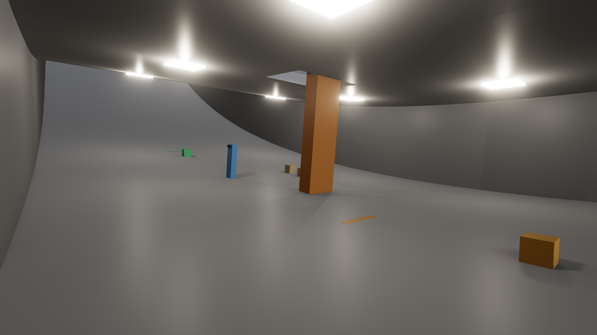 | 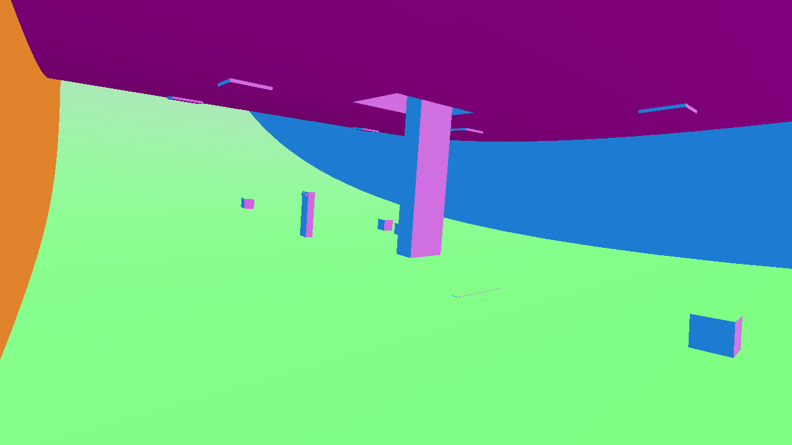 | 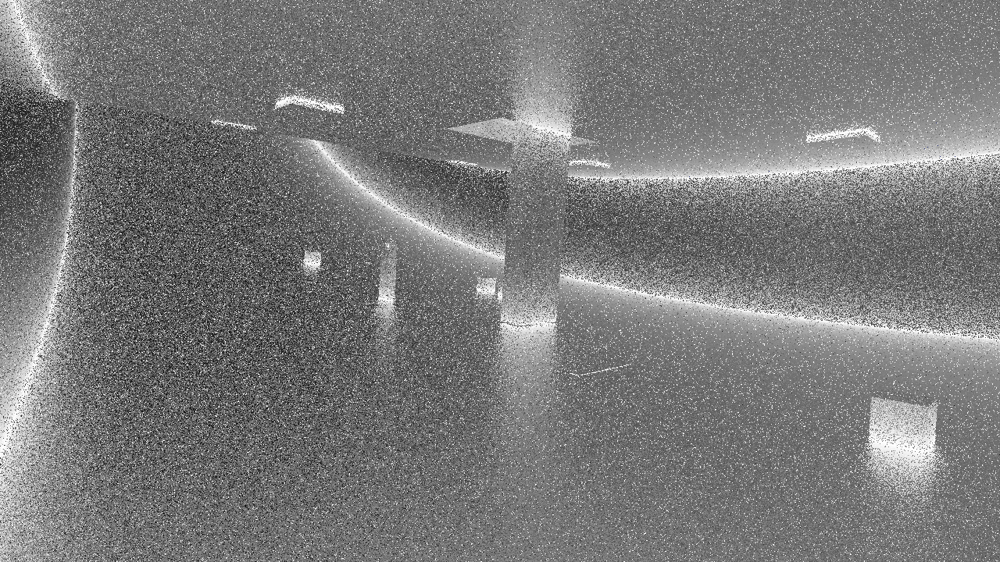 |  |
| reflections | 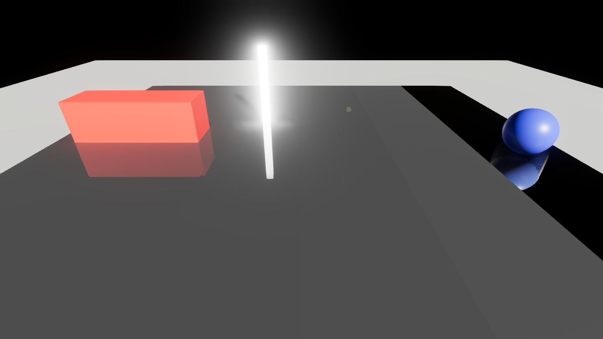 | 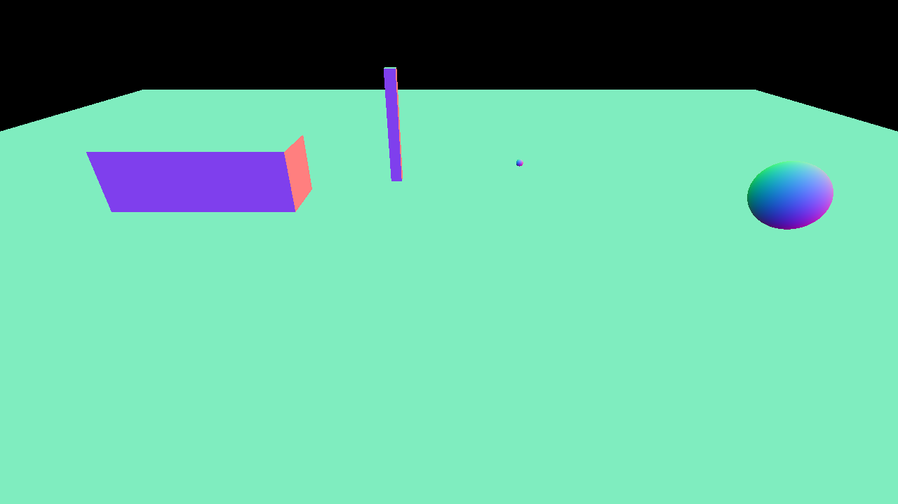 | 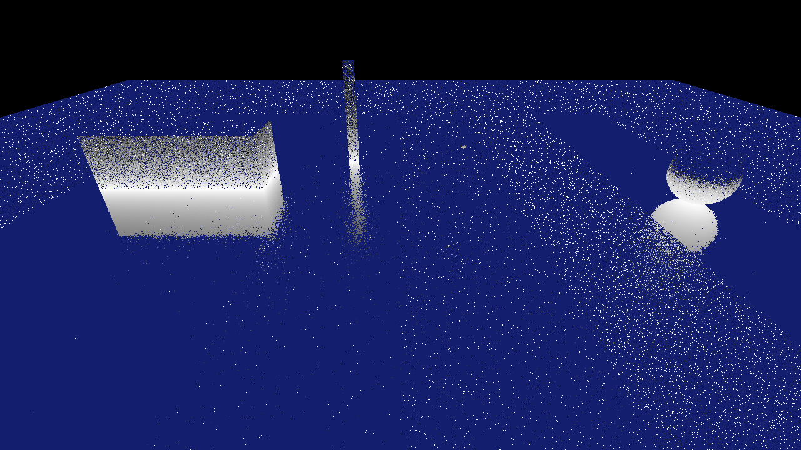 | 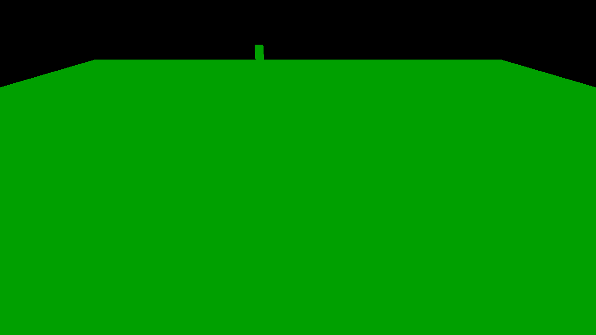 |
| rigs-crowd | 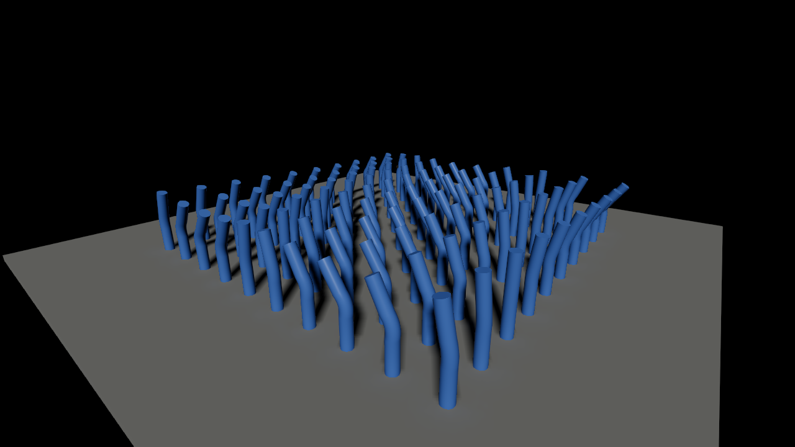 | 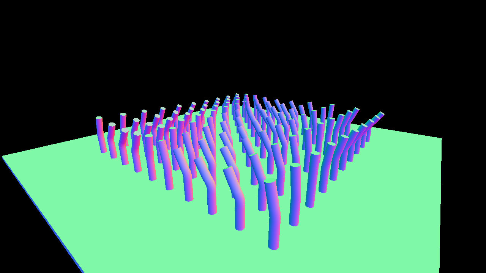 | 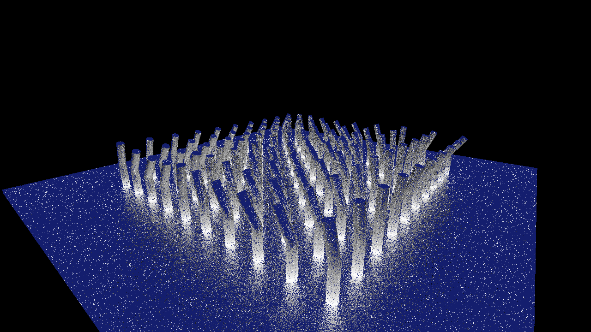 | 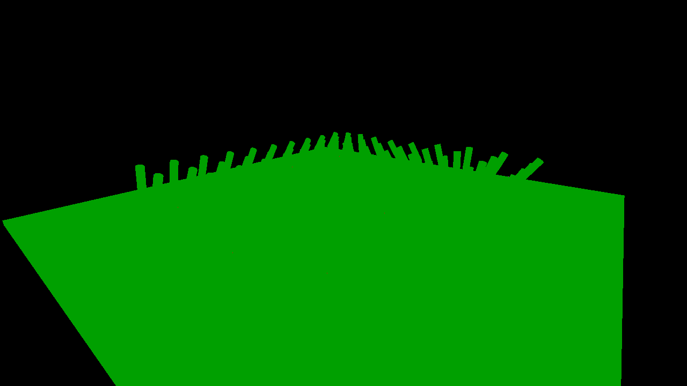 |
| lamp-hall-64 | 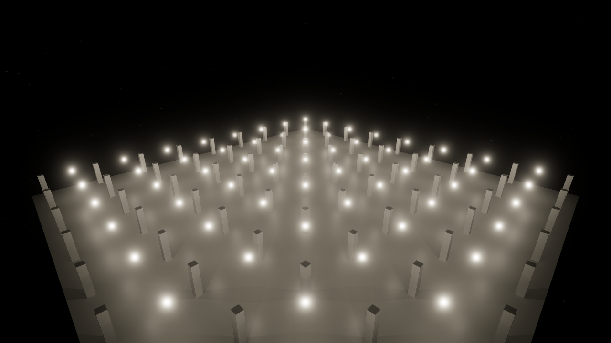 | 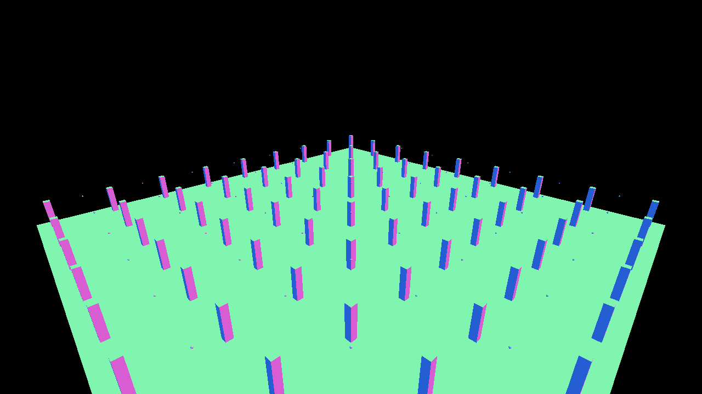 | 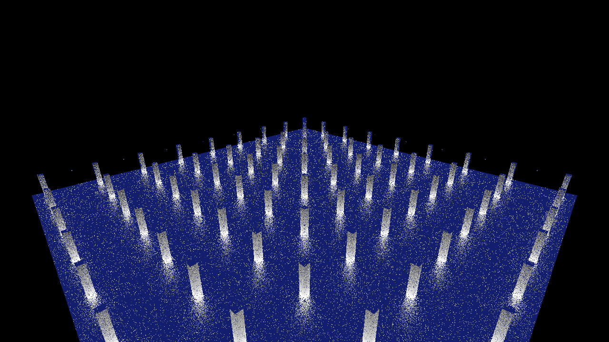 | 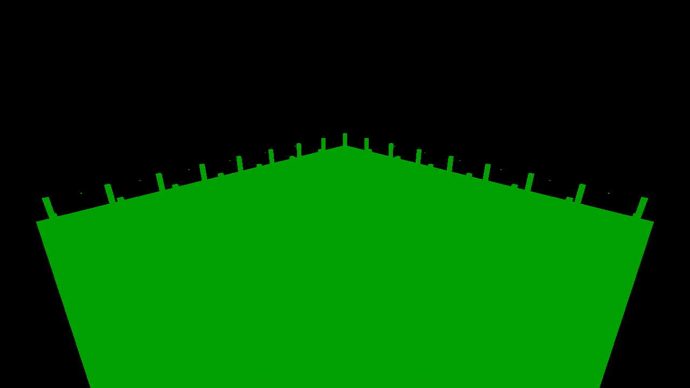 |

What the images show:

- demo-exit: the pillar, the boxes, the lamp panels, the curved floor and the wall of the capture all show in the normals. Every reflection ray hits a surface of the closed hall. The noise of the rough walls and floor spreads the reflected distances.
- reflections: the floor's bands of roughness show as bands of scattered hits. The sharp floor in front reflects the box and the sphere, and rays from the rough floor scatter to them.
- rigs-crowd: the bent rigs of the capture, with the same bends in the normals. The deformed BLASes hold this frame's deformed vertices.
- lamp-hall-64: the pillars and the floor. The small lamp spheres show as dots in the normals. In the capture, the bloom makes them large.

### Baseline: main at 1920 x 1080

The passes that B replaces, median / 95th percentile in ms, over the 120 measured frames of each view.

| View | Frame span | Environment faces | Environment prefilter | Occlusion depth | Occlusion sectors | Occlusion denoise | Occlusion upsample | Radiance pyramid | Reflection trace | Reflections | Sum of the medians | Load |
|---|---:|---:|---:|---:|---:|---:|---:|---:|---:|---:|---:|---|
| demo-exit antispinward | 15.37 / 16.29 | 0.35 / 0.66 | 0.62 / 0.66 | 0.30 / 0.34 | 1.60 / 1.79 | 0.85 / 0.97 | 0.49 / 0.58 | 0.57 / 0.60 | 0.14 / 0.15 | 0.45 / 0.46 | 5.37 | 2.36, 2.05, 2.48 |
| reflections | 12.08 / 13.26 | 0.17 / 0.25 | 0.74 / 0.90 | 0.26 / 0.34 | 1.75 / 1.90 | 0.97 / 1.16 | 0.53 / 0.66 | 0.59 / 0.67 | 1.07 / 1.21 | 1.38 / 1.65 | 7.47 | 2.49, 2.08, 2.49 |
| rigs-crowd | 13.49 / 16.01 | 0.12 / 1.97 | 0.65 / 0.70 | 0.21 / 0.25 | 1.03 / 1.09 | 0.91 / 0.98 | 0.34 / 0.51 | 0.51 / 0.60 | 0.11 / 0.13 | 0.32 / 0.34 | 4.21 | 2.69, 2.13, 2.50 |
| lamp-hall-64 | 14.45 / 16.16 | 0.36 / 0.89 | 0.63 / 0.68 | 0.19 / 0.26 | 0.76 / 0.96 | 0.79 / 0.96 | 0.34 / 0.46 | 0.49 / 0.59 | 0.11 / 0.12 | 0.29 / 0.32 | 3.96 | 2.69, 2.13, 2.50 |

The other eight films of demo-exit: frame spans 15.15 to 15.70 ms median, and replaced passes of 5.34 to 5.86 ms in the sum of their medians. At 1920 x 1080, main spends 4.0 to 7.5 ms on the passes that B replaces. At the same size, the trace's rule sum is 22.6 to 24.1 ms in demo-exit and rigs-crowd. It is 2.7 to 2.8 ms in the light views.

Three controls, on the antispinward window at 1920 x 1080: the branch without the option gave 15.29 ms (main 15.37 ms), so the option's code changes nothing without the option. The branch in count mode (the Metal export at allocation, the fence wait after each frame, no Metal work) gave 16.04 ms. Main on the spike's 140-frame window gave 15.55 ms.

## Limits of the measurement

1. One machine: the Apple M1 Max of the development Mac, macOS 27.0, MoltenVK 1.4.2. Metal traverses the BVH in shader code on this GPU. A GPU with ray tracing hardware, such as the M3 or later, or a Linux GPU with Vulkan ray query, gives other numbers.
2. The spike did not read the GPU clock. With the trace beside it, the Vulkan frame ran 20 to 40 % faster in the in-frame run. It ran 12 to 21 % faster in the timed runs of demo-exit at 1920 x 1080. One candidate cause is a clock that rises with the load. The effect of the clock on the trace's own times is unknown (limit 3).
3. The gap between a view's timed sum and its in-frame command buffer is 0.06 to 5.31 ms ("The in-frame run, 1280 x 720"). Per timed command buffer, that is 0.015 to 1.06 ms. The spike did not measure the cause. One candidate cause is a change of the clock during the CPU waits between the timed command buffers. In rigs-crowd, reflections and lamp-hall-64, the timed sum is the higher one, so there the timed numbers overstate the cost of B. The verdict rests also on the in-frame run. If the in-frame primary rays cost no more than their timed median, the four rule workloads take at least 15.90 ms in rigs-crowd there. In demo-exit they take at least 11.02 ms.
4. The reflection workload traces a ray for every pixel with a primary hit, as the rule says. In B, only the screen trace's misses need a world ray. This does not change the verdict for rigs-crowd, whose deformed BLAS refits alone take 15.2 to 16.9 ms. In demo-exit, the reflection rays must cost at most 0.54 ms for the rule sum to stay under 3.0 ms. If the cost follows the count of rays, that is about 6 % of their measured 8.62 ms. The spike did not measure the screen trace's miss rate.
5. The spike traces reflection rays from surfaces that main does not reflect. The demo paints its parts with roughness 0.38 (`DemoScenes.UsualRoughness`). Main's reflections stop at roughness 0.37 (`ConeTracedReflections.Default`, ticket ter-8bda). ter-8bda's probe marked no pixel that starts a reflection ray in 363 frames of the demo films (`.tickets/ter-eqtb.md`). In the baseline, main's reflection trace takes 0.14 ms in antispinward. Take the TLAS and the diffuse quarter rays of the nine demo-exit films at 1280 x 720, without the reflection workload. The sum of their medians is 1.55 to 2.91 ms. The sum of their 95th percentiles is 1.92 to 3.18 ms. Both are inside the bound of 3.0 / 3.5 ms. These are sums of each workload's statistics, not statistics of the per-frame sums, because the frames were not kept (limit 16). So if B traces no world ray from a surface of roughness 0.38, demo-exit passes the rule. The epic does not set a roughness limit for B's world rays. With a limit like main's, the verdict rests on the deformed BLAS refits of rigs-crowd alone.
6. The roughness is the material's scalar roughness, floored at 0.045. The spike reads no metallic-roughness texture and no normal map. A reflected direction below the surface is traced as it is, not sampled again.
7. The kernels rebuild each primary hit's surface from its triangle: three indices, three vertex normals and the material. B's passes read the G-buffer instead. This costs the spike's rays a little more memory traffic than B's.
8. The spike shades nothing. B also needs a pass that shades the hits, and the rule leaves that pass to the rest of the frame. Alpha tests, any-hit work and intersection functions are absent: cutout and fringed materials, such as hair cards, are solid.
9. The TLAS holds every visible, non-glass placed instance, also those outside the view that the frame places for its shadow views and environment faces. The CPU writes the instance descriptors in every frame. The TLAS time holds only the GPU build.
10. The static BLASes are not compacted. The sizes overstate the memory of a build with compaction. The deformed BLASes are refitted, never compacted: 380 MB for rigs-crowd.
11. The load averages during the runs were 2.4 to 5.1 for one minute on 10 cores, from other work on the machine. Each run held the GPU lock. Two timed runs of the four views at 1280 x 720 differ by up to 7 % (rigs-crowd 21.13 against 19.63 ms).
12. The baseline's pass times come from the renderer's GPU timer. On MoltenVK a pass's time can hold part of the next pass's work (ARCHITECTURE.md, "GPU timings"). Each replaced block is a run of neighboring passes, so only its last pass can hold part of the pass after the block.
13. The demo-exit view of the note, "the step view whose frame took 14.31 ms", is not on record. In the tickets, "the step view" means pbr-spheres low (`.tickets/ter-eqtb.md`), but the note puts the view under demo-exit. The spike measured all nine films of demo-exit instead, and it did not measure pbr-spheres. pbr-spheres has 14 instances, 112,908 triangles and no deformed mesh, so it has none of the refits that give rigs-crowd 16.94 of its 21.13 ms. The verdict does not change, because rigs-crowd fails. The nearest number on record is a mean frame span of 14.319 ms. It comes from a whole demo-exit run at 1920 x 1080 (captures/fsr1/runs/native-7 in the main checkout).
14. The Vulkan validation layers checked the export and the timed run in the test, with no message. The in-frame run never ran under validation. Metal's API validation (`MTL_DEBUG_LAYER=1`) checked a 12-frame rigs-crowd run of an earlier build, with no message.
15. The time of the in-frame command buffer is its `GPUEndTime − GPUStartTime`. The report assumes that this span excludes the command buffer's wait for the Vulkan frame's event. No Apple document says so. The numbers agree with the assumption: in reflections, the command buffer takes 1.75 ms, and the Vulkan frame span before it takes 5.26 ms.
16. The raw data of the timed, in-frame and baseline runs was not kept: `frames.jsonl`, `summary.json`, `gpu-timings.json` and `run.log` of each run. It was deleted with the spike's temporary folder after the tables were made. So the tables are the only record of these runs, and nobody can compute other statistics from them later. Only the counts of the fix stage at 1280 x 720 are kept ("Triangle counts").

## Open items for B

These items are moot after this verdict. They stay here in case a later machine or a later design reopens B.

- Deformed meshes: 100 rigs of 39,600 triangles each take 15 to 17 ms of refits per frame and 380 MB. B needs a cheaper traced form of a deformed mesh. Examples are a coarse proxy, refits of a few meshes per frame, or the rest pose.
- Interiors: in demo-exit every reflection ray hits a surface, and a ray costs about 9 ns of GPU time at 1280 x 720. These rays start from surfaces of roughness 0.38, which main does not reflect (limit 5). B needs a roughness limit for its world rays, or far fewer world rays than one per pixel there.
- Alpha-tested hair: the spike treats cards as solid. A real alpha test needs intersection functions or any-hit work, which add cost.
- Impostors: the billboards stay out. B needs a rule for what stands in for a far object in the TLAS.
- The hit pass: the shading of the hits was not measured.
- KosmicKrisp, LunarG's Vulkan driver over Metal: if it offers `VK_KHR_ray_query` on the Mac, the Metal path and its export become unnecessary. The spike did not evaluate it.

If B reopens and the spike code is used again, fix three defects of the code first. None of them changes a reported number.

- Scratch: the in-frame command buffer encodes the static builds and the deformed builds in two encoders. Both use the same untracked scratch buffer from offset 0 (`scratchOf` in `native/metal-trace/metaltrace.m`). Metal does not order untracked resources between encoders, so the two sets of builds can overwrite each other's scratch data. In the four views, only rigs-crowd has both kinds of build. Its deformed builds need more scratch space, so `scratchOf` makes a second buffer. The timed mode waits between command buffers. Give the deformed builds a range after the static builds' range, or make the scratch buffer tracked.
- The TLAS rule: `MetalTraceSpike.Gather` repeats the rule of `SceneBatcher.DrawsInMaps` (visible and not glass) and does not call it. The two agree today. Choose the TLAS instances with the batcher's predicate, so that one rule decides both.
- The struct layouts: each struct of the boundary has up to four copies, in `metaltrace.h`, `metaltrace.m`, `tertius_metaltrace.metal` and `MetalTraceSpike.cs`. Only `Params`, `InstanceData` and `MtHit` have a size assert. Nothing compares `MtFrame`, `MtResult` or `MtInstance` across the P/Invoke boundary. The field orders match today, by a comparison by hand. Add a native function that gives the size and the field offsets of each struct, and compare them at startup.

## How to reproduce

The runs used the Release build of the branch, the scripts that `tools/gpu-trace.py trim` makes, and the GPU lock. For example, the timed run of rigs-crowd at 1280 x 720:

```sh
nix develop --command python3 -I tools/gpu-trace.py trim scripts/rigs-crowd.json 1 140 /private/tmp/afyv/rigs-crowd.json
nix develop --command dotnet build src/Tertius.Demo -c Release
TERTIUS_METALTRACE_MODE=timed nix develop --command src/Tertius.Demo/bin/Release/net11.0/Tertius.Demo --script /private/tmp/afyv/rigs-crowd.json --headless --out /private/tmp/afyv/run --size 1280x720 --video none --metal-trace-spike /private/tmp/afyv/run/trace
nix develop --command python3 -I tools/metal-trace-spike/analyze.py timed /private/tmp/afyv/run
```

The trim starts are the first frame of each film. The table gives them.

| Film | Trim start |
|---|---:|
| demo-exit unbelt | 0 |
| demo-exit deck | 399 |
| demo-exit chute-top | 1139 |
| demo-exit chute | 1700 |
| demo-exit brake-run | 2204 |
| demo-exit floor | 2412 |
| demo-exit stack | 2810 |
| demo-exit spinward | 3176 |
| demo-exit antispinward | 3586 |
| reflections timing | 3 |
| rigs-crowd timing | 1 |
| lamp-hall-64 timing | 1 |

The baseline scripts start 20 frames later and keep 120 frames. Use `inframe` and `inframe-empty` for the in-frame run and its control, and `analyze.py inframe <trace run> <control run>`.
