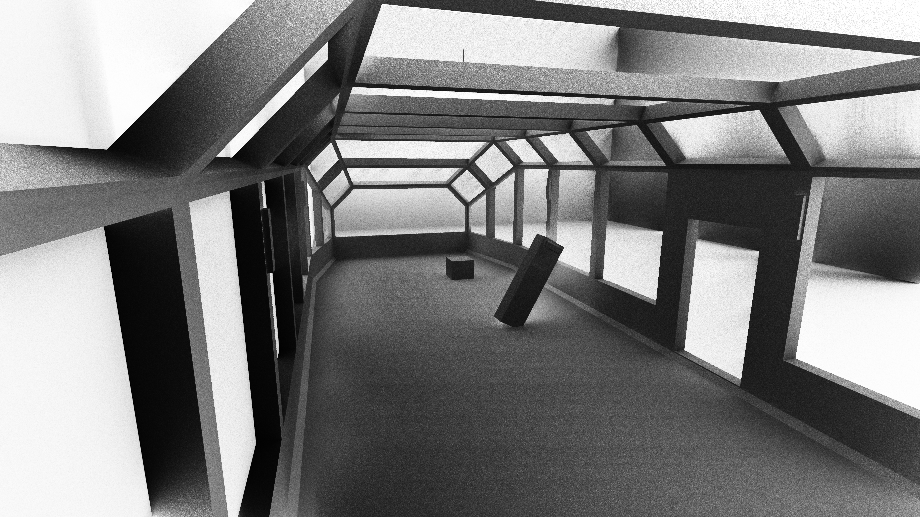
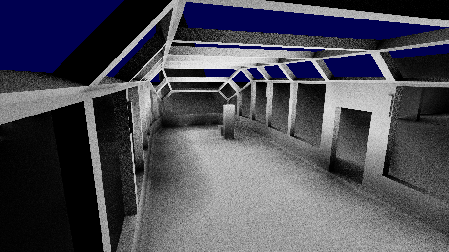
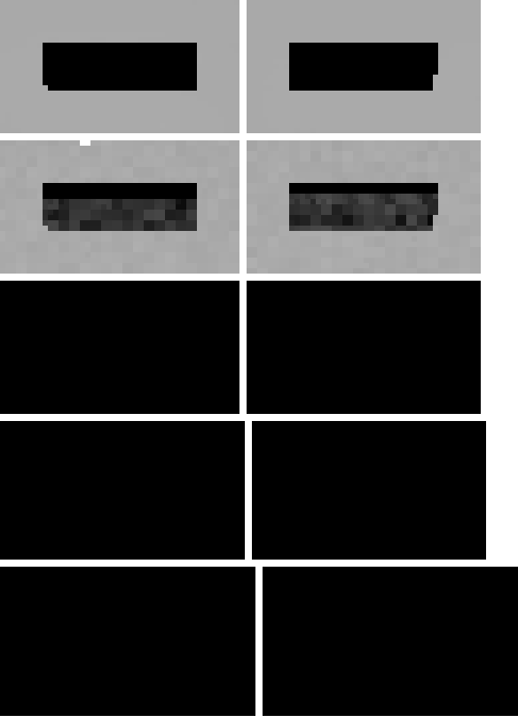
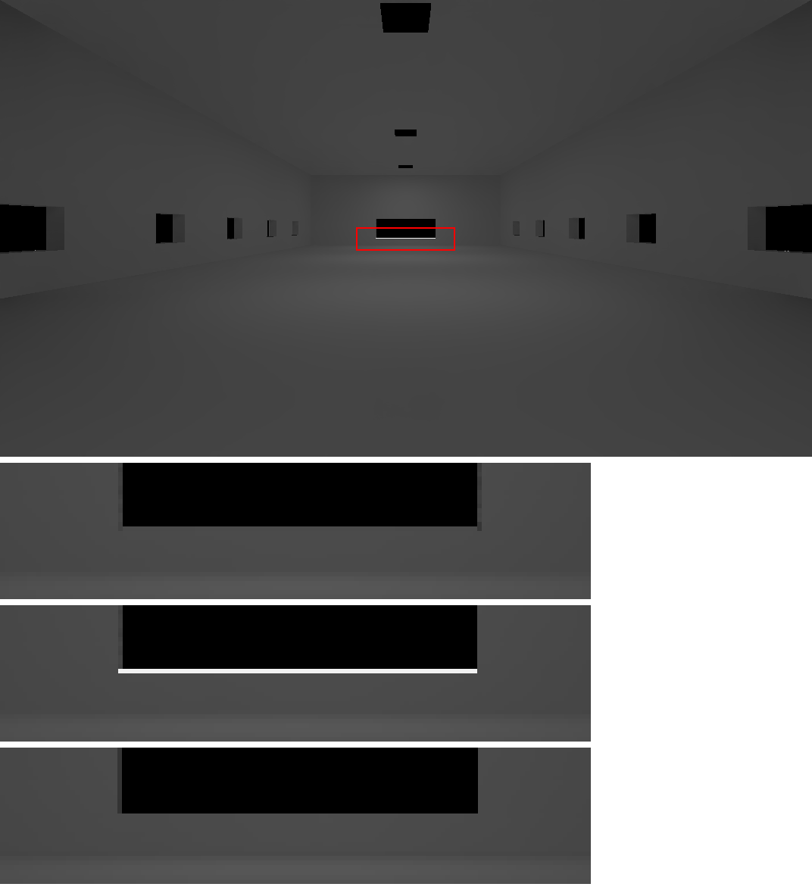

# Ray census: which rays carry the bounce light's mean and variance (ter-8pco)

Experiment E1 of [the lighting review](../lighting-system-review-2026-11-22/README.md), section 12. For five stills on
main, at two render scales, the census splits each diffuse sample by what its ray found, and reports per region which
class of rays carries the mean of the bounce light and which carries its variance. A second part, for t7-3e22, looks at
the specks on the lamp hall's ceiling at one render size.

## 1. The answer in short

- Far hits carry most of the variance in every region but one: 73 % to 104 %. The exception is exit-cabin's wall below
  its windows, where misses carry 87 %. Near hits carry at most 24 %, on the shaded floor of cabin-light-cabin.
- So the review's condition "misses and far hits carry under about 10 % of the variance" does not hold in any region.
  Misses plus far hits carry 76 % to 100 %.
- The caps (MostRayWeight and MaxRadiance) never bound a sample in any region, so the shares before and after the caps
  are equal.
- The lamp hall's specks at 1072 × 603 come from one jitter phase out of 25. In that phase, a 1 px row at the lower edge
  of the far window gets a direct light of 162, and ceiling rays that hit it bring up to 127 (diffuse) and 272
  (reflection). At 1040 × 585, with 27 phases, no phase draws that row, and no ceiling sample exceeds 2.

## 2. Terms

- **Sample X**: the diffuse sample of one pixel in one draw, as the accumulator receives it. It is the luminance of the
  rgb that `screen_trace_resolve.comp` writes into the diffuse sample image: the ray's weighted light after the caps.
  Units: pre-exposed linear light, as the image holds it.
- **Xpre**: the same sample before the caps: the hit's light times the ray's weight without MostRayWeight and without
  MaxRadiance.
- **Miss**: a diffuse sample whose record has hit distance 0. Three code paths give it:
  - the walk finds no surface on the screen (no `WalkHit`), and the sample takes the fallback's light (`missLightOf`);
  - a guided ray misses, and it brings 0;
  - the ray points below the surface's geometric plane, and it brings 0.
- **Near hit**: a hit at a distance under 2 m. **Far hit**: a hit at 2 m or more. The distance is the hit record's, in
  meters. The 2 m threshold is the review's. It splits a room by size, so a far hit in the cabin is a hit across the
  room, and in the lamp hall a hit across a part of it.
- **Class share of the mean** of a region: the sum over its pixels and draws of X for the class, over the sum of X.
- **Class share of the variance** of a region: the sum over its pixels of Cov(X_c, X), over the sum over its pixels of
  Var(X). X_c is X for the samples of class c and 0 elsewhere. Each pixel's Var and Cov are over its 400 counted draws.
  The three shares add up to 1. A share can be negative when that class's samples are below the pixel's mean more often
  than above it.
- **Check**: the region's census mean of X over the mean of the slow diffuse history at the last draw. The census mean
  is the mean of what the accumulator received. The slow history is what it kept.
- **Render scales**: 2/3 (1280 × 720) and 0.9584 (1840 × 1035, a whole number of the 16 × 9 px steps of exact ratios).
  The output is 1920 × 1080. The scale is fixed per take, so that every draw has the same pixels.

## 3. Method

1. `census.py` builds a copy of main 3549d3283 (engine code equal to 998165d42) with the survey's probe
   (`tools/renderer-survey/probe.patch`) and the census edits (`apply-census.py`). The edits never enter `src`.
2. The resolve writes into the diffuse sample's alpha, which no pass reads, `bin + log2(Xpre / X) / 16`. Bin 0 is a miss.
   A hit at distance d takes bin `clamp(floor(2 log2 d) + 21, 1, 63)`, half an octave wide, so that 2 m is a bin edge:
   bins 1 to 22 are near, bins from 23 far. A pixel without a traced surface gets alpha −1. The image's rgb is
   unchanged.
3. `RayCensus.cs` reads the diffuse sample image back after each draw from 240 to 639 and adds, per pixel, n, ΣX, ΣX²,
   and per class ΣX_c, ΣX_c·X and the count. It does the same for Xpre. For keep rectangles it also writes each sample
   with its bin, and the pixel's reflection sample with its hit distance.
4. Each still runs 240 settling draws, then 400 counted draws, with the clamps on and the automatic exposure. The take
   has 20 continued captures (660 draws).
5. `analyze.py` reads the sums and the regions of `regions.json` (output pixels) and writes the shares, the check and
   the per-pixel maps.

The stills:

| Still | Scene and view | What lights it |
|---|---|---|
| rect-lamps | the lamp hall of orbit, the person's view | the ceiling's rect lamps; the control at the bar |
| bay-sunbeam | the bay, a beam of sun through a slot | the sun on one patch |
| cabin-light-cabin | the cabin of orbit | the sun in stripes through the roof |
| exit-cabin | the cabin seen from its exit, windows on both sides | the sky through the windows and the wall lamps |
| sunlit-nose | the orbit view of ter-fe63 (tick 277243) | the sun on the floor before the nose wall |

## 4. Tables

Shares of the variance, after the caps. The shares of the mean and the shares before the caps are in each take's
`census-result.json`. Before the caps the variance shares are the same to three places in every region.

| Still and region | 2/3: miss, near, far | 0.96: miss, near, far | Check 2/3, 0.96 |
|---|---|---|---|
| rect-lamps, ceiling right of the lamps | 0.025, 0.004, 0.970 | 0.024, 0.004, 0.972 | 0.996, 0.996 |
| rect-lamps, floor in the middle | −0.014, 0.000, 1.014 | −0.013, 0.000, 1.013 | 1.032, 1.035 |
| rect-lamps, left wall above the windows | −0.042, 0.003, 1.039 | −0.039, 0.003, 1.036 | 0.996, 0.998 |
| rect-lamps, far end wall | −0.025, 0.013, 1.012 | −0.028, 0.013, 1.014 | 0.999, 0.997 |
| bay-sunbeam, sunlit patch at the upper left | −0.000, −0.000, 1.001 | −0.000, −0.000, 1.000 | 1.071, 1.079 |
| bay-sunbeam, back wall below the slot | −0.000, 0.002, 0.998 | −0.000, 0.001, 0.999 | 1.073, 1.102 |
| bay-sunbeam, floor | −0.000, 0.000, 1.000 | −0.000, 0.000, 1.000 | 1.091, 1.090 |
| bay-sunbeam, right wall | −0.002, 0.000, 1.002 | −0.001, 0.000, 1.001 | 1.061, 1.077 |
| cabin-light-cabin, floor with sun stripes | 0.022, 0.175, 0.804 | 0.022, 0.176, 0.803 | 1.081, 1.079 |
| cabin-light-cabin, floor beside the right wall, mostly in shade | 0.028, 0.239, 0.733 | 0.031, 0.231, 0.738 | 1.085, 1.085 |
| cabin-light-cabin, sunlit roof beams | 0.071, 0.097, 0.832 | 0.072, 0.081, 0.847 | 1.115, 1.067 |
| exit-cabin, floor in the middle | −0.024, 0.083, 0.941 | −0.024, 0.083, 0.940 | 1.092, 1.102 |
| exit-cabin, right wall below the windows | 0.870, 0.005, 0.125 | 0.874, 0.005, 0.120 | 1.064, 1.099 |
| exit-cabin, ceiling between the beams | 0.022, 0.040, 0.938 | 0.024, 0.039, 0.937 | 1.082, 1.083 |
| exit-cabin, side of the tilted blue crate | −0.028, 0.097, 0.931 | −0.029, 0.109, 0.920 | 1.036, 1.056 |
| sunlit-nose, ceiling cloud box of ter-fe63 | −0.001, 0.001, 1.000 | −0.001, 0.001, 1.000 | 1.030, 1.034 |
| sunlit-nose, sunlit floor before the nose wall | −0.000, 0.000, 1.000 | −0.000, 0.000, 1.000 | 1.009, 1.017 |
| sunlit-nose, near floor | −0.000, 0.000, 1.000 | −0.000, 0.000, 1.000 | 1.071, 1.081 |
| sunlit-nose, left wall | −0.000, −0.001, 1.001 | −0.000, −0.001, 1.001 | 1.055, 1.055 |

The exit-cabin take at 2/3 is a retake: the first take's regions lay on windows. All its regions are those of
`takes/exit-cabin-067/regions.png`.

The brightest 0.1 % of the samples (keep rectangles):

| Still and rectangle | Scale | Threshold | Classes | Hit distance | Capped |
|---|---|---|---|---|---|
| bay-sunbeam, sunlit patch | 2/3 | 16.0 | 100 % far | 2.8 to 11 m | none |
| bay-sunbeam, sunlit patch | 0.96 | 17.6 | 100 % far | 2.8 to 11 m | none |
| sunlit-nose, ter-fe63's box | 0.96 | 4.85 | 100 % far | 11 to 32 m, largest 61 | none |

In the ter-fe63 box at 0.96, the brightest reflection samples are far hits at 17 to 31 m, up to 1,063 against a
threshold of 96. The per-pixel mean of the reflection samples has 8,055 pixels more than 25 % above the median of their
7 × 7 neighbors. The diffuse mean has 509.

## 5. Pictures

exit-cabin at 0.96: the share of each pixel's mean light that misses bring, black 0 to white 1. The walls and frames
that face the windows are white, and the floor and the ceiling's beams are dark gray.

cabin-light-cabin at 0.96: the share of each pixel's mean light that far hits bring. Blue marks pixels with no traced
surface (the sky through the roof). The floor and the beams are light gray: far hits bring most of their light.

## 6. Reading

This section is a reading, not a measurement.

- The review's condition for "no far-field store eases class V" is false in every region. Far hits carry most of the
  variance everywhere, and misses carry most of it where a wall faces a window. A store of the far field could ease that
  part. The census does not say how much of the far hits' variance a store would remove: a store replaces a far hit's
  light by a smoother estimate, and its own noise and lag are not measured here.
- The two scales give the same shares within 0.02. The ray count per pixel does not change the split between classes.
- The check is 1.00 to 1.12. The accumulator keeps up to 12 % less than it receives. The slow history's clamp
  (ter-18hc) is the suspect, because it cuts rare bright samples. The census did not test it.

## 7. The lamp hall at 1072 × 603 and 1040 × 585 (for t7-3e22)

The speck films found bursts of specks on the lamp hall's ceiling at some render sizes and not at others (t7-3e22,
`lamp-pics/sizetable.md`). This part takes frame 62 of `scripts/rect-lamps.json` at 1072 × 603 (bursts in the films) and at
1040 × 585 (the nearest size without bursts), with the films' fixed exposure of 4.08 stops. The keep rectangle is the
ceiling around the near lamps: output columns 643 to 1043, rows 200 to 400.

### 7.1 The brightest 0.1 % of the ceiling's samples

| Quantity | 1072 × 603 | 1040 × 585 |
|---|---|---|
| Samples per draw in the rectangle | 24,976 | 23,328 |
| Diffuse: threshold, largest | 0.57, 127 | 0.57, 0.59 |
| Diffuse: classes, hit distance | 100 % far, 5.7 to 32 m | 100 % far, 5.7 to 16 m |
| Diffuse: mean before and after the caps | 1.46, 1.46 | 0.57, 0.57 |
| Reflection: threshold, largest | 0.66, 272 | 0.66, 1.72 |
| Reflection: share of the light from far hits | 99 % | 83 % |
| Diffuse samples above 5 / draws that have one | 466 / 17 | 0 / 0 |
| Reflection samples above 20 / draws that have one | 667 / 18 | 0 / 0 |
| Pixels of the per-pixel mean more than 25 % above their 7 × 7 median: diffuse, reflection | 67, 648 | 0, 0 |
| Specks in the 20 captures (the films' rule) | 0 to 180 per capture | 17 in the first, then 0 to 2 |

The census mean and the pictures agree: where the mean has specks, the captures have them, and where the mean is clean,
the captures are clean.

### 7.2 The bursts follow the jitter phase

At 1072 × 603 the draws with bright samples are counted draws 16, 41, 66, 91, ... 391: one draw in every 25, with two
stray draws. FSR's jitter has `JitterPhaseCount(1072, 1920) = (int)(8 × (1920 / 1072)²) = 25` phases. At 1040 × 585 it
has 27, and no draw bursts.

### 7.3 The images that the rays read

A ray's hit reads the hit light (`ScreenTraceImages.HitLight`, layer 1 for a diffuse ray and layer 0 for a reflection
ray). `screen_trace_plan.comp` writes it in the same draw, from this draw's direct light and the last draw's histories
at the hit pixel (`leavingLightOf`). The light pyramid's level 0 holds the hit light without its histories, and the
guided quarter of the diffuse rays aims by its levels. The census dumped both images at the last draw and at draws 606,
630, 631 and 632. Draws 606 and 631 are burst draws at 1072 × 603.

Around the near lamp, at both sizes and in every dumped draw:

- The lamp reads 0 in the diffuse hit light and 0.03 in the reflection hit light. Its entity holds a light, so the glow
  that it sends is 0 (`glowSent` in `frame.glsl`); its light reaches the scene as a light, not as a hit's glow.
- The ceiling next to the lamp reads 0.22 (diffuse) and 0.27 (reflection). The 1 px rows and columns just outside the
  lamp are within 2 % of the ceiling (diffuse) and 10 % (reflection).
- Levels 0 to 2 of the light pyramid are exactly 0 around the lamp: the ceiling gets no direct light from lamps that
  face down. No level has a border above the lamp.
- The lamp's edges lie on cell boundaries of level 1 or 2 at one size and inside a cell at the other (left, top and
  right on level 1 at 1040 × 585; right and bottom on level 1 and bottom on level 2 at 1072 × 603), but every level is 0
  there.

Around the near lamp, left 1072 × 603 and right 1040 × 585, at the last draw. Rows, top to bottom: the diffuse hit light,
the reflection hit light, levels 0, 1 and 2 of the light pyramid. Nearest sampling, 6 px per render pixel at level 0 and
2^k times more at level k. Gray is log2 of the value over the ceiling's value, from −4 (black) to +2 (white): the
ceiling is mid gray. The lamp is black in both hit lights. The pyramid rows are black because every value is 0. One
reflection pixel above the lamp at 1072 × 603 is white: a speck of the reflection history.

Away from the lamp, the source differs between the sizes:

- In burst draws 606 and 631 at 1072 × 603, the direct light holds a 1 px row of about 80 pixels at render row 314 with
  the value 162, against 0.22 on the ceiling. The row is the lower edge of the window in the hall's far wall. It is in the
  light pyramid's level 0 too, so it is direct diffuse light, not a history. It is absent in draws 630 and 632.
- At 1040 × 585 no dumped draw has that row.
- At both sizes and in most draws, 2 to 10 single pixels on the lower edges of the side windows hold 12 to 104. Ceiling
  rays rarely hit them, and no ceiling sample at 1040 × 585 exceeded 2.

Top: the diffuse hit light at 1072 × 603, draw 631, the whole frame, gray from log2 −6 (black) to +8 (white). The red box
holds the far window's lower edge. Below, that box at nearest sampling, 6 ×: 1072 × 603 at draw 630 (quiet), 1072 × 603
at draw 631 (burst, the white row), and 1040 × 585 at draw 631. The window itself is black because it shows the sky,
which holds no light in the hit light.

The pass that writes the row is the direct light pass (`DirectLightPass`, into `RenderTargets.DirectDiffuse`). The plan
copies it into the hit light, and the light pyramid's finest level reads it.

The values fit hits on the row: the brightest diffuse sample of the ceiling, 127, is 0.8 times the row's 162, and the
ceiling's reflection samples above 20, 120 to 272, are 0.7 to 1.7 times it. MostRayWeight is 4. The census does not record the hit pixel, so this
fit is a reading.

Reading: the row is the window sill's sunlit face, seen almost edge on, thinner than a pixel. Only the sun gives a
direct light of 162 there: the ceiling lamps face down and give the floor about 0.3. One jitter phase of 25 puts pixel
centers on the sill at 1072 × 603. Then, in the whole frame of burst draw 631, 140 diffuse samples above 5 and 152 reflection samples above 20
find a far, small, very bright target,
which is ter-fe63's mechanism: rare far hits on a small sunlit target. The render size decides only whether some phase
samples the sill. At 1040 × 585, no phase of 27 does.

The phase count depends on the width alone, but the films' sizes show that the height decides too: 1072 × 600 was clean
and 1072 × 603 burst, with 25 phases each (`lamp-pics/sizetable.md`, made by `lamp-pics/sizetable.py` from the speck
films of t7-3e22). This fits the reading: the sill's place inside a pixel row moves with the height, so whether a
phase's vertical offset lands a pixel center on the sill depends on both.

## 8. What the census did not measure

- How much of the far hits' variance a far-field store would remove, and what noise and lag the store would add.
- The hit pixel of each sample. The fit of section 7.3 rests on values and distances.
- The reflection rays outside the keep rectangles. The shares of section 4 are of the diffuse samples only.
- Scales other than 2/3 and 0.96, and the dynamic scale. The scale is fixed so that every draw has the same pixels.
- The clamps off. The census runs with the clamps on, as main draws.
- The slow history's clamp (ter-18hc), the suspect for the check above 1.

## 9. The probe check

The census edit changes only the alpha of the diffuse sample image. To check that the rgb, and so X, is the unpatched
renderer's, rect-lamps at 2/3 ran twice on the same build copy: once with the unpatched resolve (the file as main has
it) and once with the census resolve. Per pixel, ΣX and ΣX² over the 400 counted draws are bitwise equal between the
two takes, in all 921,600 pixels (total ΣX 42,501,283.72 in both). The unpatched resolve writes alpha 1 and 0, so its
classes are meaningless, but its X is the same. The same take twice on one computer gives the same frames, so equal sums
show that the edit does not change the sample.

## 10. Files

- `census-probe.patch`: the whole build copy's change against 3549d3283, as one diff: the survey's probe
  (`tools/renderer-survey/probe.patch`) and the census edits. `git apply` takes it on that commit.
- `RayCensus.cs`, `apply-census.py`: the probe's host code and the script that applies the census edits to a copy that
  already holds the survey's probe.
- `census.py`, `analyze.py`, `summarize.py`, `overlay.py`, `regions.json`: one take, its shares, its rows, its region
  picture, and the regions.
- `lamp.py`, `lampdump.py`, `burstline.py`, `queue-lamp.sh`: the lamp-hall part.
- `takes/<still>-<067 or 096>/`: each take's `census-result.json`, `census.json` and `script.json`, and its maps and
  region picture at half the size (the maps' gray is the share, from 0 black to 1 white).
- `lamp-pics/`: the two pictures of section 7, the films' size table with its script, and per size the results of `lamp.py` (`*.lamp-result.json`) and of
  `lampdump.py` (`*.lampdump.json`).

The raw sums and dumps (about 180 MB per take) are not kept.
