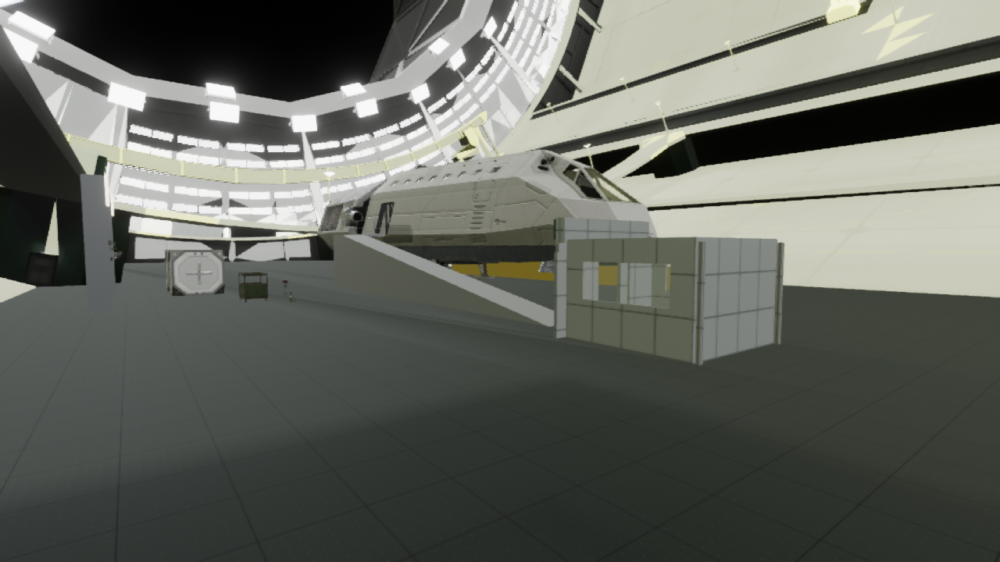
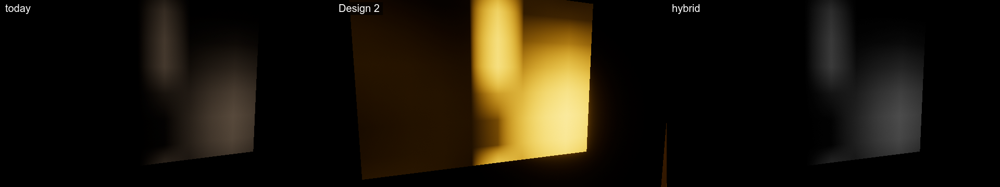

# A restraint for each surface: three prototypes (#42)

RESULTS

## Terms

- **Cell face:** one of the six sides of one grid cell. The directional light volume keeps one record for each cell face, in three grids with cell widths of 0.25, 0.5 and 1 m.
- **Reflectance:** the diffuse color of a surface, three numbers from 0 to 1.
- **Direct light:** the light that the scene's lamps send to a cell face. The shading pass computes it once for a lighting group of up to 4 × 4 × 4 cells.
- **Saturation of a color:** (largest channel − smallest channel) / largest channel. Gray has 0, pure red has 1.
- **Gray level of a color:** its smallest channel. **Colored part:** the color minus its gray level in every channel.
- **Neutral share:** the fraction of neutral bounce light that the volume keeps, 0.02 (`NeutralSourceShare`).
- **Knee:** a weight of the saturation: 0 under 0.58, 1 above 0.78, and a smooth rise between them (`saturationKnee`).
- **Color gain:** a factor on the part of the first bounce that variants 2 and 3 keep in full (`COLOR_GAIN`, 1 unless a picture says otherwise).
- **Glow:** the light that a self-lit surface emits, as the raster captures it.
- **Today:** the code at `eff66e481` (the #22 branch), which is variant 0 of the switch.

## The variants

The user decided on 2026-11-28 ([#42](https://github.com/alexispurslane/tertius/issues/42#issuecomment-7242969945)): a self-lit surface sends exactly the light that it emits, and only light scattered off surfaces is held back, per surface, gray paint times gray light alone. So Design 1 is dropped, and every variant that stays sends glow in full. Open are pure Design 2 against the hybrid, and the two amounts (the neutral share and the color gain).

Commit `bd76475b8` puts the rule behind preprocessor constants in `src/Tertius.Rendering/Shaders/volume.glsl`. `RESTRAINT_VARIANT` selects the rule, `RESTRAINT_RAMP` the ramp of variant 3, `RESTRAINT_LAMPS` whether variant 3 judges the summed direct light (0) or each lamp alone (1), and `COLOR_GAIN` the gain. The defaults (0, 0, 0, 1.0) are today's rule. Stage 2 keeps the chosen rule and removes the switches. The render tool names a variant 0, 2, 4 or 3 with its ramp letter, such as 3A, and an L for each lamp alone, such as 3AL.

The three ramps of a saturation s:

| Ramp | ramp(s) |
|---|---|
| A | smoothstep(0.58, 0.78, s), today's knee |
| B | (s / 0.78)³, at most 1 |
| C | smoothstep(0, 0.78, s) |

| Variant | What the capture adds to the cell face, per unit of area | What the first bounce sends out, times area | Glow |
|---|---|---|---|
| 0, today | reflectance | restraint(sum × light / area) × area: the knee reads the whole cell face's sum | restrained for each surface |
| 2, Design 2: only gray on gray is held back | colored part in `color.rgb`, gray level in `color.w` | gain × C × L + G × (gain × λ + share × m) | in full |
| 3, the weighted split (ramp A, B or C) | w_p × colored part in `color.rgb`, gray level in `color.w`, with w_p = mix(share, 1, ramp(saturation of the reflectance)) | gain × C × L + G × (gain × w_L × λ + share × m), with w_L = mix(share, 1, ramp(saturation of L)) | in full |
| 4, today with unrestrained glow | reflectance | as today | in full |

Number 1 held Design 1 and now stops the shader build.

where

- C and G are the cell face's summed `color.rgb` and `color.w`.
- L is the direct light of the lighting group, m its gray level and λ its colored part.
- Nothing moves from a colored part into a gray level, so a faint tint gives a dim light of the same hue. With both weights at the share, the bounce is share × reflectance × light, today's value with its natural tint. With both weights at 1 it is Design 2.
- The second bounce uses the same function with the light that reaches the cell face from the volume in place of L, and with no gain.
- "Glow in full" keeps the once-only rule of `glowSent`: an entity that holds a light sends no glow, so its power counts once.

After the capture, variants 2 and 3 only add sums and multiply them by the light. The restriction pass of #22 adds a quarter of each child face's four color words to its parent face. So the light of one surface cannot depend on the grid that captures it or on the other surfaces in its cell.

The second bounce (`volume_source.comp`) uses the same rule with the light that reaches the cell face from the volume, and with no gain. Small choices of the prototype, settled by the design's own rules and confirmed by the line orchestrator:

- Variants 2 and 3 store the color words with 64 steps per unit. One capture fragment of 0.65 gray at the neutral share adds only about 3 units at one step per unit, so rounding would bias it by up to 15%.
- With `RESTRAINT_LAMPS` 1, `volume_shade.frag` defines `VOLUME_JUDGES_LAMPS`. Then its copy of the light loop in `lighting.glsl` (`shapeLight`) also sums what gray paint keeps of each lamp's light alone, in the specular words that the volume shade does not read. No other shader changes. Stage 2 gives that sum a field of its own.
- `whiteLightAt` skips a cell face when all four color words are 0, not only `color.rgb`, because Designs 2 and 3 hold a gray surface in `color.w` alone. With today's rule `color.w` is always 0. The #20 lead, who owns the lighting points, agreed.

## Set 1: the cost of glow in full on the deck

The full-art hangar deck (`tools/deck-still.json`: `demo-exit.json` at its frame 500, the deck camera) at 1280 × 720, the headless render scale of 2/3 (848 × 477 rendered) and the automatic exposure. Each run takes three captures a, b and c of a frozen world. The exposure did not move between them: −3.1500 stops today and −3.1507 stops with glow in full (`evidence/exposure/`). The picture is c. Variant 0 (today) against variant 4 (today's restraint of scattered light, glow in full), both at commit `7f7a3979e`.

| Today | Glow in full |
|---|---|
|  |  |

[`evidence/deck-glow-difference-x16.png`](evidence/deck-glow-difference-x16.png) is the absolute difference of the two display images, times 16. It shows only thin lines on edges, the noise of the antialiasing. No surface is brighter as a whole.

In the scene-linear frame (`tools/deck-shift.py`):

- The mean RGB rises from (3.3839, 3.4839, 2.9210) to (3.3841, 3.4842, 2.9212) W/(m² sr), by 0.01%.
- The largest change in a tile of an 8 × 4 split of the frame is 0.2%, on the floor at the bottom middle. All four largest tiles are floor tiles, and all four rise.

The volume holds much more light (`tools/volume-totals.py`). The 0.5 m grid's summed outgoing light rises from (11.25, 12.38, 8.25) to (585.56, 600.69, 421.69) cell faces × W/(m² sr), and the 1 m grid's from (22.93, 23.68, 16.99) to (1154.57, 1184.73, 832.44): 50 times more. The added light is (6.4, 6.6, 4.6) W/(m² sr) on 96 faces of the 0.5 m grid and 271 faces of the 1 m grid. That is the floor's `glow0` of the station art (6.54, 6.71, 4.71), saturation 0.30, which today keeps 2% ([list of the #20 lead](https://github.com/alexispurslane/tertius/blob/t3/restore-panel-orange-light/docs/research/cockpit-helmet-light/self-lit-surfaces.md)). The strips lie 3.9 to 7.7 m from the camera and behind it, so this view sees little of their light. The bay lamps hold lights and send no glow, so they do not change.

So at this pose the gray self-lit panels do not lift the deck visibly. A pose that faces the floor's glow strips can show more. This set does not measure that.

## The ramp sheet: a faint tint gives a dim tinted wash

The user's choice of the ramp. The warm-white lamp (1, 0.9, 0.8) of set 2 lights a beige wall in the top row, reflectance (0.7, 0.6, 0.5), and a fainter beige in the bottom row, reflectance (0.62, 0.6, 0.56), closer to hull paint. The receiver gets only the wall's bounce light. Every picture has the same fixed exposure, EV 0, the "outside" pose, gain 1 and commit `bd76475b8`. Glow plays no part: no surface emits. Each label gives the receiver's mean scene-linear RGB in W/(m² sr) and its saturation.


| Rule | Beige: receiver RGB | Saturation | Red against today | Faint beige: receiver RGB | Saturation | Red against today |
|---|---|---:|---:|---|---:|---:|
| today | (0.0193, 0.0149, 0.0111) | 0.43 | 1 | (0.0172, 0.0149, 0.0123) | 0.28 | 1 |
| ramp A | (0.0193, 0.0149, 0.0110) | 0.43 | 1.00 | (0.0171, 0.0149, 0.0124) | 0.28 | 1.00 |
| ramp B | (0.0349, 0.0221, 0.0110) | 0.68 | 1.81 | (0.0198, 0.0163, 0.0124) | 0.37 | 1.15 |
| ramp C | (0.1237, 0.0630, 0.0110) | 0.91 | 6.40 | (0.0453, 0.0293, 0.0124) | 0.73 | 2.64 |
| Design 2 | (0.4252, 0.2043, 0.0110) | 0.97 | 22.0 | (0.2498, 0.1394, 0.0124) | 0.95 | 14.6 |

Each render matches the arithmetic of the rule within 1% in its ratio to today (beige within 0.2%, faint beige within 0.9%). The arithmetic for the beige wall: w_p and w_L are the weights of the paint (saturation 0.29) and of the light (saturation 0.20).

| Ramp | w_p | w_L | Bounce of the wall per unit light | Red against today |
|---|---:|---:|---|---:|
| A | 0.020 | 0.020 | (0.0140, 0.0108, 0.0080), today's value | 1.00 |
| B | 0.068 | 0.037 | (0.0253, 0.0160, 0.0080) | 1.81 |
| C | 0.318 | 0.180 | (0.0897, 0.0456, 0.0080) | 6.40 |

What the pictures show:

- Ramp A is today on these two walls. Both tints lie under the knee of 0.58, so both weights stay at the share. The hue stays today's faint warm tint.
- Ramp B gives a dim warm wash: 1.8 times today's red on beige and 1.15 times on the faint beige. The faint beige looks almost like today.
- Ramp C gives a clear warm wash at a fraction of Design 2's strength: 6.4 times today's red on beige (Design 2: 22 times) and 2.6 times on the faint beige (Design 2: 14.6 times).
- No rule turns the tint gray. The blue channel, the gray level, is the same in every rule.

## Set 2 (record): Design 2 and the rejected hybrid

The user rejected the hybrid of this set on 2026-11-28, because it turned faint tints gray ([#42](https://github.com/alexispurslane/tertius/issues/42#issuecomment-7243692495)). Its pictures stay here as a record only. They came from commit `7f7a3979e`, whose variant 3 was the hybrid, and its renders are in `captures/issue42/rejected-hybrid-g1.0/`.

Both scenes keep the layout of the #22 probe (`tools/prepare-render.py`). A gray receiver panel (reflectance 0.65) stands 3 m ahead of the camera. A wall 0.48 m wide stands 1.9 m ahead, where the probe's slabs stand, outside the picture on the right. One star lights the wall's face that looks at the receiver, and its light does not reach the receiver's front. So the receiver shows only the wall's bounce light. The exposure is fixed at EV 0, with no environment map, no screen tracer and no upscaling, at the "outside" camera pose. Glow plays no part: no surface emits. Every variant at commit `7f7a3979e` and gain 1.

**Warm-white lamp (1, 0.9, 0.8) on a beige wall (0.7, 0.6, 0.5):**



**Orange lamp (1, 0.4, 0) on a gray wall (0.8, 0.8, 0.8):**


The receiver's mean scene-linear RGB in W/(m² sr) (`tools/stills.py`; the region is the panel from x = 1/16 to 5/8 and y = 1/9 to 5/6 of the frame), at the two camera poses:

| Scene | Variant | Receiver RGB, outside | Saturation | Receiver RGB, across | Saturation |
|---|---|---|---:|---|---:|
| warm-white on beige | today | (0.0193, 0.0149, 0.0111) | 0.43 | (0.0182, 0.0141, 0.0104) | 0.43 |
| warm-white on beige | Design 2 | (0.4252, 0.2043, 0.0110) | 0.97 | (0.4015, 0.1930, 0.0104) | 0.97 |
| warm-white on beige | rejected hybrid | (0.0155, 0.0155, 0.0155) | 0.00 | (0.0146, 0.0146, 0.0146) | 0.00 |
| orange on gray | today | (1.1064, 0.4426, 0) | 1.00 | (1.0441, 0.4177, 0) | 1.00 |
| orange on gray | Design 2 | (1.1043, 0.4417, 0) | 1.00 | (1.0428, 0.4171, 0) | 1.00 |
| orange on gray | rejected hybrid | (1.1043, 0.4417, 0) | 1.00 | (1.0428, 0.4171, 0) | 1.00 |

What the pictures show:

- Warm-white on beige decides between the two. Design 2 keeps the whole colored part of the beige paint under the warm light. The receiver gets 22 times today's red and turns strong orange at saturation 0.97. The hybrid's knees drop the faint tint of the paint (saturation 0.29) and of the light (saturation 0.2) into the gray level. So the hybrid holds the scene back like today, at about the same luminance, but neutral gray instead of today's faint warm tint.
- Orange on gray is the same in all three. Today keeps this light already, because the lamp's light is saturated, and both new rules keep it in full too. The 0.2% difference between today and the new rules comes from the second bounce.
- The two poses differ by 5 to 6% in every row and every variant alike. The receiver region shows a different part of the panel when the camera moves 0.15 m, so this difference is the view and not the restraint.

## Reproduce

`tools/render-variant.sh` applies the probe of #22 (`docs/research/fine-grid-outgoing-light/tools/prepare-render.py`) and adds the two lamp scenes (`tools/prepare-render.py`), sets the two constants, builds the Demo and renders the sets that it names. It restores the checkout on exit.

```powershell
nix develop --command bash docs/research/restraint-per-surface/tools/render-variant.sh 0 1.0 probe lamps crossing deck
nix develop --command bash docs/research/restraint-per-surface/tools/render-variant.sh 3 4.0 probe orange crossing
nix develop --command bash docs/research/restraint-per-surface/tools/compose.sh captures/issue42/v0-g1.0/crossing.mkv 'today' captures/issue42/v3-g1.0/crossing.mkv 'hybrid' docs/research/restraint-per-surface/evidence/crossing-hybrid.mp4
nix develop --command python3 -I docs/research/restraint-per-surface/tools/crossing-steps.py captures/issue42/v3-g1.0/crossing.mkv
nix develop --command python3 -I docs/research/restraint-per-surface/tools/stills.py captures/issue42/v3-g1.0/outside
nix develop --command python3 -I docs/research/fine-grid-outgoing-light/tools/measure-volume.py captures/issue42/v3-g1.0/outside/volume.bin --camera-x 0.05
```

| Tool | Use |
|---|---|
| `tools/prepare-render.py` | The #22 probe, plus the scenes `restraint-orange-lamp` and `restraint-warm-white` and their scripts. |
| `tools/render-variant.sh` | Renders the sets `probe`, `lamps`, `orange`, `crossing` and `deck` for one variant and gain into `captures/issue42/v<variant>-g<gain>/`. |
| `tools/deck-still.json` | The full-art hangar deck: `demo-exit.json` cut at its frame 500 (from `docs/research/t1-af5w-shadow-softness/tools/views/exit-deck.json`), then three captures a, b and c of a frozen world. |
| `tools/compose.sh` | Two crossing films side by side, and a sheet of the frames around the grid's step. |
| `tools/crossing-steps.py` | The steps between neighboring frames of a crossing film, in 8-bit display levels. |
| `tools/stills.py` | The whole frame's and the receiver's mean scene-linear RGB, with saturation. |
| `tools/deck-shift.py` | The color shift of the deck between two variants, by region, and the display difference times 16. |
| `tools/volume-totals.py` | The summed outgoing light that each grid holds. |
| `tools/sheet.sh` | One labeled row of stills of one capture from several variants. |
| `tools/take.sh` | A list of `render-variant.sh` calls in one take, with logs in `captures/issue42/logs/`. |
