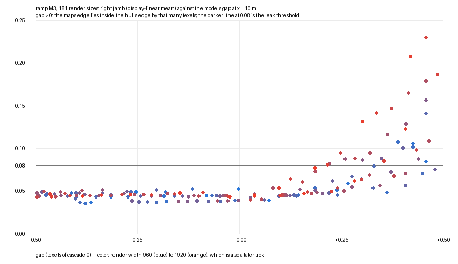
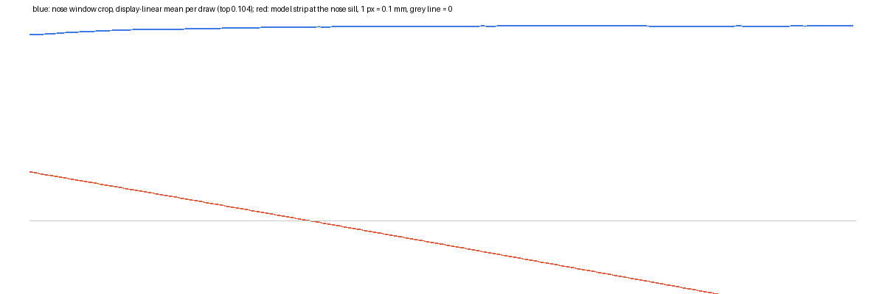
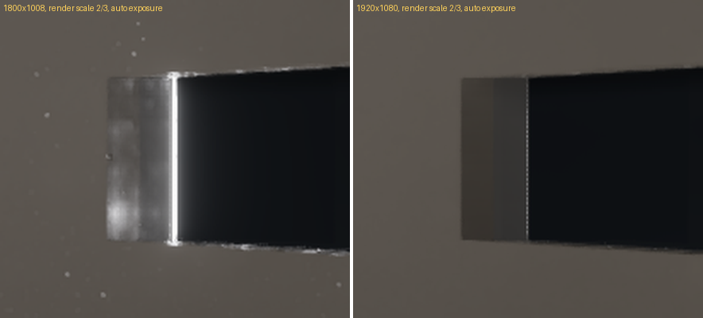

# The sunlit line on the cabin's window jambs: the shadow map's edge and the texel grid's phase (t1-gout, step 1)

The orbit scene's window jambs show a bright line at some window shapes, such as 1800 × 1008, and none at 16:9. The ramp
of t0-gbgj and the line orchestrator's window test found that the line follows the aspect error of the render size,
(width / height) / (16 / 9) − 1, as a sawtooth with teeth at −0.34 %, +0.45 % and +1.25 %. This record measures the cause.
It builds no remedy.

Terms used throughout:

- **Texel**: one texel of the sun's cascade 0, in meters. `ShadowCascades.Fit` makes it `2·radius / (2048 − 2·4)`, where
  `radius` is the bounding sphere of the view slice from 0.05 m to 50.64 m. The radius grows with the camera's aspect, so
  the texel does too: 0.05847 m at 16:9 and 0.05866 m at 1800 × 1008, with the vertical field of view of 60°.
- **Grid**: `Fit` snaps each cascade's center to a multiple of the texel from an anchor, the origin of the camera's
  reference frame. In the orbit scene the anchor is the ship's center. So the texel borders lie at whole texels from it.
- **Phase**: where a caster's edge stands within its texel, `distance from the anchor / texel mod 1`.
- **Gap**: how far the map's edge lies inside the caster's real edge, in texels.
- **Jamb light**: the display-linear mean of the window test's jamb crop (wintest.py). A leak is a mean above 0.08, and
  grey jambs read 0.035 to 0.055.

The view is that of the window test: scene `orbit`, camera `person`, lamps on, render scale 1, a fixed exposure of 4.08
stops. The near right opening is the starboard window at z = 6 m. The left crop is the port window at z = 6 m.

## 1. Where the line is and what lights it

**The surface.** The line lies on the window's jamb face at z = 5 m, whose normal points along +Z, toward the eye. The face
runs from the cabin's wall, x = 9.5 m, to the hull's outer face, x = 10 m. The line is the face's outer end, x → 10 m. The
left crop shows the same thing at x → −10 m.

**The sun.** The world starts at t = 0, and the ship starts on its circular orbit at the March equinox. The orbit's node
lies on earth's +X, which is also the direction of the sun. So the sun stays in the ship's YZ plane and turns about the
ship's X axis, the orbit normal, at the orbit rate n = 1.1332 × 10⁻³ rad/s (92.4 min per orbit):

    toward the sun, in the ship's axes = (0, cos ν, sin ν),   ν = n·t

| Tick | t (s) | ν | Toward the sun | The jamb face's N·L = sin ν |
|---:|---:|---:|---|---:|
| 60 | 1.0 | 0.065° | (0, 0.9999994, 0.00113) | 0.0011 |
| 100 | 1.67 | 0.108° | (0, 0.9999982, 0.00189) | 0.0019 |
| 6380 | 106.3 | 6.90° | (0, 0.99275, 0.12020) | 0.120 |

**The cascade and the grid's phase.** `LightBasis.FromDirection` takes +X as its reference while |toward the sun · Y| ≥
0.99, which holds until tick 7494 (ν = 8.1°). Then the light's Y axis is exactly the ship's +X, and its X axis is
(0, −sin ν, cos ν). The line's caster is the roof, which covers the whole hull from x = −10 m to 10 m. Its edge at
x = 10 m runs along the light's X axis, so only the phase across it, on the light's Y axis, matters: 10 / texel mod 1.

| Window | Texel (m) | Phase at x = 10 m | Phase along the edge, at the jamb's z = 5 m | Gap at x = 10 m (texel) | Sun's share at x = 10 m |
|---|---:|---:|---:|---:|---:|
| 1920 × 1080 | 0.05847 | 0.0383 | 0.515 | 0.038 | 0.019 |
| 1800 × 1008 | 0.05866 | 0.4599 | 0.237 | 0.460 | 0.230 |

**Is a thin strip there truly sunlit?** No. A ray toward the sun from any point of the jamb face with |x| < 10 m rises
through the opening and meets the lintel above it. Only the line x = 10 m itself is not covered, and it has no width.

**How the map lets light onto it.** A texel holds the roof when the roof covers the texel's center. So the map's edge lies
on a texel border, up to half a texel inside the roof's real edge:

    gap = phase          while the phase is below 0.5
    gap = phase − 1      from 0.5 on: the map's edge lies outside the real edge, and nothing leaks

A lookup d texels outside the map's edge has a 4 × 4 lit fraction of 1/2 + d/4. `lightOutsideShadow` turns that into the
sun's share `2 · lit − 1 = d/2` (for d < 2). So on the jamb face, the strip between the map's edge and x = 10 m takes a
share that rises from 0 at the map's edge to gap / 2 at x = 10 m. At 1800 × 1008 that strip is 0.46 texel, 2.7 cm wide,
and takes up to 0.23 of the sun.

**The model against the ramp.** [tools/rampcheck.py](tools/rampcheck.py) computes the gap for each of the ramp's 181
render sizes (t0-gbgj's `ramp-M3.txt`).

| Gap (texel) | Sizes | Leaks | Mean right jamb |
|---|---:|---:|---:|
| −1 to −0.25 | 48 | 0 | 0.045 |
| −0.25 to 0 | 41 | 0 | 0.043 |
| 0 to 0.25 | 47 | 3 | 0.051 |
| 0.25 to 0.5 | 45 | 27 | 0.100 |

The model puts the teeth at −0.350 %, +0.420 % and +1.195 % of aspect error. The measured teeth stand at −0.34 %, +0.45 %
and +1.25 %. With the measured render sizes, every tooth falls where the model's gap is near its largest. The edge at
exactly 10 m fits, and the earlier estimate of 9.74 m came from fitting the sparse sizes.



`gap-chart.png`: the ramp's right jamb against the model's gap, one point per render size, colored by the render width.

Reading: the sizes with the same gap read brighter the wider they are. The ramp ran from small sizes to large ones in
time, so a wider size is also a later tick, with a larger N·L (section 4).

## 2. Which comparison lets the light through

A scratch build of main d1e0349b8 with four switches read from the environment ([tools/scratch-toggles.patch](tools/scratch-toggles.patch)),
`/private/tmp/t1-gout/bin`, changed one thing at a time. Window 1800 × 1008, kept frame at tick 6380, where the line is
bright ([tools/take.sh](tools/take.sh)).

| Run | Right jamb | Left jamb |
|---|---:|---:|
| Base | 0.193 | 0.161 |
| Slope bias 0 (was 2.5) | 0.193 | 0.161 |
| Constant bias 0 (was 0.5 texel) | 0.193 | 0.161 |
| Normal offset 0 (was 1 texel) | 0.179 | 0.160 |
| Symmetric filter (no `lightOutsideShadow`) | 0.960 | 0.972 |

- The two depth biases change nothing. The receiver lies 6 to 7 m below the roof along the light, far beyond any bias.
- The normal offset moves the lookup along the jamb's normal, +Z, which is almost the light's X axis and runs along the
  edge. So it moves the lookup along the edge, not across it, and the jamb light changes by 7 %.
- The symmetric filter makes it far worse: the whole jamb turns white and a glow spreads on the wall. It gives 0.5 at the
  map's edge and light up to 2 texels inside it.

Reading: no bias decides the line. The lateral filter decides it, together with where the map's edge falls. The one-sided
rule removes the blur that crosses the map's edge, but the map's edge itself lies up to half a texel inside the real edge.

## 3. The red test

`ShadowTests.AWallsSideFaceUnderARoofsEdgeTakesNoSunlightWhereverTheEdgeStandsWithinItsTexel` runs on the GPU through the
real shadow pass and shader. No C# copy of the cascade lookup exists, so a test without a GPU would test only a model
written inside the test.

- The sun stands 20° from straight above, toward +Z, so the light's X axis is world X and the receiver's N·L is 0.34.
- A slab that only casts plays the roof. Its edge runs along the grid at x = (5 + place) · texel, for ten places from 0 to
  0.9. The grid passes through the camera, the origin of its frame.
- A block that does not cast ends under that edge. Its face looks along +Z, 1 m before the camera, like the jamb.
- The test reads the sun's share 0.1, 0.25 and 0.4 texel inside the edge, at three heights, as the green channel with the
  roof over the green channel without it.

The largest share at each place, measured red:

| Place | 0.0 | 0.1 | 0.2 | 0.3 | 0.4 | 0.5 | 0.6 to 0.9 |
|---|---:|---:|---:|---:|---:|---:|---:|
| Share | 0.000 | 0.000 | 0.051 | 0.106 | 0.143 | 0.197 | 0.000 |

That is the model's (place − 0.1) / 2. The test asks for less than 0.02 at every place. It is committed skipped, with
t1-gout as the reason.

## 4. Why the ramp read 0.230 and the window test 0.098 at 1800 × 1008

The crop placement is not the main cause. The two box rules differ by about 3 render pixels at 1800 × 1008. The tick is.
A film step runs one tick before each frame. The ramp's frame of 1800 × 1008 is film frame 157 · 40 + 39 = 6319, so it
shows tick 6380, about 105 s into the orbit. The window test's frame shows tick 100.

| Binary | Window | Tick | Right jamb | Left jamb |
|---|---|---:|---:|---:|
| `/private/tmp/t0-gbgj/bins/wr/probe-bin` | 1800 × 1008 | 100 | 0.0977 | 0.0582 |
| `/private/tmp/t0-gbgj/bins/wr/probe-bin` | 1800 × 1008 | 6380 | 0.193 | 0.161 |
| `/private/tmp/t1-gout/bin` (base) | 1800 × 1008 | 100 | 0.0977 | 0.0582 |
| `/private/tmp/t1-gout/bin` (base) | 1800 × 1008 | 6380 | 0.193 | 0.161 |
| The ramp (M3, upscaled to 1920 × 1080) | 1800 × 1008 render | 6380 | 0.230 | 0.242 |

`wr` is the other lead's build of 839bce1b5 with that commit's `tools/renderer-survey/probe.patch` and
`/private/tmp/t0-gbgj/scratch-dynamic-scale.patch`. I ran it read only, with no build, under the shared GPU lock, for the
first two rows. My own build gives the same numbers.

Reading: the jamb face's N·L with the sun is sin ν, 0.0019 at tick 100 and 0.120 at tick 6380, so the line is about 63
times brighter in direct light at the later tick. The rest, 0.193 against 0.230, can come from the upscale from the render
size to the 1920 × 1080 output and from the build. I did not separate those two.

## 5. What the screen's rays add

| Run | Right jamb | Left jamb |
|---|---:|---:|
| 1800 × 1008, tick 100 | 0.098 | 0.058 |
| 1800 × 1008, tick 100, screen trace off | 0.047 | 0.047 |
| 1800 × 1008, tick 6380 | 0.193 | 0.161 |
| 1800 × 1008, tick 6380, screen trace off | 0.092 | 0.119 |


`jamb-sheet.png`: the near right opening at 2x. From left: 1800 × 1008 at tick 100, the same with the screen trace off,
1800 × 1008 at tick 6380, the same with the screen trace off, and 1920 × 1080 at tick 6380.

- With the screen trace off, the jamb face is clean grey at both ticks. Only the direct line at its outer end stays: faint
  at tick 100 and bright at tick 6380. The dots along the opening's bottom edge stay too, so they are direct light.
- At tick 100 the screen's rays make almost all of the crop's excess over the floor (0.098 → 0.047), as a mottle on the
  jamb face. At tick 6380 they make about half of it.

Reading: the dots along the bottom edge are the sill's strip near x = 10 m. The sill faces the sun (N·L ≈ 1) and has the
same gap as the jamb, so it is bright even at tick 100. The screen's rays carry the strip's light onto the jamb face. I
did not check which surface each ray hits. I did not run the back-face layer with its rule off, so this record does not
split the screen's rays into the back-face layer's part and the rest.

## 6. The sun's turn and a 16:9 window

Reading, from the code: the sun turns about the ship's X axis, and the side walls' caster edges are lines of constant
ship x. So the phase at the side walls does not move with time, and the teeth do not smear over the ramp's 120 s. At
tick 7494 the basis changes its reference axis, and the side walls' lateral axis becomes the light's X axis, but the phase
is the same number. In a 16:9 window the side jambs keep their gap of 0.038 texel through the whole orbit. At 1920 × 1080
the jambs read 0.044 at both tick 100 and tick 6380.

Edges that run across the ship do move. The roof's front edge at z = −30 m has a phase that moves 0.077 texel/s, one cycle
in about 13 s ([tools/nose.py](tools/nose.py)). But the true shadow under it deepens as the sun turns: the nose window's
sill lies 6.85 m · sin ν inside the roof's shadow at its outer end. The model's strip there is at most 6.7 mm, and it
closes by tick 120. From t ≈ 3.8 s on, the true shadow lies more than half a texel deep, so the strip never returns.

A film of the first 360 draws at 1920 × 1080 ([tools/nosefilm.py](tools/nosefilm.py)) measured a crop round the nose window
(x 880 to 1040, y 505 to 575):

| Draws | Crop mean | Model's strip at the nose sill |
|---|---:|---|
| 0–59 | 0.0895 | +3.5 to +6.7 mm |
| 60–119 | 0.0925 | +0.2 to +3.4 mm |
| 120–239 | 0.0940 | −6.5 to +0.1 mm |
| 240–359 | 0.0943 | −72 to −6.6 mm |



`nose-169.png`: the crop's level per draw (blue) and the model's strip (red, 1 px = 0.1 mm, zero at the grey line).

The crop rises slowly over the first 120 draws, as the history settles, and changes by at most 1.2 % after that. No line
shows on the sill at draws 30, 90 or 300. So no line comes and goes at 16:9 in this view, and there is no film of one.

**The tracked demo script.** [scripts/jamb-grid-phase.json](../../../scripts/jamb-grid-phase.json) runs 6340 ticks, a
settling film of 40 draws, and one still, `jamb`, in a window of 1800 × 1008. Run it with the default render scale 2/3 and
the automatic exposure:

```powershell
nix develop --command dotnet run --project src/Tertius.Demo -c Release -- --script scripts/jamb-grid-phase.json --headless --out captures/jamb
```



`script-sheet.png`: the script's still at 1800 × 1008 (left), with the line, and at 1920 × 1080 with `--size 1920x1080`
(right). The right tile shows only a faint dotted line at the jamb's outer end, the 0.038-texel strip, visible when zoomed.

## 7. The local lights' tiles

`tileShadow` keeps the symmetric filter, with exact weights (1 − f, 1, 1, 1, f) per axis, the same 4 × 4 bilinear filter.
A tile's map also holds a caster only in the texels whose centers it covers. Reading, for one constructed case: a straight
caster edge whose map edge lies g texels inside the real edge ([tools/extra.py](tools/extra.py)).

| g (texel) | Share at the real edge | How far inside the real edge light reaches (texel) |
|---:|---:|---:|
| 0 | 0.500 | 2.0 |
| 0.25 | 0.562 | 2.25 |
| 0.5 | 0.625 | 2.5 |

So the tiles hold a stronger member of the class: up to 0.625 of the light at a caster's real edge, reaching 2.5 texels
inside it. A tile's grid is fixed to its light's frustum, so its phase moves only when a lamp or a caster moves, never with
the camera or the window. I did not search any scene for it.

## The cascades at 16:9

| Cascade | View depth | Texel |
|---:|---|---:|
| 0 | 0.05 m to 50.64 m | 0.05847 m |
| 1 | 45.6 m to 109.0 m | 0.12585 m |
| 2 | 103.2 m to 277.3 m | 0.32013 m |
| 3 | 260.4 m to 2 km | 2.30909 m |

## What was not measured

- The share per pixel on the jamb. The record reads the jamb crops and the red test's points, not a debug view.
- Which surfaces the screen's rays hit, and the back-face layer's own part of them.
- The split of the ramp's remaining 0.193 against 0.230 between the upscale and the build.
- The tiles in any real scene.
- Any orbit position past tick 6380, such as the stretch where the sun shines in through the nose window.
- Linux drivers. Every run is on this Mac through MoltenVK.

## How to repeat it

- The gap model and its checks: `python3 -I phase.py`, `python3 -I rampcheck.py <ramp-M3.txt>`, `python3 -I nose.py`,
  `python3 -I extra.py` and `python3 -I gapchart.py <ramp-M3.txt> <out.png>`, run in the dev shell from
  [tools/](tools/).
- The takes: [tools/take.sh](tools/take.sh) with the scratch build and its `TERTIUS_X_*` switches, and
  [tools/wintest.py](tools/wintest.py), copied from t0-gbgj, for the crops.
- The evidence: `/Users/alexispurslane/.t3/worktrees/tertius/t3-2b720d96-b40221aeff8f27f7-evidence/gout/`, each take's
  kept frame and its opening at 2x.
