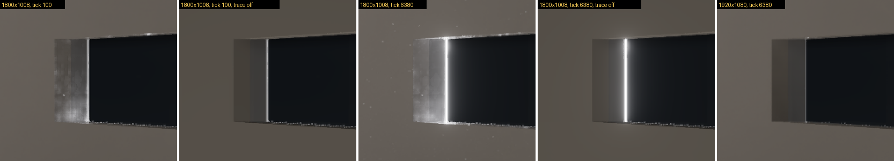
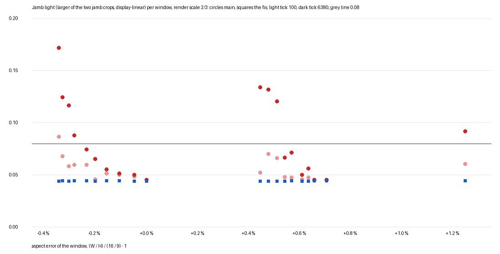
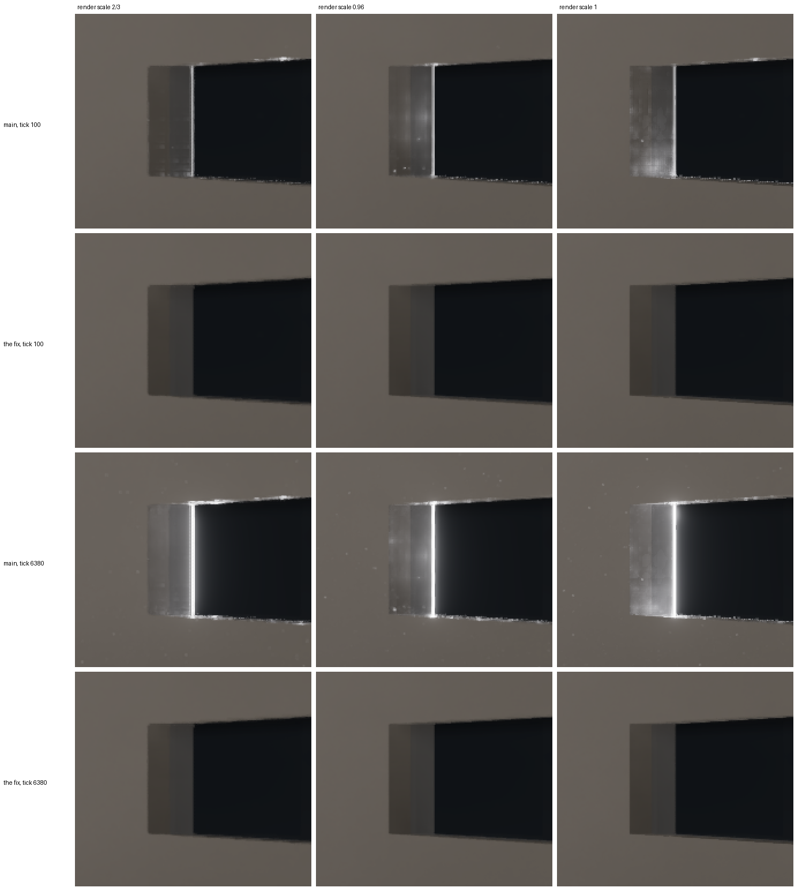
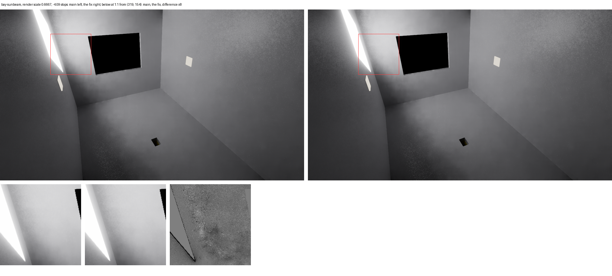
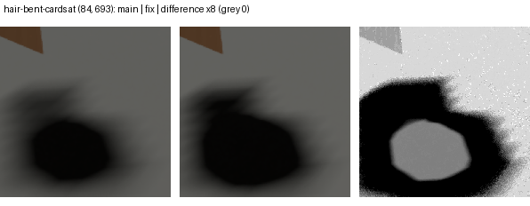
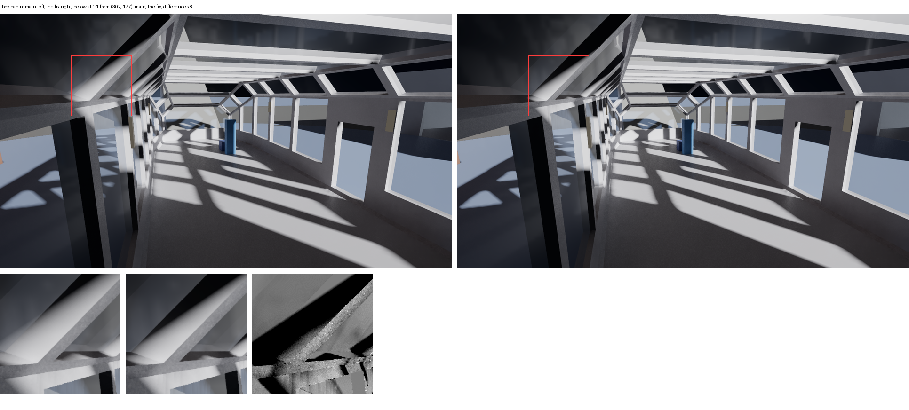
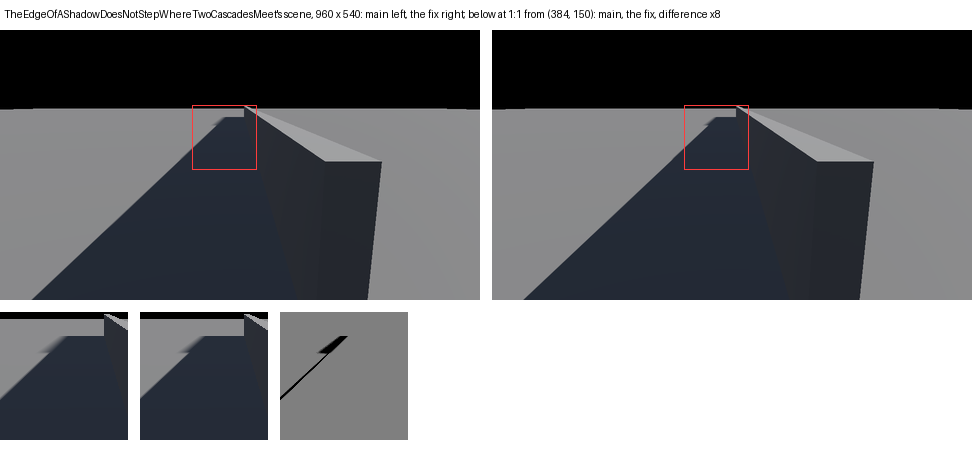

# The sunlit line on the cabin's window jambs: the shadow map's edge and the texel grid's phase (t1-gout, step 1)

The orbit scene's window jambs show a bright line at some window shapes, such as 1800 × 1008, and none at 16:9. The ramp
of t0-gbgj and the line orchestrator's window test found that the line follows the aspect error of the render size,
(width / height) / (16 / 9) − 1, as a sawtooth with teeth at −0.34 %, +0.45 % and +1.25 %. This record measures the cause.
It builds no remedy.

Terms used throughout:

- **Texel**: one texel of the sun's cascade 0, in meters. `ShadowCascades.Fit` makes it `2·radius / (2048 − 2·4)`, where
  `radius` is the bounding sphere of the view slice from 0.05 m to 50.64 m. The radius grows with the camera's aspect, so
  the texel does too: 0.05847 m at 16:9 and 0.05866 m at 1800 × 1008, with the vertical field of view of 60°.
- **Grid**: `Fit` snaps each cascade's center to a multiple of the texel from an anchor, the origin of the camera's
  reference frame. In the orbit scene the anchor is the ship's center. So the texel borders lie at whole texels from it.
- **Phase**: where a caster's edge stands within its texel, `distance from the anchor / texel mod 1`.
- **Gap**: how far the map's edge lies inside the caster's real edge, in texels.
- **Jamb light**: the display-linear mean of the window test's jamb crop (wintest.py). A leak is a mean above 0.08, and
  grey jambs read 0.035 to 0.055.

The view is that of the window test: scene `orbit`, camera `person`, lamps on, render scale 1, a fixed exposure of 4.08
stops. The near right opening is the starboard window at z = 6 m. The left crop is the port window at z = 6 m.

## 1. Where the line is and what lights it

**The surface.** The line lies on the window's jamb face at z = 5 m, whose normal points along +Z, toward the eye. The face
runs from the cabin's wall, x = 9.5 m, to the hull's outer face, x = 10 m. The line is the face's outer end, x → 10 m. The
left crop shows the same thing at x → −10 m.

**The sun.** The world starts at t = 0, and the ship starts on its circular orbit at the March equinox. The orbit's node
lies on earth's +X, which is also the direction of the sun. So the sun stays in the ship's YZ plane and turns about the
ship's X axis, the orbit normal, at the orbit rate n = 1.1332 × 10⁻³ rad/s (92.4 min per orbit):

    toward the sun, in the ship's axes = (0, cos ν, sin ν),   ν = n·t

| Tick | t (s) | ν | Toward the sun | The jamb face's N·L = sin ν |
|---:|---:|---:|---|---:|
| 60 | 1.0 | 0.065° | (0, 0.9999994, 0.00113) | 0.0011 |
| 100 | 1.67 | 0.108° | (0, 0.9999982, 0.00189) | 0.0019 |
| 6380 | 106.3 | 6.90° | (0, 0.99275, 0.12020) | 0.120 |

**The cascade and the grid's phase.** `LightBasis.FromDirection` takes +X as its reference while |toward the sun · Y| ≥
0.99, which holds until tick 7494 (ν = 8.1°). Then the light's Y axis is exactly the ship's +X, and its X axis is
(0, −sin ν, cos ν). The line's caster is the roof, which covers the whole hull from x = −10 m to 10 m. Its edge at
x = 10 m runs along the light's X axis, so only the phase across it, on the light's Y axis, matters: 10 / texel mod 1.

| Window | Texel (m) | Phase at x = 10 m | Phase along the edge, at the jamb's z = 5 m | Gap at x = 10 m (texel) | Sun's share at x = 10 m |
|---|---:|---:|---:|---:|---:|
| 1920 × 1080 | 0.05847 | 0.0383 | 0.515 | 0.038 | 0.019 |
| 1800 × 1008 | 0.05866 | 0.4599 | 0.237 | 0.460 | 0.230 |

**Is a thin strip there truly sunlit?** No. A ray toward the sun from any point of the jamb face with |x| < 10 m rises
through the opening and meets the lintel above it. Only the line x = 10 m itself is not covered, and it has no width.

**How the map lets light onto it.** A texel holds the roof when the roof covers the texel's center. So the map's edge lies
on a texel border, up to half a texel inside the roof's real edge:

    gap = phase          while the phase is below 0.5
    gap = phase − 1      from 0.5 on: the map's edge lies outside the real edge, and nothing leaks

A lookup d texels outside the map's edge has a 4 × 4 lit fraction of 1/2 + d/4. `lightOutsideShadow` turns that into the
sun's share `2 · lit − 1 = d/2` (for d < 2). So on the jamb face, the strip between the map's edge and x = 10 m takes a
share that rises from 0 at the map's edge to gap / 2 at x = 10 m. At 1800 × 1008 that strip is 0.46 texel, 2.7 cm wide,
and takes up to 0.23 of the sun.

**The model against the ramp.** [tools/rampcheck.py](tools/rampcheck.py) computes the gap for each of the ramp's 181
render sizes (t0-gbgj's `ramp-M3.txt`).

| Gap (texel) | Sizes | Leaks | Mean right jamb |
|---|---:|---:|---:|
| −1 to −0.25 | 48 | 0 | 0.045 |
| −0.25 to 0 | 41 | 0 | 0.043 |
| 0 to 0.25 | 47 | 3 | 0.051 |
| 0.25 to 0.5 | 45 | 27 | 0.100 |

The model puts the teeth at −0.350 %, +0.420 % and +1.195 % of aspect error. The measured teeth stand at −0.34 %, +0.45 %
and +1.25 %. With the measured render sizes, every tooth falls where the model's gap is near its largest. The edge at
exactly 10 m fits, and the earlier estimate of 9.74 m came from fitting the sparse sizes.


`gap-chart.png`: the ramp's right jamb against the model's gap, one point per render size, colored by the render width.

Reading: the sizes with the same gap read brighter the wider they are. The ramp ran from small sizes to large ones in
time, so a wider size is also a later tick, with a larger N·L (section 4).

## 2. Which comparison lets the light through

A scratch build of main d1e0349b8 with four switches read from the environment ([tools/scratch-toggles.patch](tools/scratch-toggles.patch)),
`/private/tmp/t1-gout/bin`, changed one thing at a time. Window 1800 × 1008, kept frame at tick 6380, where the line is
bright ([tools/take.sh](tools/take.sh)).

| Run | Right jamb | Left jamb |
|---|---:|---:|
| Base | 0.193 | 0.161 |
| Slope bias 0 (was 2.5) | 0.193 | 0.161 |
| Constant bias 0 (was 0.5 texel) | 0.193 | 0.161 |
| Normal offset 0 (was 1 texel) | 0.179 | 0.160 |
| Symmetric filter (no `lightOutsideShadow`) | 0.960 | 0.972 |

- The two depth biases change nothing. The receiver lies 6 to 7 m below the roof along the light, far beyond any bias.
- The normal offset moves the lookup along the jamb's normal, +Z, which is almost the light's X axis and runs along the
  edge. So it moves the lookup along the edge, not across it, and the jamb light changes by 7 %.
- The symmetric filter makes it far worse: the whole jamb turns white and a glow spreads on the wall. It gives 0.5 at the
  map's edge and light up to 2 texels inside it.

Reading: no bias decides the line. The lateral filter decides it, together with where the map's edge falls. The one-sided
rule removes the blur that crosses the map's edge, but the map's edge itself lies up to half a texel inside the real edge.

## 3. The red test

`ShadowTests.AWallsSideFaceUnderARoofsEdgeTakesNoSunlightWhereverTheEdgeStandsWithinItsTexel` runs on the GPU through the
real shadow pass and shader. No C# copy of the cascade lookup exists, so a test without a GPU would test only a model
written inside the test.

- The sun stands 20° from straight above, toward +Z, so the light's X axis is world X and the receiver's N·L is 0.34.
- A slab that only casts plays the roof. Its edge runs along the grid at x = (5 + place) · texel, for ten places from 0 to
  0.9. The grid passes through the camera, the origin of its frame.
- A block that does not cast ends under that edge. Its face looks along +Z, 1 m before the camera, like the jamb.
- The test reads the sun's share 0.1, 0.25 and 0.4 texel inside the edge, at three heights, as the green channel with the
  roof over the green channel without it.

The largest share at each place, measured red:

| Place | 0.0 | 0.1 | 0.2 | 0.3 | 0.4 | 0.5 | 0.6 to 0.9 |
|---|---:|---:|---:|---:|---:|---:|---:|
| Share | 0.000 | 0.000 | 0.051 | 0.106 | 0.143 | 0.197 | 0.000 |

That is the model's (place − 0.1) / 2. The test asks for less than 0.02 at every place. It is committed skipped, with
t1-gout as the reason.

## 4. Why the ramp read 0.230 and the window test 0.098 at 1800 × 1008

The crop placement is not the main cause. The two box rules differ by about 3 render pixels at 1800 × 1008. The tick is.
A film step runs one tick before each frame. The ramp's frame of 1800 × 1008 is film frame 157 · 40 + 39 = 6319, so it
shows tick 6380, about 105 s into the orbit. The window test's frame shows tick 100.

| Binary | Window | Tick | Right jamb | Left jamb |
|---|---|---:|---:|---:|
| `/private/tmp/t0-gbgj/bins/wr/probe-bin` | 1800 × 1008 | 100 | 0.0977 | 0.0582 |
| `/private/tmp/t0-gbgj/bins/wr/probe-bin` | 1800 × 1008 | 6380 | 0.193 | 0.161 |
| `/private/tmp/t1-gout/bin` (base) | 1800 × 1008 | 100 | 0.0977 | 0.0582 |
| `/private/tmp/t1-gout/bin` (base) | 1800 × 1008 | 6380 | 0.193 | 0.161 |
| The ramp (M3, upscaled to 1920 × 1080) | 1800 × 1008 render | 6380 | 0.230 | 0.242 |

`wr` is the other lead's build of 839bce1b5 with that commit's `tools/renderer-survey/probe.patch` and
`/private/tmp/t0-gbgj/scratch-dynamic-scale.patch`. I ran it read only, with no build, under the shared GPU lock, for the
first two rows. My own build gives the same numbers.

Reading: the jamb face's N·L with the sun is sin ν, 0.0019 at tick 100 and 0.120 at tick 6380, so the line is about 63
times brighter in direct light at the later tick. The rest, 0.193 against 0.230, can come from the upscale from the render
size to the 1920 × 1080 output and from the build. I did not separate those two.

## 5. What the screen's rays add

| Run | Right jamb | Left jamb |
|---|---:|---:|
| 1800 × 1008, tick 100 | 0.098 | 0.058 |
| 1800 × 1008, tick 100, screen trace off | 0.047 | 0.047 |
| 1800 × 1008, tick 6380 | 0.193 | 0.161 |
| 1800 × 1008, tick 6380, screen trace off | 0.092 | 0.119 |



`jamb-sheet.png`: the near right opening at 2x. From left: 1800 × 1008 at tick 100, the same with the screen trace off,
1800 × 1008 at tick 6380, the same with the screen trace off, and 1920 × 1080 at tick 6380.

- With the screen trace off, the jamb face is clean grey at both ticks. Only the direct line at its outer end stays: faint
  at tick 100 and bright at tick 6380. The dots along the opening's bottom edge stay too, so they are direct light.
- At tick 100 the screen's rays make almost all of the crop's excess over the floor (0.098 → 0.047), as a mottle on the
  jamb face. At tick 6380 they make about half of it.

Reading: the dots along the bottom edge are the sill's strip near x = 10 m. The sill faces the sun (N·L ≈ 1) and has the
same gap as the jamb, so it is bright even at tick 100. The screen's rays carry the strip's light onto the jamb face. I
did not check which surface each ray hits. I did not run the back-face layer with its rule off, so this record does not
split the screen's rays into the back-face layer's part and the rest.

## 6. The sun's turn and a 16:9 window

Reading, from the code: the sun turns about the ship's X axis, and the side walls' caster edges are lines of constant
ship x. So the phase at the side walls does not move with time, and the teeth do not smear over the ramp's 120 s. At
tick 7494 the basis changes its reference axis, and the side walls' lateral axis becomes the light's X axis, but the phase
is the same number. In a 16:9 window the side jambs keep their gap of 0.038 texel through the whole orbit. At 1920 × 1080
the jambs read 0.044 at both tick 100 and tick 6380.

Edges that run across the ship do move. The roof's front edge at z = −30 m has a phase that moves 0.077 texel/s, one cycle
in about 13 s ([tools/nose.py](tools/nose.py)). But the true shadow under it deepens as the sun turns: the nose window's
sill lies 6.85 m · sin ν inside the roof's shadow at its outer end. The model's strip there is at most 6.7 mm, and it
closes by tick 120. From t ≈ 3.8 s on, the true shadow lies more than half a texel deep, so the strip never returns.

A film of the first 360 draws at 1920 × 1080 ([tools/nosefilm.py](tools/nosefilm.py)) measured a crop round the nose window
(x 880 to 1040, y 505 to 575):

| Draws | Crop mean | Model's strip at the nose sill |
|---|---:|---|
| 0–59 | 0.0895 | +3.5 to +6.7 mm |
| 60–119 | 0.0925 | +0.2 to +3.4 mm |
| 120–239 | 0.0940 | −6.5 to +0.1 mm |
| 240–359 | 0.0943 | −72 to −6.6 mm |


`nose-169.png`: the crop's level per draw (blue) and the model's strip (red, 1 px = 0.1 mm, zero at the grey line).

The crop rises slowly over the first 120 draws, as the history settles, and changes by at most 1.2 % after that. No line
shows on the sill at draws 30, 90 or 300. So no line comes and goes at 16:9 in this view, and there is no film of one.

**The tracked demo script.** [scripts/jamb-grid-phase.json](../../../scripts/jamb-grid-phase.json) runs 6340 ticks, a
settling film of 40 draws, and one still, `jamb`, in a window of 1800 × 1008. Run it with the default render scale 2/3 and
the automatic exposure:

```powershell
nix develop --command dotnet run --project src/Tertius.Demo -c Release -- --script scripts/jamb-grid-phase.json --headless --out captures/jamb
```


`script-sheet.png`: the script's still at 1800 × 1008 (left), with the line, and at 1920 × 1080 with `--size 1920x1080`
(right). The right tile shows only a faint dotted line at the jamb's outer end, the 0.038-texel strip, visible when zoomed.

## 7. The local lights' tiles

`tileShadow` keeps the symmetric filter, with exact weights (1 − f, 1, 1, 1, f) per axis, the same 4 × 4 bilinear filter.
A tile's map also holds a caster only in the texels whose centers it covers. Reading, for one constructed case: a straight
caster edge whose map edge lies g texels inside the real edge ([tools/extra.py](tools/extra.py)).

| g (texel) | Share at the real edge | How far inside the real edge light reaches (texel) |
|---:|---:|---:|
| 0 | 0.500 | 2.0 |
| 0.25 | 0.562 | 2.25 |
| 0.5 | 0.625 | 2.5 |

So the tiles hold a stronger member of the class: up to 0.625 of the light at a caster's real edge, reaching 2.5 texels
inside it. A tile's grid is fixed to its light's frustum, so its phase moves only when a lamp or a caster moves, never with
the camera or the window. I did not search any scene for it.

## 8. The remedy (step 3, design L)

Design L moves the start of the lit side's ramp from the lit fraction 1/2 to `DoubtfulLitFraction` D. The map's edge lies
up to half a texel inside a caster's real edge, so on the real edge the 4 × 4 filter is lit by up to 1/2 + (1/2)/4 = 5/8.
`shadows.glsl` computes D from `FilterTapsPerAxis`, and `lightOutsideShadow` becomes clamp((f − D) / (1 − D), 0, 1).
The share is 0 up to half a texel past the map's edge and rises to 1 over the next 1.5 texels. A lit area loses 1.25
texels at each edge on average, a quarter texel more than under D = 1/2.

The build was planned as two commits, one per decision. Commit A holds the cascades, which the orchestrator confirmed,
and splits `tileLitFraction` from `tileShadow`, which returns the raw lit fraction. Commit B, the tiles' one line
`lightOutsideShadow(tileLitFraction(...))`, was refused on the tiles' stills ("The tiles keep the symmetric filter"
below), so commit A ships alone.

Terms of this section:

- **Main**: `/private/tmp/t1-gout/bin`, main d1e0349b8 with the toggles of section 2 off. Main's `src` is the same at
  deba5bdfd.
- **The fix**: `/private/tmp/t1-gout/tilesraw-bin`, commit A's code on the base deba5bdfd, built from this branch.
  Every still, ramp and window measure of this section ran on that base. The timing ran on exact commits instead
  ("The cost").
- **Jamb light** and **leak**: as in section 1, a jamb crop above 0.08.

### The tests, red and green

Each red number was measured before the shader changed. Each green number is the same test under commit A. The share is
the sun's (or the lamp's) green HDR ratio with the roof over the ratio without it, at the test's points inside the
roof's edge. The tests ask for less than 0.02.

| Test | Red: largest share | Green |
|---|---|---|
| Aligned with the grid, ten places of the edge in its texel | 0.197 at place 0.5; 0.000 at 0.0, 0.1 and 0.6 to 0.9 | 0.000 at every place |
| 45° to the grid, ten places | 0.187 at place 0.9; 0.000 at 0.0 to 0.5 | 0.000 at every place |
| 17° to the grid, ten places | 0.038 at place 0.9 | 0.000 at every place |
| A spot lamp's tile, 17° to the grid | 0.386 at 0.25 texel inside, 0.318 at 0.5, 0.197 at 1 | 0.000 at all three (commit B's line only) |

No test at an angle measured a lit fraction above 5/8 on the real edge, so D stays computed. The tile test is committed
skipped in commit A, with the tiles' decision as its reason.

Three tests of the old rule changed, and one reference image:

- `TheEdgeOfAShadowDoesNotStepWhereTwoCascadesMeet` takes the bound 2D b and a pixel ("The step where two cascades
  meet" below).
- `EnvironmentFaceTests.AFaceShowsTheSunsMapShadowBehindTheCamera` reads a ground point about 1.1 texels past the map's
  shadow edge. Its lit fraction is 1/2 + 1.1/4 ≈ 0.77, so its share was 0.548 under D = 1/2, and is 0.399 under D = 5/8,
  as the model gives. The test asked for more than a half, and its comment said a quarter darker. It now asks for more than
  0.3: the far shadow, which the test tells apart from the cascade's, would leave under a tenth.
- `LitPuffsAreBrightInTheSunDimInTheShadowOfABoxAndWarmUnderALamp` differed from `puffs-lit.png` in 192 pixels (largest
  FLIP 0.287, mean 0.00075). I opened the reference, the actual image and the FLIP heat map. At full size they look the
  same. At 4x, the heat map marks the short darker dashes along the slab's front face, which is the known limit of a face
  under 2 texels, now 8/3 of the loss in place of 2. It also marks the outline of the slab's shadow on the ground: the
  slanted left edge and the right end lie a little farther out, by the quarter texel. I approved the new image.

### The ramp across the three teeth

[tools/ramp.sh](tools/ramp.sh) runs [tools/take.sh](tools/take.sh) at 20 windows at the render scale 2/3, the headless
default. The gap model of section 1 chose them from the 181 sizes: one or two per level of the model's gap across the
teeth at −0.34 % and +0.45 %, the one aspect of the tooth at +1.25 % (1800 × 1000), and 16:9. The tables are
[remedy/ramp-main-t100.txt](remedy/ramp-main-t100.txt), [remedy/ramp-main-t6380.txt](remedy/ramp-main-t6380.txt),
[remedy/ramp-A-t100.txt](remedy/ramp-A-t100.txt) and [remedy/ramp-A-t6380.txt](remedy/ramp-A-t6380.txt).

| Build | Tick | Windows that leak | Largest jamb light |
|---|---:|---:|---:|
| Main | 100 | 1 of 20 | 0.086 |
| Main | 6380 | 8 of 20, in all three teeth | 0.172 |
| The fix | 100 | 0 of 20 | 0.044 |
| The fix | 6380 | 0 of 20 | 0.044 |



`remedy/ramp-chart.png`: the larger jamb crop per window against the window's aspect error. Circles are main, squares the
fix. Light colors are tick 100 and dark colors tick 6380. The grey line is 0.08.

### The window of 1800 × 1008 at three render scales

[remedy/window.txt](remedy/window.txt) and the ramp's rows at 2/3:

| Render scale | Tick | Main, right / left jamb | The fix, right / left jamb |
|---|---:|---|---|
| 2/3 | 100 | 0.050 / 0.052 | 0.044 / 0.044 |
| 2/3 | 6380 | 0.134 / 0.128 | 0.044 / 0.044 |
| 0.96 | 100 | 0.080 / 0.084 | 0.043 / 0.043 |
| 0.96 | 6380 | 0.136 / 0.154 | 0.043 / 0.043 |
| 1 | 100 | 0.098 / 0.058 | 0.044 / 0.043 |
| 1 | 6380 | 0.193 / 0.161 | 0.044 / 0.043 |



`remedy/openings.png`: the near right opening at 2x, main above the fix at each tick, the three render scales left to
right. Main shows the line at the jamb's outer end, a mottle on the jamb face and glints along the sill and the lintel.
The fix shows a plain grey jamb in every tile, with no line and no glints.

### bay-sunbeam at 16:9

The survey's view `bay-sunbeam`: scene `demo-surface`, camera `bay-camera`, 420 ticks, 1920 × 1080. Main's automatic
exposure is −4.09 stops, and both builds render at that fixed exposure, at the render scales 2/3 and 0.96.



`remedy/bay-sunbeam.png`: render scale 2/3, main left and the fix right, and below at 1:1 the box where the two differ
most: main, the fix, and their difference at a gain of 8. The difference is a thin dark line along the sunbeam's lower
edge, the quarter texel of lost light. Elsewhere it is the bounce light's noise. At 0.96 the box and the difference are the
same (`bay-s0.96.png` in the evidence folder).

### The survey's stills

[tools/stills.py](tools/stills.py) and [tools/stills.sh](tools/stills.sh) render the survey's still cases on main and
on the fix. Each case renders at 1920 × 1080, the render scale 2/3, the automatic exposure and no bloom. Each script is cut
after the last frame that a case names. The 75 cases whose frame lies within the first 600 frames ran. Seven cases
did not run, because each names a frame of a long film past frame 600, and the run would draw every frame of the film up
to it: docking-bay (frame 3400) and docking-cabin (3950) of demo-docking, exit-chute (1200), exit-floor (2500) and
exit-stack (2900) of demo-exit, orbit-umbra (1401), and danube-hold (16800) of blue-danube.
A still is deterministic on one machine: main against main gives 0 changed pixels in stars-1, hair-bent-cards, rigs and
lamp-hall-4. [remedy/stills-compare.txt](remedy/stills-compare.txt) has each case's count of pixels whose luminance
changed by more than 1 % of the frame's 99th percentile.

- Eighteen stills are identical: the twelve lamp-hall stills, spot-box, pillar-room, rect-lights, orbit-chase,
  orbit-far, spin-standing, spin-ring, mars-edge, deep-yard, deck-cuts, exit-cabin and exit-deck.
- Fifty-seven stills change. I looked at each one's 1:1 box of largest change. Each change is of one of four kinds:
  - The outline of a sun shadow grows by the quarter texel of lost light.
  - A soft shadow of a coarse cascade or of a thin caster grows and darkens, by the rule's factor 8/3 on partial
    losses. The widest are the ceiling near the camera in box-cabin and cabin-light-cabin, the patches of
    cabin-light-canopy, and the hair shadows of hair-bent-cards, skin-hair and skin-hair-fringed.
  - The automatic exposure moves: doorway-inside by +0.074 stops and yard-end by −0.074 stops.
  - The bounce light's noise changes.
- No still shows a new speck, leak, line or band. Two lose a fault of main. walk loses the specks and the light on the
  cabin's jamb, and airlock-door loses a bright streak in the window's recess.

### The cost under partly covered receivers

The quarter texel holds at a straight edge of a wide caster. A receiver that a caster covers only partly loses more,
because the share falls faster with the lit fraction f: f = 0.7 gives a share of 0.4 under D = 1/2 and 0.2 under D = 5/8.
Under the middle of a strip of n texels along the grid, the 4 comparisons per axis see n texels in 4, so the share is
1 − n/2 under D = 1/2 and 1 − 2n/3 under D = 5/8. A caster narrower than 1.5 texels casts 8/3 of its true shadow,
against 2. The section "A stated limit of the rule" of `.tickets/t1-gout.md` has the table by width. My integration of
the same box model gives the same rows. `ShadowTests.AStripOneTexelWideLetsAThirdOfTheSunThroughUnderItsMiddle` measures
the strip of one texel: 0.333 at all 11 heights under D = 5/8, and 0.500 under D = 1/2.



`remedy/hair-bent-cards.png`: the shadow of the hair cards at 1:1: main, the fix and the difference ×8. The blob grows and
darkens, and its edge stays soft.



`remedy/box-cabin.png`: box-cabin at half size, and at 1:1 by the ceiling near the camera. The narrow lit band beside the
diagonal beam narrows. There the sun grazes the ceiling, so the lost light spans many pixels.

### The cost

Each take draws 120 frames at 1920 × 1080 under the exclusive GPU lock, with `--video none --in-flight 2 --exposure
4.08`, in the order main, X, X, main, main, X. Main is a Release build of e5e1d1a85, and commit A one of fb18a44e0. The
cells hold the three medians of the GPU frame span in ms, and the range of the direct light pass's medians. The load is
the range of the 1-minute load over the takes.

| View | Main | Commit A as first written | Commit A as merged | Load |
|---|---|---|---|---|
| Orbit cabin, sunlit (tick 6340) | 15.035, 15.022, 15.034; direct 1.546 to 1.554 | 15.293, 15.302, 15.305; direct 1.740 to 1.750 | 15.026, 15.020, 15.024; direct 1.532 to 1.547 | 3.8 to 9.4 |
| Bay, sunlit (demo-surface, bay-camera, tick 300) | 15.900, 15.879, 15.877; direct 2.501 to 2.505 | 16.195, 16.204, 16.209; direct 2.789 to 2.796 | 15.886, 15.896, 15.868; direct 2.497 to 2.503 | 4.0 to 9.0 |
| Lamp hall 16, no sun and no sky (tick 10) | 10.216, 10.228, 10.239; direct 1.189 to 1.192 | 10.364, 10.380, 10.372; direct 1.335 to 1.337 | 10.240, 10.215, 10.218; direct 1.195 to 1.199 | 4.1 to 8.2 |

Main's cells are those of the take beside the merged form. The take beside the first form gave main the same medians
within 0.09 ms.

The first form cost the direct light pass 0.13 to 0.28 ms in every view, also in the lamp hall, where no cascade lookup
runs and the picture does not change. So the picture did not cause the cost. Two checks found the cause:

- With D set back to 1/2 and nothing else changed, commit A costs what main costs: the hall's medians are 10.217,
  10.232 and 10.222 ms, and the cabin's 15.028, 15.067 and 15.040 ms.
- An offline compile of the direct shaders for the M1 gives the highest register of each: `tools/shader_registers.py`
  (tools/README.md, "The registers of the direct shaders"), made from the scripts of t2-vsqh.

| Variant | `direct_key_fill.frag` | Its instructions | `direct.frag` |
|---|---|---|---|
| Main | r115 | 22,974 | r112 |
| Commit A, first form | r116 | 23,022 | r113 |
| Commit A with D = 1/2 | r115 | 22,974 | r112 |
| Commit A, merged form | r115 | 23,022 | r112 |

Main's rule compiles to one instruction with inline factors, `fmadd32.sat r, r, 0.125, -1.0`. The slope 8/3 of D = 5/8
has no inline encoding, so the first form loaded two constants, 1/6 and −5/3, into registers at each of the shader's 24
cascade lookups. That raised the key and fill shader to register 116, where Apple's GPU keeps 384 resident threads
instead of 448 (ARCHITECTURE.md, "Key and fill"). A division turned into a multiplication, one fused multiply-add with
folded constants and a multiplied filter mean all compile to r116. The merged form computes the rule in two steps,
clamp(2 f − 2 D, 0, 1), then times 1/2 / (1 − D), clamped. The first step's factors are inline. The form equals the
rule for every f in [0, 1], because 2 (f − D) is at most 3/4. In float32 the two forms differ by at most 6.0 × 10⁻⁸,
one step of the format below 1, at f = 0.8125: a computation over 2²² + 1 evenly spaced values of f and every lit
fraction c / 4096 of the 16 taps. The shader still has no register to spare (`t2-x53j`).

The ramp ran again on the merged form, on the base e5e1d1a85, at both ticks
([remedy/ramp-A2-t6380.txt](remedy/ramp-A2-t6380.txt), [remedy/ramp-A2-t100.txt](remedy/ramp-A2-t100.txt)). Its
largest jamb share is 0.0442 at both ticks, as under the first form, and no window differs from the first form's ramp
by more than 0.0009. The first form's ramp ran on the base deba5bdfd, whose render-scale code differs. The four tests
of the sun's share pass on the merged form.

With every light pair (`--key-lights off`), the first form changed the cabin's direct pass by 0.009 ms only, since
`direct.frag` stays far from its step.

### The step where two cascades meet

The step of `TheEdgeOfAShadowDoesNotStepWhereTwoCascadesMeet`, in meters on the ground, with a and b the finer and the
coarser texel ([remedy/seam-old.txt](remedy/seam-old.txt), [remedy/seam-L.txt](remedy/seam-L.txt)):

| Seam | a (m) | b (m) | 2D (b − a), D = 1/2 | Step, D = 1/2 | 2D (b − a), D = 5/8 | Step, D = 5/8 | (a + b) / 2 |
|---:|---:|---:|---:|---:|---:|---:|---:|
| 0 | 0.047 | 0.102 | 0.055 | 0.038 | 0.069 | 0.051 | 0.075 |
| 1 | 0.102 | 0.259 | 0.157 | 0.129 | 0.196 | 0.145 | 0.181 |
| 2 | 0.259 | 1.865 | 1.606 | 1.982 | 2.008 | 2.564 | 1.062 |

The share crosses one half 2D texels past each map's edge. So the step is 2D (b − a), plus the rounding of the two maps'
edges, which (a + b) / 2 bounds. Every measured step lies within that sum. The test bounds the step by 2D b and a pixel,
which is its old bound of one coarser texel at D = 1/2: 2.346 m at seam 2 under D = 1/2 and 2.812 m under D = 5/8.



`remedy/seam-pair.png`: the test's scene at 960 × 540, main (D = 1/2) left and D = 5/8 right, and below at 1:1 the box
where they differ most. `remedy/seam-zoom.png`: the shadow's edge at seam 2 at 6x. In both, the coarser cascade's shadow
juts out past the finer one's at the seam, a soft step of about 10 pixels. Under D = 5/8 the edge on both sides lies a
little farther out, and the step has the same form.

### The acne

The sun's `LitGroundHasNoAcne` counts the lit pixels that change by more than 2.5 levels of 255 when the ground casts
shadows. Its limit is 396 or 397 pixels per view ([remedy/sunacne-old.txt](remedy/sunacne-old.txt),
[remedy/sunacne-L.txt](remedy/sunacne-L.txt)):

| Sun, turn | Changed pixels, D = 1/2 / D = 5/8 | Largest change, D = 1/2 / D = 5/8 |
|---|---|---|
| 20°, 0° | 0 / 0 | 0 / 0 |
| 8°, 0° | 0 / 0 | 0 / 0 |
| 20°, 45° | 0 / 0 | 1.93 / 2.00 of 255 |
| 8°, 45° | 0 / 0 | 1.72 / 2.00 of 255 |

The tiles' `ALitFloorUnderASpotLightHasNoAcne` at 60° with the slope at 45° to the grid shows what commit B's line would
cost. Its limit is a thousandth of the lit pixels:

| Lamp's distance | The raw lit fraction (main, commit A) | Commit B's line |
|---|---|---|
| 4 m | 4 of 25,784 pixels, at most 3 of 255 | 634 pixels, at most 8 of 255 |
| 12 m | 2 of 135,815 pixels, at most 3 of 255 | 5,505 pixels, at most 7 of 255 |

The changed pixels are about 2.3 % darker. A difference at a gain of 30 shows the same fine rings over the whole floor
under both. The rule multiplies the shortfall of the diagonal slope (ARCHITECTURE.md, "Shadow bias", the fourth limit) by
1 / (1 − 5/8) = 8/3 against the raw lit fraction.

### The tiles keep the symmetric filter

The tiles' stills compare commit A's raw lit fraction with commit B's line, at render scales 2/3 and 0.96, with the
automatic exposure of commit A held for both builds (`tools/tilestills.sh`). The cases are spot-box, lamp-hall-4-spot,
lamp-hall-16-spot, rect-lamps, exit-cabin, exit-deck, cabin-light-cabin, surface-cabin and station-cabin. Three lamp
halls and station-cabin did not change, and the two sunlit cabins changed in 43 pixels by at most 10 of 255. Commit B
changed every lamp's shadow that the stills show: sharper and darker edges on the cabin floor (up to 194 of 255,
[remedy/tiles-cabin-floor.png](remedy/tiles-cabin-floor.png), main on the left, 2×), on the deck and at the spot lamp's
box. The user does not accept hard-edged shadows, so the orchestrator refused commit B on 2026-11-23.

Main shows one small leak of a lamp's light under a caster's edge. In exit-cabin (demo-exit.json, frame 200, 1920 ×
1080, render scale 0.96, crop x 1100 to 1260 and y 90 to 240), a ceiling lamp's light runs about 6 pixels down a black
beam's face below its top edge, and about 2.5 pixels under commit B
([remedy/tiles-beam-face.png](remedy/tiles-beam-face.png), main on the left, 4×). `t1-hdtm` holds it.

### Sub-texel precision

The cascades' taps are hardware bilinear comparisons, which round the sub-texel place to the device's precision. Vulkan
allows 4 bits, which could add up to 1/64 to the lit fraction on the real edge. NVIDIA, RADV, ANV and lavapipe give 8
bits, where the error is at most 1/1024.

## The cascades at 16:9

| Cascade | View depth | Texel |
|---:|---|---:|
| 0 | 0.05 m to 50.64 m | 0.05847 m |
| 1 | 45.6 m to 109.0 m | 0.12585 m |
| 2 | 103.2 m to 277.3 m | 0.32013 m |
| 3 | 260.4 m to 2 km | 2.30909 m |

## What was not measured

- The share per pixel on the jamb. The record reads the jamb crops and the red test's points, not a debug view.
- Which surfaces the screen's rays hit, and the back-face layer's own part of them.
- The split of the ramp's remaining 0.193 against 0.230 between the upscale and the build.
- The tiles in any real scene.
- Any orbit position past tick 6380, such as the stretch where the sun shines in through the nose window.
- Linux drivers. Every run is on this Mac through MoltenVK.

## How to repeat it

- The gap model and its checks: `python3 -I phase.py`, `python3 -I rampcheck.py <ramp-M3.txt>`, `python3 -I nose.py`,
  `python3 -I extra.py` and `python3 -I gapchart.py <ramp-M3.txt> <out.png>`, run in the dev shell from
  [tools/](tools/).
- The takes: [tools/take.sh](tools/take.sh) with the scratch build and its `TERTIUS_X_*` switches, and
  [tools/wintest.py](tools/wintest.py), copied from t0-gbgj, for the crops.
- The evidence: `/Users/alexispurslane/.t3/worktrees/tertius/t3-2b720d96-b40221aeff8f27f7-evidence/gout/`, each take's
  kept frame and its opening at 2x.
- Step 3: [tools/ramp.sh](tools/ramp.sh) with [tools/take.sh](tools/take.sh) (`SCALE` sets the render scale), then
  [tools/rampchart.py](tools/rampchart.py) and [tools/openings.py](tools/openings.py); [tools/stills.py](tools/stills.py)
  `prepare`, [tools/stills.sh](tools/stills.sh) once per build and `stills.py compare`; [tools/pair.py](tools/pair.py) for
  each pair of stills; [tools/tilestills.sh](tools/tilestills.sh) for the tiles' stills;
  [tools/timing-views.sh](tools/timing-views.sh) with [tools/timing-cabin.json](tools/timing-cabin.json),
  [tools/timing-bay.json](tools/timing-bay.json) and [tools/timing-hall.json](tools/timing-hall.json) for the cost,
  under the exclusive GPU lock; `tools/shader_registers.py` at the repository root for the registers of a form of
  `lightOutsideShadow`, run on a copy of the shader folder with that form. The evidence:
  `/Users/alexispurslane/.t3/worktrees/tertius/t3-2b720d96-b40221aeff8f27f7-evidence/step3/`.
