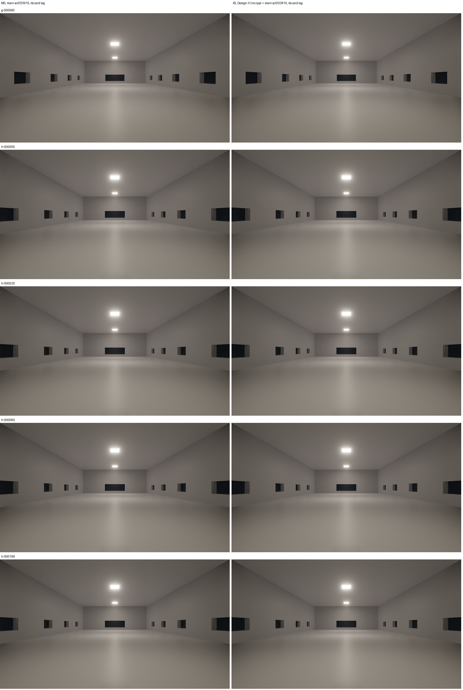
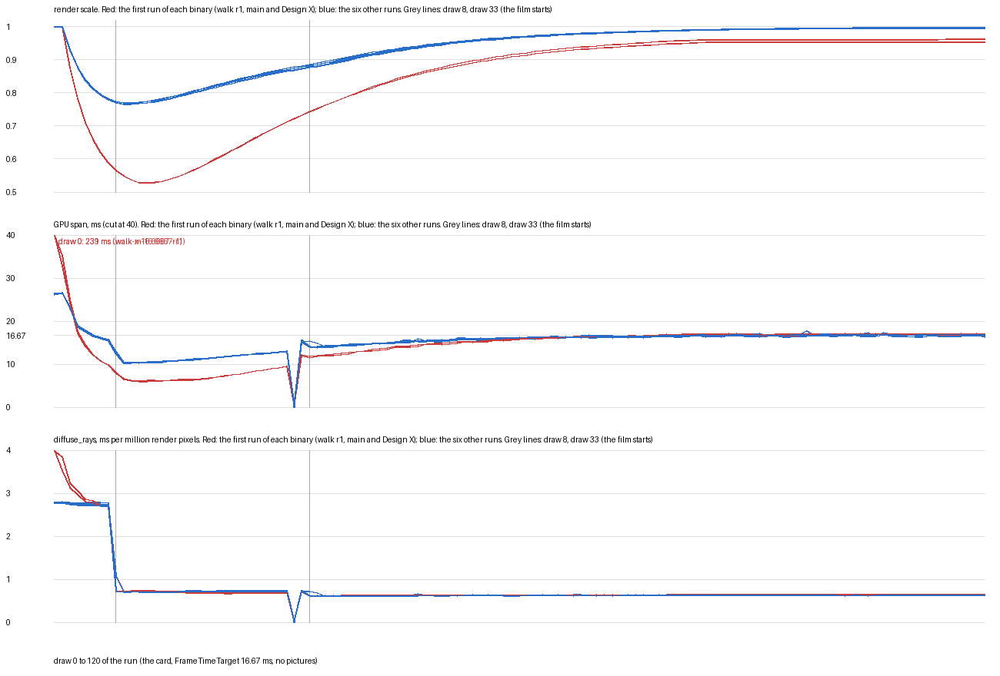

# The walk and the lamp switch under the dynamic render scale, on main with the wobble's first step (t0-3vwx)

The user's order of 2026-11-22: videos of the walk and the lamp switch "under normal engine conditions — that is, dynamic render scaling". Step 1 of the wobble's fix (`ter-qt72`: the camera's aspect comes from the output size) is on main at `ac5f23915`. This record takes the two films on the fixed code (take A), and measures whether the fix helped Design X under a moving render size (take B). It changes no engine code. The scratch patches stay in this folder.

## The sides

| Name | Code | In this record |
|---|---|---|
| M5 | main `ac5f23915`: the back-face layer, the walk's fix and step 1 of the wobble's fix | take A, left side; the control of take B |
| X5 | the line's merge `710834cc0`: Design X (`260ead7eb`) merged with main `ac5f23915`, tree `e232080f`. Design X here has no cap on the cost block after a light change (`t0-zmjx` adds it later) | take A, right side; take B, "after" |
| X3 | the combined check's merge `bcca31e95` (Design X with main `a819b10b2`), before the wobble's fix | take B, "before" |
| M3 | main `a819b10b2`, before the wobble's fix | take B's control, the switch only |

The cloud jobs ran X5 as the commit `4851ba7db`, which `git commit-tree` made from the same tree `e232080f` before the line's merge commit existed (parents `bcca31e95` and `ac5f23915`). X5's changed lines in `src` and `tests` against `bcca31e95` equal main's changed lines from `a819b10b2` to `ac5f23915`, line for line.

Each build is the side's tree with its own survey probe patch, then `scratch-region-log.patch` (X only), `scratch-dynamic-scale.patch` and `scratch-history-log.patch` (`tools/builds.sh`: `x5h`, `m5h`, `x3h`, `m3h`).

## How the pictures were taken

The render scale controller sets the render size of each draw from the measured frame time. A run that writes pictures stalls its frames, so the controller would fall to its floor. So:

1. A run without pictures on the card (RTX 2000 Ada, the cloud queue) logs the controller's own scale per draw, at the game's default target of 16.67 ms, at 1920 × 1080 (`tools/cloud.sh sizes`, the acceptance lead's `cloud.sh` and `cloudvideo.sh` of `726bf338c`, copied with the trees, the folder and the agent name changed). The logs are in `sizes/`.
2. A picture run on the Mac plays each draw's scale back from that log (`tools/queue-a.sh`, through `tools/macdyn.sh`, the acceptance lead's `macdyn.sh` copied with the builds' folder changed). A played-back run gives the card's picture on the Mac. After each run, the script checks that the played-back sizes equal the card's log on every draw.
3. The exposure is fixed at 4.08 stops, with the default ACES curve and bloom. The switch is the survey's fair switch: the switched lamps' glow goes off with their light.

The card's logs, per window of the run (draws 0 to 59 are the start, draws 60 to 172 the stand before the film, and from draw 173 the film's window):

| Log | Draws 0 to 59 | Draws 60 to 172 | Draws 173 to the end |
|---|---|---|---|
| Walk, M5 | 0.521 to 1.000, 56 changes | 0.935 to 1.000, 21 changes | 1.000, 0 changes |
| Walk, X5 | 0.516 to 1.000, 57 changes | 0.902 to 0.948, 13 changes | 0.948, 0 changes |
| Switch, M5 | 0.770 to 1.000, 50 changes | 0.969 to 1.000, 11 changes | 0.954 to 1.000, 39 changes |
| Switch, X5 | 0.766 to 1.000, 54 changes | 0.967 to 0.989, 7 changes | 0.832 to 0.989, 97 changes |

The job's replay check played X5's walk log back on the card and got the logged size on every draw.

## Take A: the lamp switch, M5 left and X5 right

[`pics/switch-M5-X5.mp4`](pics/switch-M5-X5.mp4), `/Users/alexispurslane/.t3/worktrees/tertius/t3-52bfcd29-81249085ce80dd9f/docs/research/t0-3vwx-dynamic-scale-films/pics/switch-M5-X5.mp4`: 3840 × 1080 (1920 × 1080 per side), the switch film's frames 140 to 459 (20 draws before the lamps go off, 200 off, 100 on again), one draw per video frame at 60 frames a second, H.264 `yuv420p`, CRF 12, 11.1 MB. The acceptance lead's `sidevideo.py` of `726bf338c` made it, run by its path. Each side shows its label, and the render scale and size of each draw, in orange on a draw whose size changed. The corner counts the draws since the switch. In the video's 320 draws, M5's scale runs from 0.954 to 1.000 with 39 size changes, and X5's from 0.832 to 0.989 with 97. The played-back sizes of both runs equal the card's logs on every draw.

`pics/switch-frames-M5-X5.png`: film frames 150 (10 draws before off), 220 and 355 (60 and 195 draws after off), 380 and 455 (20 and 95 draws after on), M5 left and X5 right.

What the pictures show: both sides look alike and clean at every moment. No blotch, daub or bright jamb shows on either side. Both sides show the same small faults at the near left window's sill 60 and 195 draws after off: a few bright dots along the sill's lower edge, and a soft glow on the inner jamb, a little stronger on X5.

**The motion measured in the source frames and in the video:**

- The video decoded back against its source frames: the center region's change against the last frame agrees within 0.3 % on both sides, at draws 0 and 60 after off and draw 20 after on.
- The two window edges (`wobble.py` of the combined check, the same rows and edges as its wobble take): M5's edge distance ranges 1.69 px of 1920 (rms 0.265 px), and X5's 2.16 px (rms 0.312 px). The correlation with the rounded aspect (h / w) · 16/9 is +0.048 and −0.010, so the stretch that followed the aspect before the fix is gone on both. The noise floor between two draws of one size is 0.062 px and 0.025 px. `pics/switch-edges-M5-X5.png` charts the distance per frame.
- The jamb crops (the size ramp's crops): grey on both sides in every frame. The largest mean is 0.0440 (M5) and 0.0436 (X5), and no frame is above 0.08.
- The level's kink at size changes (`levjump.py`), the boil (`boilnoise.py` of the acceptance record, by its path), the grain and the history lengths are in take B's table below. X5's video is also take B's "after" side.

Not checked: whether an eye finds the residual edge motion of about 0.3 px rms at normal speed; any edge other than the two tracked window edges; the faults' look at normal speed, beyond the five moments and the three check frames that the video tool decoded.

## Take A: the walk, M5 left and X5 right

[`pics/walk-M5-X5.mp4`](pics/walk-M5-X5.mp4), `/Users/alexispurslane/.t3/worktrees/tertius/t3-52bfcd29-81249085ce80dd9f/docs/research/t0-3vwx-dynamic-scale-films/pics/walk-M5-X5.mp4`: 3840 × 1080 (1920 × 1080 per side), the walk's last 60 draws and the 200 draws after the stop, 260 frames at 60 frames a second, one draw per frame, H.264 `yuv420p`, CRF 12, 6.1 MB, made by `sidevideo.py` as above. The corner counts the draws since the stop. The played-back sizes of both runs equal the card's logs on every draw. In the video's draws, neither scale moves: M5 stays at 1.000 (1920 × 1080) and X5 at 0.948, with no size change. So the wobble's fix has nothing to act on in the walk's window, on either code.

`pics/walk-frames-M5-X5.png`: the walk 30 draws before the stop, then 0, 20, 60 and 199 draws after it.

What the pictures show: both sides look alike and clean. The floor under the near lamp shows soft, low-contrast clouds on both sides. The walk's trail of light after the stop is the one motion that the video shows.

**The motion measured** (the video tool's check, the center region's light against the last frame, in the source frames and in the decoded video):

| Draws after the stop | M5 source / video | X5 source / video |
|---|---|---|
| 0 | +5.49 % / +5.57 % | +5.87 % / +5.91 % |
| 20 | +3.74 % / +3.90 % | +4.61 % / +4.73 % |
| 40 | +2.50 % / +2.61 % | +3.58 % / +3.68 % |

The video agrees with its source within 0.31 % in every checked region. X5's center fades back more slowly than M5's: 1.1 points more light at 40 draws after the stop. The settle draws of the survey's measure are in take B. The grain (`measure5.py`, the rms of the luminance minus its 5 × 5 mean, in % of the crop's mean) is about equal on the two sides: the bottom third 0.48 % / 0.47 % and the middle third 2.47 % / 2.58 % in the 60 to 200 draws after the stop (M5 / X5).

Not checked: the walk's trail at normal speed by eye, beyond the three checked moments; the edges, because the camera moves until the stop.

## The scale's fall at the start of a run (answers to the line orchestrator)

`pics/start-scale-span.png`: draws 0 to 120 of each run of the card's time job (two runs per scene and code, no pictures). Top: the render scale. Middle: the GPU span. Bottom: the diffuse ray pass in ms per million render pixels.

- The old and new size logs are comparable. Both jobs ran on the same endpoint and image, and the queue allows only the RTX 2000 Ada. Both used the same scripts, the same controller FrameTimeTarget(16.67, 0.5, 1) and the same order of runs. Both logged the controller's own scale from draw 0.
- On every run, draws 0 and 1 at 1920 × 1080 cost about 26.4 ms of GPU span. 23 to 24.5 ms of it is at the render size: `diffuse_rays` 5.8 ms, `filter_indirect_diffuse` 5.3 ms, `reflection_rays` 4.8 ms. `diffuse_rays` costs about 2.7 ms per million render pixels on draws 0 to 7, and 0.72 from draw 9. Young histories trace a ray at every pixel for the first 8 draws (`ter-4iic`). The controller answers with a fall to 0.771 at draw 9, and the scale climbs back to 0.99 by draw 100. Main and Design X behave the same. Ticket `t58-np60`.
- On the first run of each binary on a worker, draw 0 costs 230 to 239 ms of GPU span, and the scale falls to 0.528. Both jobs ran the walk first for each binary, so every walk log falls to about 0.52 in its first 60 draws, and every switch log only to 0.77. Ticket `t58-phgr`. The likely cause is the driver's shader cache per binary, which is not shown.
- A size change does not make the next draws dearer. In the switch film's window, draws 1 to 3 after a change differ from draws of a size unchanged for 6 draws or more, at the same render size, by −0.036 to +0.042 ms of GPU span. The sign changes between runs.

The numbers: `start.txt`. The logs: `times/` (each run's size, time and gzipped per-pass log). The tools: `tools/timeslog.py` and `tools/startchart.py`. The per-pass line is `scratch-pass-log.patch`, 4 lines inside the time log's loop.

## The cloud spend

| Job | What | Execution | Counted |
|---|---|---|---|
| `f434f616` | the size logs: walk and switch, M5 and X5, 16.67 ms, and the replay check | 241 s | $0.0498 |
| `89e20008` | the time and per-pass logs: two runs per scene and code | 335 s | $0.0649 |
| | this take so far | | $0.1147 |

## Files

- `sizes/`: the card's size logs of the pictures.
- `times/`: the card's time and per-pass logs.
- `switch-A.txt` and `walk-A.txt`: the outputs of the video tool and of the measures of take A's two films.
- `start.txt`: the start's measures.
- `scratch-*.patch`: the scratch patches. `scratch-dynamic-scale.patch` and `scratch-region-log.patch` are the acceptance record's of `726bf338c`, unchanged. `scratch-history-log.patch` (31 lines) logs the slow diffuse history's length per draw. `scratch-pass-log.patch` logs each pass's GPU time.
- `tools/` (each script says what it does in its first lines): `cloud.sh`, `cloudvideo.sh`, `cloudvideo.py` and `macdyn.sh` (copies of the acceptance record's `726bf338c`, with their changes named in their heads); `builds.sh`, `queue-a.sh`, `measure5.py`, `framesheet.py`, `timeslog.py`, `startchart.py`.
- Tools of other records that this record runs by their paths: `sidevideo.py`, `boilnoise.py` and `dynscale.py` of the acceptance record (`726bf338c`); `wobble.py` and `levjump.py` of the combined check (`docs/research/t0-gbgj-combined-check/tools`).
