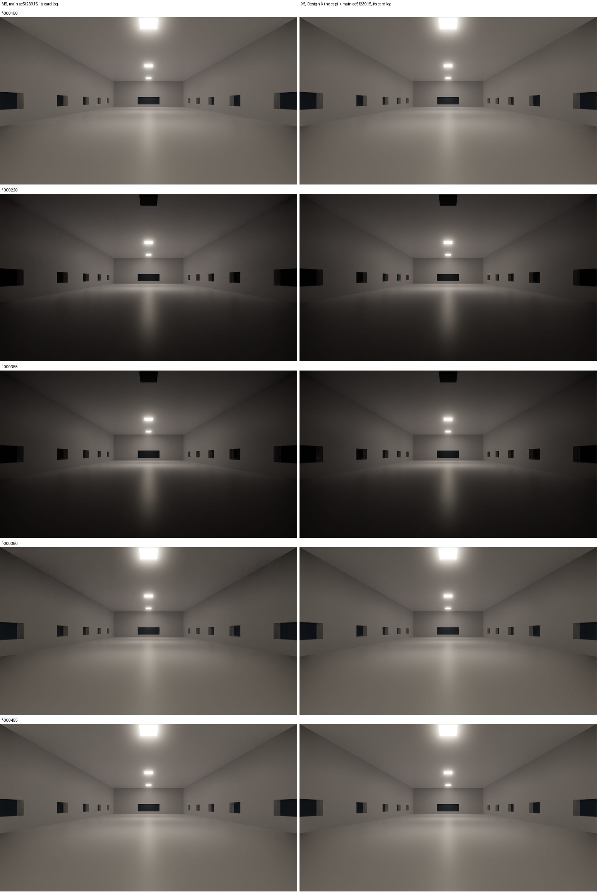

# The walk and the lamp switch under the dynamic render scale, on main with the wobble's first step (t0-3vwx)

The user's order of 2026-11-22: videos of the walk and the lamp switch "under normal engine conditions — that is, dynamic render scaling". Step 1 of the wobble's fix (`ter-qt72`: the camera's aspect comes from the output size) is on main at `ac5f23915`. This record takes the two films on the fixed code (take A), and measures whether the fix helped Design X under a moving render size (take B). It changes no engine code. The scratch patches stay in this folder.

## The sides

| Name | Code | In this record |
|---|---|---|
| M5 | main `ac5f23915`: the back-face layer, the walk's fix and step 1 of the wobble's fix | take A, left side; the control of take B |
| X5 | the line's merge `710834cc0`: Design X (`260ead7eb`) merged with main `ac5f23915`, tree `e232080f`. Design X here is without the cap: light evidence restarts a history at 4 draws, under `FullRateFrames`, so the plan traces catch-up rays after a light change. The cap waits for the user's choice of variant | take A, right side; take B, "after" |
| X3 | the combined check's merge `bcca31e95` (Design X with main `a819b10b2`), before the wobble's fix | take B, "before" |
| M3 | main `a819b10b2`, before the wobble's fix | take B's control, the switch only |

The cloud jobs ran X5 as the commit `4851ba7db`, which `git commit-tree` made from the same tree `e232080f` before the line's merge commit existed (parents `bcca31e95` and `ac5f23915`). X5's changed lines in `src` and `tests` against `bcca31e95` equal main's changed lines from `a819b10b2` to `ac5f23915`, line for line.

Each build is the side's tree with its own survey probe patch, then `scratch-region-log.patch` (X only), `scratch-dynamic-scale.patch` and `scratch-history-log.patch` (`tools/builds.sh`: `x5h`, `m5h`, `x3h`, `m3h`).

## How the pictures were taken

The render scale controller sets the render size of each draw from the measured frame time. A run that writes pictures stalls its frames, so the controller would fall to its floor. So:

1. A run without pictures on the card (RTX 2000 Ada, the cloud queue) logs the controller's own scale per draw, at the game's default target of 16.67 ms, at 1920 × 1080 (`tools/cloud.sh sizes`, the acceptance lead's `cloud.sh` and `cloudvideo.sh` of `726bf338c`, copied with the trees, the folder and the agent name changed). The logs are in `sizes/`.
2. A picture run on the Mac plays each draw's scale back from that log (`tools/queue-a.sh`, through `tools/macdyn.sh`, the acceptance lead's `macdyn.sh` copied with the builds' folder changed). A played-back run gives the card's picture on the Mac. After each run, the script checks that the played-back sizes equal the card's log on every draw.
3. The exposure is fixed at 4.08 stops, with the default ACES curve and bloom. The switch is the survey's fair switch: the switched lamps' glow goes off with their light.

The card's logs, per window of the run (draws 0 to 59 are the start, draws 60 to 172 the stand before the film, and from draw 173 the film's window):

| Log | Draws 0 to 59 | Draws 60 to 172 | Draws 173 to the end |
|---|---|---|---|
| Walk, M5 | 0.521 to 1.000, 56 changes | 0.935 to 1.000, 21 changes | 1.000, 0 changes |
| Walk, X5 | 0.516 to 1.000, 57 changes | 0.902 to 0.948, 13 changes | 0.948, 0 changes |
| Switch, M5 | 0.770 to 1.000, 50 changes | 0.969 to 1.000, 11 changes | 0.954 to 1.000, 39 changes |
| Switch, X5 | 0.766 to 1.000, 54 changes | 0.967 to 0.989, 7 changes | 0.832 to 0.989, 97 changes |

The job's replay check played X5's walk log back on the card and got the logged size on every draw.

## Take A: the lamp switch, M5 left and X5 right

[`pics/switch-M5-X5.mp4`](pics/switch-M5-X5.mp4), `/Users/alexispurslane/.t3/worktrees/tertius/t3-52bfcd29-81249085ce80dd9f/docs/research/t0-3vwx-dynamic-scale-films/pics/switch-M5-X5.mp4`: 3840 × 1080 (1920 × 1080 per side), the switch film's frames 140 to 459 (20 draws before the lamps go off, 200 off, 100 on again), one draw per video frame at 60 frames a second, H.264 `yuv420p`, CRF 12, 11.1 MB. The acceptance lead's `sidevideo.py` of `726bf338c` made it, run by its path. Each side shows its label, and the render scale and size of each draw, in orange on a draw whose size changed. The corner counts the draws since the switch. In the video's 320 draws, M5's scale runs from 0.954 to 1.000 with 39 size changes, and X5's from 0.832 to 0.989 with 97. The played-back sizes of both runs equal the card's logs on every draw.

`pics/switch-frames-M5-X5.png`: film frames 150 (10 draws before off), 220 and 355 (60 and 195 draws after off), 380 and 455 (20 and 95 draws after on), M5 left and X5 right.

What the pictures show: both sides look alike and clean at every moment. No blotch, daub or bright jamb shows on either side. Both sides show the same small faults at the near left window's sill 60 and 195 draws after off: a few bright dots along the sill's lower edge, and a soft glow on the inner jamb, a little stronger on X5.

**The motion measured in the source frames and in the video:**

- The video decoded back against its source frames: the center region's change against the last frame agrees within 0.3 % on both sides, at draws 0 and 60 after off and draw 20 after on.
- The two window edges (`wobble.py` of the combined check, the same rows and edges as its wobble take): M5's edge distance ranges 1.69 px of 1920 (rms 0.265 px), and X5's 2.16 px (rms 0.312 px). The correlation with the rounded aspect (h / w) · 16/9 is +0.048 and −0.010, so the stretch that followed the aspect before the fix is gone on both. The noise floor between two draws of one size is 0.062 px and 0.025 px. `pics/switch-edges-M5-X5.png` charts the distance per frame.
- The jamb crops (the size ramp's crops): grey on both sides in every frame. The largest mean is 0.0440 (M5) and 0.0436 (X5), and no frame is above 0.08.
- The level's kink at size changes (`levjump.py`), the boil (`boilnoise.py` of the acceptance record, by its path), the grain and the history lengths are in take B's table below. X5's video is also take B's "after" side.

Not checked: whether an eye finds the residual edge motion of about 0.3 px rms at normal speed; any edge other than the two tracked window edges; the faults' look at normal speed, beyond the five moments and the three check frames that the video tool decoded.

## Take A: the walk, M5 left and X5 right

[`pics/walk-M5-X5.mp4`](pics/walk-M5-X5.mp4), `/Users/alexispurslane/.t3/worktrees/tertius/t3-52bfcd29-81249085ce80dd9f/docs/research/t0-3vwx-dynamic-scale-films/pics/walk-M5-X5.mp4`: 3840 × 1080 (1920 × 1080 per side), the walk's last 60 draws and the 200 draws after the stop, 260 frames at 60 frames a second, one draw per frame, H.264 `yuv420p`, CRF 12, 6.1 MB, made by `sidevideo.py` as above. The corner counts the draws since the stop. The played-back sizes of both runs equal the card's logs on every draw. In the video's draws, neither scale moves: M5 stays at 1.000 (1920 × 1080) and X5 at 0.948, with no size change. So the wobble's fix has nothing to act on in the walk's window, on either code.

`pics/walk-frames-M5-X5.png`: the walk 30 draws before the stop, then 0, 20, 60 and 199 draws after it.

What the pictures show: both sides look alike and clean. The floor under the near lamp shows soft, low-contrast clouds on both sides. The walk's trail of light after the stop is the one motion that the video shows.

**The motion measured** (the video tool's check, the center region's light against the last frame, in the source frames and in the decoded video):

| Draws after the stop | M5 source / video | X5 source / video |
|---|---|---|
| 0 | +5.49 % / +5.57 % | +5.87 % / +5.91 % |
| 20 | +3.74 % / +3.90 % | +4.61 % / +4.73 % |
| 40 | +2.50 % / +2.61 % | +3.58 % / +3.68 % |

The video agrees with its source within 0.31 % in every checked region. X5's center fades back more slowly than M5's: 1.1 points more light at 40 draws after the stop. The settle draws of the survey's measure are in take B. The grain (`measure5.py`, the rms of the luminance minus its 5 × 5 mean, in % of the crop's mean) is about equal on the two sides: the bottom third 0.48 % / 0.47 % and the middle third 2.47 % / 2.58 % in the 60 to 200 draws after the stop (M5 / X5).

Not checked: the walk's trail at normal speed by eye, beyond the three checked moments; the edges, because the camera moves until the stop.

## Take B: did the wobble's fix help Design X under a moving render size?

Take B plays one card size log, X5's switch log at 16.67 ms, on X3 (Design X before the fix) and on X5 (after it). The only code change from X3 to X5 is the fix, the commits `0495319e3` and `f54129fcc` of `ter-qt72`. M3 and M5 play M5's log as the control. A third run on X5, `l-X5`, plays X5's log with the lamps on through the whole run, to separate the size change from the light's change. Each run's played-back sizes equal its card log on every draw. The walk on X3 is left out: the walk's scale stands still in the film's window (take A), so the fix cannot act there.

The terms of take A apply. A changed draw has a render size that differs from the draw before. The levels and the boil are in % of the crop's light, and the edges are in px of the 1920 × 1080 output. A settle is the survey's count of draws until a region's light stays within its tolerance of the run's own controls, which take the same played-back sizes. "None" means that the region does not settle inside the window (200 draws after off, 100 after on). The numbers are in `takeB.txt`, from `tools/takeB.sh`.

| Measure | X3, before the fix | X5, after the fix | M3 (control) | M5 (control) |
|---|---|---|---|---|
| Edge distance: range, and correlation with the rounded aspect (h / w) · 16/9 | 13.44 px, +0.994 | 2.16 px, −0.010 | 13.45 px, +0.997 | 1.69 px, +0.048 |
| Distance residual step, mean abs, changed / one size | 0.241 / 0.034 | 0.057 / 0.014 | 0.201 / 0.021 | 0.041 / 0.025 |
| Midpoint residual, rms, changed / one size | 0.243 / 0.171 | 0.119 / 0.045 | 0.280 / 0.113 | 0.185 / 0.071 |
| Left wall's kink, 60 to 200 draws after off, mean on changed / one-size draws | 0.59 / 0.02 | 0.02 / 0.01 | 0.60 / 0.02 | 0.05 / 0.02 |
| Left wall's boil, 60 to 200 draws after off, one size / changed | 0.04 / 0.60 | 0.05 / 0.08 | 0.05 / 0.60 | 0.05 / 0.08 |
| Wall grain, 60 to 200 draws after off, one size / changed | 1.20 / 6.15 | 1.01 / 0.97 | 6.68 / 5.29 | 1.06 / 1.07 |
| Right jamb's mean, 0 to 100 draws after on, one size / changed | 0.0604 / 0.0430 | 0.0376 / 0.0343 | 0.0399 / 0.0337 | 0.0366 / 0.0272 |
| Share of history under 8 draws, 0 to 60 draws after off, one size / changed | 0.136 / 0.228 | 0.123 / 0.196 | 0.054 / 0.055 | 0.051 / 0.051 |
| Region test: tested anchor-draws, 100 draws after off / after on | 11.7 % / 12.1 % | 11.7 % / 12.1 % | | |
| Settle, whole image, after off / after on | 125 / 36 | 141 / 45 | 119 / 54 | 121 / 54 |
| Settle, slowest region, after off / after on | 158 / 87 | 166 / None | 142 / 93 | 143 / 94 |

- The settle of X5 is not noise. A second run of the survey on X5 (`sw-X5r`) gave the same series bit for bit.
- X3 and X5 draw the same render sizes, and so do M3 and M5. The X sides and the M sides draw different sizes: each plays its own code's card log.

**The plain answer.** The fix helped Design X's picture under a moving size and slowed its settle.

- The picture: the stretch that followed the aspect is gone (range 13.44 to 2.16 px). The edges' steps on changed draws fell by a factor of 4. The left wall's kink and boil on changed draws fell to the one-size level (0.59 to 0.02, and 0.60 to 0.08). The jambs' leak after on is gone (0.0604 to 0.0376), and so is the wall's grain on changed draws (6.15 to 0.97). Main gained the same from the fix.
- The settle: after the fix, Design X settles 16 draws later after off and 9 draws later after on in the whole image. After on, three corner and edge regions no longer settle in 100 draws (`r00`, `r02`, `r12`; before the fix 87, 87 and 76). Main's settle did not change (119 / 54 to 121 / 54).
- My reading, not measured: before the fix, each size change stretched the picture, so every pixel's point moved on screen by more than `LeastMotion`, 1/32 px. That gave Design X's blocks motion evidence on each changed draw, and motion evidence drops the box's widening, so the history follows the light sooner. The size changes cluster in the draws after a switch, so this sped up the settle and also brought the boil on changed draws. The fix removes both. Main has no evidence of this kind, so its settle did not change. A log of the evidence level per block would test this reading.
- Under its own controller, Design X now settles slower than main after off (141 against 121 draws, whole image) and faster after on (45 against 54). In the survey's fixed 2/3, X2 settled faster than M2 after both (66 / 30 against 122 / 53, `t0-gbgj` take 2c). The region test, Design X's detector of slow changes in the bounce light, runs on only about 12 % of the anchor-draws in the 100 draws after each switch. It needs 36 draws in a row at one render size, and the size changes restart its count (`t4f-71qp`).

**The cause test: size change or light change?** `l-X5` draws the same sizes as `s-X5` with the lamps held on (`wobsplit.py`, the residual around the film's mean, px of 1920):

| Measure | X5 with the switch, changed / one size | X5 with the lamps held on, changed / one size |
|---|---|---|
| Distance residual, rms | 0.465 / 0.213 | 0.096 / 0.139 |
| Midpoint residual, rms | 0.119 / 0.045 | 0.060 / 0.028 |
| Distance residual step, mean abs | 0.057 / 0.014 | 0.013 / 0.007 |
| Distance residual's correlation with the render scale | +0.610 | −0.025 |
| Distance range | 2.16 px | 0.56 px |
| Left wall's boil, 60 to 200 draws after off, one size / changed | 0.05 / 0.08 | 0.02 / 0.02 |

With the light held still, the residual on changed draws falls below the one-size level. So the residual on changed draws belonged to the light's change, not to the size change. The residual only followed the size because the controller lowers the scale while the light changes: Design X's frames cost more after a light change. The sentence for the back-face line: "With the wobble's fix, the window edges' remaining residual on changed draws follows the change of the light, not the change of the render size: on X5's own size log with the lamps held on, it falls from 0.465 to 0.096 px rms (below the one-size draws' 0.139), and its correlation with the render scale from +0.61 to −0.03."

**The edges and the sun.** The two tracked edges lie between the lamp-lit wall and a dark window opening. In `l-X5`, the opening's side of each edge (a box 16 px wide on rows 525 to 554) stays at a display-linear 0.0077, within 0.8 % over the 320 frames, and the wall's side changes by about 3 %. So no sunlight reaches the tracked edges in this view. In the edge ramp of `t0-gbgj`, the size and the sun's place together moved the distance by only 0.159 px rms, which bounds what a moving sun did to these edges there.

**The walk.** The walk's scale stands still in the film's window on both sides, so the fix has nothing to act on there, and X3's walk was not taken. X5's logs of take A's walk (`tools/walklogs.py`):

| Span | History mean, M5 / X5 (draws) | History under 8 draws, M5 / X5 | X5's region test: tested anchor-draws, fires |
|---|---|---|---|
| The walk's last 60 draws | 29.31 / 29.34 | 0.0228 / 0.0227 | 0.0 %, none |
| Draws 0 to 59 after the stop | 29.35 / 29.51 | 0.0289 / 0.0202 | 34.7 %, 1.7 % of tested |
| Draws 60 to 199 after the stop | 29.61 / 26.99 | 0.0274 / 0.0198 | 90.4 %, 1.0 % of tested |

The region test does not run while the camera moves, because its taps need surfaces that do not move on screen. It starts again about 36 draws after the stop. The center region's light after the stop, +5.87 / +4.61 / +3.58 % at 0, 20 and 40 draws (take A), matches the earlier walk film of Design X that the line orchestrator quoted, +5.72 / +4.56 / +3.56 %. The survey's walk "cabin-walk" under the played-back scale, each side on its own card log (`wk-M5`, `wk-X5`): the whole image settles at once after the stop on both. The slowest region settles 48 draws after the stop on X5 against 25 on M5. The slow regions are the upper corners `r00` and `r02` (47 and 48 draws against 23 and 25) and the middle row's sides `r10` and `r12` (36 against 15 and 16). The survey passes both. So Design X's trail after the stop lasts about twice as long as main's in these regions, as take A's center region showed (1.1 points more light 40 draws after the stop).

What take B does not cover: the eye's view of the remaining edge motion at normal speed; edges other than the two tracked window edges; a log of Design X's evidence level per block, which would test the reading on the settle; the walk on X3.

## The scale's fall at the start of a run (answers to the line orchestrator)

`pics/start-scale-span.png`: draws 0 to 120 of each run of the card's time job (two runs per scene and code, no pictures). Top: the render scale. Middle: the GPU span. Bottom: the diffuse ray pass in ms per million render pixels.

- The old and new size logs are comparable. Both jobs ran on the same endpoint and image, and the queue allows only the RTX 2000 Ada. Both used the same scripts, the same controller FrameTimeTarget(16.67, 0.5, 1) and the same order of runs. Both logged the controller's own scale from draw 0.
- On every run, draws 0 and 1 at 1920 × 1080 cost about 26.4 ms of GPU span. 23 to 24.5 ms of it is at the render size: `diffuse_rays` 5.8 ms, `filter_indirect_diffuse` 5.3 ms, `reflection_rays` 4.8 ms. `diffuse_rays` costs about 2.7 ms per million render pixels on draws 0 to 7, and 0.72 from draw 9. Young histories trace a ray at every pixel for the first 8 draws (`ter-4iic`). The controller answers with a fall to 0.771 at draw 9, and the scale climbs back to 0.99 by draw 100. Main and Design X behave the same. Ticket `t58-np60`.
- On the first run of each binary on a worker, draw 0 costs 230 to 239 ms of GPU span, and the scale falls to 0.528. Both jobs ran the walk first for each binary, so every walk log falls to about 0.52 in its first 60 draws, and every switch log only to 0.77. Ticket `t58-phgr`. The likely cause is the driver's shader cache per binary, which is not shown.
- A size change does not make the next draws dearer. In the switch film's window, draws 1 to 3 after a change differ from draws of a size unchanged for 6 draws or more, at the same render size, by −0.036 to +0.042 ms of GPU span. The sign changes between runs.

The numbers: `start.txt`. The logs: `times/` (each run's size, time and gzipped per-pass log). The tools: `tools/timeslog.py` and `tools/startchart.py`. The per-pass line is `scratch-pass-log.patch`, 4 lines inside the time log's loop.

## The final films: Design X with the cap (`05a27262d`) against main

The merge gate's take, on the final code: Design X `05a27262d` (the acceptance lead's commit: light evidence takes region evidence's branch, `min(antiLagged, FullRateFrames)`, the cap of `t0-zmjx`) against main `454574bf8`, whose `src` equals `ac5f23915`. The builds, the outputs and the video labels name main by `ac5f23915`, the commit that was built. Each side plays back its own card scale log at 16.67 ms (one new card job for both films). `tools/final.sh switch` and `tools/final.sh walk`; the outputs are `final-switch.txt` and `final-walk.txt`, the card's logs `sizes-final/`.

`git apply --check` on `05a27262d`: the survey's probe patch fails in `sample_age.glsl`, where the commit changed a comment line inside the hunk's context. `probe-05a27262d.patch` is the original with that context fitted, and `builds.sh` and `cloudvideo.sh` take it for that commit. The record's scratch patches apply unchanged, on both sides.

### Terms of this section

- The card: the cloud queue's RTX 2000 Ada at 1920 × 1080, with the dynamic render scale aiming at 16.67 ms. A card scale log lists the render scale of every draw, and the Mac plays it back.
- `FullRateFrames`: 8 draws. While a pixel's history is shorter, the ray plan gives it a ray of its own in every draw (a catch-up ray), which costs GPU time. A cut of the history length below 8 draws therefore raises the frame's cost, and the controller answers with a lower render scale.
- Light evidence: a block's evidence that the light at its samples changed. It restarts the block's histories. Without the cap it restarts them at 4 draws; with the cap it restarts them at `min(antiLagged, FullRateFrames)`, that is at most 8 draws, as region evidence does. So with the cap a light change makes no catch-up rays.
- Region evidence: the evidence of the region's drift test, which compares a region's light with its recent past at anchor pixels. A fire caps the region's histories at 8 draws.
- `antiLagged`: the history length after the anti-lag's own cut.
- An anchor-draw: one anchor of the region test in one draw.
- The boil without the fade: per 16 × 16 block, the mean of |b[k] − (b[k − 1] + b[k + 1]) / 2| as a share of the crop's light, so that a steady fade does not count (`boilnoise.py` of the acceptance record).
- Regions `r00` to `r22`: the survey's 3 × 3 grid, row 0 at the top. The slowest region is the one that settles last.

### The switch

Video: `pics/switch-final.mp4`, main left and Design X right, 320 draws (20 before off, on at draw 220).

The line orchestrator's prediction: with the cap, the card's scale log has no size change after a switch, so Design X settles as at a fixed scale and faster than main after off and after on. **The numbers confirm it.**

- The card's scale: Design X holds 0.993 from draw 92 to the end, with 0 size changes. Main changes size 38 times in the film's 320 draws (17 in the 60 draws after off, 17 in the 60 after on, 19 in the 100 after on).
- The survey's settle under the card's sizes:

| Settle draws, after off / after on | Whole image | Slowest region |
|---|---|---|
| Main `ac5f23915` | 121 / 54 | 143 / 94 |
| Design X `05a27262d` | 73 / 33 | 86 / 53 |
| Take B's X5 | 141 / 45 | 166 / not in 100 |
| X2 at a fixed 2/3 (`t0-gbgj` take 2c, older code) | 66 / 30 | not measured |

| Measure, from the frames | Design X | Main, draws of one size | Main, changed draws |
|---|---|---|---|
| Boil without the fade, 60 draws after off, % (floor / wall / ceiling) | 0.21 / 0.22 / 0.21 | 0.18 / 0.17 / 0.21 | 0.23 / 0.22 / 0.23 |
| Boil without the fade, 100 draws after on, % | 0.05 / 0.15 / 0.11 | 0.04 / 0.13 / 0.10 | 0.06 / 0.22 / 0.18 |
| Jamb means, 60 draws after off (right / left) | 0.0103 / 0.0100 | 0.0096 / 0.0094 | 0.0104 / 0.0096 |
| Floor grain, 60 draws after off, % | 3.00 | 2.90 | 3.13 |
| Slow diffuse history mean, 60 draws after off | 8.9 draws | 26.4 draws | 25.6 draws |
| Edge distance rms around its mean | 0.085 px (noise floor 0.045) | 0.267 px over all draws (noise floor 0.057) | |

- The region test now runs on 99 % of the anchor-draws in the 200 draws after off and the 100 after on (take B: about 12 %). It fires on 56 % of them in the 100 draws after off and on 53 % after on.
- Design X boils a little more than main's draws of one size after off, and about as much as main's changed draws.

### The walk

Video: `pics/walk-final.mp4`, main left and Design X right, 260 draws (the last 60 of the walk and 200 after the stop).

- Neither side changes size in the video's draws (main 0.956, Design X 0.949). Design X's walk draws at 1816 × 1024 render pixels in both jobs (scale 0.94841 in take A, 0.94876 here), so its two takes are at the same render size.
- The center region's light after the stop, against the last frame, at 0, 20 and 40 draws: Design X +5.87 / +4.61 / +3.58 %, the same as take A's X5 to the last digit. Main +5.34 / +3.73 / +2.49 %.
- The survey's settle after the stop, slowest region: Design X 47 draws (take A's X5: 48), main 25. The slow regions are again the upper corners and the middle row's sides (`r00` and `r02` 47, `r10` 35, `r12` 36).
- So the cap changed neither the trail nor the settle after the stop. A walk has no light change, so light evidence does not act there. My reading, not measured: the trail is the region test's slow start after the stop (34.7 % of the anchor-draws tested in the first 60 draws after it).
- No flicker measure of the walk exists in this record's tools.

### The run order of the card's size jobs

Neither size job had a warm-up run. Take A's job `f434f616` and the final's job `d3eebea0` ran in the same order: main's build, Design X's build, then main's walk (the job's first run), Design X's walk, main's switch, Design X's switch and the replay check. So the first-run fact `t1-80jd` (the first run of a card job may draw 10 to 18 % slower) touches main's walk in both jobs, and the switch logs are the second runs of their binaries. The most common scale after draw 173 of each log:

| Log | Take A `f434f616` | Final `d3eebea0` |
|---|---|---|
| Main's walk (the job's first run) | 1.000 | 0.956 |
| Design X's walk | 0.948 | 0.949 |
| Main's switch | 0.993 | 0.999 |
| Design X's switch | 0.988 | 0.993 |

Main's walk was the first run in both jobs, so the run order alone does not explain why it rests at 0.956 in the final and at 1.000 in take A. A difference between the two workers can. Each settle and trail compares spans inside one run, under that run's own scale log, so those comparisons stand. Design X's zero size changes after the switch come from one card job (`d3eebea0`), and a second job could differ, as main's walk did (see "A second run of each side" below). The walk's comparison of the cap with take A crosses two jobs, but Design X draws at the same render size in both.

### What the final films do not cover

- The eye's view at normal speed.
- Edges other than the two tracked window edges.
- A second run of each side: the takes ran once.
- A flicker measure of the walk.
- `tools/final.sh` does not stop on a failed survey run in step 4 (t0-gbgj's `take.sh` exits 0), and it does not compare the survey run's played-back size log with the card's log. The Mac's picture runs are compared (`queue-a.sh`), the survey's runs are not. Step 4 also has no disk check.

## The cloud spend

| Job | What | Execution | Counted |
|---|---|---|---|
| `f434f616` | the size logs: walk and switch, M5 and X5, 16.67 ms, and the replay check | 241 s | $0.0498 |
| `89e20008` | the time and per-pass logs: two runs per scene and code | 335 s | $0.0649 |
| `d3eebea0` | the final films' size logs: walk and switch, main and Design X `05a27262d` | 235 s | $0.0488 |
| | this record so far | | $0.1635 |

Take B ran on the Mac only and used no cloud job.

## Files

- `sizes/`: the card's size logs of the pictures.
- `times/`: the card's time and per-pass logs.
- `switch-A.txt` and `walk-A.txt`: the outputs of the video tool and of the measures of take A's two films.
- `takeB.txt`: the output of `tools/takeB.sh`, every measure of take B.
- `start.txt`: the start's measures.
- `scratch-*.patch`: the scratch patches. `scratch-dynamic-scale.patch` and `scratch-region-log.patch` are the acceptance record's of `726bf338c`, unchanged. `scratch-history-log.patch` (31 lines) logs the slow diffuse history's length per draw. `scratch-pass-log.patch` logs each pass's GPU time.
- `tools/` (each script says what it does in its first lines): `cloud.sh`, `cloudvideo.sh`, `cloudvideo.py` and `macdyn.sh` (copies of the acceptance record's `726bf338c`, with their changes named in their heads); `builds.sh`, `queue-a.sh`, `queue-b.sh`, `measure5.py`, `walklogs.py`, `takeB.sh`, `framesheet.py`, `timeslog.py`, `startchart.py`.
- The final take (`tools/final.sh <switch|walk>`, with `XF` the Design X commit and `MF` the main commit): one command per film builds both codes, logs the card's sizes (one cloud job for both films, about $0.05), runs the played-back pictures and the survey's takes, writes the measures to `final-<film>.txt`, and makes the video `pics/<film>-final.mp4`. `cloud.sh` takes `M` and `C`, `builds.sh` the builds `xf` and `mf`, `queue-a.sh` the runs `s-XF`, `w-XF`, `s-MF` and `w-MF` from `SIZES`, and `macdyn.sh` the survey's tree `SURVEY_TREE`. `FROM=4` starts at the survey's takes, `FROM=5` at the measures. `GPU_JOB` names another checkout's `gpu_job.py`. `probe-<commit>.patch` is a probe patch fitted to that commit.
- Tools of other records that this record runs by their paths: `sidevideo.py`, `boilnoise.py` and `dynscale.py` of the acceptance record (`726bf338c`); `wobble.py`, `wobsplit.py`, `levjump.py`, `regions.py` (through `m.sh`) and `take.sh` of the combined check (`docs/research/t0-gbgj-combined-check/tools`).
