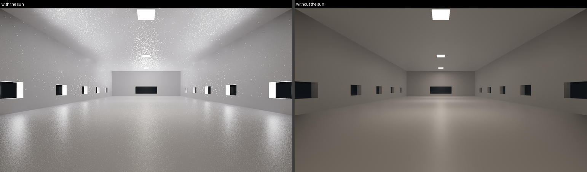
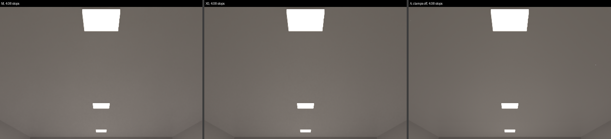
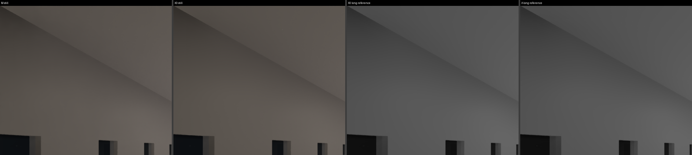
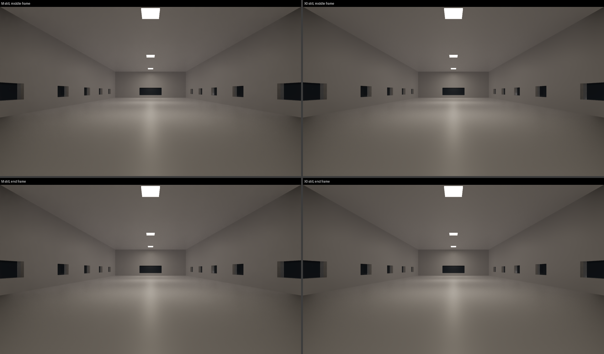

# The room after the sun's shadow fix, part A (t0-9fo0)

The other line's fix of the sun's shadow (`t8-rjno`) is on main since merge `dcd738552`. Before it, 99.2 % of the direct sunlight in the room of scene `orbit` with the camera `person` was a leak through the sun's shadow. This record takes that room again on main and on the line's head, with no evidence from the region. It answers questions 1 and 3 of ticket `t0-9fo0`. Question 2, the side X and take 4 (the bay film) wait for part B. This record changes nothing in `src`, `tests` or `tools`.

## The sides

- M is main at `d8559eb58`, which holds the shadow fix, with the survey's probe patch of main (`tools/renderer-survey/probe.patch`).
- X0 is the line's head `631cc61cc` (main merged as `93f8d3338`), with the line's survey probe patch. It has no evidence from the region, because the remedy (`t0-acxm`) is not merged yet.
- A is X0 with both history clamps off (`TERTIUS_A_NO_CLAMP=1`). It is the reference that explains a fault. It is not the bar.

Both builds come from `tools/renderer-survey.py probe-build`: M's in a scratch worktree of main under `/private/tmp/t0-9fo0`, X0's from this checkout's head. All takes ran through the line's survey script, with `--no-build`, so both sides use one measure.

## The terms

- A region is one cell of the 3 x 3 grid over the image. `r<row><column>` names it, from `r00` at the top left. `r11` is the center cell, which holds the cabin's far ceiling.
- A draw is one rendered frame of the engine. The jitter moves each draw's sample point inside the pixel. Today's jitter repeats a cycle of 18 offsets. A jitter phase is the place of a draw in that cycle.
- A still renders one world state for many draws. The survey shows draw 132 and keeps its long reference: the mean of the last 20 captures of the same run.
- Specks: the survey's count of bright single-pixel groups (ticket `ter-9371`'s rule) per 10,000 visible pixels, without the specks that the reference holds. One speck in this 1920 x 1080 view is 0.0048.
- Blotch: the survey's score. The survey divides the blurred still by its whole level and compares it with its own build's blurred long reference. The score is the 90th percentile of that relative difference over the visible pixels. The survey's limit is 0.04.
- Daub: `daub.py`'s score of errors between about 2 and 24 render pixels across, against A's long reference. "Broad" is the same score for errors wider than about 36 pixels.
- Level: the still's light against its own long reference over the whole image, minus 1.
- Light share: `light.py`'s mean light of the ceiling and of the walls in scene light, as a share of A's long reference. "Shown" reads the still at draw 132, and "settled" reads the build's own long reference.
- Settle: the draws after a lamp switch until a region stays within 5 % of its control run. A control run is the same scene with the lamps held in the new state. The goal is 60 draws.

## The answers in short

| Question | Measured |
|---|---|
| 1. Does X0 look good in this room beside M? | The still: yes. Both are clean at both exposures, with 1 or 2 specks in the whole image (M 0.0096, X0 0.0048 and 0.0096). Before the fix, the line's still had 5.96 specks. The switch: no flicker before the switch on either side. Both lag after each switch, smoothly, and neither settles within 60 draws. X0 lags longer than M in the corner regions. The stand film: yes. Both films are clean, with flicker far below the limit. |
| 3. Does a measured case of a real sub-pixel strip remain? | No step: r11's single-bounce plateau changes by +0.000 % from tick 300 to tick 306 on M (it fell 43 % before the fix). No large cycle: in M's lamps-on control, r11's darkest and brightest jitter phase lie −0.87 % and +0.54 % from the cycle's mean. Without jitter, r11 is 0.34 % below that mean (46 % before the fix). No young light-age records in the engine as built (X0: 0 with and without jitter). A scratch build has the area rule switched off. Under the jitter, 0.0027 % of its pixel-draws hold a young record (0.136 % before the fix). Without jitter, none do. The lamps cause 90 % of them, not the sun. |

My reading:

- The shadow fix removed the leak's three effects in this room: the specks, r11's step at tick 300 to 306, and r11's large jitter cycle. On these measures, X0 looks as good as M in the still and in the stand film.
- A small jitter effect remains in the light-age record: young records on the near windows' jambs and along their top edge, from the lamps' light. The area rule (`t0-6gej`) removes all of them, and no light measure shows them.
- The switch's lag is the one fault left in this room, and M has it too. It is a slow, smooth return to the control, not a flicker. In X0 it lasts longer in the corners. It is the measure that part B's remedy must not make worse.

## What the pictures show

### Before the fix

`../t0-ion0-region-drift/pics/rect-lamps-sun-nosun.png` (from `t0-ion0`, before the fix): the reference's still at 4.08 stops, with the sun (left) and without the sun (right). With the sun, the window jambs are bright white, and the ceiling, the upper walls and the floor carry a dense field of bright specks. Without the sun, the hall is lit by its lamps only and is clean.

### Take 1: the still rect-lamps

`pics/rect-lamps-whole.png`: the whole still at draw 132, automatic exposure, M (left) and X0 (right), at half size. Both look like the picture "without the sun" above: dim jambs, smooth walls, a smooth floor with the lamps' soft glow. Neither shows a speck, a blotch or a daub. X0's upper left wall looks a little darker than M's at a glance (check 2 below).

`pics/rect-lamps-whole-408.png`: the same at the fixed exposure of 4.08 stops. Both are clean. X0 is a little darker over the whole image than M. In scene light, it is about 4 points lower in the shown still and 2.5 points lower in the long mean (table 1).

`pics/rect-lamps-ceiling.png`: the ceiling at full resolution, output pixels 640 to 1280 by 0 to 420, automatic exposure: M, X0 and A. All three are smooth gray from the large lamp to the far lamps. None shows the cloud of specks around the far lamps that `t0-ion0` saw. A shows one faint single dot near its right edge. M is a little lighter below the middle lamp.

`pics/rect-lamps-ceiling-408.png`: the same crop at 4.08 stops. All three are smooth. A's faint dot shows again. By the bar, no crop shows a speck, a blotch or a daub.

#### Check 1: what X0's blotch score counts

`pics/rect-lamps-blotch-map.png`: the survey's signed blotch map of each still against its own build's long reference, at half size. The scale goes from −5 % (blue) through 0 (gray) to +5 % (red). The pixels that the score leaves out are black. X0's map is one broad, smooth split: the ceiling, the upper walls and the far wall are 2 to 4 % low, and the floor is about 2 % high. M's map shows the same kind of split, weaker and patchier. Both maps show fine regular stripes, which are the moiré of the blur against the image's regular geometry. Neither shows a patch.

Measured: the score of X0 is 0.0208, of M 0.0129 and of A 0.0221 (table 1). At 4.08 stops, where the exposure is fixed, the still at draw 132 stands below its own long reference: M by 1.1 %, X0 by 2.5 % and A by 2.6 %.

My reading: X0's score counts the shape of a still that still settles at draw 132. Its top half is still darker than its long mean, and the score's division by the whole level turns that into a split. A, with no clamps, has the same score and the same level. So it is the slow climb of the bounce light, not a blotch that the eye sees.

#### Check 2: the left wall

`pics/rect-lamps-left-wall.png`: output pixels 0 to 640 by 0 to 560 at 1:1, from left to right: M's still, X0's still, X0's long reference and A's long reference. All four show the same gradient, darker toward the top left corner.

Measured (`walls.py`, display-linear luminance, left box over the mirrored right box):

| Side | Image | Wall above the windows | Top corner | Outer 100 columns |
|---|---|---:|---:|---:|
| M | still | 0.9899 | 0.9836 | 0.9785 |
| M | long reference | 0.9903 | 0.9839 | 0.9801 |
| X0 | still | 0.9898 | 0.9851 | 0.9797 |
| X0 | long reference | 0.9904 | 0.9846 | 0.9797 |
| A | still | 0.9900 | 0.9850 | 0.9801 |
| A | long reference | 0.9904 | 0.9847 | 0.9797 |

My reading: no build has a one-sided gradient of its own. In every build and in A, the left wall is 1 to 2 % darker than the right wall. The outer columns differ by at most 0.16 points between the six images. This holds in the still and in the long mean alike. So it is the room's light, steady over the long mean. The impression in the whole-frame sheet comes from X0's darker left edge beside M's lighter right edge, where the two tiles meet.

### Take 2: the switch "cabin"

`pics/switch-r11.png`: r11 over film frames 140 to 459, in % of M's control in the same lamp state. The lamps go off at frame 160 and on at frame 360. Before the switch, both lines are flat: M at 100 %, X0 at 97.4 %. Neither line jumps or swings from frame to frame anywhere. After the lamps go off, both jump to 126 to 130 % and fall back smoothly over 200 draws. X0 falls faster at first. After the lamps come on, both drop to about 82 % and climb back smoothly. X0 climbs faster for 40 draws, and then more slowly than M. By the bar, neither side flickers. Both trail: the old light stays for longer than 60 draws.

### Take 3: the stand film

`pics/stand-film-frames.png`: the stand film's middle frame (top row) and last frame (bottom row), M (left) and X0 (right), at half size, at the film's fixed exposure. All four frames are clean and look like the still: no specks, no blotch, no daub. X0's left wall is darker at the top left corner, as in take 1.

`pics/stand-film-stills.png`: the stills of the same states, which the survey sets each frame against. They look like the frames.

## The tables

### Table 1: the still rect-lamps (take 1)

Today's jitter, draw 132. The daub is against A's long reference of the same exposure.

| Side | Exposure | Specks | Blotch | Daub | Daub, ceiling / walls | Broad | Level | Light shown, ceiling / walls | Light settled, ceiling / walls |
|---|---|---:|---:|---:|---|---:|---:|---|---|
| M | automatic | 0.0096 | 0.0129 | 0.0117 | 0.0110 / 0.0150 | 0.0202 | +0.0008 | 100.6 / 100.3 % | 101.0 / 100.7 % |
| X0 | automatic | 0.0048 | 0.0208 | 0.0088 | 0.0087 / 0.0116 | 0.0195 | +0.0013 | 99.1 / 98.8 % | 99.9 / 99.8 % |
| A | automatic | 0.0048 | 0.0221 | 0.0080 | 0.0084 / 0.0111 | 0.0213 | +0.0013 | 99.0 / 99.0 % | 100.0 / 100.0 % |
| M | 4.08 stops | 0.0096 | 0.0127 | 0.0102 | 0.0100 / 0.0128 | 0.0190 | −0.0110 | 101.2 / 101.0 % | 102.8 / 102.8 % |
| X0 | 4.08 stops | 0.0096 | 0.0206 | 0.0080 | 0.0078 / 0.0096 | 0.0193 | −0.0245 | 97.2 / 96.4 % | 100.3 / 100.2 % |
| A | 4.08 stops | 0.0048 | 0.0219 | 0.0079 | 0.0079 / 0.0089 | 0.0226 | −0.0261 | 96.7 / 96.0 % | 100.0 / 100.0 % |

Before the fix (`t0-ion0`, the line's head of then): 5.96 specks on the line and 12.08 on its reference. The light of then is not comparable, because the leak's light is gone.

Main's probe has no switch for the clamps, so the run "AM" (M with `TERTIUS_A_NO_CLAMP=1`) is a second plain run of M. It equals M's run byte for byte, in the still and in the long reference, at both exposures. So M repeats from run to run on this Mac.

### Table 2: the switch "cabin" (take 2)

Today's jitter. Settle against each side's own controls. The levels are 60 draws after each switch, in % of the side's own control. "r11 lowest / highest" is over frames 140 to 159, before the lamps go off.

| Side | Slowest region, off / on | Whole image, off / on | r11, off / on | Level 60 after off, whole / r11 | Level 60 after on, whole / r11 | r11 lowest / highest |
|---|---|---|---|---|---|---|
| M | 143 / 92 | 79 / 55 | 119 / 85 | 107.2 / 112.8 % | 95.5 / 92.3 % | 100.0 / 100.0 % |
| X0 | not settled / not settled | 94 / 50 | 153 / 93 | 107.5 / 112.1 % | 95.6 / 93.0 % | 100.0 / 100.0 % |
| X0 against M's controls | | | | 106.7 / 109.1 % | 95.0 / 91.5 % | 97.4 / 97.5 % |

"Not settled" means that the region is still more than 5 % from its control at the window's last frame: 200 draws after the lamps go off, 100 draws after they come on. The survey fails both sides on the settle, because both exceed 60 draws.

Per region (`regions.py`), draws to settle off / on, and the level 60 draws after each switch against the side's own control:

| Region | M settle | X0 settle | M level, off / on | X0 level, off / on |
|---|---|---|---|---|
| whole | 79 / 55 | 94 / 50 | 107.2 / 95.5 % | 107.5 / 95.6 % |
| r00 | 143 / 92 | not settled / not settled | 126.2 / 89.8 % | 130.1 / 89.4 % |
| r01 | 15 / 12 | 9 / 7 | 101.7 / 98.5 % | 101.7 / 98.6 % |
| r02 | 143 / 92 | not settled / not settled | 125.8 / 89.7 % | 128.1 / 89.2 % |
| r10 | 133 / 88 | 185 / not settled | 120.2 / 91.1 % | 121.4 / 91.2 % |
| r11 | 119 / 85 | 153 / 93 | 112.8 / 92.3 % | 112.1 / 93.0 % |
| r12 | 133 / 88 | 183 / not settled | 119.9 / 91.1 % | 120.2 / 91.1 % |
| r20 | 131 / 51 | 182 / 48 | 121.8 / 96.1 % | 125.1 / 96.0 % |
| r21 | 118 / 42 | 155 / 33 | 115.2 / 96.8 % | 116.2 / 96.9 % |
| r22 | 131 / 51 | 180 / 48 | 121.5 / 96.0 % | 124.3 / 95.9 % |

Near the window's end, M's r00 is 101.9 % of its control 194 draws after the lamps go off. It is 95.2 % 94 draws after they come on. X0's r00 is 105.7 % and 93.3 % at the same draws. The approach is smooth in both.

### Table 3: the stand film (take 3)

The survey's stand part, signal bounce (the single bounce alone), region r11. "Settle" counts the draws until r11 stays within the survey's tolerance of its end level. "First window" is r11's mean over the film's first 40 draws against its end level.

| Side | r11 settle from the film's start | r11 settle after tick 306 | r11 first window | Verdict |
|---|---:|---:|---:|---|
| M | 49 | 0 | −8.5 % | pass |
| X0 | 84 | 0 | −9.6 % | pass |

The survey's motion part on the stand film, 600 frames at the fixed exposure that the survey chose (M 3.83 stops, X0 3.86 stops):

| Side | Flicker | Grain flicker | Blotch, middle / last | Level, middle / last | Verdict |
|---|---:|---:|---|---|---|
| M | 0.00029 | 0.00074 | 0.0143 / 0.0153 | +1.05 / +1.25 % | pass |
| X0 | 0.00023 | 0.00060 | 0.0192 / 0.0229 | +2.31 / +2.71 % | pass |

The survey's limits are 0.006 for flicker, 0.05 for grain flicker, 0.04 for blotch and 10 % for the level. The level is the film frame against a still of the same state at draw 132.

My reading: the film is brighter than the still by about what the still at draw 132 lacks against its long mean (table 1, 4.08 stops: M −1.1 %, X0 −2.5 %). So the film's level shows the still's slow settling, not a fault of the film. The same holds for the blotch, as in check 1.

### Table 4: the sub-pixel strips design (take 5, on M)

Today's jitter unless the row says otherwise.

| Measure | Now | Before the fix |
|---|---|---|
| r11's single-bounce plateau, tick 300 → 306 (`climbstep.py`) | 0.07667 → 0.07667, +0.000 % | fell 43 % |
| The standard deviation of r11's stills about that plateau | 0.14 % | |
| r11, darkest / brightest jitter phase against the cycle mean, lamps-on control, all light, frames 36 to 215 | −0.87 / +0.54 % | |
| The same over frames 172 to 459, as `t0-ion0` took it | −0.83 / +0.41 % | reference −1.0 / +0.7 %, cap 4 −11.6 / +9.5 % (cap 4 without the sun −0.9 / +0.4 %) |
| r11 without jitter against the cycle mean, frames 36 to 215 | −0.34 % | reference −46 % |
| The same over frames 172 to 459 | +0.08 % | |
| Young light-age records in the still, share of pixel-draws, X0 as built, with / without jitter | 0 / 0 | 0.136 % / 0 |
| The same on the scratch build without the area rule, with / without jitter | 0.0027 % / 0 | |
| The same without the area rule and with the sun off, with jitter | 0.0024 % | |

Per region, darkest and brightest jitter phase against the cycle mean, M's lamps-on control over frames 36 to 215 (`phases.py`). Each frame's value includes the slow trend of a still that still settles. So a region that rises slowly shows about ±0.17 % with no cycle at all.

| Region | Cycle mean | Darkest phase | Brightest phase | No jitter |
|---|---:|---:|---:|---:|
| whole | 0.3595 | −0.28 % | +0.22 % | +0.36 % |
| r00 | 0.1805 | −0.17 % | +0.16 % | −0.02 % |
| r01 | 1.4624 | −0.52 % | +0.37 % | +0.90 % |
| r02 | 0.1813 | −0.17 % | +0.15 % | −0.04 % |
| r10 | 0.1972 | −0.16 % | +0.17 % | −0.02 % |
| r11 | 0.3180 | −0.87 % | +0.54 % | −0.34 % |
| r12 | 0.1981 | −0.17 % | +0.14 % | −0.11 % |
| r20 | 0.2080 | −0.05 % | +0.06 % | −0.01 % |
| r21 | 0.2822 | −0.07 % | +0.04 % | +0.03 % |
| r22 | 0.2080 | −0.06 % | +0.04 % | −0.02 % |

The cycle mean is in scene luminance. Before the fix, r11's cycle mean in the reference was 0.8069 (`t0-ion0`). So the leak's light was more than half of r11's light then. Without jitter, the light no longer moves between regions: no region differs by more than 0.9 % from its cycle mean. r01, which holds the large lamp, differs most.

The climb's peak share of r11 is 1.012 (the survey's limit is 1.10), so the single bounce does not overshoot its unfiltered light.

The stand film, signal bounce, shows the same. There, r11's cycle over the 18 phases is 0.04 % on both sides (`cycle.py`, frames 100 to 330). `cycle.py` first divides each frame by an 18-draw moving mean. r11 holds 0.1475 to 0.1476 (M) through frames 230 to 256, which show ticks 291 to 317.

My reading: no measured case of a real sub-pixel strip remains in this room. The step at tick 300 to 306 is gone. The jitter cycle of r11 is at the level that the old takes measured without the sun. The rest of the cycle lies in r01 and r11, the regions that hold the ceiling's lamps. Those cycles are the same on M and X0 to within 0.04 points.

#### The census of young light-age records

A young light-age record is a pixel whose record counted a lasting change of its light in the last few draws. In a still, nothing changes, so a young record there is false. The census (`TERTIUS_X_CENSUS`, the line's probe only) counts such pixels in every draw of a still to draw 300. Since `t0-6gej`, the record counts a change only where it covers an area of 3 x 3 pixels (the area rule). The 0.136 % of before the fix was counted without that rule. So the census of X0 as built (0 with and without jitter) cannot tell whether the strips are gone or the rule hides them.

The better take: a scratch build of X0 with the area rule off (`scratch-no-area-rule.patch`, one line of `screen_trace_plan.comp`). It was built in `/private/tmp/t0-9fo0/na` and never committed under `src`. Its census keeps the block maps (`TERTIUS_X_CENSUS_EVERY=1`), which show where the records lie. A second run with the sun off (`TERTIUS_PROBE_SUN=off`) tells the sun's records from the lamps'.

| Run | Diffuse pixel-draws | Specular pixel-draws | Share of pixel-draws |
|---|---:|---:|---:|
| X0 as built, today's jitter | 0 | 0 | 0 |
| X0 as built, no jitter | 0 | 0 | 0 |
| Area rule off, today's jitter | 8,064 | 8,841 | 0.0027 % |
| Area rule off, today's jitter, repeated with maps | 8,064 | 8,841 | 0.0027 % |
| Area rule off, no jitter | 0 | 0 | 0 |
| Area rule off, today's jitter, sun off | 7,266 | 8,015 | 0.0024 % |

A pixel-draw is one render pixel (1280 x 720) in one draw of one signal, over 329 draws. 8,064 diffuse pixel-draws are about 25 render pixels per draw.

`pics/census-young-records.png`: each block of 8 x 8 render pixels that held a young record in any draw, marked on X0's still. Yellow marks 1 draw, and red marks 50 draws or more. The top row has the sun on, the middle row the sun off, and the last row shows the near left window without marks. The left column is the whole image at half size. The right column is the near left window at 3 times. With the sun on and off, the marks are almost the same. The red marks cover the near windows' inner jamb faces and the row of blocks along each window's top edge. A thin field of single yellow marks lies on the ceiling around the large lamp and on the floor below the left windows. The still itself shows no fault at these places.

My reading: a small jitter effect on the light-age record remains. It lies where the lamps light the windows' jambs and edges beside the black opening. That is the layout that `t0-6gej` found: a strip between a surface and the sky. The sun does not cause it. The area rule removes all of it, so the engine as built keeps no young record in this still. No light measure of this room shows it: neither r11's step nor its cycle.

## The changes to the takes and their reasons

- The census runs on X0, not on M. Main's probe has no census switch (`TERTIUS_X_CENSUS`), and main's history has no light-age record to count. The orchestrator accepted this.
- A runs on X0's build only. Main's probe has no clamp switch, so M with the switch is a plain M run. It stays in the record as M's repeat run (table 1).
- The light per jitter phase comes from the switch's lamps-on control film. A continued still has 33 draws, so it visits only 6 of the 18 phases (33 mod 18 = 15). The film visits each phase every 18 draws.
- The per-phase frames stop at 215, before frame 239, which shows world tick 300. The climb shows that the light does not change there now, so the record also gives the old span of 172 to 459.
- The stand film runs through `standfilm.py`, the survey's motion part on the stand case (`run_motion`). The survey's stand part keeps region means only, and the brief asks for frames and the survey's flicker.
- The census also runs on a scratch build of X0 without the area rule. The census of X0 as built cannot see the strips through that rule ("The census of young light-age records").
- `regions.py`, `cycle.py`, `phases.py`, `climbstep.py` and `censusmap.py` are new. They read the survey's results and print the per-region numbers that the survey keeps but does not print.

## The load and the repeat

The Mac carried load from outside the lab: 21 to 48 on 10 cores during the takes. No number in this record depends on time: each is a measure of rendered images or of their region means. M's repeat run (AM) equals M's run byte for byte.

Another agent's timing rounds held the GPU lock for about 22 minutes before the no-jitter take. I did not use the cloud. The takes left were short, and a cloud take needs M's lamps-on control on the same worker too. Cloud money spent: 0.00 dollars.

## Files

- `README.md`: this record.
- `scratch-no-area-rule.patch`: the scratch build's change, on top of the line's head and the survey's probe patch.
- `pics/`: the pictures above.
- `tables.txt`: the output of every measure in this record.
- `tools/` (run each measure through `m.sh`, which links each run as `s/<name>` and finds scripts of the earlier records):
  - `vars.sh`: the sides and switches.
  - `take.sh`: one survey run into `/private/tmp/t0-9fo0/runs/<name>`.
  - `standfilm.sh` and `standfilm.py`: the survey's motion part on the stand case.
  - `queue-1.sh`, `queue-2.sh` and `queue-3.sh`: the takes in order. `queue-3.sh` runs the census on the scratch build.
  - `measure.sh`: every measure, in the order of the tables. Its output is `tables.txt`.
  - `m.sh`: runs a measure script in `/private/tmp/t0-9fo0/w`.
  - `blotchmap.py`: the survey's signed blotch map (check 1).
  - `walls.py`: the light of the side walls, left against right (check 2).
  - `regions.py`: the switch's settle and level per region.
  - `cycle.py`: a region's jitter cycle after the division by an 18-draw moving mean.
  - `phases.py`: `strips.py` of `t0-ion0` for all 9 regions, with and without jitter.
  - `climbstep.py`: the climb's step from tick 300 to 306 per region.
  - `censusmap.py`: where the young records lie, from the census's block maps.
- Scripts of the earlier records that this record runs: `stills.py` of `t0-xlcu`, `daub.py`, `light.py`, `sheet.py` and `levelchart.py` of `t0-mzhr`, `switch.py` of `t0-xlcu`, `filmsheet.py` of `t0-ion0`.
