# The room after the sun's shadow fix, parts A and B (t0-9fo0)

The other line's fix of the sun's shadow (`t8-rjno`) is on main since merge `dcd738552`. Before it, 99.2 % of the direct sunlight in the room of scene `orbit` with the camera `person` was a leak through the sun's shadow. This record takes that room again on main and on the line's head, with no evidence from the region. Part A answers questions 1 and 3 of ticket `t0-9fo0`. Part B ("Part B: the room with the remedy for the bay film's trail", at the end) answers question 2 on the line's head with the remedy. This record changes nothing in `src`, `tests` or `tools`.

## The sides

- M is main at `d8559eb58`, which holds the shadow fix, with the survey's probe patch of main (`tools/renderer-survey/probe.patch`).
- X0 is the line's head `631cc61cc` (main merged as `93f8d3338`), with the line's survey probe patch. It has no evidence from the region, because the remedy (`t0-acxm`) is not merged yet.
- A is X0 with both history clamps off (`TERTIUS_A_NO_CLAMP=1`). It is the reference that explains a fault. It is not the bar.

Both builds come from `tools/renderer-survey.py probe-build`: M's in a scratch worktree of main under `/private/tmp/t0-9fo0`, X0's from this checkout's head. All takes ran through the line's survey script, with `--no-build`, so both sides use one measure.

## The terms

- A region is one cell of the 3 x 3 grid over the image. `r<row><column>` names it, from `r00` at the top left. `r11` is the center cell, which holds the cabin's far ceiling.
- A draw is one rendered frame of the engine. The jitter moves each draw's sample point inside the pixel. Today's jitter repeats a cycle of 18 offsets. A jitter phase is the place of a draw in that cycle.
- A still renders one world state for many draws. The survey shows draw 132 and keeps its long reference: the mean of the last 20 captures of the same run.
- Specks: the survey's count of bright single-pixel groups (ticket `ter-9371`'s rule) per 10,000 visible pixels, without the specks that the reference holds. One speck in this 1920 x 1080 view is 0.0048.
- Blotch: the survey's score. The survey divides the blurred still by its whole level and compares it with its own build's blurred long reference. The score is the 90th percentile of that relative difference over the visible pixels. The survey's limit is 0.04.
- Daub: `daub.py`'s score of errors between about 2 and 24 render pixels across, against A's long reference. "Broad" is the same score for errors wider than about 36 pixels.
- Level: the still's light against its own long reference over the whole image, minus 1.
- Light share: `light.py`'s mean light of the ceiling and of the walls in scene light, as a share of A's long reference. "Shown" reads the still at draw 132, and "settled" reads the build's own long reference.
- Settle: the draws after a lamp switch until a region stays within 5 % of its control run. A control run is the same scene with the lamps held in the new state. The goal is 60 draws.

## The answers in short

| Question | Measured |
|---|---|
| 1. Does X0 look good in this room beside M? | The still: yes. Both are clean at both exposures, with 1 or 2 specks in the whole image (M 0.0096, X0 0.0048 and 0.0096). Before the fix, the line's still had 5.96 specks. The switch: no, on both sides, by the bar's trail. Neither flickers before the switch, but both lag smoothly after each switch, and neither settles within 60 draws. X0 is worse in the corners: r00 and r02 do not settle within the window, where M's settle in 143 / 92 draws. The stand film: yes. Both films are clean, with flicker far below the limit. |
| 3. Does a measured case of a real sub-pixel strip remain? | No step: r11's single-bounce plateau changes by +0.000 % from tick 300 to tick 306 on M (it fell 43 % before the fix). No large cycle: in M's lamps-on control, r11's darkest and brightest jitter phase lie −0.87 % and +0.54 % from the cycle's mean. Without jitter, r11 is 0.34 % below that mean (46 % before the fix). No young light-age records in the engine as built (X0: 0 with and without jitter). A scratch build has the area rule switched off. Under the jitter, 6.0e-4 of its diffuse block-draws hold light evidence, against 1.95e-2 in the same census before the fix (`t0-6gej`). That still fails the survey's limit of 1e-4. Without jitter, none do. With the sun off, 90 % of them remain. |

My reading:

- The shadow fix removed the leak's three effects in this room: the specks, r11's step at tick 300 to 306, and r11's large jitter cycle. On these measures, X0 looks as good as M in the still and in the stand film.
- A small jitter effect remains in the light-age record: young records on the near windows' jambs and along their top edge, mostly from the lamps' light. The area rule (`t0-6gej`) removes all of them, and no light measure shows them.
- The switch's lag is the one fault left in this room, and M has it too. It is a slow, smooth return to the control, not a flicker. In X0 it lasts longer in the corners. It is the measure that part B's remedy must not make worse.

## What the pictures show

### Before the fix

`../t0-ion0-region-drift/pics/rect-lamps-sun-nosun.png` (from `t0-ion0`, before the fix): the reference's still at 4.08 stops, with the sun (left) and without the sun (right). With the sun, the window jambs are bright white, and the ceiling, the upper walls and the floor carry a dense field of bright specks. Without the sun, the hall is lit by its lamps only and is clean.

### Take 1: the still rect-lamps

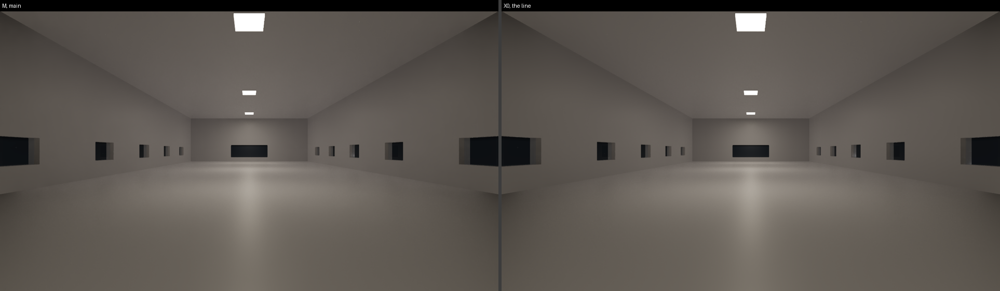

`pics/rect-lamps-whole.png`: the whole still at draw 132, automatic exposure, M (left) and X0 (right), at half size. Both look like the picture "without the sun" above: dim jambs, smooth walls, a smooth floor with the lamps' soft glow. Neither shows a speck, a blotch or a daub. X0's upper left wall looks a little darker than M's at a glance (check 2 below).

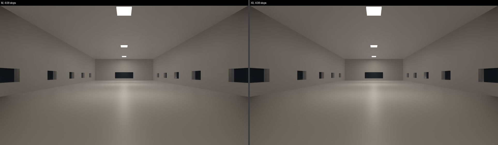

`pics/rect-lamps-whole-408.png`: the same at the fixed exposure of 4.08 stops. Both are clean. X0 is a little darker over the whole image than M. In scene light, it is about 4 points lower in the shown still and 2.5 points lower in the long mean (table 1).

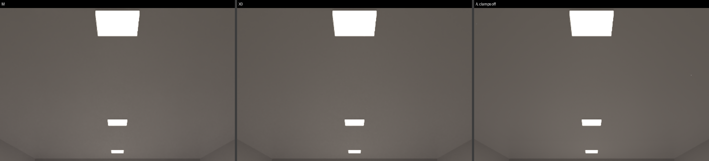

`pics/rect-lamps-ceiling.png`: the ceiling at full resolution, output pixels 640 to 1280 by 0 to 420, automatic exposure: M, X0 and A. All three are smooth gray from the large lamp to the far lamps. None shows the cloud of specks around the far lamps that `t0-ion0` saw. A shows one faint single dot near its right edge. M is a little lighter below the middle lamp.

`pics/rect-lamps-ceiling-408.png`: the same crop at 4.08 stops. All three are smooth. A's faint dot shows again. By the bar, no crop shows a speck, a blotch or a daub.

#### Check 1: what X0's blotch score counts

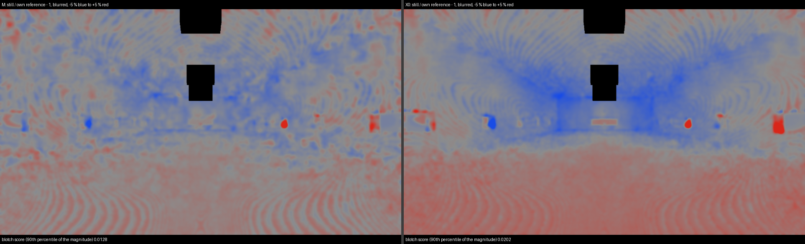

`pics/rect-lamps-blotch-map.png`: the survey's signed blotch map of each still against its own build's long reference, at half size. The scale goes from −5 % (blue) through 0 (gray) to +5 % (red). The pixels that the score leaves out are black. X0's map is one broad, smooth split: the ceiling, the upper walls and the far wall are 2 to 4 % low, and the floor is about 2 % high. M's map shows the same kind of split, weaker and patchier. Both maps show fine regular stripes, which are the moiré of the blur against the image's regular geometry. Both maps also hold small spots at the full ±5 % at window jambs. On M, a blue spot lies at the second left window and red spots at two right windows. On X0, a blue spot lies at the second left window. Red spots lie at the near right window, the far wall's window and the near left window. These are the places where the census finds young records. Their cause is not measured. Apart from these spots, neither map shows a patch.

Measured: the score of X0 is 0.0208, of M 0.0129 and of A 0.0221 (table 1). The map's own scores are 0.0202 and 0.0128. The gap comes from the reference: the survey scores against the float mean of the 20 captures (`run_still`), and the map reads the stored reference, an 8-bit gray PNG. At 4.08 stops, where the exposure is fixed, the still at draw 132 stands below its own long reference: M by 1.1 %, X0 by 2.5 % and A by 2.6 %.

My reading: X0's score counts the shape of a still that still settles at draw 132. Its top half is still darker than its long mean, and the score's division by the whole level turns that into a split. A, with no clamps, has the same score and the same level. So it is the slow climb of the bounce light, not a blotch that the eye sees.

#### Check 2: the left wall

`pics/rect-lamps-left-wall.png`: output pixels 0 to 640 by 0 to 560 at 1:1, from left to right: M's still, X0's still, X0's long reference and A's long reference. All four show the same gradient, darker toward the top left corner. The two reference tiles are gray, because the survey stores its reference without color.

Measured (`walls.py`, display-linear luminance). First, each left box over the mirrored right box:

| Side | Image | Wall above the windows | Top corner | Outer 100 columns |
|---|---|---:|---:|---:|
| M | still | 0.9899 | 0.9836 | 0.9785 |
| M | long reference | 0.9903 | 0.9839 | 0.9801 |
| X0 | still | 0.9898 | 0.9851 | 0.9797 |
| X0 | long reference | 0.9904 | 0.9846 | 0.9797 |
| A | still | 0.9900 | 0.9850 | 0.9801 |
| A | long reference | 0.9904 | 0.9847 | 0.9797 |

Second, the left box of X0 against the same box of M, the direct comparison of the builds:

| Exposure | Image | Wall above the windows | Top corner | Outer 100 columns |
|---|---|---:|---:|---:|
| automatic | still | 0.9969 | 1.0079 | 1.0135 |
| automatic | long reference | 0.9982 | 1.0077 | 1.0113 |
| 4.08 stops | still | 0.9684 | 0.9777 | 0.9833 |
| 4.08 stops | long reference | 0.9832 | 0.9911 | 0.9955 |

My reading: X0's upper left wall is not darker than M's. The whole-frame sheet has the automatic exposure. There, X0's top corner is 0.8 % lighter than M's, and its outer columns 1.1 to 1.4 % lighter. At 4.08 stops, X0 is darker than M on the whole image (table 1), and its left wall by no more than that. No build has a one-sided gradient of its own. In every build and in A, the left wall is 1 to 2 % darker than the right wall. This holds in the still and in the long mean alike. The eye's impression of a darker corner in the sheet is not in the numbers. My guess is that it comes from the sheet, where X0's left edge sits beside M's lighter right edge. That guess is not measured.

### Take 2: the switch "cabin"

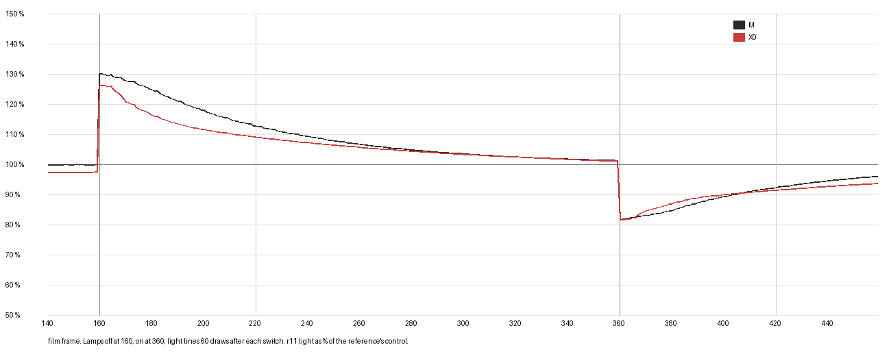

`pics/switch-r11.png`: r11 over film frames 140 to 459, in % of M's control in the same lamp state. The lamps go off at frame 160 and on at frame 360. Before the switch, both lines are flat: M at 100 %, X0 at 97.4 %. Neither line jumps or swings from frame to frame anywhere. After the lamps go off, both jump to 126 to 130 % and fall back smoothly over 200 draws. X0 falls faster at first. After the lamps come on, both drop to about 82 % and climb back smoothly. X0 climbs faster for 40 draws, and then more slowly than M. By the bar, neither side flickers. Both trail: the old light stays for longer than 60 draws.

### Take 3: the stand film

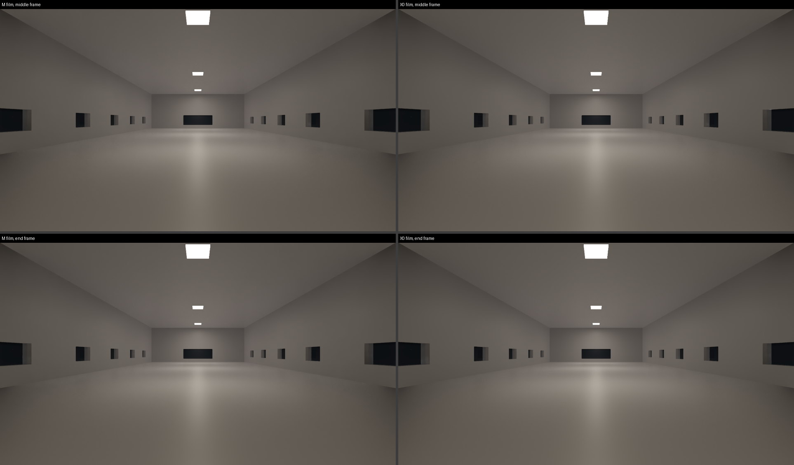

`pics/stand-film-frames.png`: the stand film's middle frame (top row) and last frame (bottom row), M (left) and X0 (right), at half size, at the film's fixed exposure. All four frames are clean and look like the still: no specks, no blotch, no daub. X0's top left corner looks a little darker to the eye, as in take 1, where it measures as no darker than M's (check 2).

`pics/stand-film-stills.png`: the stills of the same states, which the survey sets each frame against. They look like the frames.

## The tables

### Table 1: the still rect-lamps (take 1)

Today's jitter, draw 132. The daub is against A's long reference of the same exposure.

| Side | Exposure | Specks | Blotch | Daub | Daub, ceiling / walls | Broad | Level | Light shown, ceiling / walls | Light settled, ceiling / walls |
|---|---|---:|---:|---:|---|---:|---:|---|---|
| M | automatic | 0.0096 | 0.0129 | 0.0117 | 0.0110 / 0.0150 | 0.0202 | +0.0008 | 100.6 / 100.3 % | 101.0 / 100.7 % |
| X0 | automatic | 0.0048 | 0.0208 | 0.0088 | 0.0087 / 0.0116 | 0.0195 | +0.0013 | 99.1 / 98.8 % | 99.9 / 99.8 % |
| A | automatic | 0.0048 | 0.0221 | 0.0080 | 0.0084 / 0.0111 | 0.0213 | +0.0013 | 99.0 / 99.0 % | 100.0 / 100.0 % |
| M | 4.08 stops | 0.0096 | 0.0127 | 0.0102 | 0.0100 / 0.0128 | 0.0190 | −0.0110 | 101.2 / 101.0 % | 102.8 / 102.8 % |
| X0 | 4.08 stops | 0.0096 | 0.0206 | 0.0080 | 0.0078 / 0.0096 | 0.0193 | −0.0245 | 97.2 / 96.4 % | 100.3 / 100.2 % |
| A | 4.08 stops | 0.0048 | 0.0219 | 0.0079 | 0.0079 / 0.0089 | 0.0226 | −0.0261 | 96.7 / 96.0 % | 100.0 / 100.0 % |

Before the fix (`t0-ion0`, the line's head of then): 5.96 specks on the line and 12.08 on its reference. The light of then is not comparable, because the leak's light is gone.

Main's probe has no switch for the clamps, so the run "AM" (M with `TERTIUS_A_NO_CLAMP=1`) is a second plain run of M. It equals M's run byte for byte, in the still and in the long reference, at both exposures. So M repeats from run to run on this Mac.

### Table 2: the switch "cabin" (take 2)

Today's jitter. Settle against each side's own controls. The levels are 60 draws after each switch, in % of the side's own control. "r11 lowest / highest" is over frames 140 to 159, before the lamps go off.

| Side | Slowest region, off / on | Whole image, off / on | r11, off / on | Level 60 after off, whole / r11 | Level 60 after on, whole / r11 | r11 lowest / highest |
|---|---|---|---|---|---|---|
| M | 143 / 92 | 79 / 55 | 119 / 85 | 107.2 / 112.8 % | 95.5 / 92.3 % | 100.0 / 100.0 % |
| X0 | not settled / not settled | 94 / 50 | 153 / 93 | 107.5 / 112.1 % | 95.6 / 93.0 % | 100.0 / 100.0 % |
| X0 against M's controls | | | | 106.7 / 109.1 % | 95.0 / 91.5 % | 97.4 / 97.5 % |

"Not settled" means that the region is still more than 5 % from its control at the window's last frame: 200 draws after the lamps go off, 100 draws after they come on. The survey fails both sides on the settle, because both exceed 60 draws.

Per region (`regions.py`), draws to settle off / on, and the level 60 draws after each switch against the side's own control:

| Region | M settle | X0 settle | M level, off / on | X0 level, off / on |
|---|---|---|---|---|
| whole | 79 / 55 | 94 / 50 | 107.2 / 95.5 % | 107.5 / 95.6 % |
| r00 | 143 / 92 | not settled / not settled | 126.2 / 89.8 % | 130.1 / 89.4 % |
| r01 | 15 / 12 | 9 / 7 | 101.7 / 98.5 % | 101.7 / 98.6 % |
| r02 | 143 / 92 | not settled / not settled | 125.8 / 89.7 % | 128.1 / 89.2 % |
| r10 | 133 / 88 | 185 / not settled | 120.2 / 91.1 % | 121.4 / 91.2 % |
| r11 | 119 / 85 | 153 / 93 | 112.8 / 92.3 % | 112.1 / 93.0 % |
| r12 | 133 / 88 | 183 / not settled | 119.9 / 91.1 % | 120.2 / 91.1 % |
| r20 | 131 / 51 | 182 / 48 | 121.8 / 96.1 % | 125.1 / 96.0 % |
| r21 | 118 / 42 | 155 / 33 | 115.2 / 96.8 % | 116.2 / 96.9 % |
| r22 | 131 / 51 | 180 / 48 | 121.5 / 96.0 % | 124.3 / 95.9 % |

Near the window's end, M's r00 is 101.9 % of its control 194 draws after the lamps go off. It is 95.2 % 94 draws after they come on. X0's r00 is 105.7 % and 93.3 % at the same draws. The approach is smooth in both.

### Table 3: the stand film (take 3)

The survey's stand part, signal bounce (the single bounce alone), region r11. "Settle" counts the draws until r11 stays within the survey's tolerance of its end level. "First window" is r11's mean over the film's first 40 draws against its end level.

| Side | r11 settle from the film's start | r11 settle after tick 306 | r11 first window | Verdict |
|---|---:|---:|---:|---|
| M | 49 | 0 | −8.5 % | pass |
| X0 | 84 | 0 | −9.6 % | pass |

The survey's motion part on the stand film, 600 frames at the fixed exposure that the survey chose (M 3.83 stops, X0 3.86 stops):

| Side | Flicker | Grain flicker | Blotch, middle / last | Level, middle / last | Verdict |
|---|---:|---:|---|---|---|
| M | 0.00029 | 0.00074 | 0.0143 / 0.0153 | +1.05 / +1.25 % | pass |
| X0 | 0.00023 | 0.00060 | 0.0192 / 0.0229 | +2.31 / +2.71 % | pass |

The survey's limits are 0.006 for flicker, 0.05 for grain flicker, 0.04 for blotch and 10 % for the level. The level is the film frame against a still of the same state at draw 132.

My reading: the film is brighter than the still by about what the still at draw 132 lacks against its long mean (table 1, 4.08 stops: M −1.1 %, X0 −2.5 %). So the film's level shows the still's slow settling, not a fault of the film. The same holds for the blotch, as in check 1.

### Table 4: the sub-pixel strips design (take 5, on M)

Today's jitter unless the row says otherwise.

| Measure | Now | Before the fix |
|---|---|---|
| r11's single-bounce plateau, tick 300 → 306 (`climbstep.py`) | 0.07667 → 0.07667, +0.000 % | fell 43 % |
| The standard deviation of r11's stills about that plateau | 0.14 % | |
| r11, darkest / brightest jitter phase against the cycle mean, lamps-on control, all light, frames 36 to 215 | −0.87 / +0.54 % | |
| The same over frames 172 to 459, as `t0-ion0` took it | −0.83 / +0.41 % | reference −1.0 / +0.7 %, cap 4 −11.6 / +9.5 % (cap 4 without the sun −0.9 / +0.4 %) |
| r11 without jitter against the cycle mean, frames 36 to 215 | −0.34 % | reference −46 % |
| The same over frames 172 to 459 | +0.08 % | |
| Light evidence in the census still, share of diffuse / specular block-draws, X0 as built, today's jitter | 0 / 0 | |
| The same on the scratch build without the area rule, today's jitter | 6.0e-4 / 6.5e-4 | 1.95e-2 / 5.13e-3 (`t0-6gej`, Design X 5a1d70cae) |
| The same without the area rule, no jitter | 0 / 0 | |
| The same without the area rule, today's jitter, sun off | 5.5e-4 / 5.9e-4 | |

Per region, darkest and brightest jitter phase against the cycle mean, M's lamps-on control over frames 36 to 215 (`phases.py`). Each frame's value includes the slow trend of a still that still settles. So a region that rises slowly shows about ±0.17 % with no cycle at all.

| Region | Cycle mean | Darkest phase | Brightest phase | No jitter |
|---|---:|---:|---:|---:|
| whole | 0.3595 | −0.28 % | +0.22 % | +0.36 % |
| r00 | 0.1805 | −0.17 % | +0.16 % | −0.02 % |
| r01 | 1.4624 | −0.52 % | +0.37 % | +0.90 % |
| r02 | 0.1813 | −0.17 % | +0.15 % | −0.04 % |
| r10 | 0.1972 | −0.16 % | +0.17 % | −0.02 % |
| r11 | 0.3180 | −0.87 % | +0.54 % | −0.34 % |
| r12 | 0.1981 | −0.17 % | +0.14 % | −0.11 % |
| r20 | 0.2080 | −0.05 % | +0.06 % | −0.01 % |
| r21 | 0.2822 | −0.07 % | +0.04 % | +0.03 % |
| r22 | 0.2080 | −0.06 % | +0.04 % | −0.02 % |

The cycle mean is in scene luminance. Before the fix, r11's cycle mean in the reference was 0.8069 (`t0-ion0`). So the leak's light was more than half of r11's light then. Without jitter, the light no longer moves between regions: no region differs by more than 0.9 % from its cycle mean. r01, which holds the large lamp, differs most.

The climb's peak share of r11 is 1.012 (the survey's limit is 1.10), so the single bounce does not overshoot its unfiltered light.

The stand film, signal bounce, shows the same. There, r11's cycle over the 18 phases is 0.04 % on both sides (`cycle.py`, frames 100 to 330). `cycle.py` first divides each frame by an 18-draw moving mean. r11 holds 0.1475 to 0.1476 (M) through frames 230 to 256, which show ticks 291 to 317.

My reading: no measured case of a real sub-pixel strip remains in this room. The step at tick 300 to 306 is gone. The jitter cycle of r11 is at the level that the old takes measured without the sun. The rest of the cycle lies in r01 and r11, the regions that hold the ceiling's lamps. Those cycles are the same on M and X0 to within 0.04 points.

#### The census of young light-age records

A young light-age record is a pixel whose record counted a lasting change of its light in the last few draws. In a still, nothing changes, so a young record there is false. The census (`TERTIUS_X_CENSUS`, the line's probe only) counts such pixels in every draw of the census still: 10 continued stills of 33 draws, 330 draws, of which it counts the 329 after the first. Since `t0-6gej`, the record counts a change only where it covers an area of 3 x 3 pixels (the area rule). The census of `t0-6gej` before the fix and before that rule found light evidence in 1.95e-2 of the bounce light's block-draws in this still. The brief's 0.136 % comes from another census (`t0-3kyb`, the cabin's lamps-on control film), so this record does not compare with it. The census of X0 as built (0 with and without jitter) cannot tell whether the strips are gone or the rule hides them.

The better take: a scratch build of X0 with the area rule off (`scratch-no-area-rule.patch`, one line of `screen_trace_plan.comp`). It was built in `/private/tmp/t0-9fo0/na` and never committed under `src`. Its census keeps the block maps (`TERTIUS_X_CENSUS_EVERY=1`), which show where the records lie. A second run with the sun off (`TERTIUS_PROBE_SUN=off`) tells the sun's records from the lamps'.

| Run | Diffuse / specular pixel-draws | Diffuse / specular block-draws with light evidence | Share of block-draws | Acceptance 12 |
|---|---:|---:|---:|---|
| X0 as built, today's jitter | 0 / 0 | 0 / 0 | 0 / 0 | pass |
| X0 as built, no jitter | 0 / 0 | 0 / 0 | 0 / 0 | pass |
| Area rule off, today's jitter | 8,064 / 8,841 | 2,841 / 3,086 | 6.0e-4 / 6.5e-4 | fail |
| Area rule off, today's jitter, repeated with maps | 8,064 / 8,841 | 2,841 / 3,086 | 6.0e-4 / 6.5e-4 | fail |
| Area rule off, no jitter | 0 / 0 | 0 / 0 | 0 / 0 | pass |
| Area rule off, today's jitter, sun off | 7,266 / 8,015 | 2,596 / 2,806 | 5.5e-4 / 5.9e-4 | fail |

A pixel-draw is one render pixel (1280 x 720) in one counted draw of one signal. A block-draw is one block of 8 x 8 render pixels in one counted draw. If a pixel of a block holds a young record, the block has light evidence. Acceptance 12 of the survey allows light evidence in at most 1e-4 of each signal's block-draws. 8,064 diffuse pixel-draws are about 25 render pixels per draw.

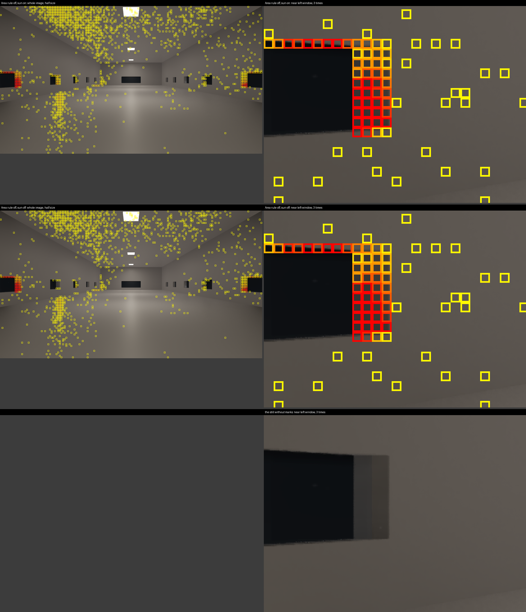

`pics/census-young-records.png`: each block of 8 x 8 render pixels that held a young record in any draw, marked on X0's still. Yellow marks 1 draw, and red marks 50 draws or more. The top row has the sun on, the middle row the sun off, and the last row shows the near left window without marks. The left column is the whole image at half size. The right column is the near left window at 3 times. With the sun on and off, the marks are almost the same. The red marks cover the near windows' inner jamb faces and the row of blocks along each window's top edge. A field of hundreds of yellow marks covers most of the ceiling's left and center around the large lamp. A dense column of them lies on the floor below the left windows. The still itself shows no fault at these places.

My reading: a small jitter effect on the light-age record remains. Its densest part lies where the lamps light the windows' jambs and edges beside the black opening. That is the layout that `t0-6gej` found: a strip between a surface and the sky. The sun causes at most about 10 % of it. The area rule removes all of it, so the engine as built keeps no young record in this still. No light measure of this room shows it: neither r11's step nor its cycle. Against the census before the fix, the bounce light's share fell from 1.95e-2 to 6.0e-4 of the block-draws without the area rule.

## The changes to the takes and their reasons

- The census runs on X0, not on M. Main's probe has no census switch (`TERTIUS_X_CENSUS`). Main has the light-age record and the area rule, but its probe cannot count them. The orchestrator accepted this.
- A runs on X0's build only. Main's probe has no clamp switch, so M with the switch is a plain M run. It stays in the record as M's repeat run (table 1).
- The light per jitter phase comes from the switch's lamps-on control film. A continued still has 33 draws, and the largest common divisor of 33 and 18 is 3. So its captures visit only 18 / 3 = 6 of the 18 phases. The film visits each phase every 18 draws.
- The per-phase frames stop at 215, before frame 239, which shows world tick 300. The climb shows that the light does not change there now, so the record also gives the old span of 172 to 459.
- The stand film runs through `standfilm.py`, the survey's motion part on the stand case (`run_motion`). The survey's stand part keeps region means only, and the brief asks for frames and the survey's flicker.
- The census also runs on a scratch build of X0 without the area rule. The census of X0 as built cannot see the strips through that rule ("The census of young light-age records").
- `regions.py`, `cycle.py`, `phases.py`, `climbstep.py` and `censusmap.py` are new. They read the survey's results and print the per-region numbers that the survey keeps but does not print.

## The load and the repeat

The Mac carried load from outside the lab: 21 to 48 on 10 cores during the takes. No number in this record depends on time: each is a measure of rendered images or of their region means. M's repeat run (AM) equals M's run byte for byte.

Another agent's timing rounds held the GPU lock for about 22 minutes before the no-jitter take. I did not use the cloud. The takes left were short, and a cloud take needs M's lamps-on control on the same worker too. Cloud money spent: 0.00 dollars.

## Files

- `README.md`: this record.
- `scratch-no-area-rule.patch`: the scratch build's change, on top of the line's head and the survey's probe patch.
- `pics/`: the pictures above.
- `tables.txt`: the output of every measure in this record.
- `tools/` (run each measure through `m.sh`, which links each run as `s/<name>` and finds scripts of the earlier records):
  - `vars.sh`: the sides and switches.
  - `take.sh`: one survey run into `/private/tmp/t0-9fo0/runs/<name>`.
  - `standfilm.sh` and `standfilm.py`: the survey's motion part on the stand case.
  - `queue-1.sh`, `queue-2.sh` and `queue-3.sh`: the takes in order. `queue-3.sh` runs the census on the scratch build.
  - `measure.sh`: every measure, in the order of the tables. Its output is `tables.txt`.
  - `m.sh`: runs a measure script in `/private/tmp/t0-9fo0/w`.
  - `blotchmap.py`: the survey's signed blotch map (check 1).
  - `walls.py`: the light of the side walls, left against right (check 2).
  - `regions.py`: the switch's settle and level per region.
  - `cycle.py`: a region's jitter cycle after the division by an 18-draw moving mean.
  - `phases.py`: `strips.py` of `t0-ion0` for all 9 regions, with and without jitter.
  - `climbstep.py`: the climb's step from tick 300 to 306 per region.
  - `censusmap.py`: where the young records lie, from the census's block maps.
- Scripts of the earlier records that this record runs: `stills.py` of `t0-xlcu`, `daub.py`, `light.py`, `sheet.py` and `levelchart.py` of `t0-mzhr`, `switch.py` of `t0-xlcu`, `filmsheet.py` of `t0-ion0`.

## Part B: the room with the remedy for the bay film's trail (question 2)

Part B takes the same room on the line's head, which now holds the remedy for the bay film's trail (`t0-acxm`, merge `4d660b215`). The remedy gives region evidence to the bounce light. Part B answers question 2: by the user's bar, does X keep the still clean, how does it settle the switch against M and X0, does it flicker before the switch, and is the stand film clean? It also changes nothing in `src`, `tests` or `tools`.

### The sides of part B

- X is the line's head `6d8a68332`, with `probe-acxm.patch` of `t0-acxm` (the survey's probe fitted to the remedy's push constants). The line's own probe patch does not apply to this tree ("The changes to the takes in part B").
- M and X0 are part A's sides, built again from the same commits and the same probe patches by `tools/build.sh`. Their stills repeat part A's numbers to every digit. They run again only where a picture, the chart or the grid sheet needs their frames.
- A is X with both history clamps off (`TERTIUS_A_NO_CLAMP=1`), the reference of the daub.
- Xr is X with `scratch-region-log.patch`, which writes the region test's answers of each draw to a file. It is a scratch build outside the checkout. Its images equal X's byte for byte.

### The terms of part B

- An anchor is a block of 8 x 8 render pixels at which the bounce light's region test runs: every 8th block in x and in y. The 1280 x 720 render has 20 x 12 = 240 anchors. In the 1920 x 1080 output, anchor (i, j) samples the pixel (96 i + 6, 96 j + 6).
- An anchor's region is the 17 x 17 blocks around it. Neighbor regions overlap by half, so a block lies in the regions of 4 anchors, or of up to 9 on the anchors' own rows and columns. The anchor keeps a ring of its region's light (the mean of one tap pixel per block) over the last 36 draws.
- A fire is an anchor's answer "the region's light moved". The test compares the mean light of the newer 18 draws in the ring with the mean of the older 18 draws. It fires where they differ by more than 3 times the older draws' standard deviation times sqrt(2 / 18), the spread of such a difference. The test runs only when the ring holds 36 valid draws in a row. A block gets region evidence on the draw after a fire of any anchor whose region holds it. Region evidence caps the block's history length at 8 draws.
- An anchor-draw is one anchor at one draw. A tested anchor-draw is one at which the test ran. The share of fires is the fires over the tested anchor-draws.
- Pure noise makes a test at 3 standard deviations fire at about 0.27 % of its tests. So a share near 0.3 % is what a still with no moving light gives.
- The anchors' grid is the lines where the set of regions that hold a block changes: every 8 blocks, which is every 96 output pixels in x and in y. A block's region evidence can change only at these lines, so a fault of the remedy would show as a straight edge along them.

### The answers to question 2 in short

| Question | Measured |
|---|---|
| Does X keep the still clean? | Yes. At both exposures, X's still shows no blotch, no daub and no straight edge, beside M and X0 (take 1). It has 2 specks in the whole view at the automatic exposure and 3 at 4.08 stops (M 2 and 2, X0 1 and 2). Its blotch is the lowest of the three: 0.0102 against M's 0.0129 and X0's 0.0208. Its daub equals X0's: 0.0088 and 0.0081. |
| How does X settle the switch against M and X0? | Faster than both in every region but r01, where X equals X0 (9 / 7 draws after off / on) and both beat M (15 / 12). The whole image settles in 43 / 31 draws (M 79 / 55, X0 94 / 50). The corners settle in 75 to 77 draws after off and 31 to 51 after on. X0 does not settle r00 and r02 within the window, and M needs 131 to 143 / 51 to 92 draws there. X still needs more than 60 draws after the lamps go off in 8 of the 9 regions, so the survey fails it on the settle, as it fails M and X0. By the bar, X still trails after the lamps go off, for less time than M and X0. |
| Does X flicker before the switch? | No. r11 stays at 100.0 % of X's own control over frames 140 to 159, in its lowest and its highest frame. The grid sheets show no flicker, and the chart shows no swing. |
| Is the stand film clean? | Yes. The frames are clean beside M's. Flicker 0.00025 (M 0.00029), grain flicker 0.00063 (M 0.00074), blotch 0.0114 / 0.0116 (M 0.0143 / 0.0153), all far under the survey's limits. |
| The bay film (cited, not taken again) | In the remedy's record, the built form R is better than main in level, blotch, last-frame specks and lag. Its flicker, 0.00273, is above main's 0.00204 and far under the limit of 0.006 (table B4). |
| The region test's fires | In the still's last 523 draws, 1.22 % of the tested anchor-draws fire, above the brief's 0.3 %. Most of them lie at the near windows, where the light does not move: these fires are false. A random order of the same draws fires at 1.36 %, and the test fires at 0.80 % on Gaussian noise. In the first 96 draws, while the light climbs, the share is 3.59 %, and these fires are true. |
| The anchors' grid | No grid edge, daub or flicker shows in X's frames at 20 and 60 draws after either switch. The step across the grid's lines is the same on M, which has no region test. |

My reading:

- X keeps the still clean. Its still at draw 132 lies closer to its long mean than X0's at both exposures (level −0.0002 against +0.0013, and −0.0116 against −0.0245), and about as close as M's. The region test's true fires in the first 96 draws cause that.
- X settles the switch faster than M and X0, about twice as fast after the lamps go off. It is the only side of the three whose every region settles within 60 draws after the lamps come on. The trail after the lamps go off remains, 64 to 77 draws in the middle and the corners. That fault is smaller than on M and X0, but it is not gone.
- The false fires at the near windows cost nothing that the pictures or the scores show. Each of those anchors caps the history of the blocks in its region at 8 draws on 8 to 14 % of the draws in a still. A block lies in up to 9 regions, so its history can get the cap more often. A change of the test could lower that share, for example a spread from all 36 draws, or a spread that ignores the brightest draws. Part B did not try it.

### What the pictures show in part B

#### Take 1: the still rect-lamps

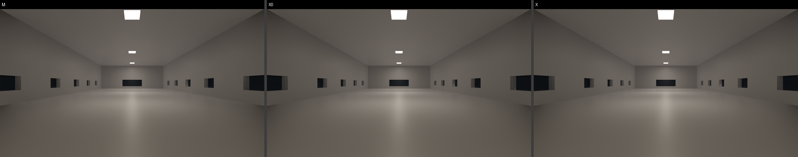

`pics/b-rect-lamps-whole.png` (automatic exposure) and `pics/b-rect-lamps-whole-408.png` (4.08 stops): the still at draw 132, M, X0 and X, at a third of the size. The three stills look the same. X shows no speck, no blotch, no daub and no straight edge. 

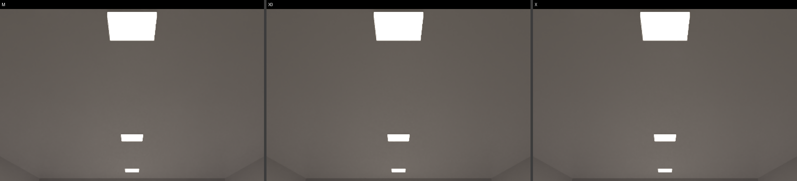

`pics/b-rect-lamps-ceiling.png` and `pics/b-rect-lamps-ceiling-408.png`: the ceiling around the lamps at full resolution (output pixels 640 to 1280 across, 0 to 420 down). The ceiling is smooth in all three. X shows no speck beside the far lamps and no line every 96 pixels.

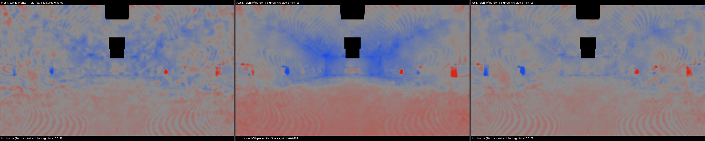

`pics/b-rect-lamps-blotch-map.png`: the survey's signed blotch map (the still over its own long reference, blurred, from −5 % blue to +5 % red). X0's map has a broad split: the upper half is blue (the still is darker than its long mean), and the floor is red. X's map has lost most of that split. It is gray with weak blue on the ceiling, like M's. The small spots at the window jambs remain in all three, at the same places. The scores, read from these maps: M 0.0128, X0 0.0202, X 0.0105.

My reading: the remedy lets the still's bounce light reach its long mean sooner, which removes X0's broad lag at draw 132. The fires of the region test in the still (below) are the cause, and most of them come before draw 133.

#### Take 2: the switch "cabin"

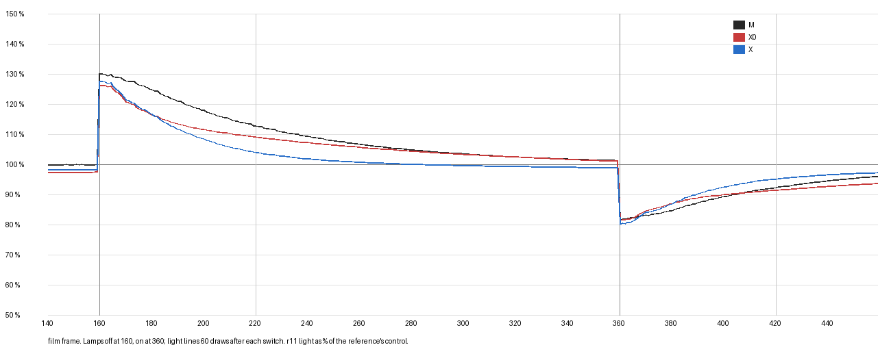

`pics/b-switch-r11.png`: r11 over film frames 140 to 459, in % of M's control in the same lamp state. The lamps go off at frame 160 and on at frame 360. Before the switch, all three lines are flat: M at 100 %, X at 98.4 %, X0 at 97.4 %. After the lamps go off, all three jump to 126 to 130 %. X falls with X0 for 20 draws and then falls faster: X reaches 104 % at frame 220, where X0 is at 109 % and M at 113 %. From frame 260 to 359, X lies at 99 to 100 % of M's control. 
After the lamps come on, all three drop to about 80 to 82 %. X climbs with X0 for 20 draws and then faster than both. No line jumps or swings from frame to frame anywhere. By the bar, no side flickers. All three trail. X trails for the shortest time, but its trail is still longer than 60 draws in most regions.

#### Take 3: the stand film

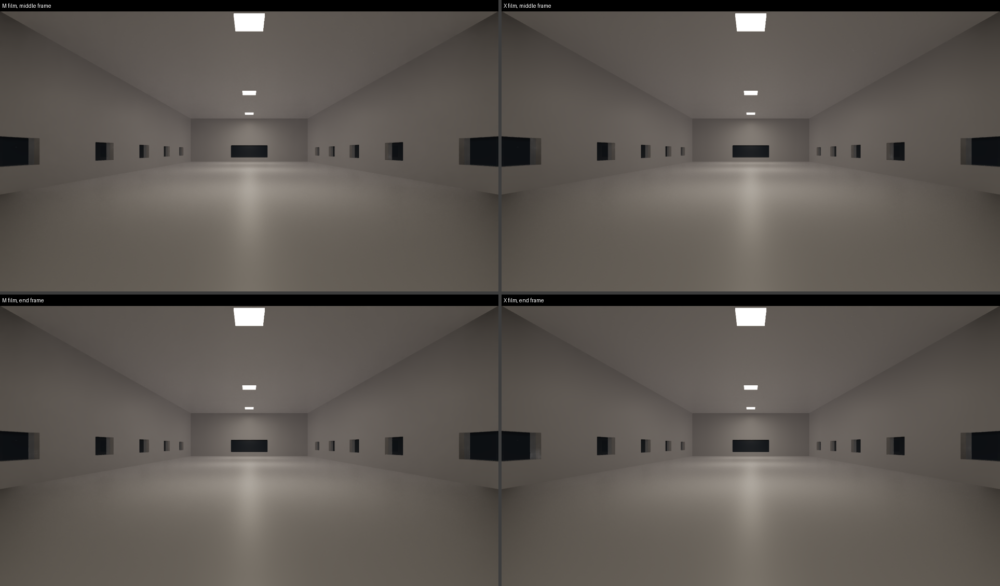

`pics/b-stand-film-frames.png`: the stand film's middle frame (top row) and last frame (bottom row), M (left) and X (right), at half size, at the film's fixed exposure. All four frames are clean: no specks, no blotch, no daub, no straight edge. The ceiling, the walls and the floor are smooth. X's top left corner looks a little darker than M's to the eye, as X0's did in part A.

#### The anchors' grid in the switch

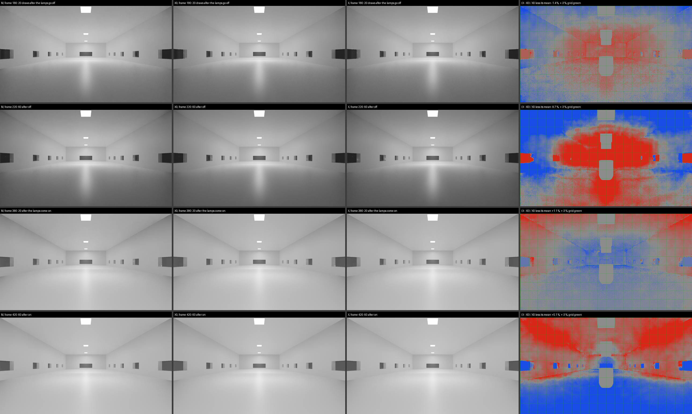

`pics/b-grid-whole.png`: one row per film frame, 180 and 220 (20 and 60 draws after the lamps go off), 380 and 420 (20 and 60 draws after they come on). The columns are M, X0 and X at a third of the size, and the difference map of X against X0. The tiles show scene luminance through one fixed curve for every tile, so a darker tile is less light. The map shows (X − X0) / X0, blurred by 2 output pixels, less its mean over the frame, from −3 % (blue) through 0 (gray) to +3 % (red), with the anchors' grid in green. The lamps are gray.

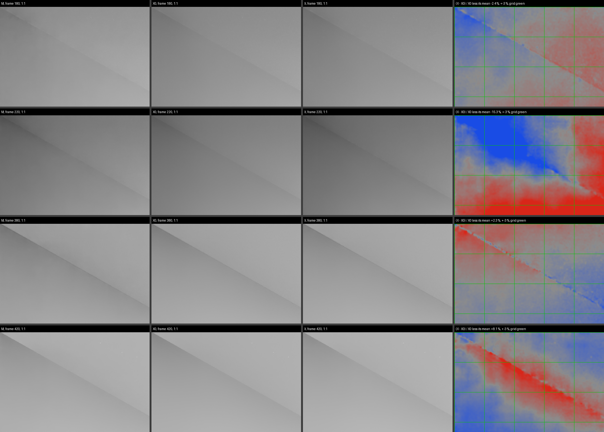

`pics/b-grid-crops.png`: the same frames in the 480 x 320 crop where X differs most from X0 (the top left ceiling corner, output pixels 0 to 480 across, 0 to 320 down), at full resolution.

What the sheets show:

- No tile of X shows a straight edge, a daub or a speck. The ceiling, the walls and the floor are smooth in every frame. Frame 420's crop shows two or three single bright pixels on the ceiling in M, X0 and X alike.
- The difference maps follow the room, not the grid. At frame 220, X is 9.75 % darker than X0 on the whole measured image and 15.3 % darker in the crop. The map is red in the middle of the room and blue on the outer walls and the ceiling's corners, with soft borders that follow the light's falloff from the large lamp. At frame 420, X is 5.1 % brighter than X0. The map is red on the upper walls and ceiling and blue on the floor.
- The crop's map at frame 220 has a large blue area at the top and a red band at the bottom, with soft borders. To the eye, the red seems to begin at the lowest green line (y = 288). The profile across that line (`gridstep.py`) shows no step: X / X0 changes by 0.0 to 0.1 % between rows 287 and 288, as between any two rows beside them. It climbs smoothly by about 0.07 % per row over the 24 rows around the line. The map's ±3 % scale around the crop's mean of −15 % makes that slope look like a band. At frame 420, the largest step of X / X0 between rows 287 and 288 is 0.3 %, at x 384 to 480. The row-to-row steps of M's and X0's own light scatter by ±0.2 % there, and the step does not show in X's tile.

The edge measure (`gridedge.py`): for each frame, the step of the log luminance across the grid's lines, over the median step across the other 95 lines of each 96-pixel period. A ratio of 1 means no edge on the grid.

| Frame | M, vertical / horizontal lines | X0 | X |
|---|---|---|---|
| 159 (before the switch) | 0.686 / 1.341 | 0.721 / 1.279 | 0.724 / 1.305 |
| 180 | 0.830 / 1.231 | 0.896 / 1.179 | 0.847 / 1.193 |
| 220 | 0.841 / 1.367 | 0.846 / 1.287 | 0.847 / 1.314 |
| 380 | 0.913 / 1.134 | 0.957 / 1.095 | 0.970 / 1.102 |
| 420 | 0.853 / 1.264 | 0.848 / 1.283 | 0.833 / 1.340 |

My reading: the ratios differ from 1 by the same amount on M, which has no region test, so the room's edges (the windows' rows, the wall's corners) cause them. X's ratios lie within the spread of M's and X0's in every frame. So the measure finds no edge that the remedy adds. The difference X − X0 is the faster settle of the switch, spread smoothly over the room.

#### The region test's fires

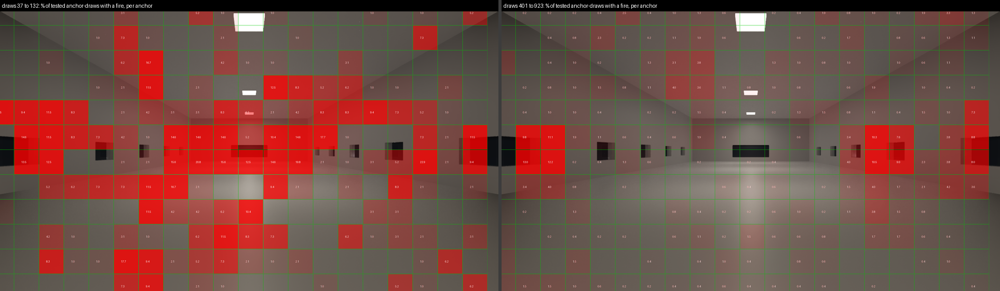

`pics/b-fires-still.png`: the still rect-lamps of X, with one square of 96 x 96 output pixels around each anchor's tap pixel. The red's strength is the anchor's share of fires, from 0 to 10 % and more, and the number is that share in %. Left: draws 37 to 132, while the still's light climbs. Right: draws 401 to 923. In the early span, fires cover the middle of the room: the floor below the lamps, the far wall, the ceiling and the rows of windows, at 5 to 23 % per anchor. In the last span, nearly all anchors fire at 0 to 2 %. The ones that fire more lie at the near windows: on the left at columns 1 and 2, rows 5 and 6 (10 to 13 %), and on the right at columns 14 to 16 and 19 (4 to 11 %).

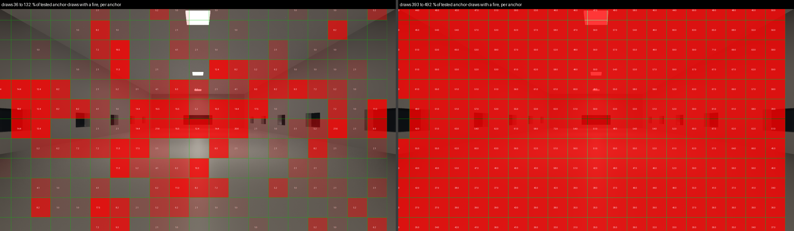

`pics/b-fires-switch.png`: the same marks for the switch film, drawn on the still of the same view. Left: draws 36 to 132, the film's start, which looks like the still's early span. Right: draws 393 to 492, the 100 draws after the lamps come on. Every anchor fires there, at 24 to 72 %.

The share of tested anchor-draws with a fire per span (`regionspans.py`). The light change of a span is, per anchor, the mean light of the span's last 18 draws over that of its first 18, minus 1.

| Run | Draws | Tested anchor-draws | Fires | Share | Light change: median magnitude / mean |
|---|---|---:|---:|---:|---|
| Still | 37 to 132 | 22,848 | 821 | 3.59 % | 3.96 % / +3.79 % |
| Still | 133 to 400 | 63,784 | 781 | 1.22 % | 1.22 % / +0.30 % |
| Still | 401 to 923 | 124,474 | 1,513 | 1.22 % | 1.12 % / −0.40 % |
| Switch | 36 to 132 | 23,086 | 846 | 3.66 % | 3.90 % / +3.73 % |
| Switch | 133 to 192 (before the switch) | 14,280 | 176 | 1.23 % | 1.19 % / +0.53 % |
| Switch | 193 to 292 (100 draws after off) | 23,800 | 12,776 | 53.68 % | 42.96 % / −40.82 % |
| Switch | 293 to 392 | 23,800 | 543 | 2.28 % | 2.24 % / −1.82 % |
| Switch | 393 to 492 (100 draws after on) | 23,800 | 11,972 | 50.30 % | 42.87 % / +49.67 % |

The draw index counts from the run's start. The switch film's frame k is draw 33 + k, so the lamps go off at draw 193 (frame 160) and come on at draw 393 (frame 360).

How much of each share noise alone explains (`regionnoise.py`). The script replays the test on the logged light of every anchor. The replay gives the logged answer at all 211,344 tested anchor-draws of the still and all 108,766 of the switch. Then it replays the test on each anchor's draws in a random order, which keeps the spread of the light and removes any trend, and on Gaussian noise. Each test of a span uses only the span's draws, so the counts start at the span's 36th draw.

| Run | Draws | Real order | Random order (spread of 20 orders) | Gaussian noise | Anchors with a trend, abs(t) > 3 |
|---|---|---:|---:|---:|---:|
| Still | 37 to 132 | 2.58 % | 0.97 % (0.19) | 0.80 % | not measured, 5 means |
| Still | 133 to 400 | 1.16 % | 1.25 % (0.11) | 0.78 % | 0.0 % |
| Still | 401 to 923 | 1.10 % | 1.36 % (0.06) | 0.81 % | 1.3 % |
| Switch | 36 to 132 | 2.57 % | 1.03 % (0.22) | 0.80 % | not measured, 5 means |
| Switch | 133 to 192 | 0.66 % | 1.08 % (0.26) | 0.78 % | not measured, 3 means |
| Switch | 293 to 392 | 2.13 % | 1.90 % (0.29) | 0.79 % | not measured, 5 means |

The trend is the slope of each anchor's 18-draw means over the span, against its standard error. Spans with fewer than 8 such means get no trend.

The anchors at the near windows in the still's last span:

| Anchor (column, row) | Share of fires | In a random order | Slope per 100 draws (t) | Second half against first | Scatter from draw to draw |
|---|---:|---:|---|---:|---:|
| (1, 6) | 13.9 % | 11.9 % | +0.46 % (+1.1) | +0.91 % | 17.0 % |
| (2, 6) | 13.1 % | 9.0 % | +0.24 % (+0.8) | −0.11 % | 11.8 % |
| (2, 5) | 11.9 % | 5.7 % | +0.44 % (+1.5) | +0.79 % | 11.0 % |
| (1, 5) | 10.5 % | 12.7 % | +0.44 % (+1.1) | +0.77 % | 15.1 % |
| (19, 4) | 7.8 % | 4.5 % | +0.37 % (+1.1) | +1.43 % | 11.3 % |
| (15, 6) | 7.6 % | 11.9 % | −0.45 % (−1.3) | −0.53 % | 13.7 % |

The scatter is the standard deviation of the anchor's light from draw to draw over its mean. Over all anchors in this span, its median is 5.2 %, and 80 % of the anchors lie between 3.7 and 12.2 %.

My reading:

- A fire is true where the light moves. In the first 96 draws of the still and of the switch film, the light still climbs: the mean light rises by 3.8 % over the span, and the real order fires 2.5 to 2.7 times as often as a random order. These fires are true evidence of the climb, which is the test's job. They are the likely cause of X's lower blotch at draw 132 (take 1).
- After draw 133, the light of the still does not move. Only 0.0 % and 1.3 % of the anchors trend at abs(t) > 3, and their halves differ by 0.43 % and 0.33 % in the median. The real order fires no more often than a random order. So the 1.22 % of the still's last two spans are false fires.
- The brief's limit of about 0.3 % assumes a test with a known spread. This test estimates its spread from the older 18 draws, so it fires at about 0.8 % on Gaussian noise. The anchors at the near windows fire more again. Their light scatters by 11 to 17 % from draw to draw, two to three times the median anchor's 5.2 %. Over all anchors, a random order of the same draws fires at least as often as the real order. So the shape of their scatter, not a trend, makes them fire. The record does not show which pixels of their regions cause that scatter.
- The still's last span exceeds 0.3 % at the near windows' anchors. There the light does not move. Their false fires cap the history of the blocks around them at 8 draws on about 10 % of the draws. No picture shows a fault there, and the walls' daub is X 0.0118 against X0 0.0116 (automatic) and 0.0094 against 0.0096 (4.08 stops).
- In the switch before the lamps go off, draws 133 to 192 fire at 1.23 % (0.66 % in the replay from draw 168, under the random order's 1.08 %). r11 does not swing in frames 140 to 159 (take 2). After each switch, about half of all tested anchor-draws fire for 100 draws. These are true fires of the switch.

### The tables of part B

#### Table B1: the still rect-lamps (take 1)

Today's jitter, draw 132. The daub is against A's long reference of the same exposure. M's, X0's and A's rows repeat part A's table 1 to every digit, from new builds of the same commits.

| Side | Exposure | Specks | Blotch | Daub | Daub, ceiling / walls | Broad | Level | Light shown, ceiling / walls | Light settled, ceiling / walls |
|---|---|---:|---:|---:|---|---:|---:|---|---|
| M | automatic | 0.0096 | 0.0129 | 0.0117 | 0.0110 / 0.0150 | 0.0202 | +0.0008 | 100.6 / 100.3 % | 101.0 / 100.7 % |
| X0 | automatic | 0.0048 | 0.0208 | 0.0088 | 0.0087 / 0.0116 | 0.0195 | +0.0013 | 99.1 / 98.8 % | 99.9 / 99.8 % |
| X | automatic | 0.0096 | 0.0102 | 0.0088 | 0.0091 / 0.0118 | 0.0071 | −0.0002 | 99.5 / 99.4 % | 99.9 / 99.8 % |
| M | 4.08 stops | 0.0096 | 0.0127 | 0.0102 | 0.0100 / 0.0128 | 0.0190 | −0.0110 | 101.2 / 101.0 % | 102.8 / 102.8 % |
| X0 | 4.08 stops | 0.0096 | 0.0206 | 0.0080 | 0.0078 / 0.0096 | 0.0193 | −0.0245 | 97.2 / 96.4 % | 100.3 / 100.2 % |
| X | 4.08 stops | 0.0145 | 0.0102 | 0.0081 | 0.0087 / 0.0094 | 0.0079 | −0.0116 | 98.9 / 98.7 % | 100.4 / 100.3 % |

Every light share and daub is against A, which here is X with the clamps off. A's own scores equal part A's A (X0 with the clamps off) to every digit. 0.0145 specks are 3 specks in the 1920 x 1080 view, and 0.0096 are 2.

#### Table B2: the switch "cabin" (take 2)

Today's jitter. Draws to settle after the lamps go off / come on, each side against its own controls. "Not settled" means more than 5 % from the control at the window's last frame (200 draws after off, 100 after on). The levels are 60 draws after each switch, against the side's own controls.

| Region | M settle | X0 settle | X settle | X against X0 | X against M | X level 60 after off / on |
|---|---|---|---|---|---|---|
| whole | 79 / 55 | 94 / 50 | 43 / 31 | faster / faster | faster / faster | 102.7 / 98.4 % |
| r00 | 143 / 92 | not settled / not settled | 77 / 50 | faster / faster | faster / faster | 108.5 / 96.6 % |
| r01 | 15 / 12 | 9 / 7 | 9 / 7 | equal / equal | faster / faster | 100.6 / 99.5 % |
| r02 | 143 / 92 | not settled / not settled | 76 / 51 | faster / faster | faster / faster | 108.6 / 96.6 % |
| r10 | 133 / 88 | 185 / not settled | 72 / 48 | faster / faster | faster / faster | 107.3 / 96.8 % |
| r11 | 119 / 85 | 153 / 93 | 64 / 46 | faster / faster | faster / faster | 105.5 / 96.7 % |
| r12 | 133 / 88 | 183 / not settled | 72 / 48 | faster / faster | faster / faster | 106.9 / 96.9 % |
| r20 | 131 / 51 | 182 / 48 | 77 / 31 | faster / faster | faster / faster | 108.3 / 98.6 % |
| r21 | 118 / 42 | 155 / 33 | 68 / 26 | faster / faster | faster / faster | 106.2 / 98.8 % |
| r22 | 131 / 51 | 180 / 48 | 75 / 31 | faster / faster | faster / faster | 108.2 / 98.6 % |

The corners (r00, r02, r20, r22) are X's slowest regions after the lamps go off, at 75 to 77 draws. X0 did not settle r00 and r02 in the window, and M needed 143 / 92 draws. After the lamps come on, X's slowest regions are r00 and r02 at 50 and 51 draws, within the goal of 60.

r11 over frames 140 to 159, before the lamps go off, against each side's own control: lowest / highest 100.0 / 100.0 % on M, X0 and X. Against M's controls, X is at 98.4 / 98.4 % (X0 97.4 / 97.5 %). X's whole image against M's controls 60 draws after off is 102.6 %, and r11's 104.0 %. 60 draws after on, they are 97.9 % and 95.2 %. The survey fails X on the settle (`failed`: the settle), as it fails M and X0.

#### Table B3: the stand film (take 3)

The survey's stand part, signal bounce, region r11, as in part A's table 3. M's and X0's rows are part A's.

| Side | r11 settle from the film's start | r11 settle after tick 306 | r11 first window | Verdict |
|---|---:|---:|---:|---|
| M | 49 | 0 | −8.5 % | pass |
| X0 | 84 | 0 | −9.6 % | pass |
| X | 34 | 0 | −7.7 % | pass |

The survey's motion part on the stand film, 600 frames at the fixed exposure that the survey chose (M 3.83 stops, X0 3.86 stops, X 3.84 stops). M ran again in part B and gave part A's numbers to every digit. X0's row is part A's.

| Side | Flicker | Grain flicker | Blotch, middle / last | Level, middle / last | Verdict |
|---|---:|---:|---|---|---|
| M | 0.00029 | 0.00074 | 0.0143 / 0.0153 | +1.05 / +1.25 % | pass |
| X0 | 0.00023 | 0.00060 | 0.0192 / 0.0229 | +2.31 / +2.71 % | pass |
| X | 0.00025 | 0.00063 | 0.0114 / 0.0116 | +1.04 / +1.28 % | pass |

The survey's limits are 0.006 for flicker, 0.05 for grain flicker, 0.04 for blotch and 10 % for the level.

#### Table B4: the bay film (take 4, cited, not taken again)

Source: `docs/research/t0-acxm-region-evidence/README.md`, sections "The film rect-bay" and "The lag film bay-sun". There, M is main at `c4c1f1f2f`, L is the line without the remedy (`36c3fd0e8`), and R is the remedy's built form, from the working tree `41e6119e1` with `probe-acxm.patch`.

| Side | Level, middle / last frame | Blotch, middle / last | Specks, middle / last | Flicker | Grain flicker | Median lag | Largest lag | Median lag error | Largest lag error |
|---|---|---|---|---:|---:|---|---|---:|---:|
| M | +1.17 / +0.53 | 0.238 / 0.231 | 0.18 / 0.89 | 0.00204 | 0.00638 | 28.3 draws | 73.0 draws | 0.270 | 0.556 |
| L | +2.11 / +2.27 | 0.372 / 0.502 | 0.15 / 0.09 | 0.00098 | 0.00487 | 40.6 draws | 121.0 draws | 0.354 | 0.628 |
| R | +0.85 / +0.29 | 0.187 / 0.162 | 0.22 / 0.27 | 0.00273 | 0.00709 | 14.0 draws | 30.3 draws | 0.150 | 0.395 |

R is not exactly X. X (`6d8a68332`) adds the review's fixes of the remedy to R: the previous render size after a change of the camera's frame (`FrameHistory`), no region test for the single-history prototype, and comments. No part B take shows whether these change the bay film's images.

My reading by the bay film's bar (no worse than main): R is better than main in level, blotch, last-frame specks and lag. Its flicker is higher than main's (0.00273 against 0.00204), far under the survey's limit of 0.006.

### The changes to the takes in part B

- X's probe is `probe-acxm.patch` of `t0-acxm`, not the line's `tools/renderer-survey/probe.patch`. The line's patch does not apply to `6d8a68332`: `patch -p1` rejects its hunks in `GpuTypes.cs` and `accumulate.glsl`, because the remedy added a push constant and an argument where the probe inserts its own. Ticket `tc-w3c0` (a bug under `ter-8hyd`) records the fix. `probe-acxm.patch` is the same probe, fitted to those two places.
- `tools/build.sh` builds each side outside the checkout, from `git archive` of the commit and the patches, so that no build needs a worktree. M and X0 are built again from part A's commits.
- M and X0 ran again. Their stills give part A's numbers to every digit, so the record keeps one row each.
- The grid sheet needs frames that the survey's switch run does not keep: the survey keeps a run's frames only where `TERTIUS_PROBE_KEEP` names them, and its `render()` sets that variable itself. `gridfilm.py` runs the switch run alone through the survey's `render()` with its own list of kept frames. Its region series equals the survey's switch run byte for byte for M, X0 and X, so the grid film is the same film.
- The region log (`scratch-region-log.patch`) is a scratch build. It reads back the anchors' ring each draw. Its stills and grid film equal X's byte for byte, so the log does not change the images.

### The files of part B

- `tools/build.sh`: builds a side outside the checkout, from `git archive` of a commit and the patches.
- `scratch-region-log.patch`: the scratch build's change on top of `probe-acxm.patch`: the region log, per draw and per anchor.
- `tools/queue-b.sh`: the takes of part B in order. `tools/queue-b2.sh`: the takes with the per-anchor log, on the build x2.
- `tools/gridfilm.sh` and `tools/gridfilm.py`: the switch run alone, with the frames that the grid sheets need.
- `tools/measure-b.sh`: every measure of part B and its pictures, in the order of the tables. Its output is the part B half of `tables.txt`.
- `tools/gridsheet.py`: the grid sheets. `tools/gridedge.py`: the step across the grid's lines. `tools/gridstep.py`: the light across one line.
- `tools/regionfires.py`: the fire counts of the first log, per window of the switch. `tools/regionspans.py`: the fires per span, and their maps. `tools/regionnoise.py`: the replay of the test on real, shuffled and Gaussian light.
- `pics/b-*.png`: the pictures of part B.
- Scripts of the earlier records that part B runs: as in part A, and `probe-acxm.patch` of `t0-acxm`.
