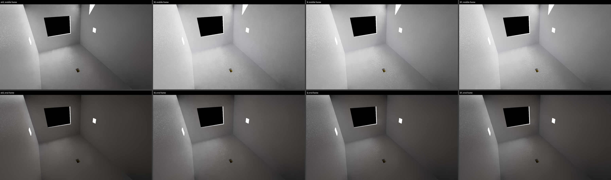
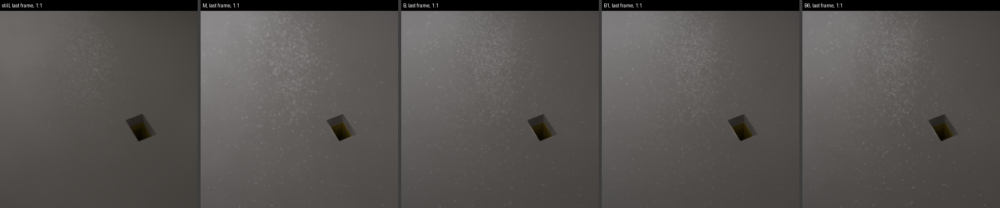
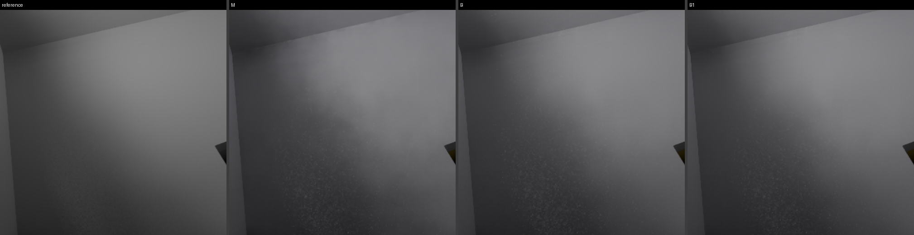
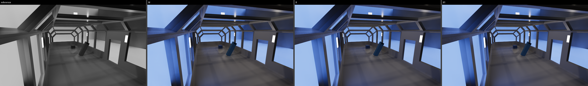

# The remedy for the bay film's trail: region evidence (t0-acxm)

Design X let the bounce light of the film `rect-bay` trail the sunbeam that narrows and goes out (take T16). Decision Y1 of `docs/plans/bounce-light-confidence.md` (section 2.3) gives a block a second source of evidence for a change: its region. This record holds the remedy's timing, its takes in the bay and the forms that the timing rejected. Section 8.7 of the design doc holds the design as built.

The remedy as built: the region's drift test runs at anchor blocks only, every 8th block of 8 × 8 pixels in x and in y, inside the spatial dispatch of each signal with a light age. An anchor keeps its region's light of the last 36 draws in a ring, and it tests whether the mean of the last 18 draws moved by more than 3 standard deviations of the 18 before. A block whose anchors found a move in the draw before takes `RegionEvidence`, which cuts its histories to at most 8 draws.

## The answers in short

| Question | Measured |
|---|---|
| Does the build close the trail against main? | Mostly yes. B's film level is +0.84 / +0.28 against main's +1.17 / +0.53, and its blotch 0.180 / 0.162 against 0.238 / 0.231. In the lag film, B's median lag is 12.7 draws against 28.3, and its lag error 0.150 against 0.270. The stills have less daub than main. Two measures are worse than main: B's specks in the film's last frame, 1.07 against 0.89, and its flicker, 0.00263 against 0.00204 (the survey's limit is 0.006). The trail is not closed: the last frame is still 28 % too bright. |
| The bounce light alone against both signals | B1 equals B in level, blotch and lag error. Its last-frame specks are 0.27, against B's 1.07 and main's 0.89. Its median lag is 14.0 draws against B's 12.7. Paired by round against B, B1 saves 0.026 ms on the deck (spread 0.106) and costs 0.223 ms more in the film (spread 0.043), because the film's reflections keep their long histories. |
| The cut to 6 draws without own rays | Not taken. B6 beats the cut to 8 in level (+0.56 / +0.22), its flicker 0.00341 is under 0.006, and its span is within budget (deck +0.003 ms, film −0.052 ms against B). But its last-frame specks are 2.23, above the bar of 1.28. So the cut stays at 8 draws, and `src` does not change for it. |
| The cost on the deck | B against main, paired over 8 rounds: deck +0.279 ms (spread 0.072), film −0.245 ms (spread 0.043). That is Design X with the remedy against main. The remedy's own share was +0.091 ms against the line's head (section 8.7 of the design doc). |
| Which passes hold the rise | From the line's head `36c3fd0e8` to B, the deck's mean frame span rose by 0.036 ms in the trace. The rise lies in the two accumulation passes: +0.040 ms for the bounce light and +0.049 ms for the reflections. No pass after the reflections' spatial dispatch rose, so this record did not measure how often the reflections' region evidence fires on the deck. |

The values "a / b" are at the film's middle and last frame.

## The sides

All sides hold the shadow fix (`t8-rjno`, merged into main as `dcd738552`).

| Side | What it is | Build |
|---|---|---|
| M | Main at `c4c1f1f2f` | The survey's probe (`tools/renderer-survey/probe.patch`) |
| B | The build: the line's head `36c3fd0e8` merged into the remedy, `c98d3d2da`. The region's test for both signals | `probe-acxm.patch`, the survey's probe fitted to the remedy's push constant `regionSlot` |
| B1 | B with the region's test for the bounce light only: `spike/switches.patch` and `TERTIUS_SPIKE_REGION=one` | As B |
| B6 | B with the scratch cut to 6 draws (`cut6.patch`): region evidence cuts to at most 6 draws, and the ray plan counts such a pixel as mature, so that it keeps the block's shared ray | As B |
| A | B with the probe's clamps off (`TERTIUS_A_NO_CLAMP=1`): the stills' reference for the daub | As B |

`probe-acxm.patch` differs from the survey's probe in two hunks only. The probe adds five push constants after `retainedSigmas`, and the remedy added `regionSlot` there. The fitted patch puts the probe's constants after `regionSlot` in both the GLSL block and `AccumulatePushConstants`, and passes the draw index through the probe's `Of`. Under `TERTIUS_A_NO_CLAMP`, the probe drops every evidence level, so the reference A has no region evidence either.

How B6 marks a cut pixel. The ray plan reads a pixel's history length through a weighted blend of 4 taps of the slow history, so it cannot read a flag beside the length. B6 cuts a history with region evidence to `floor(min(L, 6)) − 0.5`, a length with the fraction one half, and the plan counts a length with that fraction as mature. Two limits of the scratch: a history cut so grows 6.5, 7.5, so it counts as mature for 2 draws after its evidence ends; and an anti-lag length whose fraction happens to lie within 1/64 of one half counts as mature too. Both make B6 trace fewer own rays than an exact flag, never more.

## The takes

Tool code: `tools/queue-bay.sh` runs every take through `tools/take.sh` (one survey run per side and case). `tools/measure.sh` prints `tables.txt`, and `tools/pics.sh` draws `pics/`. The takes ran on 2026-11-22 from 00:44 to 01:01, at loads between 5 and 9.

### The film rect-bay

| Side | Level | Blotch | Specks | Flicker | Grain flicker |
|---|---|---|---|---|---|
| M | +1.17 / +0.53 | 0.238 / 0.231 | 0.18 / 0.89 | 0.00204 | 0.00638 |
| B | +0.84 / +0.28 | 0.180 / 0.162 | 0.21 / 1.07 | 0.00263 | 0.00738 |
| B1 | +0.85 / +0.29 | 0.187 / 0.162 | 0.22 / 0.27 | 0.00273 | 0.00709 |
| B6 | +0.56 / +0.22 | 0.129 / 0.123 | 0.39 / 2.23 | 0.00341 | 0.00807 |

- The level = the survey's median ratio of the film frame's blurred light to the still's of the same state, minus 1. +0.84 means 84 % too bright: that is the trail.
- The blotch = the survey's measure of soft patches against the still.
- Specks = the survey's count of bright single pixels per 10,000 visible pixels, without the specks that the still holds (`t0-xdck`'s `filmspecks.py`).
- The flicker = the survey's median over the frames of each pixel's change against its two neighbor frames, low frequency. The survey's limits are 0.006 for the flicker and 0.05 for the grain flicker.

### The lag film bay-sun

| Side | Median lag | Largest lag | Median lag error | Largest lag error |
|---|---|---|---|---|
| M | 28.3 draws | 73.0 draws | 0.270 | 0.556 |
| B | 12.7 draws | 26.2 draws | 0.150 | 0.391 |
| B1 | 14.0 draws | 30.3 draws | 0.150 | 0.395 |

The lag error = the median error of the light against the moving sunbeam's state. The survey fails all three sides on it ("lag error"), main too.

### The stills

| Still | Side | Specks | Blotch | Daub | Broad |
|---|---|---|---|---|---|
| bay-sunbeam | A | 0.15 | 0.0315 | 0.0148 | 0.0329 |
| | M | 0.14 | 0.0342 | 0.0311 | 0.0583 |
| | B | 0.17 | 0.0292 | 0.0228 | 0.0371 |
| | B1 | 0.14 | 0.0294 | 0.0225 | 0.0374 |
| exit-cabin | A | 0.14 | 0.0147 | 0.0128 | 0.0109 |
| | M | 0.24 | 0.0201 | 0.0273 | 0.0519 |
| | B | 0.27 | 0.0177 | 0.0167 | 0.0135 |
| | B1 | 0.24 | 0.0176 | 0.0166 | 0.0140 |

The daub and the broad measure = the survey's measures of soft clouds against the reference A. The stills are at the automatic exposure.

## What the pictures show

`pics/rect-bay-frames.png`: the film `rect-bay` at its middle frame (top row) and last frame (bottom row), at 0.4 scale. The columns are the still of the same state, M, B and B1. The mean gray of each whole frame, from 0 to 255, follows each name below.

- In the middle frame, every film is brighter than the still (118). M (159) is the brightest, flat and bright on the left wall and the floor. B (152) and B1 (152) are a little darker and look alike. The still shows the sunlit band on the floor more clearly than any film. B6 (143, not in the sheet) is darker again.
- In the last frame, M (86) is lighter than the still (69), most on the left wall and the floor below it. B (77) and B1 (77) are close to the still. B6 is at 74.
- At this scale, no tile shows a blotch, a daub or an edge along the anchors' grid.

`pics/rect-bay-end-floor.png`: the floor above the hole in the last frame at 1:1, output pixels 700 to 1100 by 600 to 1000. The columns are the still, M, B, B1 and B6.

- The still shows a faint cloud of fine specks above the hole.
- M shows a denser cloud and a lighter band on the left, which is the trail.
- B and B1 show a cloud like the still's but a little denser, and no band. At 1:1 the two look alike, although the speck count gives B 1.07 and B1 0.27.
- B6 shows the brightest and densest cloud of the five, and a light area at the top of the crop.

`pics/bay-sunbeam-floor.png`: the still `bay-sunbeam`, output pixels 480 to 980 by 520 to 1020 at 1:1. The columns are the reference A, M, B and B1. The reference is smooth. M shows soft light and dark clouds in the sunlit cone, which is the daub. B and B1 show a smoother cone, close to the reference, with fine grain low on the floor, as M has too.

`pics/exit-cabin.png`: the still `exit-cabin`, the whole image at 0.35 scale. The columns are the reference A, M, B and B1. The survey writes the reference of this case without its color, so only its shapes compare. At this scale, M, B and B1 look the same: the blue sky light in the windows, the lit floor and the lamps. No tile shows a blotch or specks at this scale.

The pictures show no consecutive frames, so they cannot show the flicker. The flicker is in the film's table.

## The cost

Tool code: `tools/timing-bay.sh` ran 8 rounds, b1 to b8, on 2026-11-22 from 01:05 to 01:16. Each round took the exclusive GPU lock and ran every side's deck (`scripts/temporal-upscale-timing.json`) and film `rect-bay`, one after the other, at 1920 × 1080 with two frames in flight. The order of the sides turned round each round. Every round waited for a load below 8. The loads lay between 4.05 and 7.48, and every run held the top clock, 1296 MHz. `timing-bay.txt` holds every round, from `tools/table.py`.

The GPU frame span is the median over a run's frames. A paired difference is the median over the rounds of one side's span minus the other's in the same round. Its spread is the highest minus the lowest per-round difference.

| Pair | Deck | Film `rect-bay` |
|---|---:|---:|
| B − M | +0.279 ms (spread 0.072) | −0.245 ms (spread 0.043) |
| B1 − M | +0.254 ms (spread 0.145) | −0.023 ms (spread 0.060) |
| B1 − B | −0.026 ms (spread 0.106) | +0.223 ms (spread 0.043) |
| B6 − B | +0.003 ms (spread 0.060) | −0.052 ms (spread 0.055) |
| B6 − M | +0.288 ms (spread 0.125) | −0.294 ms (spread 0.053) |

- B − M on the deck is the whole of Design X with the remedy against main. The remedy's queues against the line's head gave +0.091 ms (section 8.7 of the design doc), and the GPU trace below gives +0.036 ms to the mean and +0.068 ms to the median.
- B1 − B on the deck, −0.026 ms, is smaller than the 0.08 ms that the remedy's queues gave the reflections' test (section 8.7). Those queues scattered between +0.06 and +0.12 ms at the same load, so a difference of 0.05 ms between two queues is within their scatter.
- The film is cheaper with the reflections' test, because the evidence cuts the reflections' histories while the light moves.

## The GPU trace of the deck

Tool code: `tools/tracepair.sh` recorded one trace of the deck per revision with `tools/gpu-trace.sh --no-counters`: frames 399 to 518 of `scripts/demo-exit.json`, 1920 × 1080, two frames in flight. The base is the line's head `36c3fd0e8`, the side before the remedy. The other is B, `c98d3d2da`. Both ran at 1296 MHz, at loads of 7.3 and 7.6 when the recording started. The script sets `TERTIUS_DIFFUSE_FILTER=on`, the default kernel, because `gpu-trace.sh` passes an empty `--env` value otherwise, and xctrace refuses it (`t0-8jfj`). `trace/` holds both tables and `trace/difference.txt`.

| Pass | Base | B | Difference |
|---|---:|---:|---:|
| accumulate indirect diffuse | 0.598 ms | 0.638 ms | +0.040 ms |
| accumulate indirect specular | 1.417 ms | 1.466 ms | +0.049 ms |
| transparent | 2.040 ms | 2.014 ms | −0.026 ms |
| exposure | 0.262 ms | 0.280 ms | +0.018 ms, all of it shared with other passes |
| Frame span, mean / median | 20.197 / 19.706 ms | 20.233 / 19.774 ms | +0.036 / +0.068 ms |

Every other pass moved by less than 0.01 ms. A pass's time is its busy time, the union of its encoders' GPU intervals (tools/README.md, "GPU trace"). The two accumulation passes hold the temporal and the spatial dispatch of their signal, and the region's test runs in the spatial dispatch. So the rise lies in the region's test of each signal, about evenly split. No pass after the reflections' spatial dispatch rose: the transparent pass fell, and the exposure's rise is time that it shares with the passes beside it. So the condition of the question, a rise after the reflections' spatial dispatch, does not hold, and this record did not measure the share of the deck's block draws in which the reflections' region evidence fires.

## The forms that the timing rejected

The design doc's section 8.7 holds the table of every form and its numbers, and `spike/timing.txt` every round. `spike/` holds each form as a patch:

| Patch | Form |
|---|---|
| `plain.patch` | A separate region pass per signal, 17 × 17 loads per block |
| `box-and-switches.patch` | A separate region pass per signal, box sum in two steps through shared memory, with the switch for one signal and the tap store alone |
| `fused-serial.patch` | The test at every block inside the spatial dispatch, invocation 0 sums |
| `fused-parallel.patch` | The same, with the sums in parallel |
| `anchored-with-switches.patch` | The test at anchors, with the scratch switches |
| `switches.patch` | Puts the scratch switches back on the build: `TERTIUS_SPIKE_REGION=one` (bounce light only), `off` and `reads` |

The reason for the fused form: each compute dispatch behind a barrier costs about 0.06 to 0.13 ms on MoltenVK, whatever work it holds, because MoltenVK ends a Metal compute encoder at each barrier. The reason for the anchors: inside the spatial dispatch, a test at every block cost +0.27 ms, because each of the 14,400 workgroups of a signal summed 289 taps and 36 ring layers.

## Tool code

| Tool | What it does |
|---|---|
| `tools/vars.sh` | The takes' folder and the sides |
| `tools/probe.sh` | Builds one side's survey probe or plain timing build from a revision and patches |
| `tools/take.sh`, `tools/queue-bay.sh` | One survey run, and the queue of the bay takes |
| `tools/m.sh` | Runs a measuring script of this record or of an older one (`t0-xdck`, `t0-ion0`, `t0-xlcu`, `t0-y46f`, `t0-mzhr`) in the takes' folder |
| `tools/measure.sh`, `tools/pics.sh`, `tools/filmcrop.py` | The tables and the pictures |
| `tools/round.sh`, `tools/round-inner.sh`, `tools/table.py` | One timing round under the exclusive GPU lock, and its table |
| `tools/timing-bay.sh` | The 8 timing rounds of the bay sides |
| `tools/tracepair.sh` | The GPU traces of the deck for two revisions |
