# The combined check of Design X with the back-face layer (t0-gbgj)

- M2 is main at `284025851`, the back-face depth layer, with main's survey probe fitted to the layer. That fit equals byte for byte the probe patch that main got later in `2ffd7e66f` (bug `t58-k95j`, a tool fix only).
- X2 is the merged head `a7e373197`: Design X's line `795e1661f` merged into main `284025851` (merge `b1a433aae`), with this branch's survey probe patch (`e867afcc1`, the cherry-pick of `0e441286d`, fitted to the layer in `a7e373197`).
- M3 is main `a819b10b2`, which adds the walk's stored inverse depth (`ter-186q`, `t53-eyrv`, ending at `8c52592de`) and the survey's fair lamp switch (`ee9dec413`) to M2. X3 is this branch's merge of it, `bcca31e95`. The takes after 13:17 on 2026-11-22 ran on M3 and X3. The takes before stay on M2 and X2, each named by its side.
- W is the wobble fix's branch `t3/fix-projection-aspect-wobble` at `839bce1b5` (step 1 of `ter-qt72`: the projection's and FSR's aspect from the output extent). It holds the layer and the fair-switch probe, and not the walk's fix, so its "before" is M2.
- A2 is X2 with both history clamps off (`TERTIUS_A_NO_CLAMP=1`): the reference of the daub. It explains a fault and is not the bar.
- "Design X alone" is the record of the line before the merge, against main `c4c1f1f2f` (old main, without the layer): the room's part B (`docs/research/t0-9fo0-room-after-shadow-fix`, the still rect-lamps and the switch), the remedy's record (`docs/research/t0-acxm-region-evidence`, the bay), and the acceptance lead's takes of `t0-5tyj` on the line's head `57b4045ae`, whose `src` equals `795e1661f`. Those takes lie in `/private/tmp/t0-5tyj/runs`, and their record is not committed yet.

This record changes nothing in `src` or `tests`. The merge needed no change there. Under `tools`, it changes only `tools/renderer-survey/probe.patch`.

## The answers in short

Each row says what the pictures show first, then the scores. "Better", "equal" and "worse" are by the user's bar: the pictures must look good and show no blotch, daub, bright speck, trail or flicker. A little lost light is acceptable. The bay films' bar is: no worse than main.

### X2 against M2, and against the record of Design X alone

| Take | What the pictures and videos show | X2 against M2 | X2 against Design X alone |
|---|---|---|---|
| Still rect-lamps, automatic exposure and 4.08 stops | Both clean, with no blotch, daub or bright speck. X2's floor glow is a little more defined. | Better: blotch 0.0105 / 0.0106 against 0.0128 / 0.0126, daub 0.0089 / 0.0081 against 0.0119 / 0.0102 | Equal: blotch 0.0102 / 0.0102, daub 0.0088 / 0.0081 in part B |
| Still exit-cabin | M2's floor shows soft dark patches near the box and the pillar. X2's floor is smoother. | Better: daub 0.0173 against 0.0289 | Equal: specks 0.1977 against 0.2363, blotch 0.0179 against 0.0176 |
| Still docking-cabin | Alike. | Better: daub 0.0169 against 0.0263, blotch 0.0194 against 0.0246 | Equal: blotch 0.0194 against 0.0195, specks lower |
| Still cabin-light-cabin | Alike. M2 has a broader soft bright wash on the upper left beam. | Better: daub 0.0348 against 0.0428, blotch 0.0160 against 0.0204 | Worse in score, not in the picture: specks 0.1478 against 0.1283, blotch 0.0160 against 0.0146. M2 rose by the same steps against old main |
| Still deck-cuts | Alike. M2's window glass is a little more mottled. | Better: daub 0.0053 against 0.0076 | Equal: blotch 0.0045 against 0.0045 |
| Still bay-sunbeam | M2's floor and right wall show coarser grain and soft clouds. X2's floor is smoother. | Better: daub 0.0229 against 0.0315, blotch 0.0294 against 0.0345. Specks 0.1487 against 0.1437, about one speck more | Equal: blotch 0.0294 against 0.0294 in the remedy's record |
| Switch cabin, glow stays | Before the switch, r11 is flat on both. After each switch, both return smoothly, and X2 returns sooner. | Better: whole image settles in 42 / 30 draws against 77 / 54, slowest region 77 / 50 against 142 / 92 | Equal: part B gave 43 / 31 and 77 / 50 |
| Film rect-bay (video) | Both films trail the sunbeam: the middle frame is brighter than its still. M2's last frame is speckled on the left wall and the floor. X2's last frame is close to its still. | Better: level +1.01 / +0.13 against +1.35 / +0.24, last-frame specks 0.26 against 0.97. Flicker 0.00241 against 0.00190, under the limit 0.006 | Mixed: the last frame is better (+0.13 against +0.29), the middle frame is worse (+1.01 against +0.85). Old main rose the same way (+1.17 to +1.35) |
| Lag film bay-sun | No frames kept. | Better: median lag 13.6 draws against 27.8, median lag error 0.150 against 0.266 | Equal: 14.0 draws and 0.150 |
| Film bay-sunbeam (video) | M2's sunlit cone on the floor is a soft cloud. X2's cone is more defined. | Better in level and blotch: level −0.37 / −0.06 against −0.60 / −0.16, last-frame specks 0.16 against 0.41. Worse in flicker: 0.00515 against 0.00397, under the limit 0.006 | Equal: flicker 0.00519, level −0.38 / −0.07 |
| The slit's teeth (bug `tc-6v3d`) | The teeth appear with a step of the sun's slit, keep their rows for 2 to 4 frames, and fade. They do not crawl along the edge. | Equal: the same rows and depths | Equal: the same rows and depths |
| Jambs after the switch, constant scale 0.956 and 2/3, glow stays (take 2b) | At 0.956, both sides show blotches and bright texels on the jambs after off. X2 has the brightest blotch and holds more light 60 draws after off. At 2/3 both are clean. | Worse at 0.956: jamb mean 60 after off 0.0104 against 0.0065. Equal at 2/3 | Not taken |
| Switch cabin, fair switch: glow off with the light (take 2c) | The switched panel is black after off and lit after on. Only the panel and its bloom change. The jambs and the floor are equal bit for bit to the glow-stays case. | Better: whole image 66 / 30 against 122 / 53, slowest region 77 / 50 against 142 / 92 | Not taken |
| The jambs through the dynamic scale's path, M2 only (take 2d) | Grey jambs, the same picture as the fixed path within 4 of 255 steps | | |
| Faults at 0.956 that 2/3 hides (bug `t58-i3sn`) | Ceiling specks, a bright line and dots at the openings' edges, grain on the floor's sides, on both sides | Equal: the same faults and about the same counts | Not taken |
| The deck's frame span | No pictures. | Within the allowance: X2 − M2 is +0.126 ms in the mean of four rounds (median +0.179), each round between −0.122 and +0.267 ms. Design X's allowance is +0.30 ms | |
| Checked and Release suites | | Pass: Checked 11,141 tests and Release 11,128, 0 failed in each | |

The values "a / b" are at the automatic exposure and at 4.08 stops for the stills, after the lamps go off and after they come on for the switch, and at the film's middle and last frame for the films.

My reading:

- By the user's bar, X2 shows no new fault against M2 at the survey's render scale. Every still and both films look as good as M2 or better. The one score where X2 is worse than M2 in a picture that moves is the flicker of the two bay films. Both stay under the survey's limit, and Design X alone has the same flicker. The videos let the user judge it.
- The layer did not change what Design X gives, with two exceptions in the scores. In the still cabin-light-cabin, X2 has a few more specks and a little more blotch than Design X alone, and the layer adds the same on main. In the film rect-bay, X2's middle frame trails more than Design X alone (+1.01 against +0.85). The layer adds about as much on main, and the two films ran at different exposures ("The changes to the takes").
- The layer changes the cabins in the same way on both lines: the jambs beside the window lamps turn from black to lit, and the shadowed floor of cabin-light-cabin gets darker.
- Both films carry faults that an eye finds on both sides ("Motion in the two films"): fine grain on the walls in the second half of each film, and soft clouds on bay-sunbeam's back wall. X2 lowers the grain and the specks but does not remove them. By the user's rule these are bugs on both lines, and the layer does not add them.
- At a constant render scale of 0.956, X2's jambs in the cabin hold more light and show the brightest blotch after the lamps go off, in the glow-stays case (take 2b). At 2/3 both sides are clean. This is the one place where X2 looks worse than M2.

## The videos

Both videos show M2 on the left and X2 on the right, at M2's fixed exposure, as the survey's motion part renders them: 1920 × 1080 per side, 180 real frames at 60 frames a second, one draw per video frame, H.264 `yuv420p`, CRF 12. A counter at the bottom right gives the film's frame, counted from 0.

| Video | Exposure | Size |
|---|---|---|
| [`pics/rect-bay-M2-X2.mp4`](pics/rect-bay-M2-X2.mp4), `/Users/alexispurslane/.t3/worktrees/tertius/t3-52bfcd29-81249085ce80dd9f/docs/research/t0-gbgj-combined-check/pics/rect-bay-M2-X2.mp4` | −0.26 stops | 12 MB |
| [`pics/bay-sunbeam-M2-X2.mp4`](pics/bay-sunbeam-M2-X2.mp4), `/Users/alexispurslane/.t3/worktrees/tertius/t3-52bfcd29-81249085ce80dd9f/docs/research/t0-gbgj-combined-check/pics/bay-sunbeam-M2-X2.mp4` | −4.01 stops | 13 MB |

`ffprobe` reads 180 frames from each. Frames 0, 90 and 179 decoded from each file show the scene with both labels. The switch and the lag film have no video: the survey keeps their region means and four frames of the switch, not the films' frames.

## What the pictures show

### Take 1: the stills

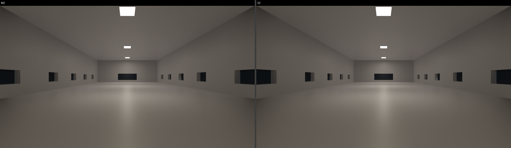

`pics/rect-lamps-whole.png`: the still rect-lamps at the automatic exposure, M2 left and X2 right, at half scale. Both are clean: smooth walls, ceiling and floor, with no blotch, daub or bright speck. X2's floor glow under the lamps is a little more defined, and its near corners are a little darker. `pics/rect-lamps-whole-408.png` shows the same at 4.08 stops, with the same reading.

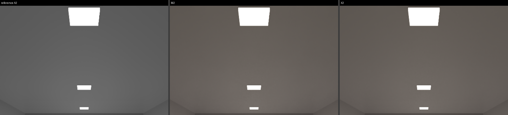

`pics/rect-lamps-ceiling.png`: the ceiling at 1:1, output pixels 640 to 1280 by 0 to 420. The reference A2 comes first. The survey writes this reference without its color, so only its shapes compare. M2's and X2's ceilings are smooth, with no patch.

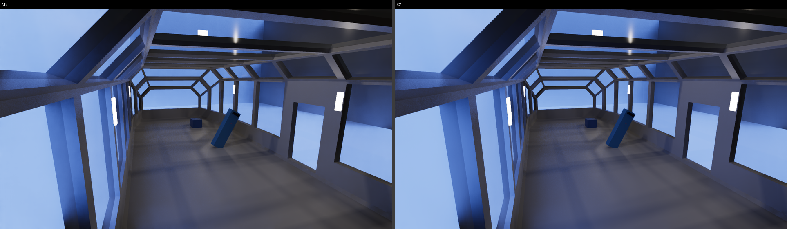

`pics/exit-cabin.png`: M2 left, X2 right, at half scale. M2's floor shows soft dark patches around the box and near the leaning pillar. X2's floor is smoother.

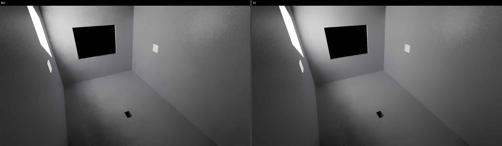

`pics/bay-sunbeam.png`: M2's floor and right wall show coarser grain and soft clouds in the sunlit cone. X2's floor is smoother. No tile shows a bright speck that the other lacks.

`pics/docking-cabin.png`, `pics/cabin-light-cabin.png` and `pics/deck-cuts.png`: the two sides look alike. In cabin-light-cabin, M2 has a broader soft bright wash on the upper left beam. In deck-cuts, M2's window glass is a little more mottled.

### What the layer changed in the stills

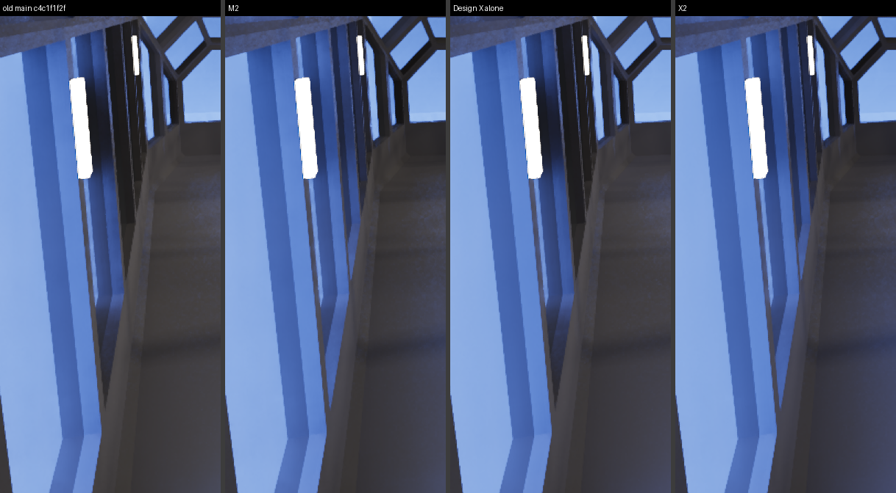

`pics/layer-exit-cabin-jamb.png`: the still exit-cabin at 1:1, output pixels 450 to 750 by 350 to 1000, on four sides: old main `c4c1f1f2f`, M2, Design X alone and X2. On old main and on Design X alone, the jambs between the window pillars beside the lamp are black. On M2 and on X2 they are lit blue, as the window light is. The parent orchestrator's statement holds: the layer turns the jambs from black to lit, on both lines alike.

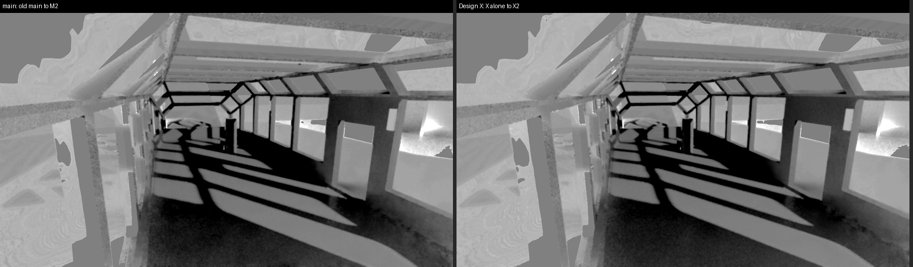

`pics/layerdiff-cabin-light-cabin.png` and `pics/layerdiff-exit-cabin.png`: where the layer changed each still, left on main (old main to M2) and right on Design X (Design X alone to X2). Gray is no change, white is +25 % or more, black is −25 % or less. The tool takes out the exposure first. The two tiles of each pair look the same. In cabin-light-cabin, the floor and the walls in shadow are darker with the layer, and the sunlit patches do not change. In exit-cabin, the left window jamb and the floor's glow under the near lamp are brighter.

### Take 2: the switch "cabin" (the glow-stays case)

This take is the glow-stays case: the probe turns the selected lamps' light off and leaves their glow on. The glow that stays reaches the image only through the main view's emission and bloom: `glowSent` in `Shaders/frame.glsl` keeps the glow of an instance that holds a light out of ray hits and environment faces, on main and on the line. So the grain after the switch is not light from rays that hit a glowing panel. Its cause is open. The user ordered that the switch turn a lamp's light and glow off together. The acceptance lead's change of the probe does that (`ProbeLampSwitch`, commit `68239c0af`).

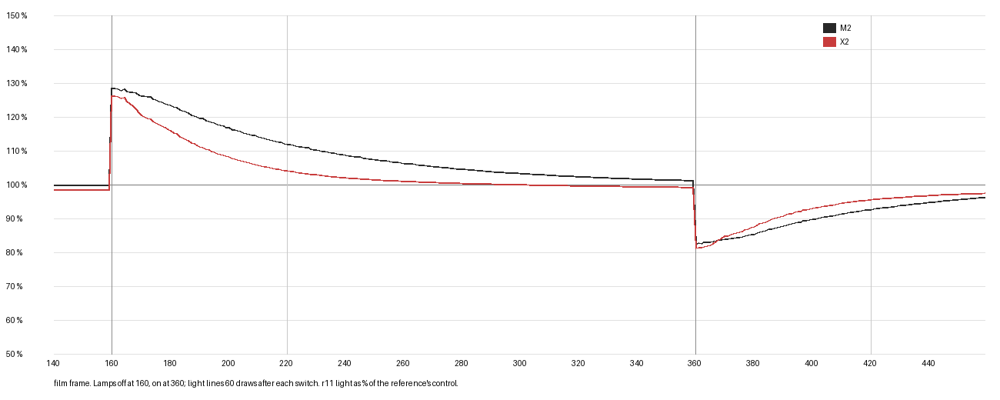

`pics/switch-r11.png`: the center region r11 from frame 140 to frame 459, in % of M2's control in the same lamp state. The lamps go off at frame 160 and come on at frame 360. Before the switch, both lines are flat: X2 lies at 98.5 % of M2's control, as Design X alone did (98.4 %). After the lamps go off, both jump to 126 to 129 % and return smoothly, and X2's r11 comes within 5 % of its control 53 draws before M2's (63 against 116 draws). After the lamps come on, both drop to about 82 % (`switch.py`'s lowest: M2 82.7 %, X2 81.4 %, 2 draws after the switch) and rise smoothly, and X2 rises sooner. No line flickers.

### Take 3: the film rect-bay and the lag film

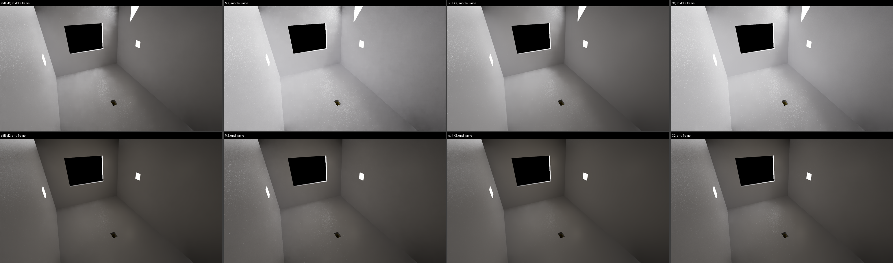

`pics/rect-bay-frames.png`: the film's middle frame (top) and last frame (bottom), at 0.4 scale. The columns are M2's still of the same state, M2's film, X2's still and X2's film, all at M2's exposure. In the middle frame, both films are brighter than their stills: that is the trail. X2's middle frame is a little less bright than M2's. In the last frame, M2's left wall is still lighter than its still and carries specks. X2's last frame is close to its still.

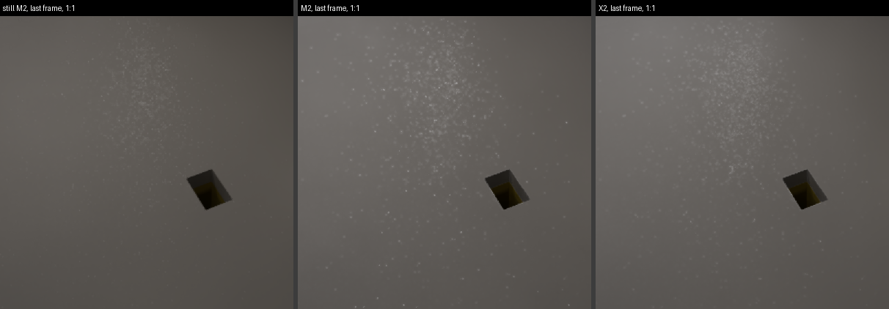

`pics/rect-bay-end-floor.png`: the floor above the hole in the last frame at 1:1, output pixels 700 to 1100 by 600 to 1000. M2's still, M2's film and X2's film. M2's film scatters bright specks over the whole floor. X2's film shows a cloud like the still's, a little denser, with few stray specks.

`pics/layer-rect-bay-frames.png`: the same frames on old main, M2, Design X alone and X2, each at its own exposure, so their brightness does not compare. In structure, the layer changed nothing visible: old main and M2 both carry specks on the left wall, and Design X alone and X2 are both cleaner.

### Take 3b: the film bay-sunbeam and the slit's teeth

The line orchestrator added this film because its flicker is the nearest to the limit in the acceptance record, and for bug `tc-6v3d`. Its video is the picture of the flicker: `pics/bay-sunbeam-M2-X2.mp4`.

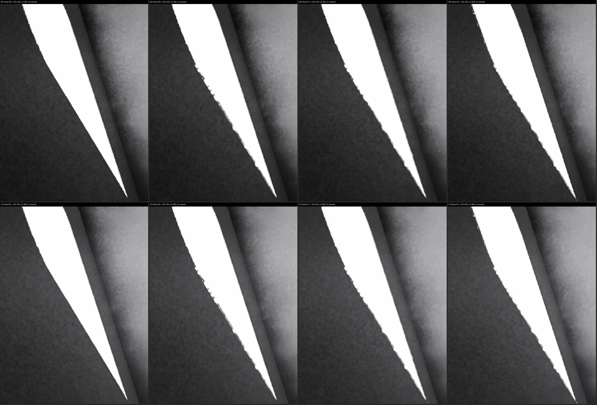

`pics/bay-sunbeam-slit-teeth.png`: the left edge of the sun's slit on the left wall, output pixels 150 to 420 by 0 to 360, at 3x nearest neighbor, in film frames 89 to 92, M2 on top and X2 below.

- Frame 89 has a smooth edge. In frame 90, the slit's edge has moved, and its lower half carries teeth about 2 to 3 output pixels deep. In frames 91 and 92, the same teeth stay at the same rows and get shallower.
- So the teeth do not crawl along the edge, and they do not change at random. They appear in the frame where the slit's edge moves, keep their rows for 2 to 4 frames while they fade, and a new set comes at the next move. Frames 60 to 63 show the same: a notch at row 201 keeps its row and fades by frame 63.

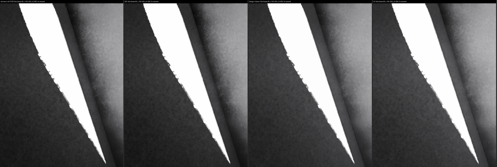

`pics/bay-sunbeam-slit-layer.png`: frame 90 on old main and Design X alone (tiles 0 and 1 of the acceptance lead's `film-bay-sunbeam-slit.png`, read back to 1:1) beside M2 and X2. The four edges are the same. The edge trace finds tooth tips at rows 122, 147, 155, 162, 172, 185, 227, 261 and 294 on all four, with depths that agree within 0.2 pixels. Old main and Design X alone have two more shallow tips each. The layer does not change the teeth.

### Motion in the two films

The line orchestrator asked for measures of motion in the kept frames, beside each video. `tools/filmmotion.py` measures, per film frame, in display-linear luminance:

- light: the mean of the whole image and of each cell of the survey's 3 × 3 grid (r00 at the top left);
- specks: the survey's speck count against the frame's own 5 × 5 median, per 10,000 visible pixels;
- grain: the RMS of the relative fine detail on smooth surfaces, (y − g) / max(g, 0.01), where g is y blurred by 2 pixels;
- edges: the x of two fixed vertical edges, in output pixels. The edge "window" is the right edge of the dark window in the back wall (box x 860 to 910, y 180 to 340). The edge "corner" is the corner between the back wall and the right wall (box x 990 to 1050, y 100 to 450). The camera stands still, so a still picture gives the same x in every frame.

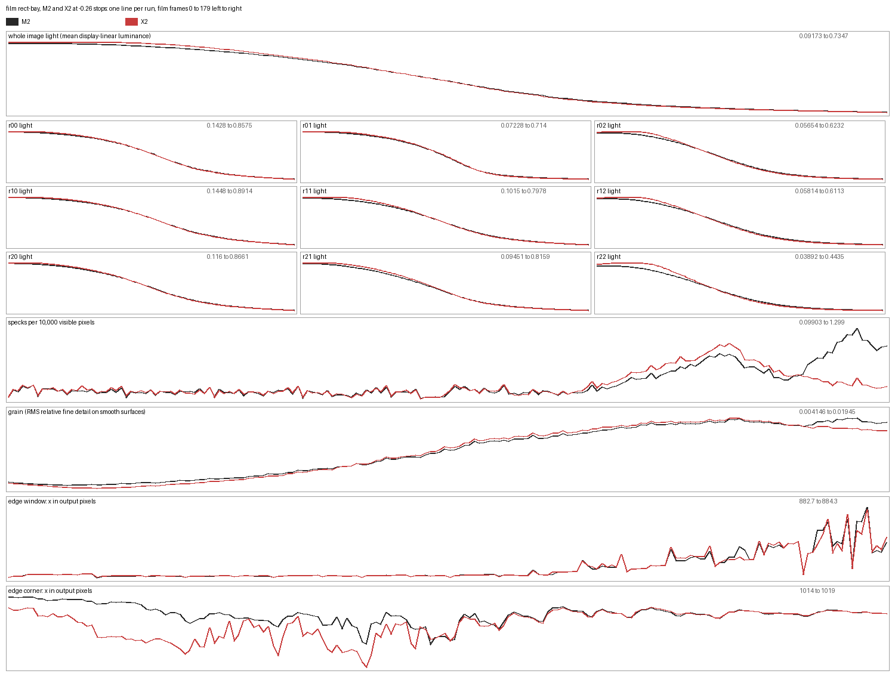

`pics/rect-bay-motion.png`: the film rect-bay, M2 black and X2 red, frames 0 to 179 from left to right.

- Light: the whole image and the nine regions fall smoothly from the sunlit start to the dark end on both sides. No region has a step or a frame-to-frame jump. X2's right column (r02, r12, r22) is a little brighter than M2's for the first 60 frames.
- Specks: equal on both sides up to frame 120 (about 0.1 to 0.3). From frame 120 to 150 both rise to about 0.8, X2 a little higher. After frame 150, M2 rises to 1.30 and X2 falls to about 0.2.
- Grain: equal on both sides. It rises from 0.004 to 0.019 as the room darkens.
- Edge "window": within 0.1 pixel up to about frame 110 on both sides, then the x scatters by up to 1.5 pixels (M2 1.53, X2 1.48 over the film) as the room darkens and the edge's contrast falls.
- Edge "corner": X2's x moves left by up to 4 pixels between frames 10 and 75 and comes back. M2's moves by up to 3 pixels later. The range is 3.44 pixels on M2 and 4.32 on X2. This edge lies between two walls that the sunbeam lights differently, so the measure follows the light across the corner as well as the geometry. It cannot tell a wobble of the picture from a change of light there.

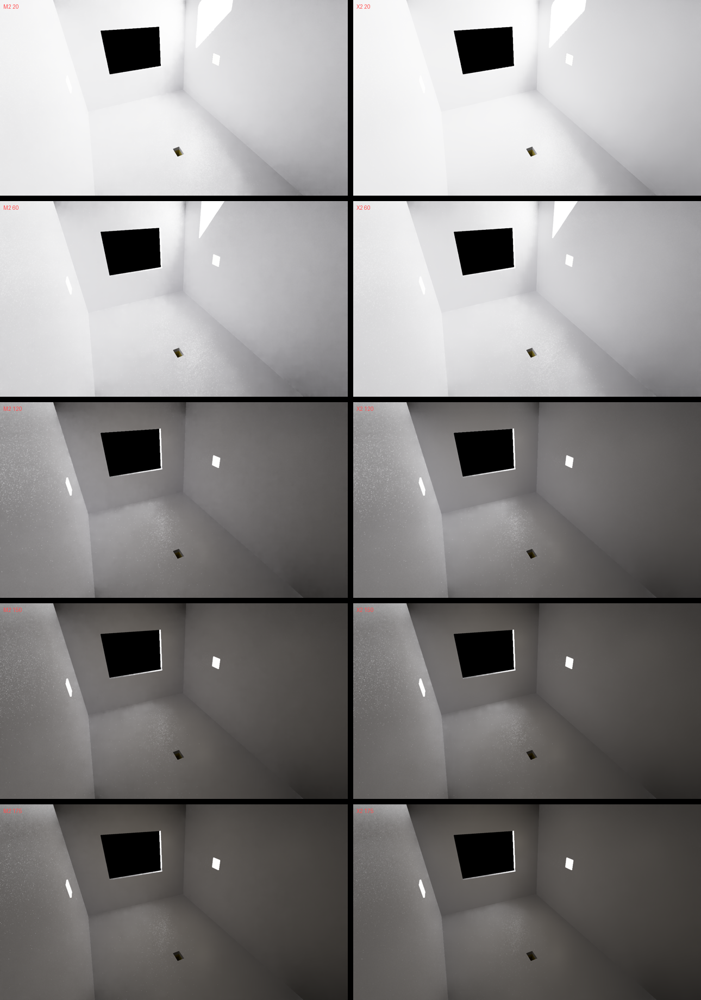

`pics/rect-bay-strip.png`: frames 20, 60, 120, 150 and 175, M2 left and X2 right, at 1/3 scale. What an eye finds:

- M2: from frame 120 on, fine bright grain on the left wall and on the floor in front of the back wall. It is strongest on the left wall at 175. The window's right and lower edges carry a thin bright rim from frame 60 on.
- X2: the same grain on the left wall at 120 and 150, a little weaker, and fainter on the floor. At 175 the left wall is close to clean. The same bright rim on the window's edges.
- Both: the light falls smoothly, with no flash and no blotch that moves. The grain is there on both sides. By the user's rule, grain that is there at all is a bug, so X2 lowers it but does not remove it.

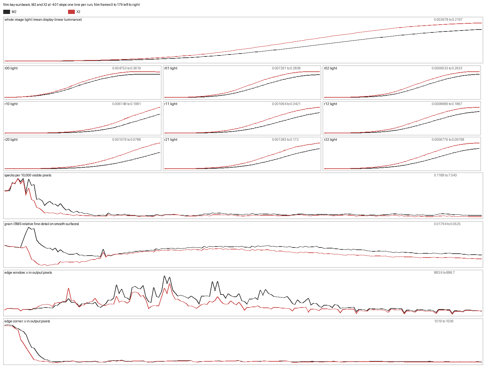

`pics/bay-sunbeam-motion.png`: the film bay-sunbeam, with the same measures and the same two edges. In this film the room starts nearly black (whole-image light 0.0027) and the sun brightens it.

- Light: every region rises smoothly on both sides, with no step and no frame-to-frame jump. X2 rises sooner than M2 in every region. At the last frame, the whole image is 0.2197 on X2 against 0.1828 on M2. That is the shorter lag of the lag film, seen per region.
- Specks: both sides start high in the dark first frames (up to 7.04 on M2 and 6.93 on X2, at frames 0 to 15). X2's count falls by frame 25, M2's by frame 45. Then both stay low, X2 a little lower (mean 0.69 against 1.01 over the film).
- Grain: M2 has a burst at frames 10 to 20 (largest 0.0525). X2 has none (largest 0.0362), and X2 stays below M2 for the rest of the film (mean 0.0278 against 0.0321).
- Edge "window": its x scatters by up to 2.7 pixels on M2 and 2.2 on X2 in frames 40 to 130, while the back wall's clouds pass the window's edge, then settles within about 0.3 pixel. The scatter follows the clouds' light at the edge, not a shift of the whole picture.
- Edge "corner": its x moves by 16.8 pixels on M2 and 16.5 on X2 in the first 15 frames, while the corner is nearly black and the measure finds no edge. After frame 15 it stays within about 0.5 pixel on both sides.

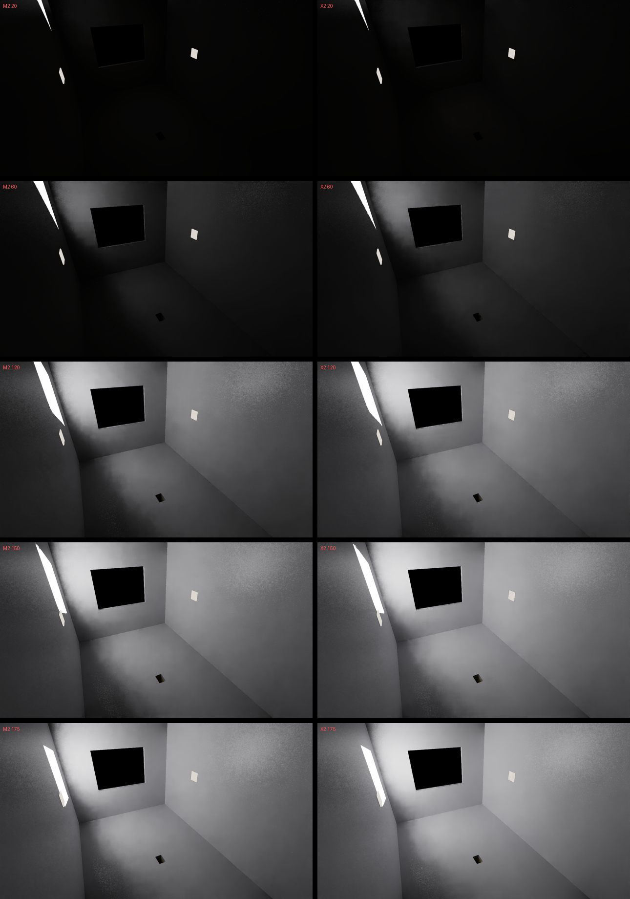

`pics/bay-sunbeam-strip.png`: frames 20, 60, 120, 150 and 175, M2 left and X2 right, at 1/3 scale. What an eye finds:

- M2: soft light clouds on the back wall beside the window and around the slit, a soft cloud on the floor in the sunlit cone, and fine grain on the right wall from frame 120 on.
- X2: the same clouds on the back wall, a little more defined. The floor's cone is more defined than M2's. The same fine grain on the right wall, about as strong as M2's.
- Both: the teeth on the slit's edge (take 3b). The grain and the clouds are there on both sides, so by the user's rule both sides carry these bugs.

What the motion measures do not check:

- A wobble of the picture smaller than 0.1 pixel, and any wobble in a region away from the two edges. The edges are vertical, so a vertical shift is not measured.
- The edge "corner" mixes light and geometry, as said above.
- The speck count misses dim specks below its absolute floor of +0.03 (the jamb take shows such specks).
- Color: every measure is luminance.
- Each frame alone: the grain and specks are measured per frame, so a speck that stays in place and one that moves count the same. Only the video shows whether specks crawl.

### Take 2b: the jambs after the switch, at two constant render scales (the glow-stays case)

The acceptance lead saw bright silver jambs on Design X in the cloud's video at the dynamic render scale. This take looks at the same jambs at two constant render scales, 0.956 and 2/3, on M2 and on X2. It uses the switch "cabin" at 4.08 stops with the default tone curve and bloom, and keeps frames 150 (10 draws before the lamps go off), 180, 220 and 355 (20, 60 and 195 after off), and 380 and 455 (20 and 95 after on).

This is the glow-stays case, as in take 2: the probe turns the selected lamps' light off and leaves their glow on.

The constant scale comes from `scratch-render-scale.patch`: with `TERTIUS_X_RENDER_SCALE` set, a headless run sets a `FixedRenderScale` of that value on its FSR setting. This is simpler than the acceptance lead's replay of a size series, and it is not their method. Both builds carry the patch for this take only.

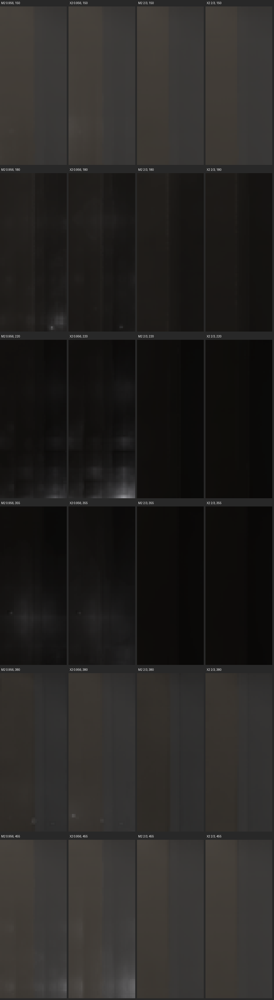

`pics/jamb-sheet-glow-stays-jamb.png`: the jamb crop (output pixels 1770 to 1808 by 495 to 585) at 6x nearest neighbor. Rows are frames 150, 180, 220, 355, 380 and 455. Columns are M2 at 0.956, X2 at 0.956, M2 at 2/3 and X2 at 2/3. `pics/jamb-sheet-glow-stays.png` shows the jamb crop and the floor crop (output pixels 0 to 450 by 840 to 1050) of the same frames.

- At 0.956, both sides show soft blotches and single bright texels on the jambs after the lamps go off (frames 180, 220, 355). X2 has the brightest blotch, at the bottom right in frame 220. Both sides show specks 20 draws after on (frame 380), X2 more.
- At 2/3, the jambs are dark and clean on both sides after off, and smooth after on.

The jamb crop's mean display-linear light (`tools/jambsheet.py`):

| Frame | M2 0.956 | X2 0.956 | M2 2/3 | X2 2/3 |
|---|---:|---:|---:|---:|
| 150, 10 before off | 0.0446 | 0.0465 | 0.0435 | 0.0435 |
| 180, 20 after off | 0.0131 | 0.0106 | 0.0100 | 0.0082 |
| 220, 60 after off | 0.0065 | 0.0104 | 0.0038 | 0.0036 |
| 355, 195 after off | 0.0066 | 0.0079 | 0.0032 | 0.0033 |
| 380, 20 after on | 0.0283 | 0.0351 | 0.0275 | 0.0325 |
| 455, 95 after on | 0.0470 | 0.0519 | 0.0430 | 0.0439 |

The floor crop's speck score is 0 in every cell by the survey's rule. The rule's absolute floor of +0.03 hides the dim specks that the eye sees at 0.956 after off, so the score does not answer the speckle question.

The two edges, the back wall's left and right corners (boxes x 715 to 755 and 1165 to 1205, y 430 to 560), lie 451.12 pixels apart at 0.956 and 450.39 pixels at 2/3 in frame 150: +0.73 pixels, +0.16 %. That matches the expected stretch of about 0.15 %.

Both sides carry the layer, so the M2-to-X2 difference is Design X on the layer. This take has no side without the layer, so it does not separate the layer's own effect. The answers:

1. Brightness: at 0.956, X2's jambs hold more light after off (60 after off, 0.0104 against 0.0065) and are brighter after on (+24 % 20 after on). At 2/3 the two sides match after off within 0.0002, and X2 is +18 % 20 after on.
2. Speckle: at 0.956, both sides show blotches and single bright texels after off, X2 the brightest one. At 2/3, both sides are clean.
3. Fade: at 0.956, X2 falls faster for the first 20 draws (0.0106 against 0.0131), then stops falling while M2 goes on down to 0.0065. At 2/3 both fade the same.

### Take 2c: the fair lamp switch (glow off with the light)

The user ordered that the switch turn a lamp's light and glow off together. The acceptance lead's probe change does that (`ProbeLampSwitch`, commit `68239c0af`): it decides the selected lamps once per draw in the batcher, zeroes their light rows, and gives their instances a non-emissive twin of their material. `TERTIUS_PROBE_LAMP_GLOW=off` is the default, and `=stays` is the old switch.

The builds:

- M2's build `m2g` is main `284025851` with main's version of the change, `probe-main-2ffd7e66f-glow.patch` of `68239c0af`, unchanged, plus `scratch-render-scale.patch`. Main took that patch later as `ee9dec413`.
- X2's build `x2g` is the merged head with the line's `probe.patch` of `68239c0af`, fitted as before: the `Count` hunk reads 12 to 14. Nothing else changed.
- Both built with 0 warnings and 0 errors in about 25 s. They ran under the line orchestrator's disk floor of 32 GiB, given for these builds. The free disk read 37.3 GiB before m2g, 37.1 at the lowest sample and 37.1 after. For x2g it read 36.7 at the lowest and 36.8 after. The sampler reads every 20 s, so it can miss a short peak.

The checks:

- On both sides, the probe log of the switch "cabin" has one line "PROBE draw 193: 2 of 6 lights off, 2 of 34 placed instances dark (glow off)".
- The near overhead panel is black in film frame 220 and lit again in 380.
- With `=stays`, M2's six kept frames equal take 2b's frames bit for bit.

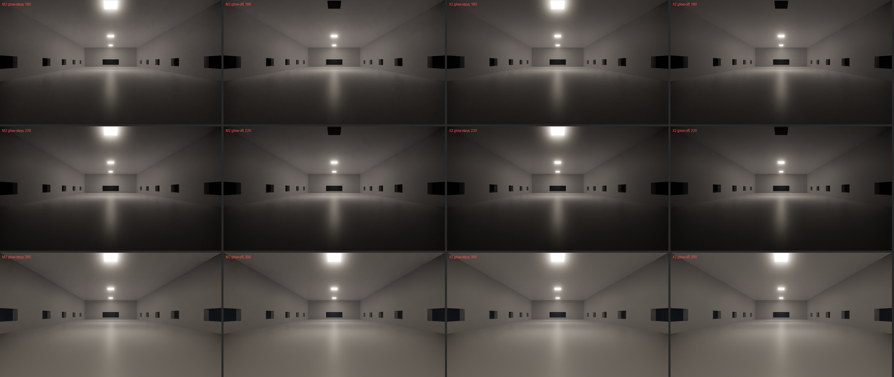

`pics/glow-switch-23.png`: film frames 180, 220 and 380 at 2/3, columns M2 glow stays, M2 glow off, X2 glow stays and X2 glow off. `pics/glow-switch-956.png` shows the same at 0.956.

- The fair switch changes only the top middle of the frame, x 589 to 1331 and y 0 to 408: the switched panel and its bloom.
- In all 24 kept frames, both sides and both scales, the jamb crop and the floor crop are equal bit for bit between the two switches (`tools/glowsheet.py`). So the glow does not cause the faults of take 2b.
- The glow that stays reaches the image only through the main view's emission and bloom (take 2). So the switch changes nothing that rays see.

The survey's switch "cabin" at the headless 2/3 with the fair switch, each side against its own controls (runs `wg-M2` and `wg-X2`). Draws to settle after the lamps go off / come on, and the level 60 draws after each switch. The glow-stays values of take 2 are in brackets where they differ.

| Region | M2 settle | X2 settle | M2 level 60, off / on | X2 level 60, off / on |
|---|---|---|---|---|
| whole | 122 / 53 (77 / 54) | 66 / 30 (42 / 30) | 115.8 / 95.7 % (106.9 / 95.6) | 105.9 / 98.5 % (102.6 / 98.5) |
| r00 | 141 / 92 | 77 / 50 | 125.1 / 89.9 % | 108.2 / 96.7 % |
| r01 | 96 / 5 (14 / 12) | 51 / 4 (8 / 7) | 109.8 / 98.6 % (101.7 / 98.6) | 103.6 / 99.6 % (100.6 / 99.5) |
| r02 | 142 / 92 | 74 / 50 | 124.8 / 89.9 % | 108.2 / 96.7 % |
| r10 | 131 / 87 | 72 / 47 | 119.3 / 91.3 % | 107.0 / 97.0 % |
| r11 | 116 / 83 | 63 / 44 | 112.0 / 92.7 % | 105.2 / 96.9 % |
| r12 | 131 / 87 | 72 / 47 | 119.1 / 91.3 % | 106.7 / 97.0 % |
| r20 | 129 / 50 | 76 / 31 | 121.0 / 96.1 % | 108.1 / 98.6 % |
| r21 | 115 / 41 | 66 / 25 | 114.6 / 96.9 % | 105.9 / 98.8 % |
| r22 | 129 / 51 | 75 / 31 | 120.7 / 96.1 % | 107.9 / 98.6 % |

- Only the whole image and r01, the top-middle region that holds the switched panel, change against take 2. With the glow off, the panel's own light no longer fills their means after the lamps go off, so the room's slow light decides when they settle.
- X2 settles about twice as fast as M2 in every region, as with the glow staying.
- Before the switch, r11 is 100.0 / 100.0 % on M2 and 98.5 / 98.6 % on X2 of M2's control, as in take 2.
- The survey fails both sides on the settle, because both exceed 60 draws after the lamps go off.

### Take 2d: the jambs through the dynamic scale's path

The acceptance lead's take of the same frames at a constant 0.956 shows bright silver jambs, specks on the ceiling and grain on the floor's sides. It ran on main without the layer (`c4c1f1f2f`), on Design X alone, and on the clamps-off reference, through its replay of the dynamic scale. My take 2b shows grey jambs on M2 and X2. The two takes differ in two ways: the layer, and the path of the scale. A fixed headless scale allocates the render targets at the render size. The dynamic setting allocates them for the largest scale and draws in a part of them. This take separates the path on M2.

- Build `m2r`: main `284025851` with main's glow probe and the acceptance lead's `scratch-dynamic-scale.patch` of `a01ec40d0`. The build had 0 warnings and 0 errors. The free disk read 33.9 GiB before it, 33.7 at the lowest sample and 33.8 after.
- Run `scr-M2-956`: `TERTIUS_X_FRAME_TIME_TARGET=16.6667`, and `TERTIUS_X_SIZE_REPLAY` set to a file of 493 lines "k 0 0 0.956". The glow stays, so the frames compare with take 2b's.
- The replay took effect: the back wall's corners lie 451.12 pixels apart, as at the fixed 0.956. At 2/3 they lie 450.39 apart.
- Replay against the fixed path, the same six frames: 876 to 2,886 pixels differ per frame, by at most 4 of 255 steps. The jamb crop differs by at most 1 step. So a different path ran, and it gives the same picture.

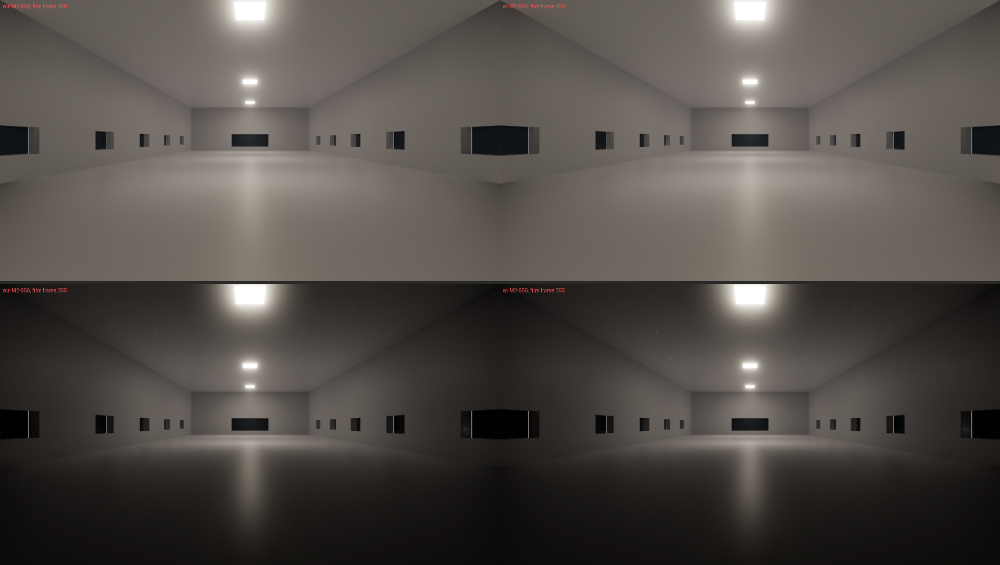

`pics/jamb-m2-replay-0956-vs-fixed.png`: M2's whole frames 150 and 355, replay left and fixed right. `pics/jamb-m2-fixed-0956-vs-23.png`: the fixed 0.956 left and 2/3 right, in the form of the acceptance lead's `jamb-m-0956-vs-23-off195.png`. `pics/jamb-sheet-replay-jamb.png`: the jamb crops of the fixed 0.956, the replay 0.956 and the fixed 2/3.

| Frame | Jamb mean, fixed 0.956 | Replay 0.956 | Fixed 2/3 |
|---|---:|---:|---:|
| 150, 10 before off | 0.0446 | 0.0446 | 0.0435 |
| 180, 20 after off | 0.0131 | 0.0131 | 0.0100 |
| 220, 60 after off | 0.0065 | 0.0065 | 0.0038 |
| 355, 195 after off | 0.0066 | 0.0066 | 0.0032 |
| 380, 20 after on | 0.0283 | 0.0283 | 0.0275 |
| 455, 95 after on | 0.0470 | 0.0470 | 0.0430 |

With the layer, the jambs are grey through both paths. So the scale's path does not make bright jambs on M2. The acceptance lead's half of the separation tests main without the layer through the fixed path.

### What stays at a render scale near 1 (bug `t58-i3sn`)

On M2 and on X2 at 0.956, at 1:1, four faults stay that are gone or much weaker at 2/3:

- single bright specks on the ceiling, with the lamps on and after they go off;
- a bright thin vertical line along the inner edge of the near openings;
- a row of bright dots along the openings' lower sill;
- faint fine grain on the floor's sides after the lamps go off.

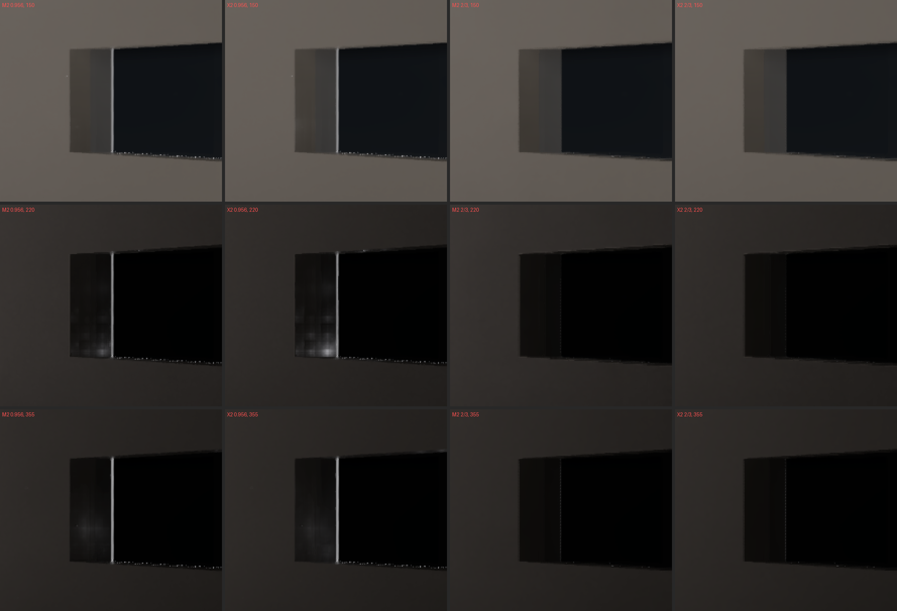

`pics/opening-0956-vs-23.png`: the near right opening (output pixels 1700 to 1920 by 440 to 640) at 2x nearest neighbor, frames 150, 220 and 355, columns M2 0.956, X2 0.956, M2 2/3 and X2 2/3.

Specks per box (`tools/edgefaults.py`, which counts groups of pixels at least 1.5 times and 0.01 above their 7 × 7 median in display-linear light), ceiling / opening / floor's sides:

| Frame | M2 0.956 | X2 0.956 | M2 2/3 | X2 2/3 |
|---|---|---|---|---|
| 150, 10 before off | 5 / 39 / 0 | 5 / 39 / 0 | 0 / 5 / 0 | 0 / 5 / 0 |
| 220, 60 after off | 10 / 36 / 41 | 10 / 45 / 33 | 0 / 2 / 0 | 0 / 0 / 0 |
| 355, 195 after off | 10 / 37 / 30 | 11 / 37 / 30 | 0 / 32 / 0 | 0 / 33 / 0 |

- At 2/3, frame 355 shows a faint dotted line at the opening's inner edge, which gives the 32 and 33 specks. It is much dimmer than at 0.956.
- M2 and X2 carry the same faults at the same places, in about the same counts. At frame 220, X2's jamb face carries a brighter blotch than M2's.
- Bug `t58-i3sn` records them. It names two candidate causes, both untested: screen rays at the openings' edges (the class of `ter-ukw6`), and rare bright hits on the lit panels (the class of `ter-fe63`).

### The stills sample at a constant render scale of 0.956

The survey's still part of rect-lamps (at the automatic exposure and at 4.08 stops), exit-cabin, deck-cuts and bay-sunbeam, on M2 and X2 at a constant 0.956 (builds `m2g` and `x2g` with `scratch-render-scale.patch`, runs `s9-*`, `e9-*` and `s9d-M2`), beside take 1's stills at 2/3. M2's first run of deck-cuts failed with `ErrorIncompatibleDriver`, and `s9d-M2` is its repeat.

| Still | Specks, M2 / X2 at 0.956 | Specks, M2 / X2 at 2/3 | Blotch, M2 / X2 at 0.956 | Blotch, M2 / X2 at 2/3 |
|---|---|---|---|---|
| rect-lamps, automatic | 0.0241 / 0.0193 | 0.0048 / 0.0000 | 0.0150 / 0.0109 | 0.0128 / 0.0105 |
| rect-lamps, 4.08 stops | 0.0145 / 0.0096 | 0.0096 / 0.0096 | 0.0146 / 0.0106 | 0.0126 / 0.0106 |
| exit-cabin | 0.2025 / 0.2074 | 0.2267 / 0.1977 | 0.0174 / 0.0140 | 0.0215 / 0.0179 |
| deck-cuts | 0.0255 / 0.0204 | 0.0051 / 0.0051 | 0.0047 / 0.0037 | 0.0057 / 0.0045 |
| bay-sunbeam | 0.0099 / 0.0099 | 0.1437 / 0.1487 | 0.0313 / 0.0255 | 0.0345 / 0.0294 |

The sheets `pics/s956-<still>.png` show each still whole in four columns: M2 and X2 at 0.956, M2 and X2 at 2/3. Where the specks differ, a count per cell of a 3 × 3 grid found them, and a crop at 1:1 or 2x shows them:

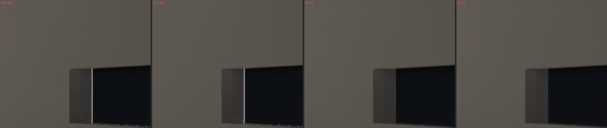

- rect-lamps (`pics/s956-rect-lamps-opening.png`): at 0.956 about 90 more specks, all in the middle row's left and right cells. They are the bright line at the openings' inner edge and the dots along the sill of bug `t58-i3sn`. At 2/3 the openings are clean.
- deck-cuts (`pics/s956-deck-cuts-glass.png`): about 11 more specks around the glass hall's frames. A bright streak on a pillar's lower edge shows on all four tiles, a little longer at 0.956. No other fault that 2/3 hides.
- bay-sunbeam (`pics/s956-bay-sunbeam-slit.png`): better at 0.956. At 2/3 the slit's edge has stair-step teeth (bug `tc-6v3d`) and the wall beside it a coarser grain, which give the 60 extra specks. At 0.956 the edge is smooth and the grain finer.
- exit-cabin: no change in score, and the sheet at 0.4 scale shows none. I did not look at it at 1:1.
- M2 and X2 match in every crop and grid cell, within one or two specks.

### Main moved: the sides M3 and X3

Main moved during the check to `a819b10b2`. Against M2 it changes `Shaders/screen_ray.glsl`, `Shaders/screen_walk.glsl` and `Shading/ScreenRay.cs`: the walk keeps the inverse depth that a descent solved. The line orchestrator ordered every take that had not started onto the new sides.

- X3, the merge `bcca31e95`: only `tools/renderer-survey/probe.patch` conflicted. Its resolution is the line's fair-switch probe of `68239c0af` with the `Count` hunk at 12 to 14. `ARCHITECTURE.md` merged without a conflict: it takes main's new paragraph of the walk and main's removal of the two limits that the fix ends, and `ter-18hc` and `td-hjn6` stay out of the known limits as before. The pre-commit hook ran the Rendering tests on it: 3,411 tests, 0 failed, 10 skipped.
- The replay builds `m3r` (`a819b10b2` with its tree's probe patch and `scratch-dynamic-scale.patch`) and `x3r` (`bcca31e95` the same way) built with 0 warnings and 0 errors.
- The faults of `t58-i3sn` at 0.956 (1832 × 1032), old beside new, specks per box (ceiling / opening / floor's sides) at film frames 150, 220 and 355:

| Side | 150 | 220 | 355 |
|---|---|---|---|
| M2 | 5 / 39 / 0 | 10 / 36 / 41 | 10 / 37 / 30 |
| M3 | 5 / 39 / 0 | 10 / 36 / 42 | 10 / 37 / 31 |
| X2 | 5 / 39 / 0 | 10 / 45 / 33 | 11 / 37 / 30 |
| X3 | 5 / 39 / 0 | 10 / 45 / 28 | 11 / 37 / 25 |

`pics/opening-0956-m2-vs-m3.png` and `pics/opening-0956-x2-vs-x3.png` show the opening old beside new. The bright line, the sill's dots and the ceiling's specks are the same on the new main. The floor's grain is the same on M3 and a little weaker on X3. The jamb's soft blotch at frame 220 may be a little dimmer on M3.

### The jambs at every render size (the size ramp)

The acceptance lead found on main without the layer (`c4c1f1f2f`) that sunlight leaks onto the cabin's window jambs at some render sizes and not at others. Its ramp (`sizeramp.sh` and `sizeramp.py` of `b53c037f1`, run by their paths; both files equal the commit) holds each of the 181 render sizes that `RenderExtent` gives for 1920 × 1080 at the scales 0.50 to 1.0 for 40 draws, in the cabin's view with the lamps on at 4.08 stops, and measures the display-linear mean of the right and the left jamb crop. A size leaks when either mean is above 0.08. Grey jambs measure 0.035 to 0.055.

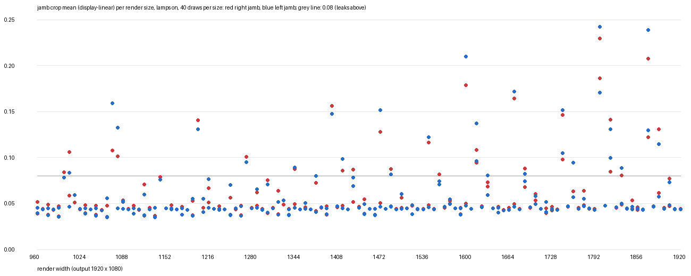

On M3, with the layer (`ramp-M3.txt`):

- 32 of the 181 sizes leak. All 32 are among the 74 sizes that leak on main without the layer (the acceptance record's `ramp-jambs-main-c4c1f1f2f.txt`). 49 sizes measure above 0.06, so 17 lie between 0.06 and 0.08.
- The brightest: 1800 × 1008 (right 0.2298, left 0.2420), 1872 × 1048 (0.2073, 0.2390) and 1600 × 896 (0.1789, 0.2099). Without the layer the largest jamb mean is 0.7722.
- All 8 sizes of the exact 16:9 aspect are on the floor, 0.043 to 0.047 on both jambs.
- The leak is not monotone in the size. 1832 × 1032, the size of the constant 0.956 in takes 2b to 2d, gives 0.0491. That is why those takes showed grey jambs. The next size down, 1832 × 1024, gives 0.0805 and 0.0888.
- The settle check: at 1344 × 752 the right jamb measures 0.0836 ten draws before the size's last frame and 0.0876 at it; at 1920 × 1080, 0.0449 and 0.0444.

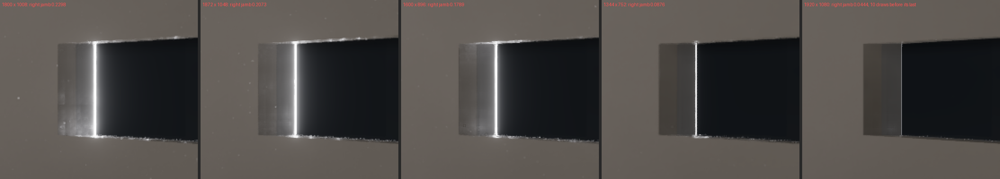

`pics/ramp-M3-openings.png`: the near right opening at 2x at 1800 × 1008, 1872 × 1048, 1600 × 896 and 1344 × 752, and at 1920 × 1080, which does not leak. At the leaking sizes the jamb face is silver and speckled, the inner edge carries a broad bright line with a glow, and the sill and the ceiling carry bright dots. At 1920 × 1080 the opening is grey and clean.

Fact: with the layer, 32 sizes leak against 74 without it, and the brightest leak is 0.24 against 0.77. Reading: the layer weakens the leak but does not cure it. Bug `t58-i3sn` holds the list and the crops.

On X3 (`ramp-X3.txt`, `pics/ramp-X3.png`), 35 sizes leak and 54 measure above 0.06. The largest mean is again at 1800 × 1008: right 0.2339, left 0.2996. The lists of M3 and X3 differ at five sizes, and every one of them lies within 0.012 of the threshold on both sides. Only on M3: 1376 × 776 (0.0801 on M3 against 0.0791 on X3, left). Only on X3: 1120 × 632, 1144 × 640, 1216 × 680 and 1904 × 1064. Per size, X3's larger mean minus M3's has a median of +0.0014 and ranges from −0.0134 to +0.0576. So Design X leaks at the same sizes as main with the layer, a little higher on a few of them.

On W, the wobble fix's branch (`ramp-W.txt`, `pics/ramp-W.png`), no size leaks: 0 of 181 above 0.08 and 0 above 0.06. The largest mean is 0.0468, at 1088 × 616. At 1800 × 1008, W gives 0.0441 and 0.0439. The fix takes the projection's and FSR's aspect from the output, so every render size draws the picture at 16:9.

**The window test.** The back-face line read the ramp of M3 against the aspect error of the render size, (width / height) / (16 / 9) − 1. All sizes lie on one sawtooth curve of it, so a zero on W can mean "cured" or "hidden at 16:9". The test draws windows of a given shape with the render scale held at 1, so the render size equals the window (`tools/wintest.py` and `tools/wintest.sh`, the ramp's view and 40 draws). The crop boxes scale to the window by the projection's rule: the vertical field of view is fixed, so x' = W / 2 + (x − 960) H / 1080 and y' = y H / 1080. At 1800 × 1008 the right box sits on the jamb face, as the crop shows. The camera's field of view has no switch, so the test varies the window's width at the height 1008.

| Code | Window | Aspect error | Right | Left |
|---|---|---|---|---|
| M3 | 1800 × 1008 | +0.45 % | 0.0977 | 0.0582 |
| M3 | 1920 × 1080 | 0 | 0.0436 | 0.0435 |
| M3 | 1784 × 1008 | −0.45 % | 0.0437 | 0.0437 |
| M3 | 1792 × 1008 | 0 | 0.0438 | 0.0433 |
| M3 | 1808 × 1008 | +0.89 % | 0.0435 | 0.0431 |
| M3 | 1816 × 1008 | +1.34 % | 0.0510 | 0.0591 |
| W | 1800 × 1008 | +0.45 % | 0.0977 | 0.0582 |
| W | 1920 × 1080 | 0 | 0.0436 | 0.0435 |

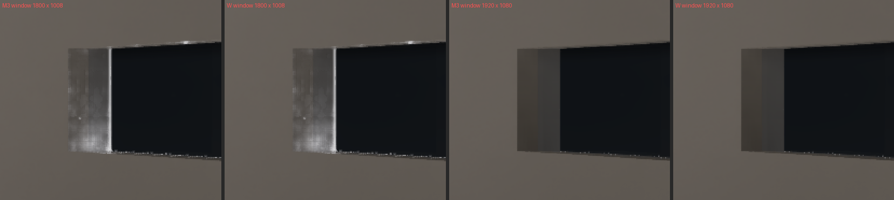

`pics/window-1800x1008-M3-W.png`: the near right opening at 2x, M3 and W at the window 1800 × 1008, then both at 1920 × 1080.

- A window whose own shape is off 16:9 by +0.45 % leaks with no dynamic scale, and it leaks the same on W, equal to four decimals. So W's zero hides the leak at a 16:9 output and does not cure it.
- The leak at the window is weaker than at the same render size on the ramp (right 0.098 against 0.230), where 1800 × 1008 is upscaled to a 1920 × 1080 output.
- 1792 and 1808 lie on the floor and 1816 a little above it, as the sawtooth predicts. 1784 lies on the floor, where the reading put a tooth near −0.34 %. The sizes between were not tested.
- The cause is not measured. The back-face line's candidate, read from the code, is the texel grid of the sun's shadow cascades: a cascade's texel size depends on the field of view and the aspect (`ShadowCascades.cs`), and its center snaps to a grid fixed in the world.

## The tables

`tables.txt` holds the output of every measure. `tools/measure.sh` prints it.

### Table 1: the stills

Draw 132 of the survey's still part. Specks are per 10,000 visible pixels: one speck in the 1920 × 1080 view of rect-lamps is 0.0048. The blotch is the survey's score against the side's own long reference, and its limit is 0.04. The daub and the broad score are `daub.py`'s, against A2's long reference.

| Still | Side | Specks | Blotch | Daub | Broad | Level |
|---|---|---:|---:|---:|---:|---:|
| rect-lamps, automatic | M2 | 0.0048 | 0.0128 | 0.0119 | 0.0191 | +0.0007 |
| | X2 | 0.0000 | 0.0105 | 0.0089 | 0.0078 | +0.0000 |
| | A2 | 0.0048 | 0.0219 | 0.0079 | 0.0215 | +0.0010 |
| | Design X alone (part B) | 0.0096 | 0.0102 | 0.0088 | 0.0071 | −0.0002 |
| rect-lamps, 4.08 stops | M2 | 0.0096 | 0.0126 | 0.0102 | 0.0178 | −0.0116 |
| | X2 | 0.0096 | 0.0106 | 0.0081 | 0.0084 | −0.0123 |
| | A2 | 0.0096 | 0.0221 | 0.0079 | 0.0229 | −0.0275 |
| | Design X alone (part B) | 0.0145 | 0.0102 | 0.0081 | 0.0079 | −0.0116 |
| exit-cabin | M2 | 0.2267 | 0.0215 | 0.0289 | 0.0473 | −0.0004 |
| | X2 | 0.1977 | 0.0179 | 0.0173 | 0.0135 | −0.0008 |
| | Design X alone (`t0-5tyj`) | 0.2363 | 0.0176 | | | −0.0006 |
| | old main (`t0-5tyj`) | 0.2411 | 0.0201 | | | −0.0007 |
| docking-cabin | M2 | 0.2652 | 0.0246 | 0.0263 | 0.0306 | +0.0012 |
| | X2 | 0.2025 | 0.0194 | 0.0169 | 0.0142 | −0.0007 |
| | Design X alone (`t0-5tyj`) | 0.2315 | 0.0195 | | | −0.0004 |
| | old main (`t0-5tyj`) | 0.2604 | 0.0248 | | | +0.0007 |
| cabin-light-cabin | M2 | 0.1725 | 0.0204 | 0.0428 | 0.1268 | −0.0005 |
| | X2 | 0.1478 | 0.0160 | 0.0348 | 0.0483 | −0.0004 |
| | Design X alone (`t0-5tyj`) | 0.1283 | 0.0146 | | | +0.0007 |
| | old main (`t0-5tyj`) | 0.1628 | 0.0193 | | | −0.0002 |
| deck-cuts | M2 | 0.0051 | 0.0057 | 0.0076 | 0.0077 | −0.0003 |
| | X2 | 0.0051 | 0.0045 | 0.0053 | 0.0044 | −0.0000 |
| | Design X alone (`t0-5tyj`) | 0.0051 | 0.0045 | | | −0.0001 |
| | old main (`t0-5tyj`) | 0.0102 | 0.0059 | | | +0.0002 |
| bay-sunbeam | M2 | 0.1437 | 0.0345 | 0.0315 | 0.0587 | +0.0008 |
| | X2 | 0.1487 | 0.0294 | 0.0229 | 0.0383 | −0.0004 |
| | Design X alone (R of `t0-acxm`) | 0.14 | 0.0294 | 0.0225 | 0.0374 | |
| | old main (M of `t0-acxm`) | 0.14 | 0.0342 | 0.0311 | 0.0583 | |

The daub of Design X alone in bay-sunbeam is against that record's own reference A, not against A2. Every still passes the survey's verdict on both sides (`failed` is empty).

The light of rect-lamps' ceiling and walls, as a share of A2's long reference (`light.py`):

| Side | Exposure | Shown, ceiling / walls | Settled, ceiling / walls |
|---|---|---|---|
| M2 | automatic | 100.6 / 100.2 % | 101.0 / 100.7 % |
| X2 | automatic | 99.5 / 99.4 % | 99.9 / 99.8 % |
| M2 | 4.08 stops | 101.1 / 100.7 % | 102.7 / 102.6 % |
| X2 | 4.08 stops | 98.8 / 98.6 % | 100.4 / 100.3 % |

Part B's Design X alone gave 99.5 / 99.4 % and 99.9 / 99.8 % at the automatic exposure, and 98.9 / 98.7 % and 100.4 / 100.3 % at 4.08 stops.

What the layer changed in the stills (`layerdiff.py`, the share of visible pixels whose light changed by more than 10 % after the exposure is taken out):

| Still | Exposure ratio, main / Design X | Brighter, main / Design X | Darker, main / Design X |
|---|---|---|---|
| cabin-light-cabin | 0.951 / 0.951 | 0.082 / 0.118 | 0.262 / 0.261 |
| exit-cabin | 1.020 / 1.024 | 0.139 / 0.151 | 0.053 / 0.049 |
| docking-cabin | 1.026 / 1.023 | 0.143 / 0.134 | 0.037 / 0.037 |
| deck-cuts | 0.994 / 0.994 | 0.000 / 0.000 | 0.017 / 0.016 |

### Table 2: the switch "cabin", glow stays

Draws to settle after the lamps go off / come on, each side against its own controls, by the survey's rule: until the region stays within 5 % of the control. The levels are 60 draws after each switch.

| Region | M2 settle | X2 settle | Design X alone settle (part B) | M2 level, off / on | X2 level, off / on |
|---|---|---|---|---|---|
| whole | 77 / 54 | 42 / 30 | 43 / 31 | 106.9 / 95.6 % | 102.6 / 98.5 % |
| r00 | 141 / 92 | 77 / 50 | 77 / 50 | 125.1 / 89.9 % | 108.2 / 96.7 % |
| r01 | 14 / 12 | 8 / 7 | 9 / 7 | 101.7 / 98.6 % | 100.6 / 99.5 % |
| r02 | 142 / 92 | 74 / 50 | 76 / 51 | 124.8 / 89.9 % | 108.2 / 96.7 % |
| r10 | 131 / 87 | 72 / 47 | 72 / 48 | 119.3 / 91.3 % | 107.0 / 97.0 % |
| r11 | 116 / 83 | 63 / 44 | 64 / 46 | 112.0 / 92.7 % | 105.2 / 96.9 % |
| r12 | 131 / 87 | 72 / 47 | 72 / 48 | 119.1 / 91.3 % | 106.7 / 97.0 % |
| r20 | 129 / 50 | 76 / 31 | 77 / 31 | 121.0 / 96.1 % | 108.1 / 98.6 % |
| r21 | 115 / 41 | 66 / 25 | 68 / 26 | 114.6 / 96.9 % | 105.9 / 98.8 % |
| r22 | 129 / 51 | 75 / 31 | 75 / 31 | 120.7 / 96.1 % | 107.9 / 98.6 % |

r11 over frames 140 to 159, before the lamps go off, lowest / highest: M2 100.0 / 100.0 % and X2 100.0 / 100.0 % of their own lamps-on controls. Against M2's control, X2 is 98.5 / 98.6 % (Design X alone in part B: 98.4 / 98.4 %). X2 against M2's controls 60 draws after each switch: whole 102.6 / 97.9 %, r11 104.1 / 95.6 %. The survey fails both sides on the settle, because both exceed 60 draws after the lamps go off.

### Table 3: the films and the lag film

The film's level is the survey's median ratio of the film frame's light to the still of the same state, minus 1: +1.01 means 101 % too bright. The specks are the survey's count in the film frame against that still (`filmspecks.py`). The survey's limits are 0.006 for the flicker and 0.05 for the grain flicker.

| Film | Side | Exposure | Level, middle / last | Blotch, middle / last | Specks, middle / last | Flicker | Grain flicker |
|---|---|---|---|---|---|---:|---:|
| rect-bay | M2 | −0.256 (own) | +1.35 / +0.24 | 0.259 / 0.168 | 0.21 / 0.97 | 0.00190 | 0.00580 |
| | X2 | −0.256 (M2's; own −0.375) | +1.01 / +0.13 | 0.219 / 0.134 | 0.19 / 0.26 | 0.00241 | 0.00619 |
| | Design X alone (`t0-5tyj`, equal to R of `t0-acxm`) | −0.735 (own) | +0.85 / +0.29 | 0.187 / 0.162 | 0.22 / 0.27 | 0.00273 | 0.00709 |
| | old main (`t0-5tyj`) | −0.604 (own) | +1.17 / +0.53 | 0.238 / 0.231 | 0.18 / 0.89 | 0.00204 | 0.00638 |
| bay-sunbeam | M2 | −4.012 (own) | −0.60 / −0.16 | 0.336 / 0.243 | 0.49 / 0.41 | 0.00397 | 0.00951 |
| | X2 | −4.012 (M2's; own −4.158) | −0.37 / −0.06 | 0.210 / 0.126 | 0.24 / 0.16 | 0.00515 | 0.00981 |
| | Design X alone (`t0-5tyj`) | −4.165 (own) | −0.38 / −0.07 | 0.209 / 0.124 | 0.25 / 0.14 | 0.00519 | 0.00982 |
| | old main (`t0-5tyj`) | −4.018 (own) | −0.61 / −0.16 | 0.342 / 0.243 | 0.48 / 0.41 | 0.00393 | 0.00943 |

The survey fails every film here on its motion blotch and motion level, on both lines, as before the layer.

The lag film bay-sun: the lag is the film's difference from the still of the same state divided by the film's change per draw, in draws. The lag error is the median error of the light against the moving sunbeam's state.

| Side | Median lag | Largest lag | Median lag error | Largest lag error |
|---|---|---|---|---|
| M2 | 27.8 draws | 71.6 draws | 0.266 | 0.548 |
| X2 | 13.6 draws | 26.2 draws | 0.150 | 0.387 |
| Design X alone (R of `t0-acxm`) | 14.0 draws | 30.3 draws | 0.150 | 0.395 |
| old main (M of `t0-acxm`) | 28.3 draws | 73.0 draws | 0.270 | 0.556 |

The survey fails both sides on the lag error, as it fails main.

## Take 4: the deck's GPU frame span

Each run is the Release demo on the deck (`scripts/temporal-upscale-timing.json`, 1920 × 1080 output, `--in-flight 2`, no video), alone under the exclusive GPU lock and beside `gpu-clock`. The builds are plain: M2's is main `284025851`, X2's is the merged head `a7e373197`, with no probe patch. A run counts only when the 1-minute load average is under 8 at its start, inside the lock (`tools/run-one.sh`). Odd rounds run M2 first, even rounds X2 first. The number per run is the median GPU frame span over its 120 timed frames.

| Round | M2 | X2 | X2 − M2 | GPU clock, M2 / X2 | Load at start, M2 / X2 |
|---|---:|---:|---:|---|---|
| 1 | 19.247 ms | 19.385 ms | +0.138 ms | 1296 / 1296 MHz | 7.91 / 5.07 |
| 2 | 19.617 ms | 19.495 ms | −0.122 ms | 1296 / 1296 MHz | 6.94 / 7.96 |
| 3 | 19.561 ms | 19.781 ms | +0.220 ms | 1296 / 1296 MHz | 6.05 / 6.94 |
| 4 | 19.148 ms | 19.415 ms | +0.267 ms | 1296 / 1296 MHz | 4.90 / 7.87 |
| mean | 19.393 ms | 19.519 ms | +0.126 ms | | |

- The per-round differences have a median of +0.179 ms and spread over 0.389 ms, from −0.122 to +0.267 ms.
- Round 2 scattered: its sign differs from rounds 1 and 3. So I took round 4, as the brief asks for a round that scatters. Rounds 1 to 3 stay in the table, as the line orchestrator asked.
- Each side's median moves by up to 0.47 ms between rounds (M2 19.148 to 19.617 ms), more than the difference between the sides. This drift is common to both sides and runs of minutes, so a single round decides nothing.
- Round 4's two runs lie 29 minutes apart (X2 at 13:12, M2 at 13:41), because M2's first try failed (see "The load and the cloud").

Fact: in every round X2's difference lies under +0.30 ms, and the mean is +0.126 ms. Reading: Design X on the layer costs about 0.1 to 0.2 ms of the deck's GPU frame span on this Mac, within its allowance. The rounds cannot resolve the cost more finely than about ±0.2 ms.

## The suites

Both suites ran on the merged tree with `nix develop --command dotnet test --solution Tertius.slnx`, one after the other.

| Suite | Tree | Total | Passed | Failed | Skipped | Rendering project |
|---|---|---:|---:|---:|---:|---|
| Checked | the staged merge, committed as `b1a433aae` | 11,141 | 11,113 | 0 | 28 | 3,396 passed in 20 min 28 s |
| Release | `a7e373197` (the same `src` and `tests`) | 11,128 | 11,100 | 0 | 28 | 3,395 passed in 19 min 54 s |

Checked runs 13 more tests than Release, the tests that run only in that configuration. The 28 skipped tests of the Release run, by their reasons: 16 explicit test filters, 9 opt-in measures (`TERTIUS_FSR_TIMING`, `TERTIUS_GPU_CALIBRATION`, `TERTIUS_STORE_ROUNDING_REPORT`), 1 for the M1 Max's late time stamps, and 2 tests of main's walk that wait for `ter-186q` and `t53-eyrv`.

## Every take where X2 is worse than Design X alone

- The still cabin-light-cabin, in score: specks 0.1478 against 0.1283, blotch 0.0160 against 0.0146. The pictures of M2 and X2 look alike and show no fault. Main rose the same way with the layer (old main 0.1628 and 0.0193, M2 0.1725 and 0.0204).
- The film rect-bay's middle frame: level +1.01 against +0.85, blotch 0.219 against 0.187. Main rose the same way (old main +1.17, M2 +1.35). The two sides ran at different exposures: X2 at M2's −0.256 stops, Design X alone at its own −0.735. The last frame is better on X2: +0.13 against +0.29, blotch 0.134 against 0.162.

No other take is worse than Design X alone beyond the scatter of a speck or two.

## The merge and the probe patch

- `git merge --no-ff 795e1661f` into main `284025851` conflicted only in `ARCHITECTURE.md`, at three places. The line orchestrator's resolution (`/private/tmp/t0-gbgj/ARCHITECTURE.resolved.md`, made by a trial merge in the other direction) differed from the conflicted file only inside the three conflict hunks, so it fits this direction too, and the merge uses it unchanged. Its rule is in the ticket's note "Start and design": the known limits keep main's two new items and leave out `ter-18hc` and `td-hjn6`; the two rows of storage image formats keep the line's R16_UINT facts and main's facts of the depth pyramid.
- Everything under `src` merged without a text conflict. The merged head built with 0 warnings and 0 errors, and the Checked suite passed on it before the merge commit. No change under `src` or `tests` was needed.
- The probe patch: the cherry-pick of `0e441286d` did not apply at one hunk. The layer adds the specialization constant `BothFaces` (id 7), so `SpecializationStorage.Count` is 12 on the merged tree, not 11. The probe adds two rows (`probeSignal` at id 12 and `LeastMotion` at id 13), so the hunk now reads `Count` 12 to 14 (`a7e373197`). Nothing else in the patch changes. `ShaderConstants.Specialization` throws on a row past `Count`, so a wrong fit fails at the first render, and every probe take ran.
- Main's own probe patch had the same stale hunk, so `probe-build` failed on main `284025851`. M2 is built with the one-line fit `scratch-probe-m2.patch` (`Count` 12 to 13). Main fixed its patch in `2ffd7e66f` with the same line (bug `t58-k95j`), and that patch equals `scratch-probe-m2.patch` byte for byte.

## The changes to the takes and their reasons

- The film rect-bay and the film bay-sunbeam run through `tools/film.py`, the survey's own `run_motion` with two changes: it keeps the film's frames for the video and the slit's teeth, and X2 renders at M2's fixed exposure. The survey itself deletes the frames and gives each side its own exposure. The user's rule for a fault over time is a side-by-side video at one exposure, and the brief forbids a new take only for a video. So the one film take serves both. The cost: X2's film numbers are at M2's exposure, not at its own (−0.375 and −4.158 stops). The level, blotch and specks compare each film frame with a still at the same exposure, so the exposure moves them only through the tone curve. Design X alone's film numbers are at its own exposure.
- The film bay-sunbeam is a take that the line orchestrator added during the check, with its video and the slit's teeth.
- The comparison with Design X alone for exit-cabin, docking-cabin, cabin-light-cabin and deck-cuts uses the acceptance lead's still takes of `t0-5tyj` on the line's head (`/private/tmp/t0-5tyj/runs/s1-X` and `s1-M`, built from `57b4045ae` and `c4c1f1f2f`), because no committed record has them. Their `src` equals `795e1661f`.
- The layer's difference maps (`layerdiff.py`) take out the exposure first: without that, the whole image shows structure, because the automatic exposure differs between builds.
- `teeth.py` traces the slit's edge per row and fits a straight line. The line also counts a bend of the edge as teeth (frames 104 to 107 show a smooth bend that it reads as teeth 4 to 9 pixels deep), and a running median reads the slit's corner as a tooth in every frame. So the record reads its numbers only where the pictures show teeth, and the answer on the crawl rests on the pictures of frames 60 to 63 and 89 to 92.

## The load and the cloud

The stills, the switch and the films ran under the shared GPU lock at loads of 7 to 138 on 10 cores. A compiler build outside the lab carried most of it. No image number depends on time: each is a measure of rendered images or of their region means. The timing rounds ran under the exclusive GPU lock and counted only at a load under 8, but four tries did not count:

- Round 1's first try: M2 failed with `vkCreateInstance` returning `ErrorIncompatibleDriver`, while the dev shell fetched its nix store paths again. The `gpu-clock` binary was also not built yet. I built it with `xcrun clang -O2 -o captures/gpu-calibration/bin/gpu-clock tools/gpu-calibration/gpu-clock.c -framework CoreFoundation -framework IOKit -lIOReport`.
- Round 1's second try: M2 ran at a load of 37.8 after a wait of 632 s for the lock (median 19.204 ms at 1296 MHz). From then on the load check runs inside the lock.
- Round 2's first try: X2 started at a load of 24.0 and M2 at 147.5, after a 10-minute wait. From then on a try without a quiet start gives the lock back and tries again (`tools/round-2.sh`).
- Round 4's first M2 try: `ErrorIncompatibleDriver` again, with no frames.

The discarded runs lie in `/private/tmp/t0-gbgj/timing/discarded`. Some process on the machine removes nix store paths of the dev shell, so a dev shell opened at the wrong moment fetches them again. The same cause once left the survey's Python without `scipy` (the stills at 0.956, run again). Cloud money spent: 0.00 dollars.

## Files

- `README.md`: this record.
- `tables.txt`: the output of `tools/measure.sh`, every measure in the order of the tables.
- `ramp-M3.txt`, `ramp-X3.txt`, `ramp-W.txt`: the size ramp's tables.
- `scratch-probe-m2.patch`: main's survey probe fitted to the layer, M2's probe. Main's `2ffd7e66f` holds the same patch.
- `scratch-render-scale.patch`: a constant headless render scale from `TERTIUS_X_RENDER_SCALE`, for take 2b only.
- `pics/`: the pictures and the two videos above.
- `tools/` (tool code; each script says what it does in its first lines):
  - `vars.sh`: the takes' folder and the sides.
  - `build.sh` and `builds.sh`: the four builds, from `git archive` of a revision and patches, outside the checkout.
  - `take.sh` and `queue.sh`: one survey run and the takes in order. `queue-2.sh`: the added film bay-sunbeam. `queue-3.sh`: take 2b.
  - `scalefilm.py` and `scalefilm.sh`: the switch "cabin" at a constant render scale, with the default tone curve and six frames kept.
  - `film.py` and `film.sh`: the survey's motion part, with the frames kept and an optional fixed exposure.
  - `video.sh`: the side-by-side video of two kept films.
  - `round.sh` and `timing.sh`: the first form of the deck's timing rounds, which checked the load outside the lock.
  - `run-one.sh`, `round-2.sh` and `timing-2.sh`: the timing rounds that count. `run-one.sh` runs one side under the exclusive lock only after a load under 8 at its start, and `round-2.sh` tries again until it gets one.
  - `timetable.py`: the timing rounds' table.
  - `m.sh`: runs a measuring script of this record or of an earlier one (`t0-9fo0`, `t0-acxm`, `t0-xdck`, `t0-ion0`, `t0-xlcu`, `t0-y46f`, `t0-mzhr`) in `/private/tmp/t0-gbgj/w`.
  - `measure.sh`: every measure and picture. Its output is `tables.txt`.
  - `summary.py`: the survey's numbers that the tables cite.
  - `filmspecks.py`: `t0-xdck`'s speck count of a film's sampled frames, for any case.
  - `layerdiff.py`: where the layer changed a still, after the exposure is taken out.
  - `teeth.py` and `layerteeth.py`: the slit's teeth in kept frames, and beside the acceptance lead's crop.
  - `filmmotion.py` and `filmstrip.py`: the motion measures of a kept film with their chart, and five of its frames.
  - `queue-4.sh`, `queue-5.sh` and `queue-6.sh`: the fair-switch takes, the stills sample at 0.956, and the takes on M3 and X3.
  - `diskbuild.sh`: `build.sh` beside a sampler of the free disk.
  - `glowsheet.py`, `scalepair.py`, `edgefaults.py`, `stillcrops.py`: the glow sheets, the whole frames at two scales, the speck counts per box, and the still crops.
  - `rampcrops.py`, `wintest.py`, `wintest.sh`, `winsheet.py`: the ramp's crops, the window test and its sheet. The ramp itself is the acceptance lead's `sizeramp.sh` and `sizeramp.py` of `b53c037f1`, run by their paths.
  - `jambsheet.py`: take 2b's sheets, the jamb crop's mean and the floor crop's specks, and the two edges' distance.
- Scripts of earlier records that this record runs: `daub.py`, `light.py`, `sheet.py`, `levelchart.py` and `films.py` of `t0-mzhr`, `switch.py` and `stills.py` of `t0-xlcu`, `regions.py` of `t0-9fo0`, `filmsheet.py` of `t0-ion0`, `filmcrop.py` of `t0-acxm`.
