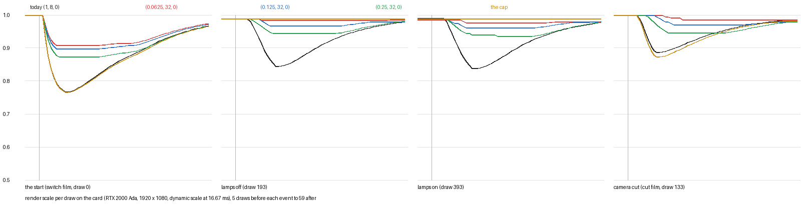
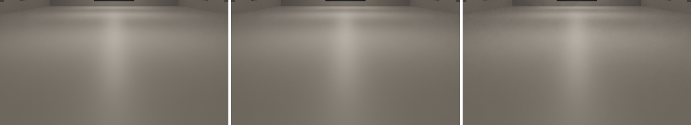

# Spread the catch-up rays of a young history over more draws (t0-gumm, experiment)

The user's words, 2026-11-22: "i think catch up rays are important after a reset of the history. maybe spreading them out more somehow?" Today the ray plan gives a pixel a ray of its own in every draw while its history is shorter than `FullRateFrames`, 8 draws: a cliff. This experiment replaces the cliff with one share function, so that the same rays can arrive over more draws at a lower peak. It is scratch code. The patches stay in this folder and never go into `src`.

## Terms

- A block is 2 × 2 pixels. In each draw one pixel of a block, the chosen pixel, traces the block's ray of a kind. An own ray is a ray that another pixel of the block traces for itself.
- A catch-up ray is an own ray that a pixel traces because its history is young, not because the block's ray does not fit it.
- L is the length of a pixel's slow history of a kind, in draws: the slow history's alpha, as the plan reads it from the last draw.
- The shape (PeakShare, EndFrames, Fall) gives the share of draws on which a young pixel traces a catch-up ray: `share = L >= End ? 0 : PeakShare · (1 − L / End)^Fall`, with `End = min(EndFrames, cap)`, and Fall 0 a box. (1, 8, 0) is today's cliff.
- The tree: X5, the line's merge `710834cc0` (tree `e232080f`): Design X with light evidence restarting a history at 4 draws, without the cap of `t0-zmjx`.

## The scratch code

`scratch-ownray-log.patch` (`TERTIUS_X_OWNRAY_LOG`) logs each draw's own-ray lists: their counts, and of them those in even columns and in even rows. `scratch-catch-up-share.patch` builds the share in `Shaders/screen_trace_plan.comp`. Both apply after X5's probe patch and `t0-3vwx`'s region, dynamic-scale and history-log patches (`tools/builds.sh`: `xt` is today's code with the log, `xg` adds the share).

```glsl
            if (fits(p, c, kind) && !catchUpTurn(pixel, kind, catchUpShare(historyLengthOf(r, kind), capOf(p, kind), youngHistory(ownAge, blockCodes[kind]))))
                continue;
```

where

- `fits(p, c, kind)` = whether the block's ray from its chosen pixel `c` fits the pixel `p`, as today.
- `historyLengthOf(r, kind)` = L.
- `capOf(p, kind)` = the history's cap at the pixel in draws: 32 for the diffuse signal; for the reflections, 4 up to roughness 0.1, linear to 32 at 0.7, as `SignalParameters.Specular` and `capAt` give it. The plan has no signal parameters, so the scratch carries them as constants.
- `youngHistory(ownAge, blockCode)` = whether the history restarted less than End draws ago (see "Where the ticket's design did not fit").
- `catchUpShare(L, cap, young)` = the share above for a young history whose cap is at least 8 draws; today's rule (1 while L < 8, else 0) for every other history.
- `catchUpTurn(pixel, kind, share)` = whether the pixel takes its turn in this draw: `phase = offset + drawIndex · 2654435769` in 32-bit unsigned arithmetic, a turn when `phase < share · 2^32`. 2654435769 is 2^32 divided by the golden ratio.

The shape comes from `TERTIUS_X_CATCHUP="<peak> <end> <fall>"` through three new push constants of the tracer, so one build serves every shape and one cloud job can run many.

## Where the ticket's design did not fit, and the forms chosen

1. **The young test.** The ticket's share is a function of L alone, ending at the cap. In the settled cabin at 2/3, many diffuse histories stay below the cap of 32 for good. The map below shows why: region evidence that fires falsely, not the anti-lag as I first read it (the patch's comment still says the anti-lag). Shape (1, E, 0) on today's code, mean diffuse own rays per draw over the settled draws 150 to 192 (today: 2,164):

   | End | 12 | 16 | 24 | 32 |
   |---|---|---|---|---|
   | Diffuse own rays per draw | 33,844 | 65,315 | 130,638 | 163,080 |

   So about 161,000 of 921,600 pixels (17 %) sit between 8 and 32 draws. L alone cannot tell such a history from one that grows after a light change or a reset, and any End above 8 draws would trace own rays there for ever. The chosen form gates the share by the time since the history's restart. A history is young while one of these is under End draws:
   - the draws since the last reset (`drawIndex`: a start or a camera cut empties every history);
   - the draws since the pixel's own exact light changed (its light-age record);
   - the draws since its block's rays last saw a changed light: the youngest light code of the last draw's samples over the plan's 8 × 8 workgroup, which is the spatial dispatch's block. This is the source of the light evidence that restarts the block's histories, and it covers the pixels whose own direct light did not change. Without it, about half of today's peak stayed after a lamp switch (286,000 to 322,000 diffuse own rays per draw in draws 1 to 10 after off, against today's 545,000 to 675,000). The read is the one that the acceptance lead's variant XD made: the plan reads the last draw's sample ages (the images lose `writeonly`), with two barriers that every invocation reaches before any return.

   A history that is not young keeps today's rule exactly, so a settled view traces today's own rays.
2. **The offset.** The blue-noise mask holds 8 bits per channel. The offset takes the mask's first frame at the pixel (red for the reflections, green for the diffuse rays) as its high 8 bits and `pcg3d` of the pixel as its low 24, so that small shares still get distinct offsets.

## The settled history lengths of the cabin


`pics/history-map-cabin.png`: the cabin of the switch film with the lamps on through the whole run (no switch), at the constant scale 2/3, draw 190 on today's code `xt` (`scratch-history-dump.patch`, `tools/histmap.py`). Left the still, right the slow diffuse history's length per render pixel, in five bands (`historymap.txt`):

| Band, draws | Under 8 | 8 to under 16 | 16 to under 24 | 24 to under 31.5 | 31.5 or more (the cap) |
|---|---|---|---|---|---|
| Share of the pixels | 1.9 % | 9.7 % | 6.6 % | 4.5 % | 77.4 % |

- Under 8 draws: the window openings, which show space and hold no history.
- 8 to 31.5 draws, 20.8 % of the pixels: whole rectangles about 136 render pixels high, which is the size of a region of the drift test (17 × 17 blocks of 8 pixels), on the ceiling, the walls and the floor. In the same run, the region test fires on 1 to 11 of its 238 tested anchors in each of the draws 100 to 131, although nothing changes. Region evidence caps a region's histories at 8 draws, and they regrow by one per draw, so the rectangles show fires of different ages. These are the false fires of `t0-qvm1`.
- The short histories do not lie at edges, at the jambs or on the floor's glow, and they are not grain spread over the view.
- Main has no region test. There is no dump of main `ac5f23915` (`m5h` has no dump patch), so the map has no main row.

## The card, job 1: the render scale under the first shapes



`pics/card-scale-shapes1.png` (job 1 ran the old cut film: 100 frames on the bright chase camera, then a cut to the cabin at draw 133; after it the cabin stays saturated white for over 100 draws, so job 2 uses a cut inside the cabin): the render scale per draw on the card (RTX 2000 Ada, 1920 × 1080, the dynamic scale at 16.67 ms), from 5 draws before each event to 59 after. Black is today's cliff (1, 8, 0), red (0.0625, 32, 0), blue (0.125, 32, 0), green (0.25, 32, 0), orange the cap (`scratch-light-evidence-cap.patch` of the acceptance record: light evidence restarts at 8 draws, so today's plan traces no catch-up ray after a light change). One cloud job, `card.sh shapes1`, $0.0542; one warm-up run of each build first. The logs are in `logs/card-shapes1/`, the table in `cardscale-shapes1.txt` (`tools/cardscale.py`).

The bar is the idle span, draws 133 to 192 of the switch film (lamps on, nothing changes): 0 scale changes for every code, at a scale of 0.988 or 0.989. Its GPU span is 17.2 to 17.5 ms, above the target, and the controller's dead band holds the scale.

| Code | Start: changes, largest fall, scale lost | Off: changes, fall, lost | On: changes, fall, lost | Cut: changes, fall, lost |
|---|---|---|---|---|
| Today (1, 8, 0) | 57, 0.232, 7.38 | 54, 0.144, 3.71 | 53, 0.150, 4.02 | 49, 0.113, 3.02 |
| (0.25, 32, 0) | 45, 0.127, 5.51 | 32, 0.045, 1.76 | 33, 0.052, 2.02 | 31, 0.053, 2.16 |
| (0.125, 32, 0) | 42, 0.102, 4.52 | 14, 0.020, 0.81 | 23, 0.026, 1.05 | 16, 0.029, 1.27 |
| (0.0625, 32, 0) | 39, 0.091, 4.09 | 3, 0.005, 0.22 | 5, 0.009, 0.40 | 3, 0.014, 0.61 |
| The cap | 57, 0.234, 7.54 | 0, 0, 0 | 0, 0, 0 | 50, 0.127, 3.35 |

"Changes" counts the draws of the window whose scale differs from the draw before. "Largest fall" is the scale before the event minus the lowest scale in the window. "Scale lost" is the sum over the window of (the scale before − the scale), in draws. In no window with a fall does the scale come back to its level before the event within 60 draws, because the controller rises slowly.

- No shape passes the bar. Each moves the scale after the switch and the cut. At (0.0625, 32, 0) the move is small: 3 to 5 changes and a fall of 0.005 to 0.014. The share falls with the peak, about by half for each halving of the peak.
- The start falls for every shape: 0.091 still at (0.0625, 32, 0), against 0.232 today. Part of the start's fall is not catch-up rays (`t58-np60`: the scale falls to about 0.77 at every start). The shape (0, 32, 0), with no catch-up ray at all, measures that part in job 2.
- The cap holds the scale after off and on, with no change at all, as the orchestrator predicted. After the cut, the cap falls as today does (0.127 against 0.113), because it changes only the light evidence.

## The card, job 2: the search, the start's two parts, and the codes with the cap


`pics/card-scale-shapes2.png`: as job 1's chart, for six of job 2's codes. Black today, red A (the cap), blue (0, 32, 0) with no catch-up ray, green B32 (0.03125, 32, 0), orange C32 (the cap with (0.03125, 32, 0)), violet C' at 1/16 (the cap, and the spread rays only after a start or a cut). Job `card.sh shapes2`, $0.0846, through main's `gpu_job.py` after the user raised the daily cap. The cut film is the new one (cut inside the cabin at draw 134). Logs in `logs/card-shapes2/`, the table of all eleven codes in `cardscale-shapes2.txt`.

| Code | Start: changes, fall, scale lost | Off: changes, fall | On: changes, fall | Cut: changes, fall |
|---|---|---|---|---|
| Today (1, 8, 0) | 57, 0.232, 7.39 | 54, 0.154 | 53, 0.151 | 56, 0.140 |
| A: the cap | 57, 0.231, 7.42 | 0, 0 | 0, 0 | 58, 0.140 |
| (0, 32, 0): no catch-up ray | 30, 0.070, 3.29 | 0, 0 | 0, 0 | 6, rises only |
| (0.015625, 32, 0) | 34, 0.081, 3.76 | 0, 0 | 1, 0.004 | 3, rises only |
| B32: (0.03125, 32, 0) | 32, 0.084, 3.93 | 0, 0 | 1, 0.005 | 3, rises only |
| B16: (0.0625, 32, 0), second run | 35, 0.092, 4.19 | 8, 0.013 | 9, 0.008 | 4, 0.003 |
| (0.0625, 16, 0) | 45, 0.093, 3.98 | 8, 0.013 | 21, 0.018 | 11, 0.011 |
| (0.0625, 32, 1) | 43, 0.091, 4.00 | 1, 0.004 | 12, 0.014 | 4, 0.002 |
| C32: the cap with (0.03125, 32, 0) | 31, 0.086, 4.03 | 0, 0 | 1, 0.004 | 3, rises only |
| C16: the cap with (0.0625, 32, 0) | 34, 0.092, 4.30 | 5, 0.009 | 6, 0.009 | 11, 0.011 |
| C' at 1/16: the cap, light clocks off | 32, 0.093, 4.30 | 0, 0 | 0, 0 | 5, 0.007 |

- **The noise of the card's scale.** The idle span had 0 changes in every code except one: C16's idle span has 3 changes. B16 ran in both jobs: after off 3 and 8 changes (falls 0.005 and 0.013), after on 5 and 9. So one change of 0.004 or 0.005 lies inside the card's noise.
- **The search.** The largest peak share that leaves the scale alone within that noise is 1/32: B32 and C32 have no change after off, one change of 0.004 to 0.005 after on, and after the cut only small rises. 1/64 gives the same. 1/16 moves the scale in both runs. EndFrames 16 at 1/16 moves it more, because it gives the same rays in half the draws. Fall 1 at 1/16 lies between 1/16 and 1/32. So neither EndFrames nor Fall beats a smaller peak with the box.
- **The start in two parts** (the scale's largest fall, then the scale lost over 60 draws):
  - The part without catch-up rays, from (0, 32, 0): 0.070, 3.29. This is the dear first draws of `t58-np60` and the other start costs.
  - The catch-up rays' part, today minus that: 0.162, 4.10. At B32 it is 0.014, 0.64.
- **The cut** without catch-up rays raises the scale a little (up to 0.003). After a cut, the draws with empty histories cost less than settled draws in some pass.
- **What one ray must buy.** A share of 1/32 for 32 draws gives one catch-up ray per restarted pixel, and this card allows no more without a move of the scale. So the Mac's measures must show whether that one ray buys anything: C against A (the cap alone), and B against today's cliff. The table says so plainly, also if the answer is "nothing that the measures see".
- **The share is a cost budget.** A faster card or a higher frame time target fits a larger share, so a production form could take the share from the controller's headroom. Not built.
- **C'** gives the cap's flat scale after a light change, because no history counts as young then. After the start and the cut it runs C's code. C' therefore needs no Mac run of its own.
- (0, 32, 0) still traces today's own rays for the reflections whose cap is under 8 draws (smooth surfaces), so "no catch-up ray" holds for the diffuse rays and the rough reflections.

## The card, job 3: two runs of each code, 1/16 against 1/32


`pics/card-scale-shapes3-zoom.png`: the render scale per draw, as job 1's chart, but from 0.95 to 1 (a scale under 0.95 sits on the bottom line). Black A's second run, red and blue B32's two runs, green C32's first run, orange and violet B16's two runs. `pics/card-scale-shapes3.png` shows today, A, B32 and B16 from 0.5 to 1. Job `card.sh shapes3` with `RUNS=2`, $0.0898: one warm-up run of each build, then each code once, then each code again (run 1 and run 2). Logs in `logs/card-shapes3/`, the table in `cardscale-shapes3.txt`.

The warm-up runs also cover the fact `t1-80jd` (the first run of a card job may draw 10 to 18 % slower; not proven): no compared run is the first run of the job. Jobs 1 and 2 had the same warm-up.

| Code | Off: changes, fall (run 1 / run 2) | On: changes, fall | Cut: changes, fall | Idle: changes |
|---|---|---|---|---|
| Today (1, 8, 0) | 54, 0.151 / 53, 0.156 | 53, 0.154 / 53, 0.154 | 56, 0.139 / 56, 0.144 | 0 / 0 |
| A: the cap | 0, 0 / 0, 0 | 0, 0 / 1, 0.004 | 56, 0.141 / 56, 0.140 | 0 / 0 |
| B16: (0.0625, 32, 0) | 2, 0.009 / 8, 0.013 | 10, 0.009 / 11, 0.013 | 4, 0.003 / 8, 0.006 | 0 / 0 |
| B32: (0.03125, 32, 0) | 0, 0 / 0, 0 | 4, 0.013 / 1, 0.004 | 3, rises only / 3, rises only | 0 / 0 |
| C16: the cap with (0.0625, 32, 0) | 3, 0.010 / 1, 0.005 | 12, 0.013 / 8, 0.009 | 10, 0.011 / 8, 0.006 | 0 / 0 |
| C32: the cap with (0.03125, 32, 0) | 0, 0 / 0, 0 | 1, 0.004 / 0, 0 | 4, 0.002 / 3, rises only | 1 / 0 |

The start, for the record (changes, fall, run 1 / run 2): today 57, 0.233 / 57, 0.238; A 57, 0.235 / 57, 0.238; B16 36, 0.093 / 32, 0.093; B32 32, 0.086 / 31, 0.087; C16 33, 0.093 / 34, 0.094; C32 31, 0.085 / 31, 0.086.

- **The card's noise.** A traces no catch-up ray after a light change, yet its second run changes the scale once by 0.004 after on, and C32's first run changes it once in the idle span. So one change of about 0.004 is the card's noise.
- **The spread between two runs of one code** (changes, then the largest fall): B32 differs by 0 and 0 after off, 3 and 0.009 after on, 0 and 0 at the cut. B16 differs by 6 and 0.004 after off, 1 and 0.004 after on, 4 and 0.003 at the cut. C32 differs by at most 1 and 0.004 in each window.
- **1/16 against 1/32.** After off, every run of 1/16 changes the scale (1 to 8 changes, falls 0.005 to 0.013), and no run of 1/32 does. After on, every run of 1/16 changes it 8 to 12 times, and every run of 1/32 0 to 4 times. At the cut, every run of 1/16 falls 0.003 to 0.011, and the runs of 1/32 rise or fall 0.002 at most. The one overlap is B32's first run after on: its fall of 0.013 (in 4 changes) is as large as 1/16's. **So the card tells 1/16 from 1/32**: the two runs of 1/32 do not differ as much as 1/16 differs from 1/32. The answer of job 2 stands: 1/32 is the largest peak share that leaves the card's scale within its noise. B32 sits at that limit, because one of its four light-change windows came out above the noise. C32 sits inside it in each of its windows.
- The idle levels of the runs lie between 0.981 and 0.989. Each window's fall counts from its own run's level before the event.

## The three codes: the table, the rule and the recommendation

**The base.** Every code here is built on X5, the line's merge `710834cc0` (tree `e232080f`). A and C add the cap as the acceptance record's `scratch-light-evidence-cap.patch`, the same rule as the production commit `05a27262d`. Main's step 2 of the wobble fix (`3549d3283`, merged to the line as `6f54dd615`, line head `aeed1895b`) came after this base, and no code here has it.

**The codes.**

- Today: X5's cliff, (1, 8, 0), with light evidence restarting a history at 4 draws.
- A: the cap. Light evidence restarts a history at 8 draws, so no history is young after a light change, and the plan keeps today's cliff after a start or a cut.
- B: the share (P, 32, 0) with the restart at 4 draws, and all three clocks in the young test.
- C: the cap and the share (P, 32, 0), with all three clocks.
- C': the cap and the share, with only the reset's clock (`drawIndex < End`, the fourth shape value 0). After a light change it runs A's code path, and after a start or a cut C's. So it needs no run of its own.
- None: (0, 32, 0), no catch-up ray at all after a reset (the Mac's start and cut, `tools/queue-mac6.sh`). With the cap, after a light change it runs A's code path.

P is 1/32 (B32, C32) or 1/16 (B16, C16).

### The cost

| Code | Card, start: largest fall (run 1 / 2) | Card, off: changes | Card, on: changes | Card, cut: changes, fall | Mac, extra GPU ms over 60 draws: off / on / start / cut |
|---|---|---|---|---|---|
| Today | 0.233 / 0.238 | 54 / 53 | 53 / 53 | 56, 0.139 / 56, 0.144 | 79 / 75 / 91 / 78 |
| A | 0.235 / 0.238 | 0 / 0 | 0 / 1 | 56, 0.141 / 56, 0.140 | 2 / 9 / as today / as today |
| B32 | 0.086 / 0.087 | 0 / 0 | 4 / 1 | 3, rises / 3, rises | 6 / 12 / 42 / 8 |
| C32 | 0.085 / 0.086 | 0 / 0 | 1 / 0 | 4, 0.002 / 3, rises | 3 / 11 / 39 / 10 |
| C' at 1/32 | as C32 | as A | as A | as C32 | as A after a light change, as C32 after a start or a cut |
| B16 | 0.093 / 0.093 | 2 / 8 | 10 / 11 | 4, 0.003 / 8, 0.006 | 12 / 19 / 52 / 18 |
| C16 | 0.093 / 0.094 | 3 / 1 | 12 / 8 | 10, 0.011 / 8, 0.006 | 13 / 18 / 48 / 22 |
| None | 0.070 (job 2, one run) | 0 (job 2) | 0 (job 2) | 6, rises (job 2) | not run |

- The card's columns come from job 3 (two runs per code), the last row from job 2. One change of about 0.004 is the card's noise.
- The start falls by about 0.070 for every code, also with no catch-up ray. That part is the dear first draws of `t58-np60`, so rule 1 counts only the catch-up rays' part above it.
- The Mac's GPU spans (`tools/spans.py`, timing runs with the GPU lock held alone, at 2/3) are noisy under load. A runs today's code at a start and a cut, but its timing runs gave 217 and 177 ms. So those two cells say "as today".

### The picture on the Mac, at the constant scale 2/3

The slowest region's settle in draws, the boil without the fade over draws 1 to 59 in %, and the grain over draws 0 to 15 in % (`tools/events.py`):

| Code | Off: settle, boil, grain | On: boil, grain | Start: settle, boil, grain | Cut: settle, boil, grain |
|---|---|---|---|---|
| Today | 142, 0.276, 2.14 | 0.177, 1.01 | 139, 0.109, 0.86 | 134, 0.106, 0.88 |
| A | 139, 0.267, 1.61 | 0.174, 0.89 | as today | as today |
| B32 | 142, 0.291, 2.11 | 0.191, 1.00 | 139, 0.114, 0.89 | 133, 0.112, 0.87 |
| C32 | 139, 0.266, 1.61 | 0.174, 0.88 | as B32 | as B32 |
| C' at 1/32 | as A | as A | as B32 | as B32 |
| B16 | 142, 0.290, 2.11 | 0.190, 1.00 | 139, 0.113, 0.89 | 133, 0.112, 0.87 |
| C16 | 139, 0.265, 1.62 | 0.173, 0.89 | 139, 0.113, 0.89 | 133, 0.112, 0.87 |
| None | as A (with the cap) | as A (with the cap) | 139, 0.114, 0.89 | 133, 0.112, 0.87 |

- **The spread between runs with the event moved by 1 and 2 draws** (`tools/queue-mac3.sh`). Today after off: settle 142, 140, 138, and boil 0.276, 0.268, 0.274, so the boil's spread is 0.008. After on: boil 0.177, 0.175, 0.177. At the cut, the three runs give the same numbers to the last digit. B32 after off: settle 142, 139, 137, and boil 0.291, 0.283, 0.287. At the cut, its three runs are equal. The start cannot move.
- After on, no code's upper and middle regions settle within the 100 draws of the film. The bottom row settles in 77 to 91 draws in today's three runs, and every code lies inside that span.
- A and C32 differ by at most 0.001 in boil and 0.01 in grain after a light change. A against today: the same settle within the spread, and less grain after off (1.61 against 2.03 to 2.14), because the cap keeps 8 draws of history where today keeps 4.

### The picture under the card's scale

The runs of the final videos (`tools/queue-mac5.sh`) play back each code's own card scale log, the second run of job 3, so the cliff's fall of the scale shows in the picture. Each run's own size log gives the card log's scale on every draw. The measures are as above (`videos-events.txt`):

| Code | Off: settle, boil, grain | On: settle, boil, grain | Start: settle, boil, grain | Cut: settle, boil, grain |
|---|---|---|---|---|
| Today | 173, 0.182, 2.24 | none, 0.140, 1.06 | 156, 0.112, 0.87 | 153, 0.105, 0.89 |
| A, run 2's log | 135, 0.208, 1.97 | none, 0.139, 1.02 | 158, 0.110, 0.87 | 152, 0.104, 0.89 |
| A, run 1's log | 135, 0.208, 1.97 | 80, 0.152, 1.01 | | |
| C32 | 140, 0.211, 1.95 | 81, 0.141, 1.03 | 154, 0.111, 1.08 | 132, 0.106, 1.02 |

- **After off**, today settles 38 draws after A and 33 after C32. Its scale changes 90 times in the video. At 2/3, the three settled within 3 draws of each other.
- **After on**, A's run-2 log has one size change of 0.004 at draw 402, which is the card's noise. With it, A's upper and middle regions do not settle within 100 draws. On run 1's log, which has no size change after on, A settles in 80 draws, as C32 does in 81. So one size change after a light change costs more than 20 draws of settle. The likely cause is `t4f-71qp` (the region's drift test restarts its count at every change of the render size). Not hunted.
- **At the cut**, C32 settles in 132 draws, and A and today in 152 and 153. A and today fall to a scale of 0.85 and change size 40 and 44 times. C32 holds 0.98.
- **At the start**, the three settle within 4 draws.
- **The grain of the first 16 draws** is the cliff's price on the picture: C32 1.08 against 0.87 at the start, and 1.02 against 0.89 at the cut. At 2/3 the difference was 0.03. At draw 2 after the start, C32's floor shows a fine speckle that A and today do not show (`pics/start-draw2-floor.png`: A, today, C32, a crop of 800 × 440 source pixels; the render scale at draw 2 is 0.929 (1776 × 1000) for A, 0.929 (1776 × 1000) for today and 0.969 (1856 × 1040) for C32).



**The cut's fade in the videos** (the orchestrator's question). `videos.txt` puts C32's center region (r11) 1.7 to 2.1 % further below its last frame than A's at 2, 10 and 40 draws after the cut. The source frames show where that comes from:

- In the PNGs, the center's mean display-linear luminance is the same at those draws (A, today, C32): 0.1642, 0.1640, 0.1641 at draw 2, 0.1750, 0.1749, 0.1743 at draw 10, and 0.1853, 0.1851, 0.1854 at draw 40. The gap appears later. At draws 80 and 119 after the cut, C32 is 2.9 % and 2.0 % brighter than A (0.1963 against 0.1908, and 0.1996 against 0.1956). So the gap is in the reference frame, the video's last frame.
- The catch-up rays do not cause it. At 2/3, the probe's scene luminance of the center (`frames.series`) is the same for today, none and C32 within 0.1 % at every draw compared.
- Under the card's scale, the probe's scene luminance of A and C32 also agrees within 0.1 % at draws 80, 119 and 199 after the cut. The grain at draws 40, 80 and 119 is equal too (rms 1.97 to 2.04 of 255). So the renderer's light is the same, and the difference lies in the shown picture after it.
- The runs differ only in their scale logs. A falls to 0.85 at draw 144, changes size 40 times, and is back at 0.983 by draw 214. C32 holds 0.985. So the render scale's changes cause the gap, most likely through FSR's history after the size changes. That is not proven.

### What one catch-up ray per restarted pixel buys

A share of 1/32 for 32 draws gives one catch-up ray per restarted pixel. **It buys nothing that the measures see.**

- After a light change, C32 measures as A, which traces none.
- At the start and the cut, B32 and C32 measure as "none" to the last digit.
- B against today: B boils more than today after off (0.283 to 0.291 against 0.268 to 0.276) and after on (0.188 to 0.191 against 0.175 to 0.177), by 0.013 to 0.015 at each matched shift of the event, more than the spread of 0.008. Its settle is the same within the spread. So B buys back today's cost, but not today's picture after a light change.

Today's cliff, 8 rays per restarted pixel, buys a little at the start and the cut: a boil of 0.109 against 0.114 at the start and 0.106 against 0.112 at the cut. That is about 5 % less, and more than the spread, which is zero at the cut. The settle is the same at the start, and 1 draw slower at the cut. Its price is the card's fall: 0.14 at the cut, and 0.24 at the start, of which about 0.16 is the cliff's.

### The rule

1. **No cost peak that moves the card's scale.** Today fails at every event. A fails at the start and the cut (falls of 0.24 and 0.14). B16 and C16 fail after off, after on and at the cut. B32 sits at the limit: one window of four after a light change is above the noise. C32, C' at 1/32 and None pass.
2. **Then the faster settle, unless its boil is higher by more than the spread.** C32, C' at 1/32 and None measure the same at every event: the same settle, and boil and grain within 0.001 and 0.01. (B32 settles as they do but boils 0.014 to 0.025 more after a light change, so it would lose here too.)
3. **Then the smaller reach and less code.** None needs no catch-up machinery after a reset: the plan skips the cliff while the draws since the reset are under End (`drawIndex < 32` in the scratch). C' needs the share and its turn but only the reset's clock. C32 needs all three clocks, with a new read and two barriers.

### The recommendation

**The cap and no catch-up ray after a reset.** It is "None" with the cap: A's code, plus a plan that gives no catch-up ray to a history whose cap is 8 draws or more while the draws since the last reset are fewer than 32, as the shape (0, 32, 0) ran it. The smooth reflections, whose cap is under 8 draws, keep today's rule. It passes the card at every event, and it gives the same picture on the Mac as C32. It needs one existing read and no new state.

Its price on the picture is the grain of the first draws after a start or a cut, under the card's scale: 1.08 against A's 0.87 at the start, and a fine speckle at draw 2. C' at 1/32 does not remove it, because C32 shows it too. The only way back to A's smooth first draws is the cliff, and the cliff moves the card's scale by 0.14 to 0.24.

### The production form

- **Reads that exist in the plan today:** the draw index since the last reset (`trace.drawIndex`, in the push constants), and the pixel's own light-age record (`lightAgeOf`, from the last draw's `lastLightAge`). None and C' need only the draw index. A C or B form also needs the light-age record, which exists.
- **A new read:** the block's youngest light code (C and B only). The plan would read the last draw's sample-age images (`specularSampleAge`, `diffuseSampleAge`, today `writeonly`) and reduce them over its 8 × 8 workgroup in shared memory, with two `barrier()` calls that every invocation reaches before any return. That also needs a memory barrier from the last draw's tracer writes to this read. The scratch form ran only on MoltenVK. It was not checked on Linux.
- **Restarts that no clock sees:** region evidence (the drift test's real and false fires cap a region's histories at 8 draws), the anti-lag's cut of a history, and a disocclusion (a surface newly in view while the camera moves). A history that is not young keeps today's rule, so these restarts still get today's cliff of own rays while their history is under 8 draws. With the cap, light evidence restarts at 8 draws, so a light change gives none.
- **The share is a cost budget.** A faster card or a higher frame time target fits a larger share, and a production form could take the share from the controller's headroom. Not built.

### Parity

- **The column split:** within each draw parity, even and odd columns get catch-up rays within 0.33 % of each other. So the column parity does not follow the draw parity (`t2-8foa`).
- **The draw-parity excess:** in the light-change windows only, the odd draws take about 2.3 % more catch-up rays than the even draws. At a start, the four counts lie within 0.34 % of a quarter.
- **The light code's clock:** the excess shows only where the light clocks decide youngness. The block's light code comes from the last draw's samples, whose block-ray pixels move with the draw parity. That may cause it. Not hunted.

## The videos

The three files `pics/preview-switch-three.mp4`, `pics/preview-start-three.mp4` and `pics/preview-cut-three.mp4` (A | today | C32) are previews only. They do not follow the line's video rules:

- They run at 30 frames a second and show only the pictures that the measure runs kept, so draws are skipped.
- Each pane is 960 × 540.
- The scale is the constant 2/3, so they hide the cliff's price, which is the fallen render scale.
- In the switch preview, the corner shows the film frame, not the draw. The draw is the film frame + 33.

The final videos are `pics/<event>-final.mp4` (`tools/queue-mac5.sh`, then `tools/videos.py`). They meet the rules: 3840 × 720 (three panes of 1280 × 720), 60 frames a second, one draw per frame, H.264 `yuv420p` at CRF 12, the render scale per pane, a draw counter, and the fixed exposure 4.08. `videos.txt` holds each video's scale range and size changes per pane, and the check of three decoded frames against the source PNGs (every pane within 0.43 %).

The C32 pane also stands for the recommended code, the cap with no catch-up ray (answer 85 of the orchestrator). At the start and the cut the two measure the same at 2/3 to the last digit, and their card logs are close: at the start a fall of 0.070 (none, job 2) against 0.085 and 0.086 (C32, job 3), and at the cut 6 changes that only rise (none) against 4 changes with a fall of 0.002, and 3 that only rise (C32). Each code plays back its own card scale log, the second run of card job 3. The start has no film of its own on the card, so it plays back the switch film's log from draw 0, the card's start window.

## Check 1: the shape (1, 8, 0) gives today's own-ray counts

The switch film (the fair lamp switch of the cabin, the lamps off at draw 193 and on at 393), at the constant render scale 2/3 (1280 × 720) through the replay path, on the Mac (`check1.txt`, `tools/ownrays.py`, logs in `logs/`):

- `xg` with no shape and with `TERTIUS_X_CATCHUP="1 8 0"`: the own-ray log equals today's (`xt`) byte for byte in all 492 draws.
- The settled diffuse own rays of the shapes (0.25, 32, 0) and (0.125, 32, 0) equal today's in each of the draws 150 to 192. The settled reflection own rays differ by at most 15 per draw (0.46 %), with a mean of +1.1. Those runs' histories differ since the start, so the reflections' young pixels below 8 draws differ a little. This is not a catch-up ray of a settled history.


`pics/ownrays-switch-23.png`: diffuse own rays per draw at the start, after off and after on. Today's line lies under the red line of (1, 8, 0), because the two are equal.

| Run, diffuse own rays | Start: peak, draws above, catch-up rays | Off: peak, draws above, catch-up rays | On: peak, draws above, catch-up rays |
|---|---|---|---|
| Today (Design X, restart at 4) | 678,200, 8, 5.41 M | 675,283, 12, 6.79 M | 670,848, 10, 6.37 M |
| (0.25, 32, 0) | 175,984, 32, 5.41 M | 176,014, 31, 5.25 M | 176,251, 31, 5.22 M |
| (0.125, 32, 0) | 92,106, 32, 2.71 M | 94,665, 31, 2.64 M | 94,515, 31, 2.63 M |

"Draws above" counts the draws above the settled count by more than 10 % of today's peak. "Catch-up rays" is the sum over 60 draws of the own rays above the settled count. (0.25, 32, 0) spreads today's total of the start over 4 times the draws, as the ticket asks. After a light change it gives 23 % fewer rays than today, because today's restart at 4 draws buys 11 catch-up draws, not 8.

**The parity check.** The catch-up rays by (column parity, draw-index parity), over each event's 60 draws, diffuse: the four counts lie within 0.34 % (start), 2.28 % (off) and 2.15 % (on) of a quarter for (0.25, 32, 0), and within 0.12 %, 2.59 % and 2.32 % for (0.125, 32, 0). The excess after a light change is between the draw parities and alike in both column parities: within each draw parity, even and odd columns differ by at most 0.33 %. So the column parity does not follow the draw parity, which is the fault of `t2-8foa`. The odd draws of the light-change window take about 2.3 % more catch-up rays than the even draws; the cause is not found. The reflections' four counts lie within 3.1 %, and their column split within a draw parity within 1.65 %. Those counts also hold the own rays of the pixels whose block ray does not fit, which change from draw to draw.

## Files

- `scratch-ownray-log.patch`, `scratch-catch-up-share.patch`, `scratch-history-dump.patch`: the scratch patches. The last writes one draw's slow diffuse history length for the map.
- `check1.txt`: the output of `tools/ownrays.py` for check 1. `historymap.txt`: the output of `tools/histmap.py`.
- `cut-exterior.json`: job 1's cut film, from 100 frames on the bright chase camera into the cabin; after it the cabin stays white for over 100 draws (`t58-rcd6`, `pics/cut-exterior-white.png`).
- `cut.json`: the cut film, the cabin's person camera (the switch's view) for a still and 100 frames, one frame on the chase camera, then the person camera from draw 134 for 200 frames. At draw 134 the draw index restarts at 0 and the diffuse history mean falls from 25.6 to 0.98 draws. `start.json`: the cabin's person camera filmed from draw 0 for 200 frames.
- `logs/`: the own-ray logs, and the card's scale and time logs per job (`logs/card-<job>/<film>-<code>/`).
- `cardscale-<job>.txt`: the output of `tools/cardscale.py` per card job.
- `tools/` (each script says what it does in its first lines): `builds.sh`, `ownrays.py`, `histmap.py`, `card.sh` and `cardrun.sh` (the card's job), `cardscale.py` (the card's scale per event), `threepane.py` (the previews), `macrun.sh` (a Mac run of an event), `queue-mac2.sh`, `queue-mac3.sh`, `queue-mac5.sh` and `queue-mac6.sh` (the Mac's queues), `compact.sh` (packs and measures the finished runs), `events.py` (the settle, boil and grain per event), `spans.py` (the Mac's GPU spans), `videos.py` (the final videos).
- `videos.txt`: the final videos' scale ranges and frame checks. `videos-events.txt`: the measures of the video runs under the card's scale.
- The cloud spend of the three card jobs: $0.0542 + $0.0846 + $0.0898 = $0.2286, of the $1.50 allowed.
