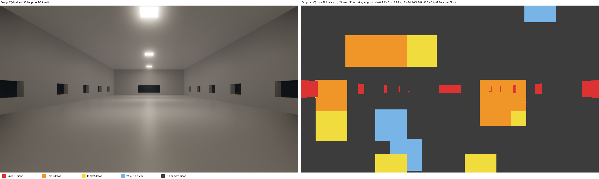
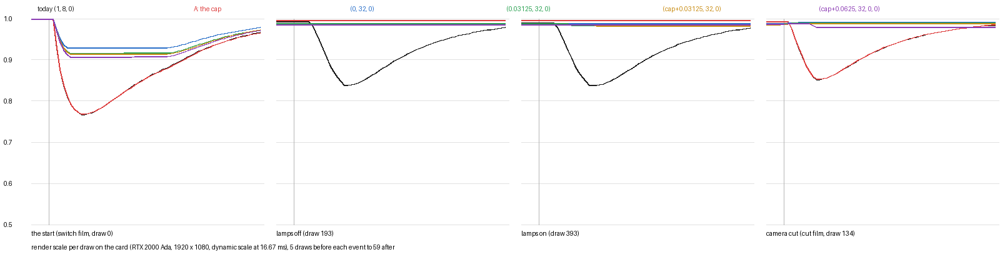

# Spread the catch-up rays of a young history over more draws (t0-gumm, experiment)

The user's words, 2026-11-22: "i think catch up rays are important after a reset of the history. maybe spreading them out more somehow?" Today the ray plan gives a pixel a ray of its own in every draw while its history is shorter than `FullRateFrames`, 8 draws: a cliff. This experiment replaces the cliff with one share function, so that the same rays can arrive over more draws at a lower peak. It is scratch code. The patches stay in this folder and never go into `src`.

## Terms

- A block is 2 × 2 pixels. In each draw one pixel of a block, the chosen pixel, traces the block's ray of a kind. An own ray is a ray that another pixel of the block traces for itself.
- A catch-up ray is an own ray that a pixel traces because its history is young, not because the block's ray does not fit it.
- L is the length of a pixel's slow history of a kind, in draws: the slow history's alpha, as the plan reads it from the last draw.
- The shape (PeakShare, EndFrames, Fall) gives the share of draws on which a young pixel traces a catch-up ray: `share = L >= End ? 0 : PeakShare · (1 − L / End)^Fall`, with `End = min(EndFrames, cap)`, and Fall 0 a box. (1, 8, 0) is today's cliff.
- The tree: X5, the line's merge `710834cc0` (tree `e232080f`): Design X with light evidence restarting a history at 4 draws, without the cap of `t0-zmjx`.

## The scratch code

`scratch-ownray-log.patch` (`TERTIUS_X_OWNRAY_LOG`) logs each draw's own-ray lists: their counts, and of them those in even columns and in even rows. `scratch-catch-up-share.patch` builds the share in `Shaders/screen_trace_plan.comp`. Both apply after X5's probe patch and `t0-3vwx`'s region, dynamic-scale and history-log patches (`tools/builds.sh`: `xt` is today's code with the log, `xg` adds the share).

```glsl
            if (fits(p, c, kind) && !catchUpTurn(pixel, kind, catchUpShare(historyLengthOf(r, kind), capOf(p, kind), youngHistory(ownAge, blockCodes[kind]))))
                continue;
```

where

- `fits(p, c, kind)` = whether the block's ray from its chosen pixel `c` fits the pixel `p`, as today.
- `historyLengthOf(r, kind)` = L.
- `capOf(p, kind)` = the history's cap at the pixel in draws: 32 for the diffuse signal; for the reflections, 4 up to roughness 0.1, linear to 32 at 0.7, as `SignalParameters.Specular` and `capAt` give it. The plan has no signal parameters, so the scratch carries them as constants.
- `youngHistory(ownAge, blockCode)` = whether the history restarted less than End draws ago (see "Where the ticket's design did not fit").
- `catchUpShare(L, cap, young)` = the share above for a young history whose cap is at least 8 draws; today's rule (1 while L < 8, else 0) for every other history.
- `catchUpTurn(pixel, kind, share)` = whether the pixel takes its turn in this draw: `phase = offset + drawIndex · 2654435769` in 32-bit unsigned arithmetic, a turn when `phase < share · 2^32`. 2654435769 is 2^32 divided by the golden ratio.

The shape comes from `TERTIUS_X_CATCHUP="<peak> <end> <fall>"` through three new push constants of the tracer, so one build serves every shape and one cloud job can run many.

## Where the ticket's design did not fit, and the forms chosen

1. **The young test.** The ticket's share is a function of L alone, ending at the cap. In the settled cabin at 2/3, many diffuse histories stay below the cap of 32 for good. The map below shows why: region evidence that fires falsely, not the anti-lag as I first read it (the patch's comment still says the anti-lag). Shape (1, E, 0) on today's code, mean diffuse own rays per draw over the settled draws 150 to 192 (today: 2,164):

   | End | 12 | 16 | 24 | 32 |
   |---|---|---|---|---|
   | Diffuse own rays per draw | 33,844 | 65,315 | 130,638 | 163,080 |

   So about 161,000 of 921,600 pixels (17 %) sit between 8 and 32 draws. L alone cannot tell such a history from one that grows after a light change or a reset, and any End above 8 draws would trace own rays there for ever. The chosen form gates the share by the time since the history's restart. A history is young while one of these is under End draws:
   - the draws since the last reset (`drawIndex`: a start or a camera cut empties every history);
   - the draws since the pixel's own exact light changed (its light-age record);
   - the draws since its block's rays last saw a changed light: the youngest light code of the last draw's samples over the plan's 8 × 8 workgroup, which is the spatial dispatch's block. This is the source of the light evidence that restarts the block's histories, and it covers the pixels whose own direct light did not change. Without it, about half of today's peak stayed after a lamp switch (286,000 to 322,000 diffuse own rays per draw in draws 1 to 10 after off, against today's 545,000 to 675,000). The read is the one that the acceptance lead's variant XD made: the plan reads the last draw's sample ages (the images lose `writeonly`), with two barriers that every invocation reaches before any return.

   A history that is not young keeps today's rule exactly, so a settled view traces today's own rays.
2. **The offset.** The blue-noise mask holds 8 bits per channel. The offset takes the mask's first frame at the pixel (red for the reflections, green for the diffuse rays) as its high 8 bits and `pcg3d` of the pixel as its low 24, so that small shares still get distinct offsets.

## The settled history lengths of the cabin



`pics/history-map-cabin.png`: the cabin of the switch film with the lamps on through the whole run (no switch), at the constant scale 2/3, draw 190 on today's code `xt` (`scratch-history-dump.patch`, `tools/histmap.py`). Left the still, right the slow diffuse history's length per render pixel, in five bands (`historymap.txt`):

| Band, draws | Under 8 | 8 to under 16 | 16 to under 24 | 24 to under 31.5 | 31.5 or more (the cap) |
|---|---|---|---|---|---|
| Share of the pixels | 1.9 % | 9.7 % | 6.6 % | 4.5 % | 77.4 % |

- Under 8 draws: the window openings, which show space and hold no history.
- 8 to 31.5 draws, 20.8 % of the pixels: whole rectangles about 136 render pixels high, which is the size of a region of the drift test (17 × 17 blocks of 8 pixels), on the ceiling, the walls and the floor. In the same run, the region test fires on 1 to 11 of its 238 tested anchors in each of the draws 100 to 131, although nothing changes. Region evidence caps a region's histories at 8 draws, and they regrow by one per draw, so the rectangles show fires of different ages. These are the false fires of `t0-qvm1`.
- The short histories do not lie at edges, at the jambs or on the floor's glow, and they are not grain spread over the view.
- Main has no region test. There is no dump of main `ac5f23915` (`m5h` has no dump patch), so the map has no main row.

## The card, job 1: the render scale under the first shapes


`pics/card-scale-shapes1.png` (job 1 ran the old cut film: 100 frames on the bright chase camera, then a cut to the cabin at draw 133; after it the cabin stays saturated white for over 100 draws, so job 2 uses a cut inside the cabin): the render scale per draw on the card (RTX 2000 Ada, 1920 × 1080, the dynamic scale at 16.67 ms), from 5 draws before each event to 59 after. Black is today's cliff (1, 8, 0), red (0.0625, 32, 0), blue (0.125, 32, 0), green (0.25, 32, 0), orange the cap (`scratch-light-evidence-cap.patch` of the acceptance record: light evidence restarts at 8 draws, so today's plan traces no catch-up ray after a light change). One cloud job, `card.sh shapes1`, $0.0542; one warm-up run of each build first. The logs are in `logs/card-shapes1/`, the table in `cardscale-shapes1.txt` (`tools/cardscale.py`).

The bar is the idle span, draws 133 to 192 of the switch film (lamps on, nothing changes): 0 scale changes for every code, at a scale of 0.988 or 0.989. Its GPU span is 17.2 to 17.5 ms, above the target, and the controller's dead band holds the scale.

| Code | Start: changes, largest fall, scale lost | Off: changes, fall, lost | On: changes, fall, lost | Cut: changes, fall, lost |
|---|---|---|---|---|
| Today (1, 8, 0) | 57, 0.232, 7.38 | 54, 0.144, 3.71 | 53, 0.150, 4.02 | 49, 0.113, 3.02 |
| (0.25, 32, 0) | 45, 0.127, 5.51 | 32, 0.045, 1.76 | 33, 0.052, 2.02 | 31, 0.053, 2.16 |
| (0.125, 32, 0) | 42, 0.102, 4.52 | 14, 0.020, 0.81 | 23, 0.026, 1.05 | 16, 0.029, 1.27 |
| (0.0625, 32, 0) | 39, 0.091, 4.09 | 3, 0.005, 0.22 | 5, 0.009, 0.40 | 3, 0.014, 0.61 |
| The cap | 57, 0.234, 7.54 | 0, 0, 0 | 0, 0, 0 | 50, 0.127, 3.35 |

"Changes" counts the draws of the window whose scale differs from the draw before. "Largest fall" is the scale before the event minus the lowest scale in the window. "Scale lost" is the sum over the window of (the scale before − the scale), in draws. In no window with a fall does the scale come back to its level before the event within 60 draws, because the controller rises slowly.

- No shape passes the bar. Each moves the scale after the switch and the cut. At (0.0625, 32, 0) the move is small: 3 to 5 changes and a fall of 0.005 to 0.014. The share falls with the peak, about by half for each halving of the peak.
- The start falls for every shape: 0.091 still at (0.0625, 32, 0), against 0.232 today. Part of the start's fall is not catch-up rays (`t58-np60`: the scale falls to about 0.77 at every start). The shape (0, 32, 0), with no catch-up ray at all, measures that part in job 2.
- The cap holds the scale after off and on, with no change at all, as the orchestrator predicted. After the cut, the cap falls as today does (0.127 against 0.113), because it changes only the light evidence.

## The card, job 2: the search, the start's two parts, and the codes with the cap



`pics/card-scale-shapes2.png`: as job 1's chart, for six of job 2's codes. Black today, red A (the cap), blue (0, 32, 0) with no catch-up ray, green B32 (0.03125, 32, 0), orange C32 (the cap with (0.03125, 32, 0)), violet C' at 1/16 (the cap, and the spread rays only after a start or a cut). Job `card.sh shapes2`, $0.0846, through main's `gpu_job.py` after the user raised the daily cap. The cut film is the new one (cut inside the cabin at draw 134). Logs in `logs/card-shapes2/`, the table of all eleven codes in `cardscale-shapes2.txt`.

| Code | Start: changes, fall, scale lost | Off: changes, fall | On: changes, fall | Cut: changes, fall |
|---|---|---|---|---|
| Today (1, 8, 0) | 57, 0.232, 7.39 | 54, 0.154 | 53, 0.151 | 56, 0.140 |
| A: the cap | 57, 0.231, 7.42 | 0, 0 | 0, 0 | 58, 0.140 |
| (0, 32, 0): no catch-up ray | 30, 0.070, 3.29 | 0, 0 | 0, 0 | 6, rises only |
| (0.015625, 32, 0) | 34, 0.081, 3.76 | 0, 0 | 1, 0.004 | 3, rises only |
| B32: (0.03125, 32, 0) | 32, 0.084, 3.93 | 0, 0 | 1, 0.005 | 3, rises only |
| B16: (0.0625, 32, 0), second run | 35, 0.092, 4.19 | 8, 0.013 | 9, 0.008 | 4, 0.003 |
| (0.0625, 16, 0) | 45, 0.093, 3.98 | 8, 0.013 | 21, 0.018 | 11, 0.011 |
| (0.0625, 32, 1) | 43, 0.091, 4.00 | 1, 0.004 | 12, 0.014 | 4, 0.002 |
| C32: the cap with (0.03125, 32, 0) | 31, 0.086, 4.03 | 0, 0 | 1, 0.004 | 3, rises only |
| C16: the cap with (0.0625, 32, 0) | 34, 0.092, 4.30 | 5, 0.009 | 6, 0.009 | 11, 0.011 |
| C' at 1/16: the cap, light clocks off | 32, 0.093, 4.30 | 0, 0 | 0, 0 | 5, 0.007 |

- **The noise of the card's scale.** The idle span had 0 changes in every code except one: C16's idle span has 3 changes. B16 ran in both jobs: after off 3 and 8 changes (falls 0.005 and 0.013), after on 5 and 9. So one change of 0.004 or 0.005 lies inside the card's noise.
- **The search.** The largest peak share that leaves the scale alone within that noise is 1/32: B32 and C32 have no change after off, one change of 0.004 to 0.005 after on, and after the cut only small rises. 1/64 gives the same. 1/16 moves the scale in both runs. EndFrames 16 at 1/16 moves it more, because it gives the same rays in half the draws. Fall 1 at 1/16 lies between 1/16 and 1/32. So neither EndFrames nor Fall beats a smaller peak with the box.
- **The start in two parts** (the scale's largest fall, then the scale lost over 60 draws):
  - The part without catch-up rays, from (0, 32, 0): 0.070, 3.29. This is the dear first draws of `t58-np60` and the other start costs.
  - The catch-up rays' part, today minus that: 0.162, 4.10. At B32 it is 0.014, 0.64.
- **The cut** without catch-up rays raises the scale a little (up to 0.003). After a cut, the draws with empty histories cost less than settled draws in some pass.
- **What one ray must buy.** A share of 1/32 for 32 draws gives one catch-up ray per restarted pixel, and this card allows no more without a move of the scale. So the Mac's measures must show whether that one ray buys anything: C against A (the cap alone), and B against today's cliff. The table says so plainly, also if the answer is "nothing that the measures see".
- **The share is a cost budget.** A faster card or a higher frame time target fits a larger share, so a production form could take the share from the controller's headroom. Not built.
- **C'** gives the cap's flat scale after a light change, because no history counts as young then. After the start and the cut it runs C's code. C' therefore needs no Mac run of its own.
- (0, 32, 0) still traces today's own rays for the reflections whose cap is under 8 draws (smooth surfaces), so "no catch-up ray" holds for the diffuse rays and the rough reflections.

## Check 1: the shape (1, 8, 0) gives today's own-ray counts

The switch film (the fair lamp switch of the cabin, the lamps off at draw 193 and on at 393), at the constant render scale 2/3 (1280 × 720) through the replay path, on the Mac (`check1.txt`, `tools/ownrays.py`, logs in `logs/`):

- `xg` with no shape and with `TERTIUS_X_CATCHUP="1 8 0"`: the own-ray log equals today's (`xt`) byte for byte in all 492 draws.
- The settled diffuse own rays of the shapes (0.25, 32, 0) and (0.125, 32, 0) equal today's in each of the draws 150 to 192. The settled reflection own rays differ by at most 15 per draw (0.46 %), with a mean of +1.1. Those runs' histories differ since the start, so the reflections' young pixels below 8 draws differ a little. This is not a catch-up ray of a settled history.


`pics/ownrays-switch-23.png`: diffuse own rays per draw at the start, after off and after on. Today's line lies under the red line of (1, 8, 0), because the two are equal.

| Run, diffuse own rays | Start: peak, draws above, catch-up rays | Off: peak, draws above, catch-up rays | On: peak, draws above, catch-up rays |
|---|---|---|---|
| Today (Design X, restart at 4) | 678,200, 8, 5.41 M | 675,283, 12, 6.79 M | 670,848, 10, 6.37 M |
| (0.25, 32, 0) | 175,984, 32, 5.41 M | 176,014, 31, 5.25 M | 176,251, 31, 5.22 M |
| (0.125, 32, 0) | 92,106, 32, 2.71 M | 94,665, 31, 2.64 M | 94,515, 31, 2.63 M |

"Draws above" counts the draws above the settled count by more than 10 % of today's peak. "Catch-up rays" is the sum over 60 draws of the own rays above the settled count. (0.25, 32, 0) spreads today's total of the start over 4 times the draws, as the ticket asks. After a light change it gives 23 % fewer rays than today, because today's restart at 4 draws buys 11 catch-up draws, not 8.

**The parity check.** The catch-up rays by (column parity, draw-index parity), over each event's 60 draws, diffuse: the four counts lie within 0.34 % (start), 2.28 % (off) and 2.15 % (on) of a quarter for (0.25, 32, 0), and within 0.12 %, 2.59 % and 2.32 % for (0.125, 32, 0). The excess after a light change is between the draw parities and alike in both column parities: within each draw parity, even and odd columns differ by at most 0.33 %. So the column parity does not follow the draw parity, which is the fault of `t2-8foa`. The odd draws of the light-change window take about 2.3 % more catch-up rays than the even draws; the cause is not found. The reflections' four counts lie within 3.1 %, and their column split within a draw parity within 1.65 %. Those counts also hold the own rays of the pixels whose block ray does not fit, which change from draw to draw.

## Files

- `scratch-ownray-log.patch`, `scratch-catch-up-share.patch`, `scratch-history-dump.patch`: the scratch patches. The last writes one draw's slow diffuse history length for the map.
- `check1.txt`: the output of `tools/ownrays.py` for check 1. `historymap.txt`: the output of `tools/histmap.py`.
- `cut-exterior.json`: job 1's cut film, from 100 frames on the bright chase camera into the cabin; after it the cabin stays white for over 100 draws (`t58-rcd6`, `pics/cut-exterior-white.png`).
- `cut.json`: the cut film, the cabin's person camera (the switch's view) for a still and 100 frames, one frame on the chase camera, then the person camera from draw 134 for 200 frames. At draw 134 the draw index restarts at 0 and the diffuse history mean falls from 25.6 to 0.98 draws. `start.json`: the cabin's person camera filmed from draw 0 for 200 frames.
- `logs/`: the own-ray logs, and the card's scale and time logs per job (`logs/card-<job>/<film>-<code>/`).
- `cardscale-<job>.txt`: the output of `tools/cardscale.py` per card job.
- `tools/` (each script says what it does in its first lines): `builds.sh`, `ownrays.py`, `histmap.py`, `card.sh` and `cardrun.sh` (the card's job), `cardscale.py` (the card's scale per event).
