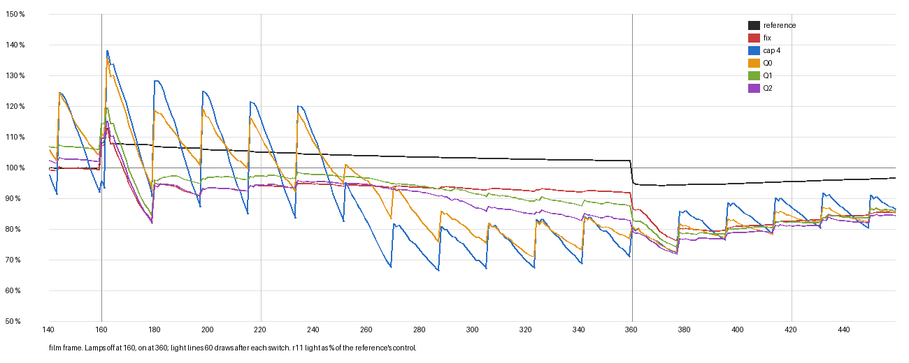
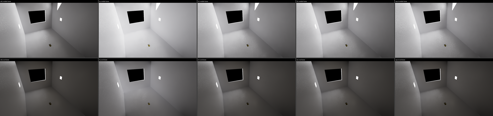
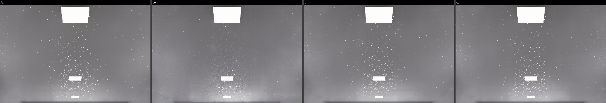
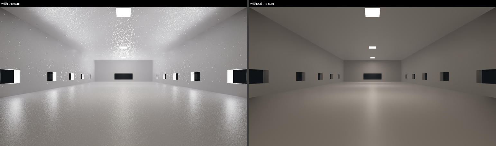

# The region's drift as light evidence (t0-ion0)

This experiment asks whether the region's moving light can serve as a second source of light evidence. Light evidence makes the one reader of the bounce history cut the history's length to the fast cap of 4 draws. The experiment changes nothing in `src`. It uses a scratch probe on `73f4a6548`, as the tolerance record `t0-xlcu` did.

## The answers in short

| Question | Measured |
|---|---|
| 1. False evidence in a still | Lamp hall, today's jitter: Q0 30.5 %, Q1 9.2 %, Q3 3.8 %, Q2 14.3 % of the block draws. Bay and exit cabin: Q1 6 to 7 %, Q3 1 %, Q2 13 to 14 %. No jitter and the long Halton sequence raise the lamp hall's numbers (Q1 12.6 and 14.3 %). |
| 2a. The film rect-bay, middle / last frame | The fix: +1.86 / +1.91. Cap 4: +0.43 / +0.18. Q0 and Q1: +0.44 / +0.19. Q3: +0.47 / +0.23. Q2: +0.43 / +0.19. Main (old store): +1.18 / +0.53. |
| 2b. The cabin's settle, slowest region off / on | The fix: 74 / none. Cap 4: 46 / 23. Q0: 134 / 42. Q1: 77 / 90. Q3: 76 / none. Q2: 37 / 69. Main (old store): 75 / 52. |
| 2c. The cabin center before the switch, lowest / highest | The fix: 99.1 / 100.3 %. Cap 4: 91.2 / 124.3 %. Q0: 102.1 / 124.3 %. Q1: 106.0 / 107.4 %. Q3: 104.3 / 105.5 %. Q2: 101.4 / 103.3 %. |
| 3. The still: light, specks, length | Light at 4.08 stops, ceiling / walls: the fix 96.0 / 99.7 %, Q1 96.7 / 100.3 %, Q3 96.5 / 100.2 %, Q2 94.0 / 96.0 %. Specks: the fix 5.96, Q1 7.99, Q3 6.27, Q2 9.50. Mean length of the ceiling's bounce history: the fix 32.0, Q1 26.1, Q3 29.4, Q2 22.3. |

My reading:

- Every rule closes the film's trail to the level of the cap of 4 draws, well below main's. The film is no longer the limit.
- No rule settles the cabin like the cap of 4 draws in both switches. Q2 comes closest (37 / 69). Q1 and Q3 settle no faster than the fix.
- Q1 and Q3 keep the still's light. Q1 costs 34 % more specks, and Q3 costs 5 % more. Q2 loses 2 to 4 points of the still's light under today's jitter and costs 59 % more specks.
- So no rule passes all three questions. Q3 comes closest on questions 1 and 3, and fails the cabin's settle of question 2. Under the long Halton sequence, every rule loses the still's light: Q3 94.9 / 95.6 %, Q1 94.0 / 93.9 %, Q2 92.2 / 91.4 %, against the fix's 96.8 / 99.6 %.
- The strips check shows that the sun causes the jitter's cycle in the cabin center and window 4's loss of the still's light. Without the sun, both are gone.

## Terms

- `F(t)` = the sum over the 17 × 17 taps of the samples' luminance in draw `t`, each divided by its draw's exposure scale. The taps are 8 render pixels apart. `F` is the region's light.
- `Rnew` = the mean of `F` over the last 18 draws. `Rold` = the mean of `F` over the 18 draws before those.
- `dold` = the standard deviation of `F` over the older window of 18 draws.
- drift = |Rnew − Rold| / Rold.
- A rule fires at a pixel = its test passes at that pixel. If the rule fires at the block's center pixel, local pixel (4, 4), the block takes evidence.
- Block evidence acts like the light evidence of a ray. The reader cuts the history's length to the fast cap of 4 draws and leaves the box wide.
- Today's jitter repeats a cycle of 18 sub-pixel offsets. The long Halton sequence does not repeat inside a still. No jitter keeps the pixel centers fixed.
- The nearest-half store rounds the bounce histories to the nearest half float (`TERTIUS_X_HALF_NEAREST=1`, from `t8-69v7`). Every variant of this record has it, so a history's light does not depend on its length.
- The fix = the light evidence of the rays cuts to the fast cap and leaves the box wide (`TERTIUS_X_LIGHT_ACTION=cut`). Cap 4 = the fix with every bounce history held at 4 draws. The reference A = clamps off (`TERTIUS_A_NO_CLAMP=1`).
- Main = the earlier records' main. Its numbers carry the old store. Each comparison with main says so.

## The rules

| Rule | Evidence where | Switches |
|---|---|---|
| Q0 | drift > 0.10 | `TERTIUS_X_DRIFT_RULE=0` |
| Q1 | drift > 2 × (dold / Rold) × sqrt(2 / 18) | `TERTIUS_X_DRIFT_RULE=1` |
| Q2 | for any m of 3, 6 and 18: \|the mean of the last m differences F(t − k) − F(t − k − 18)\| / Rold > 2 × (dold / Rold) × sqrt(2 / m) | `TERTIUS_X_DRIFT_RULE=2` |
| Q3 | drift > 3 × (dold / Rold) × sqrt(2 / 18) | `TERTIUS_X_DRIFT_RULE=1 TERTIUS_X_DRIFT_SIGMAS=3` |

Q0 and Q1 are the ticket's. Q2 is the ticket's later addition. Q3 is mine. In step 1 of this record, it first had the name Q2. Its reason: under a normal distribution, a test at 2 standard deviations fires at 4.6 % of the draws. Q1 fired at 9 to 14 % in the lamp hall. The drift's tails are heavier than a normal distribution's, so I tried 3.

Every rule variant also takes `TERTIUS_X_LIGHT_ACTION=cut TERTIUS_X_HALF_NEAREST=1 TERTIUS_X_REGION_WINDOW=18 TERTIUS_X_WINDOW_ALL=1 TERTIUS_X_DRIFT=8` (`tools/vars.sh`). The regional lag test of `t0-xlcu` is off. The reflections take the same rule from their own samples, as the earlier probes did.

The shader computes the drift and Q1's tolerance in `driftAt` (`accumulate_spatial.comp` of the patch):

```glsl
    float olderSpread = sqrt(squares / float(window - 1u));
    float divisor = max(olderMean, LeastLuminance);
    test.drift = abs(newer / float(window) - olderMean) / divisor;
    test.tolerance = ProbeDriftSigmas * olderSpread / divisor * sqrt(2.0 / float(window));
```

where

- `squares` = the sum of the squared differences of the older window's 18 values of `F` from their mean.
- `window` = 18, the draws of each window.
- `olderSpread` = `dold`.
- `olderMean` = `Rold`. `newer` = the sum of the newer window's 18 values of `F`, so `newer / float(window)` = `Rnew`.
- `LeastLuminance` = the renderer's least luminance, which keeps the divisor above zero.
- `ProbeDriftSigmas` = 2 for Q1 and Q2, 3 for Q3 (specialization constant 28).
- `test.drift` = the drift. `test.tolerance` = Q1's tolerance (Q3's under `ProbeDriftSigmas` = 3).

Q2's two short lengths follow:

```glsl
    float differences = 0.0;
    for (uint back = 0u; back < 6u; back++)
    {
        float now = back == 0u ? draw : imageLoad(regionWindow, ivec3(pixel, base + int((parameters.probeDraw - back) % span))).r;
        differences += now - imageLoad(regionWindow, ivec3(pixel, base + int((parameters.probeDraw - back - window) % span))).r;
        if (back == 2u)
            test.phase3 = abs(differences / 3.0) / divisor;
    }
    test.phase6 = abs(differences / 6.0) / divisor;
```

where

- `back` = how many draws before this draw the difference starts, 0 to 5.
- `draw` = this draw's `F`, still in a register.
- `regionWindow` = the probe's ring image. Layers `base` to `base + span - 1` hold the last 36 values of `F`.
- `parameters.probeDraw` = this draw's number. `span` = 36.
- `now` = `F(t − back)`. The second load is `F(t − back − 18)`, the draw at the same jitter phase one cycle before.
- `test.phase3`, `test.phase6` = |the mean of the last 3 or 6 differences| / `Rold`.

The rules' bits:

```glsl
uint driftBitsOf(DriftTest test)
{
    if (!test.valid)
        return 0u;
    float ratio = float(parameters.probeRegionWindow);
    bool q2 = test.drift > test.tolerance || test.phase3 > test.tolerance * sqrt(ratio / 3.0)
        || test.phase6 > test.tolerance * sqrt(ratio / 6.0);
    return (test.drift > ProbeDriftTolerance ? 1u : 0u) | (test.drift > test.tolerance ? 2u : 0u) | (q2 ? 4u : 0u);
}
```

where

- `test.valid` = false until the ring holds 36 draws since the last reset.
- `ratio` = 18. Q2's tolerance for the length m is Q1's tolerance times sqrt(18 / m), the same 2 × (dold / Rold) × sqrt(2 / m).
- `ProbeDriftTolerance` = Q0's tolerance, 0.10.
- The bits: 1 Q0, 2 Q1 (or Q3), 4 Q2. If the bit of the chosen rule is set at the block's center pixel, the block takes evidence.

## The builds

Four builds of the same patch ran. Each later build repeats the one before byte for byte with its new switch at its default.

| Build | What it adds | Its control |
|---|---|---|
| First | The drift test. If any of a block's 64 pixels fires, the block takes evidence | Every new switch at its default, the old store: the T0 lamp hall still gives 96.4 / 101.4, as in `t0-xlcu`. The store in scene light: 102.7 / 105.8 % and 100.0 / 100.1 %, as in `t8-69v7` |
| Second | One test per block, at its center pixel. Q3's switch | The T0 still and the count still repeat the first build's images. The fix with the store repeats step 1's count still |
| Third | Q2 and three more count layers | Q1's still repeats the second build's. The count's first five layers repeat the second build's |
| Fourth | `TERTIUS_NO_SUN` for the strips check | Q1's still repeats the second build's |

The change from "any pixel" to the center pixel has a reason. In the lamp hall, Q1 fired at 9.9 % of the pixel draws but flagged 75.6 % of the block draws. The 64 pixels of a block read 64 different sets of taps, so their tests are close to independent. So "any of 64" multiplies the false evidence.

## Step 1: the count without action

The count runs the drift test with `TERTIUS_X_DRIFT_ACT=0` (no evidence) and writes each test's numbers. `tables-step1.txt` holds every region and both lights. The bounce light, whole image, % of counted pixel draws whose block has evidence:

| Still | Q0 | Q1 | Q3 | Q2 |
|---|---:|---:|---:|---:|
| Lamp hall, today's jitter | 30.5 | 9.2 | 3.8 | 14.3 |
| Lamp hall, no jitter | 30.5 | 12.6 | 5.6 | 20.4 |
| Lamp hall, long Halton sequence | 34.1 | 14.3 | 7.7 | 21.9 |
| Bay still, each jitter | 7.3 to 7.6 | 7.0 to 7.3 | 1.1 | 14.2 to 14.4 |
| Exit cabin, each jitter | 6.2 to 6.3 | 6.0 to 6.1 | 0.9 | 12.6 to 12.7 |
| Cabin before the switch | 30.4 | 9.8 | 3.5 | 15.6 |
| Film rect-bay, 180 frames | 86.7 | 84.1 | 71.0 | 86.0 |

A still has no change, so all its evidence is false. Q2's two short lengths alone give 5 to 9 % and 5 to 11 % in the lamp hall. They add those to Q1's share.

### The wait before the first cut

A step in the light enters the newer window one draw at a time, so the drift grows over 18 draws. The count gives the first draw after a change at which half of the changed region's counted pixel draws have block evidence. In the cabin, the changed region is the union of the regions that the survey counts as changed (all but r01). In the film, it is the whole image. In brackets: the share in % at d = 0, 3, 5, 10, 15, 20 and 30 draws after the change.

| Change | Q0 | Q1 | Q3 | Q2 |
|---|---|---|---|---|
| Cabin, lamps off | d 13 [29 32 33 34 62 77 69] | never [15 14 13 11 28 45 33] | never [7 8 7 7 14 25 12] | d 21 [19 19 21 27 37 49 35] |
| Cabin, lamps on | d 17 [34 38 37 37 45 56 59] | never [7 9 10 11 19 31 33] | never [2 3 4 4 9 16 18] | never [14 14 19 20 28 38 38] |
| Film rect-bay | frame 3 [n/a 51 24 15 18 37 63] | frame 28 [n/a 17 20 11 9 23 60] | frame 38 [n/a 2 6 2 1 6 29] | frame 23 [n/a 20 27 17 20 36 66] |

Film frame 0 is run draw 32. The test is valid from run draw 35, frame 3. At frame 3 the older window holds the run's first 18 draws. So Q0's 51 % there comes from the run's start, not from the film's change.

The film's level in the first frames (`tools/filmearly.py`), as the frame's light over a still of the same state, minus 1:

| Variant | Frame 10 | Frame 20 | Frame 30 | Middle (90) | Last (179) |
|---|---:|---:|---:|---:|---:|
| The fix | +0.02 | +0.08 | +0.15 | +1.86 | +1.91 |
| Cap 4 | +0.03 | +0.06 | +0.09 | +0.43 | +0.18 |
| Q0 | +0.02 | +0.07 | +0.10 | +0.44 | +0.19 |
| Q1 | +0.02 | +0.08 | +0.12 | +0.44 | +0.19 |
| Q3 | +0.02 | +0.08 | +0.14 | +0.47 | +0.23 |
| Q2 | +0.02 | +0.07 | +0.10 | +0.43 | +0.19 |

In plain words: after a real change, Q0 cuts half of the changed region after 13 to 17 draws in the cabin. Q2 needs 21 draws or never reaches half. Q1 and Q3 never reach half in the cabin. In the film, Q1 reaches half after 28 frames, Q2 after 23 and Q3 after 38. In those first frames, the film's trail is still small under every variant: at frame 30 the fix trails by +0.15, and the rules by +0.10 to +0.14. The trail of the fix grows later, to +1.86 at the middle frame, where every rule holds +0.43 to +0.47. So the wait costs the film little, because the trail needs many draws to build.

The step size explains Q2's small gain. The cabin's switch changes the light by about 18 % (the survey's change −0.176). At m = 3, Q2's tolerance is Q1's times 2.45, a median of about 0.41. A step of 18 % does not pass it. So Q2 fires mostly through m = 6 and 18, from about d 6.

## Step 2: each rule acting

All takes have the nearest-half store. `tables.txt` holds every number. Main's numbers come from the earlier records and carry the old store.

### The lamp hall still, today's jitter

| Variant | Light at 4.08 stops, ceiling / walls (%) | Scene light, no jitter, ceiling / walls (%) | Specks | Daub | Ceiling's mean length / share below 8 draws |
|---|---|---|---:|---:|---|
| Reference | 100.0 / 100.0 | 100.0 / 100.0 | 12.08 | 0.0420 | not counted |
| The fix | 96.0 / 99.7 | 98.7 / 100.0 | 5.96 | 0.0406 | 32.0 / 0.0 % |
| Cap 4 | 94.5 / 99.2 | 98.4 / 99.9 | 6.85 | 0.0434 | 4.0 / 100 % |
| Q0 | 96.0 / 100.5 | 98.5 / 99.9 | 8.78 | 0.0437 | 12.5 / 50.5 % |
| Q1 | 96.7 / 100.3 | 98.7 / 100.1 | 7.99 | 0.0417 | 26.1 / 11.2 % |
| Q3 | 96.5 / 100.2 | 98.7 / 100.1 | 6.27 | 0.0405 | 29.4 / 4.8 % |
| Q2 | 94.0 / 96.0 | 98.6 / 99.9 | 9.50 | 0.0424 | 22.3 / 18.3 % |
| Main (old store) | 78.4 / 81.2 | | | | |

The light is the settled light, the mean of draws 297 to 920 against the reference's. Specks and daub come from the still at the automatic exposure, against the reference of the same jitter. The scene light is without jitter, so the jitter's loss does not show in its column.

### No jitter and the long Halton sequence

The lamp hall still at 4.08 stops, settled light against the reference of the same jitter, ceiling / walls, and the ceiling's mean length:

| Variant | No jitter, light | No jitter, length | Long sequence, light | Long sequence, length |
|---|---|---:|---|---:|
| The fix | 96.9 / 100.0 % | 32.0 | 96.8 / 99.6 % | 32.0 |
| Q1 | 96.8 / 100.1 % | 21.5 | 94.0 / 93.9 % | 21.5 |
| Q3 | 96.8 / 100.1 % | 26.9 | 94.9 / 95.6 % | 26.0 |
| Q2 | 96.7 / 99.9 % | 15.7 | 92.2 / 91.4 % | 16.0 |

Without jitter, specks at the automatic exposure: reference 6.90, the fix 3.19, Q1 5.03, Q3 3.87, Q2 7.33. The stills at the automatic exposure under the long sequence were not taken (the lab stopped).

The cabin switch:

| Variant | No jitter: settle off / on | No jitter: r11 before, lowest / highest | Long sequence: settle off / on | Long sequence: r11 before, lowest / highest |
|---|---|---|---|---|
| Reference | none / none | 100.0 / 100.0 % | none / none | 100.0 / 100.0 % |
| The fix | 112 / 66 | 100.8 / 100.8 % | 168 / none | 98.1 / 99.3 % |
| Cap 4 | 49 / 26 | 104.1 / 104.8 % | not taken | not taken |
| Q1 | 84 / 41 | 103.6 / 104.2 % | 65 / 38 | 87.3 / 99.4 % |
| Q3 | 83 / 42 | 102.9 / 103.4 % | 103 / 55 | 89.2 / 99.6 % |
| Q2 | 66 / 39 | 103.8 / 104.5 % | 83 / 40 | 84.3 / 101.5 % |

My reading: without jitter, every rule keeps the still's light. Under the long sequence, every rule loses 2 to 8 points of it. The cabin center before the switch then swings by 12 to 17 points under each rule. The long sequence settles the cabin faster under Q1 and Q2 than today's jitter does.

### The film rect-bay and the lag films, today's jitter

| Variant | rect-bay middle / last | Blotch middle / last | bay-sun lag / lag error | lamp-hall-16-moving | lamp-hall-64-spot-moving |
|---|---|---|---|---|---|
| The fix | +1.86 / +1.91 | 0.383 / 0.484 | 29.72 / 0.2808 | 4.44 / 0.0277 | −0.17 / 0.0107 |
| Cap 4 | +0.43 / +0.18 | 0.102 / 0.101 | 8.34 / 0.0897 | 4.47 / 0.0271 | −0.34 / 0.0115 |
| Q0 | +0.44 / +0.19 | 0.105 / 0.101 | 8.56 / 0.1027 | 4.39 / 0.0276 | −0.35 / 0.0118 |
| Q1 | +0.44 / +0.19 | 0.105 / 0.111 | 8.66 / 0.1026 | 4.38 / 0.0275 | −0.30 / 0.0116 |
| Q3 | +0.47 / +0.23 | 0.122 / 0.148 | 8.22 / 0.1019 | 4.46 / 0.0275 | −0.29 / 0.0114 |
| Q2 | +0.43 / +0.19 | 0.102 / 0.108 | 8.78 / 0.1029 | 4.48 / 0.0274 | −0.33 / 0.0121 |
| Main (old store) | +1.18 / +0.53 | | 28.55 / 0.2644 | | |

The lag columns give the median lag in draws and the median lag error.

### The cabin switch, today's jitter

| Variant | Settle, slowest off / on | r11 settle off / on | Level 60 draws after, off / on, whole (%) | r11 before the switch, lowest / highest (%) | r11 at d 5 / 10 / 20 after off (%) | r11 at d 5 / 10 / 20 after on (%) |
|---|---|---|---|---|---|---|
| Reference | none / 99 | 66 / 43 | 105.8 / 96.0 | 100.0 / 100.0 | 107.8 / 107.7 / 107.0 | 94.5 / 94.3 / 94.5 |
| The fix | 74 / none | 74 / none | 95.3 / 89.4 | 99.1 / 100.3 | 105.8 / 94.9 / 95.2 | 84.7 / 79.5 / 80.2 |
| Cap 4 | 46 / 23 | 20 / 18 | 102.0 / 91.1 | 91.2 / 124.3 | 131.2 / 117.8 / 128.3 | 78.1 / 75.5 / 85.9 |
| Q0 | 134 / 42 | 134 / 42 | 100.8 / 89.9 | 102.1 / 124.3 | 127.5 / 114.1 / 118.5 | 78.1 / 75.2 / 81.3 |
| Q1 | 77 / 90 | 77 / 90 | 96.7 / 89.5 | 106.0 / 107.4 | 112.0 / 99.5 / 96.0 | 81.4 / 77.2 / 78.8 |
| Q3 | 76 / none | 76 / none | 96.3 / 89.4 | 104.3 / 105.5 | 110.3 / 98.3 / 95.7 | 82.7 / 78.1 / 79.3 |
| Q2 | 37 / 69 | 37 / 69 | 95.7 / 89.2 | 101.4 / 103.3 | 108.0 / 96.4 / 94.3 | 77.6 / 74.3 / 76.8 |
| Main (old store) | 75 / 52 | | | | | |

"Settle" = the draws until a region stays within 5 % of its own control. The control is the run that holds the lamps in the state after the switch. "none" = it does not settle within the window. The levels are in % of the reference's control at the same frame.



The chart shows r11 from film frame 140 to 459, in % of the reference's control. Before the switch, cap 4 and Q0 swing in a sawtooth of 18 frames, between about 92 and 125 %. Q1 lies near 107 %, Q2 near 102 %, and the fix near 100 %. After the lamps go off at 160, cap 4 and Q0 keep the sawtooth. From frame 260 on, they lie between 67 and 82 %. Q1, Q2 and the fix fall smoothly from about 97 % to about 85 to 92 % before frame 360. Q1 and Q2 show a small step every 18 frames. After the lamps come on at 360, every variant but the reference drops to about 73 to 77 %. Then it climbs slowly to about 85 %. The reference holds near 95 %.



The sheet shows the middle frame (top) and the last frame (bottom) of rect-bay: the still of the same state, the fix, Q1, Q2 and cap 4. In the middle frame, the fix is lighter all over than the still, on the left wall and on the floor. Q1, Q2 and cap 4 look like the still. In the last frame, the fix keeps a light band on the floor along the left wall and a lighter floor. Q1, Q2 and cap 4 again look like the still.



The crops show the lamp hall's ceiling at the automatic exposure: the fix, Q0, Q1 and Q2. Each has a cloud of bright single-pixel specks around the far lamps and scattered specks elsewhere. Q0's cloud holds more fine dark and bright grain below the middle lamp. Q1 and Q2 look like the fix, with Q2's cloud a little denser.

## The strips check

Another line found that the bright strip on a window jamb of rect-lamps is direct sunlight that the sun's shadow lets through (`t8-rjno`). The earlier records named thin sunlit strips as the cause of two effects. One is the jitter's 18-draw cycle in the cabin center. The other is window 4's loss of the still's light. "Region, window 4" = the fix with the regional lag test of `t0-mzhr` (`TERTIUS_X_REGION=8 TERTIUS_X_REGION_TOL=10`). Its recent mean is the fast history, and its tolerance is 10 %. The switch `TERTIUS_NO_SUN=1` drops every light beyond 10^9 m, as that line's probe does.

The limit of this check: without the sun, the real sunlit surfaces go dark too. So the check says how much of the cycle and of window 4's loss the sun causes. It does not say whether a strip is a leak or real geometry. That diagnosis is the other line's.



The reference's still at 4.08 stops, today's jitter. With the sun, the window jambs are bright white. The ceiling and the upper walls carry a field of bright specks. The glossy floor shows bright reflections. Without the sun, the hall is darker and lit by its lamps only, the jambs are dim, and the specks are gone.

### Question 1: always or never

The reference's and cap 4's lamps-on control of the cabin switch over film frames 172 to 459 (`strips.py`), mean scene luminance:

| Run | Region | Today's jitter: darkest / median / brightest phase | Cycle mean | No jitter |
|---|---|---|---:|---:|
| Reference | whole image | 0.7881 / 0.7893 / 0.7911 | 0.7896 | 0.7913 |
| Reference | r11 | 0.7991 / 0.8073 / 0.8124 | 0.8069 | 0.4389 |
| Cap 4 | whole image | 0.7109 / 0.7308 / 0.7450 | 0.7291 | 0.7683 |
| Cap 4 | r11 | 0.6310 / 0.7169 / 0.7816 | 0.7139 | 0.4436 |

Under cap 4, r11 rises at one phase and then falls over the next 15 phases, a sawtooth. The reference's history of 32 draws smooths the cycle to ±0.7 %.

My reading: without jitter, r11 is 46 % darker than the cycle mean, and far below even the darkest phase. So r11's extra light under the jitter is "never" without jitter: the fixed pixel centers never see what the jitter's offsets see. The light then stays in r11 for many draws after the bright phase, longer than cap 4's 4 draws. For the whole image, no jitter equals the cycle mean for the reference (+0.2 %).

### Question 2: how much of the cycle is the sun's

Window 4 in the lamp hall still, settled light against the reference of the same sun and jitter, ceiling / walls:

| Jitter | Measure | With the sun | Without the sun |
|---|---|---|---|
| Today's | Light at 4.08 stops | 90.7 / 92.8 % | 100.3 / 100.2 % |
| Today's | Scene light | 95.4 / 94.1 % (whole image 92.9 %) | 100.1 / 100.1 % (whole image 100.1 %) |
| None | Light at 4.08 stops | 96.1 / 99.6 % | 100.3 / 100.2 % |
| None | Scene light | 98.3 / 99.7 % (whole image 96.3 %) | 98.3 / 99.7 % (whole image 96.3 %)N |

Window 4's loss with the old store was 89.4 / 90.4 % under today's jitter and 97.7 / 102.1 % without jitter (`t0-mzhr`). At 4.08 stops, the image without the sun is darker than with it, so nothing clips.

The cabin switch under today's jitter with cap 4, r11 over frames 140 to 159 in % of the reference's control of the same sun:

| | With the sun | Without the sun |
|---|---|---|
| r11, lowest / highest | 91.2 / 124.3 % | 102.0 / 102.3 % |
| Settle, slowest off / on | 46 / 23 | 50 / 34 |
| r11 per jitter phase in the lamps-on control, darkest / brightest, against the cycle mean | −11.6 / +9.5 % | −0.9 / +0.4 % |

Without the sun the cabin is darker: r11's mean scene luminance in the lamps-on control falls from 0.714 to 0.317 under cap 4. The reference without the sun does not settle within the window (none / none), so its own lag shapes the "settle" column of that state.

My reading: without the sun, window 4 keeps the still's light under today's jitter, and cap 4's r11 no longer swings. So the sun's light causes both effects in these scenes. Whether that light is a leak through the shadow or real light on thin geometry, this check cannot say.

## Files

- `scratch-probe-on-73f4a6548.patch`: the fourth build's patch. Apply it to a scratch worktree of `73f4a6548`. Then build `src/Tertius.Demo` in Release into `/private/tmp/t0-ion0/out-z/probe-bin`, as `tools/renderer-survey.py probe-build` does.
- `tables-step1.txt` (`tools/measure-1.sh`) and `tables.txt` (`tools/measure.sh`): every number of this record.
- `tools/` holds the scripts of this record:
  - the queues, in the order that they ran: `queue-c.sh`, `queue-1.sh`, `queue-1c.sh`, `queue-2.sh`, `queue-1m.sh`, `queue-s.sh`, `queue-4.sh`, `queue-3.sh`.
  - the variants: `vars.sh`.
  - the take wrappers: `take.sh`, `scenetake.sh`, `earlytake.sh`.
  - the measures: `driftcount.py`, `filmearly.py`, `switchearly.py`, `strips.py`, `filmsheet.py`, and `pics.sh`.
- `tools/m.sh` finds the other scripts in the earlier records:
  - `switch.py` and `stills.py` from `t0-xlcu`.
  - `light.py`, `lengths.py`, `scene.py` and `scenelight.py` from `t0-y46f`.
  - `daub.py`, `films.py`, `lags.py`, `levelchart.py` and `sheet.py` from `t0-mzhr`.
- The scripts name this ticket's worktree and the run folders in `/private/tmp/t0-ion0`. The raw captures are deleted after the record, so `measure.sh` prints a section only while its runs exist.
