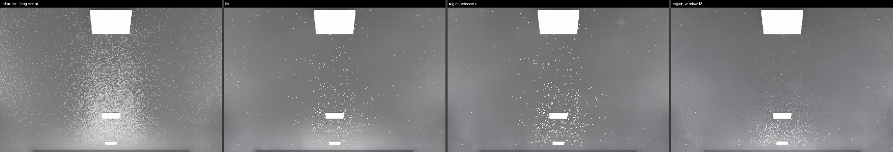
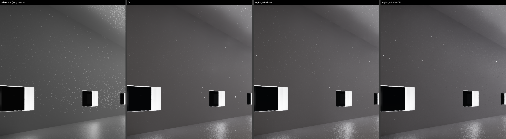
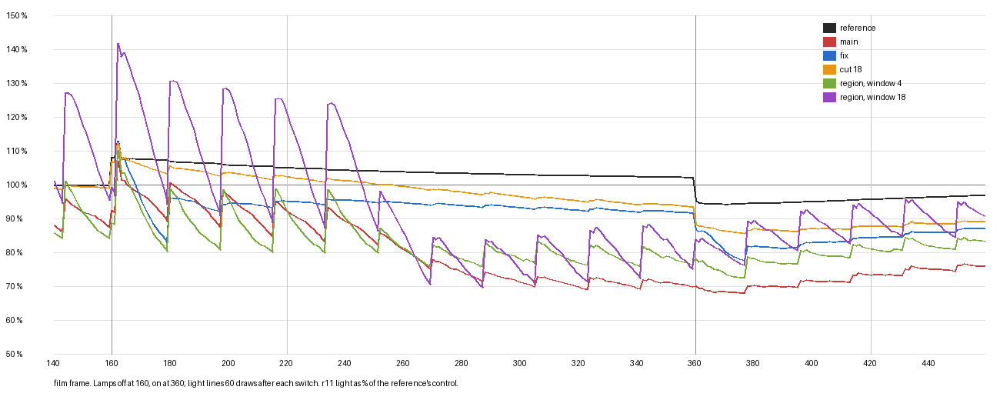
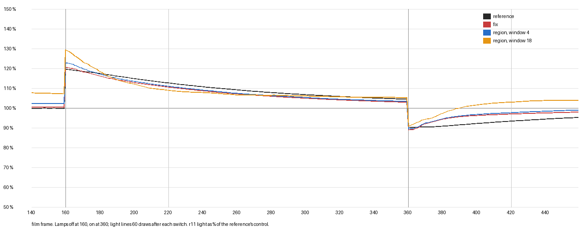
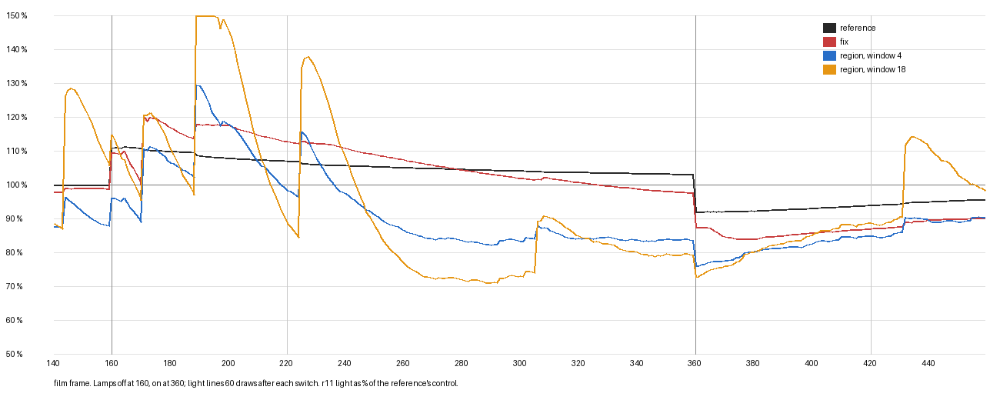

# The regional lag test against the jitter's cycle of 18 draws (t0-mzhr), 2026-11-14

## Correction of 2026-11-15: the takes of "region, window 18" are not valid

The scratch patch of this folder has a bug, which ticket `t0-y46f` found (`docs/research/t0-y46f-window-18-excess/README.md`, "The window bug", and bug ticket `t8-r6dw`). The bounce light's temporal dispatch never wrote the 18-draw window. So the regional test of the bounce light fired at every pixel in every draw, and held every bounce history at 4 draws.

- Every number of "region, window 18" below, also with tolerance 20 and with the clamps off, measures a bounce history held at 4 draws. It does not measure the regional test with an 18-draw window. A plain cap of 4 draws with no test repeats its still to 0.1 point.
- So these readings below do not stand: that the 18-draw window trails least in the films, that it still follows the jitter's cycle, that the long sequence does not help it, and the answers to question 1 and to the window-18 part of question 2.
- The numbers of main, the reference, the fix, cut 18 and "region, window 4" are valid. Window 4 reads the fast history, not the ring.
- The corrected patch is `docs/research/t0-y46f-window-18-excess/scratch-probe-on-73f4a6548.patch`, with `TERTIUS_X_WINDOW_ALL=1`. With it, the lamp hall still of region, window 18 at 10 % gives 96.4 / 101.4 % under today's jitter and 97.8 / 101.9 % without jitter. Ticket `t0-xlcu` takes the films and the switch again.

This folder holds the takes of ticket `t0-mzhr`. They measure the regional lag test with a fast estimate over a box window of 18 draws, under three camera jitters. They also measure a history cut to 18 draws.
All takes ran on this Mac in one session, from 20:37 to 22:04 local time, under the shared GPU lock. No take used the cloud.
The ticket's section "Design (line orchestrator, 2026-11-14)" holds the reasons and the questions.

## Terms

- Draw: one frame that the renderer draws. Film frame t of a switch or lag run is one draw.
- The jitter's cycle: the camera jitter repeats AMD's 18 sub-pixel offsets (`Fsr3Upscaler.JitterPhaseCount` at 1280 x 720 to 1920 x 1080).
- Today's jitter: that cycle of 18 draws. No jitter: `TERTIUS_DEBUG_JITTER=none`. The long sequence: the new switch `TERTIUS_X_LONG_JITTER=1` below.
- The reference: the scratch build with both history clamps off (`TERTIUS_A_NO_CLAMP=1`), under the same jitter as the variant that it judges.
- The fix: the scratch build with `TERTIUS_X_LIGHT_ACTION=cut`. Light evidence cuts a history to 4 draws and leaves the clamp box wide.
- Cut 18: the fix with `TERTIUS_X_CUT_LENGTH=18`. Light evidence cuts a history to 18 draws.
- The regional lag test: a test at each pixel. It sums the slow history's luminance and a fast estimate's luminance over one tap per ray block within 8 blocks. These are 17 x 17 taps, 8 render pixels apart. The tolerance is 10 % of the fast sum. Where the two sums differ by more, the anti-lag shortens the history by the excess, down to the fast cap of 4 draws.
- Region, window 4: the fix with `TERTIUS_X_REGION=8 TERTIUS_X_REGION_TOL=10`. The fast estimate is the fast history, an exponential mean of the last samples with a length of at most 4 draws. This is the first probe of `t0-acxm`.
- Region, window 18: region, window 4 with `TERTIUS_X_REGION_WINDOW=18`. The fast estimate is the exact mean of the tap pixel's samples over the last 18 draws.
- Main: commit `ab54c785e` with the survey's probe patch, its own build.
- r11: the center region of the survey's 3 x 3 grid of the image.
- Slow history: a pixel's mean of its past samples of one light signal, with the weight 1 / length. Its length grows by one per draw up to a cap of 32 draws for a rough surface. So it acts as an exponential mean with the weight 1/32.
- Fast history: the same mean with a length of at most 4 draws, the fast cap.
- Light evidence: a sign in a ray block's samples that the light that they saw changed in the last 7 draws (the light-change age). It cuts the history's length (`docs/plans/bounce-light-confidence.md`, section 8).
- Specks: groups of bright pixels, per 10,000 visible pixels. A speck pixel is brighter than twice the median of its 7 x 7 window (tools/README.md, "The measures").
- Blotch: the survey's 90th percentile of the blurred still's relative error against the build's own long mean.
- Daub: `daub.py`'s 90th percentile of the error at 2 to 24 render pixels across, against the reference. Broad: the same at about 36 pixels and above.
- Lag: a lag film's difference from a still of the same state, divided by the film's change per draw, in draws. Lag error: that difference as a share of the light.
- Acceptance 9: item 9 of `docs/plans/bounce-light-confidence.md`, line 962. A film's median lag error can rise by at most 0.005 against main.

## The scratch switches

`scratch-probe-on-73f4a6548.patch` replaces the patch of `docs/research/design-x-acceptance-2026-11-14`. It applies to commit `73f4a6548` and holds every switch of that folder and these three:

| Switch | Effect | Default |
|---|---|---|
| `TERTIUS_X_REGION_WINDOW=<N>` | The fast estimate of the regional lag test. 4 is the fast history. Every other N is the exact mean of the tap pixel's samples over the last N draws. | 4 |
| `TERTIUS_X_CUT_LENGTH=<N>` | The length in draws to which light evidence cuts a history, in place of the fast cap. | 0, the fast cap of 4 |
| `TERTIUS_X_LONG_JITTER=1` | The camera jitter takes the Halton sequence over a period of 2^10 x 3^6 = 746,496 draws. FSR keeps its phase count of 18. | off |

### The box window

The temporal dispatch writes the window. It runs before the spatial dispatch, which holds the regional test, and a barrier lies between the two (`TemporalSignal.BeforeSpatial`):

```glsl
void storeRegionWindow(ivec2 pixel, float sampleLuminance)
{
    uint window = parameters.probeRegionWindow;
    if (window == 4u)
        return;
    float scale = exp2(clamp(exposureStops, -64.0, 64.0));
    uint current = parameters.probeDraw % window;
    float value = sampleLuminance / scale;
    imageStore(regionWindow, ivec3(pixel, int(current)), vec4(value));
    uint filled = min(parameters.probeDraw + 1u, window);
    float sum = value;
    for (uint k = 0u; k < filled; k++)
        if (k != current)
            sum += imageLoad(regionWindow, ivec3(pixel, int(k))).r;
    imageStore(regionWindow, ivec3(pixel, int(window)), vec4(scale * sum / float(filled)));
}
```

where

- `regionWindow` = an R32F image array at the render size, 1280 x 720, with `window` + 1 layers per signal part. Layers 0 to `window` - 1 are the ring of the last samples. Layer `window` holds their mean.
- `sampleLuminance` = the luminance of the sample that the histories took in this draw (`sampled`). Where the pixel took no sample, it is the fast history's luminance. A sky pixel writes 0.
- `probeDraw` = the draw's index since the last reset of the histories (`FrameHistory`, `DrawIndex`), sent in the push constants.
- `current` = the ring layer of this draw.
- `filled` = how many draws since the reset the mean covers: all draws up to 18, then always 18.
- `scale` = the exposure scale of this draw. The ring holds each value divided by its own draw's scale, so the mean is in this draw's scale even under the automatic exposure.
- `sum` = this draw's value from the register plus the other `filled` - 1 layers. So no read depends on a write of the same invocation.

The spatial dispatch reads the mean at each tap in place of the fast history:

```glsl
uint window = parameters.probeRegionWindow;
fastSum += window == 4u ? luminance(imageLoad(fastHistory, tap).rgb)
    : imageLoad(regionWindow, ivec3(tap, int(window))).r;
```

where

- `tap` = the pixel 8 x (bx, by) render pixels from the shaded pixel, for bx and by from -8 to 8.
- `fastSum` = the fast sum of the test.

So for N = 18 the fast estimate at each tap is the plain mean of exactly the last 18 samples of that pixel. Under today's jitter these 18 draws hold each of the 18 jitter offsets once.

The ring holds screen pixels and is not reprojected. Every take here has a fixed camera, so this does not change its results. Under a moving camera the window-18 estimate mixes the samples of other surfaces.

The ticket proposed a ring at ray-block resolution, 160 x 90 texels. I kept the ring per pixel. Reason: the test with window 4 reads the fast history at the tap pixel, and a per-pixel ring changes only the fast estimate's time window. The taps, the slow side and the tolerance stay the same. The cost is about 70 MB per signal part, which a scratch build can pay.

### The cut length and the long sequence

```glsl
float cutLength = act == 5u || act == 7u ? max(fastCap, 8.0) : fastCap;
if (parameters.probeCutLength > 0.0 && !(act == 5u || act == 7u))
    cutLength = parameters.probeCutLength;
```

where

- `act` = the light action, 2 for `cut`.
- `fastCap` = the fast cap, 4 draws.
- `cutLength` = the length to which light evidence cuts the history.

The long sequence changes the period that both readers of the jitter use, `FrameHistory.Jitter` (this draw's) and `VulkanRenderer.ApplyRenderProjection` (the last draw's):

```csharp
public static int JitterPeriod(int phases) => LongJitter ? LongJitterPeriod : phases;
...
return Fsr3Upscaler.JitterOffset((int)(DrawIndex % phases), phases);
```

where `phases` = the result of `JitterPeriod`, 746,496 under the switch. `JitterOffset(index, period)` takes Halton point `index % period + 1`. For a draw index below 18, `index % 746496` equals `index % 18`, so the first 18 draws after a reset take AMD's offsets. `docs/plans/sub-pixel-strips.md`, section 5.1, specifies this sequence.

## The control runs

Each new switch at its default must repeat the first session's result of the same switches. The runs below had every new switch unset. `tools/same.py` compares every number of two result files.

| Run | Compared with (first session, same Mac) | Result |
|---|---|---|
| Cabin switch, region, window 4 | `out-x6-r8` | 13,818 of 13,818 values equal |
| Lamp hall still, automatic exposure, region, window 4 | `out-x6-r8-s` | 14 of 14 values equal. Both PNGs equal byte for byte |
| Lamp hall still at 4.08 stops, region, window 4 | `out-x6-r8-e` | light 89.4 / 90.4 % in both |
| Film rect-bay, region, window 4 | `out-x6-rb-r8` | 19 of 19 values equal |
| Cabin switch, fix | `out-x2-cutfull` | 13,818 of 13,818 values equal |
| Cabin switch, main (copied probe of `out-m`) | `out-m-full` | 13,818 of 13,818 values equal |

So the new build repeats the first probe, and the region-4 control runs serve as its takes under today's jitter. The cut-18 still equals the fix's still to every printed digit, because a still has no light evidence.

The long sequence has no control run of its own. A switch film starts after the warm-up draws of a still, so even its frame 0 differs from today's jitter. The code above shows that the first 18 offsets are AMD's.

## The takes

All numbers come from the result files of the survey (`tools/renderer-survey.py`, `run --no-build --chunk 0`). `tables.txt` holds the printed output of the measuring scripts for every take.

### Lamp hall still, light

Still `rect-lamps` at a fixed exposure of 4.08 stops. The long mean is the mean of the last 20 captures, draws 297 to 924. The table gives the long mean of the ceiling and of the walls, as % of the same jitter's reference (`tools/light.py`). The shown still (draw 132) is in brackets.

| Variant | Today's jitter | No jitter | Long sequence |
|---|---|---|---|
| main | 78.4 / 81.2 (77.0 / 78.8) | not taken | not taken |
| fix | 96.0 / 99.5 (87.1 / 84.9) | 96.9 / 99.9 (93.8 / 94.0) | 96.9 / 99.4 (92.2 / 91.4) |
| cut 18 | 96.0 / 99.5 (87.1 / 84.9) | not taken | not taken |
| region, window 4 | 89.4 / 90.4 (86.4 / 85.3) | 97.7 / 102.1 (96.1 / 98.7) | 93.0 / 93.1 (91.9 / 91.0) |
| region, window 18 | 99.5 / 105.8 (102.8 / 111.5) | 100.8 / 106.5 (101.5 / 107.2) | 99.0 / 102.5 (104.6 / 114.2) |
| region, window 18, tolerance 20 | 99.3 / 105.6 (102.5 / 111.2) | not taken | not taken |

### Lamp hall still, noise

Still `rect-lamps` at the automatic exposure, draw 132. Specks per 10,000 visible pixels and the blotch from the survey. The daub (`tools/daub.py`, `REF` = the same jitter's reference) for the whole smooth area, then the ceiling and the walls.

| Variant | Jitter | Specks | Blotch | Daub | Daub ceiling / walls | Broad |
|---|---|---:|---:|---:|---|---:|
| reference | today's | 12.16 | 0.1064 | 0.0416 | 0.0462 / 0.0265 | 0.0956 |
| main | today's | 7.05 | 0.0530 | 0.0432 | 0.0510 / 0.0276 | 0.1071 |
| fix | today's | 6.01 | 0.0933 | 0.0403 | 0.0455 / 0.0268 | 0.0913 |
| cut 18 | today's | 6.01 | 0.0933 | 0.0403 | 0.0455 / 0.0268 | 0.0913 |
| region, window 4 | today's | 9.61 | 0.0581 | 0.0396 | 0.0508 / 0.0264 | 0.1052 |
| region, window 18 | today's | 9.69 | 0.0628 | 0.0448 | 0.0533 / 0.0345 | 0.1425 |
| region, window 18, tolerance 20 | today's | 8.63 | 0.0621 | 0.0460 | 0.0521 / 0.0341 | 0.1427 |
| reference | none | 6.95 | 0.0536 | 0.0322 | 0.0307 / 0.0155 | 0.0441 |
| fix | none | 3.25 | 0.0553 | 0.0322 | 0.0305 / 0.0162 | 0.0943 |
| region, window 4 | none | 7.43 | 0.0491 | 0.0317 | 0.0335 / 0.0181 | 0.1068 |
| region, window 18 | none | 7.51 | 0.0396 | 0.0356 | 0.0421 / 0.0192 | 0.1321 |
| reference | long | 11.06 | 0.0712 | 0.0378 | 0.0436 / 0.0237 | 0.0568 |
| fix | long | 5.50 | 0.0658 | 0.0380 | 0.0429 / 0.0236 | 0.0766 |
| region, window 4 | long | 7.39 | 0.0535 | 0.0372 | 0.0450 / 0.0228 | 0.1156 |
| region, window 18 | long | 8.91 | 0.1152 | 0.0414 | 0.0507 / 0.0281 | 0.1667 |

### Crops of the lamp hall still, today's jitter



`pics/rect-lamps-ceiling-today.png`: output pixels 640 to 1280 by 0 to 420 at full size. From the left: the reference's long mean, the fix, region with window 4, region with window 18, each the shown still at draw 132 at the automatic exposure. I looked at it first, then at the numbers.

- The reference's long mean is covered with single bright pixels, densest in the band under the far lamps. These are the reference's own fireflies, which the clamps-off history keeps.
- The fix shows a smooth band with scattered large bright specks around the far lamps.
- Region, window 4 looks like the fix, with a few more specks and a slightly darker band. A soft round lighter patch lies near the top right, about 200 pixels right of the near lamp.
- Region, window 18 has a brighter band. Under the far lamps the specks are smaller and much denser, a grain of bright and dark pixels. The rest of the ceiling shows fewer large specks.



`pics/rect-lamps-wall-today.png`: output pixels 0 to 560 by 120 to 720, the same four images. The walls are smooth in all three builds, with a few isolated specks. Region, window 18 shows a fine grain on the floor's reflections that the fix and window 4 show too. I saw no soft blotches on the wall in any build.

### Bay film

Film `rect-bay`. Level (the frame's light over a still of the same state, minus 1) and blotch at the middle frame / the last frame.

| Variant | Today's jitter level | blotch | No jitter level | blotch | Long sequence level | blotch |
|---|---|---|---|---|---|---|
| main | +1.18 / +0.53 | 0.245 / 0.231 | not taken | | not taken | |
| fix | +1.86 / +1.75 | 0.370 / 0.488 | +2.01 / +1.97 | 0.372 / 0.502 | +1.84 / +1.72 | 0.369 / 0.486 |
| cut 18 | +2.16 / +2.69 | 0.391 / 0.484 | not taken | | not taken | |
| region, window 4 | +0.89 / +0.43 | 0.218 / 0.211 | +0.92 / +0.43 | 0.223 / 0.212 | +0.89 / +0.42 | 0.218 / 0.212 |
| region, window 18 | +0.43 / +0.18 | 0.102 / 0.101 | +0.43 / +0.18 | 0.105 / 0.101 | +0.43 / +0.17 | 0.100 / 0.101 |
| region, window 18, tolerance 20 | +0.43 / +0.18 | 0.101 / 0.101 | not taken | | not taken | |

### Cabin switch

The lamps go off at film frame 160 and come on at frame 360. The run "switch" switches them, and the controls "off" and "on" hold them in one state. "d draws after a switch" means frame 160 + d or 360 + d, as in `ratio.py` of the earlier folder. `tools/switch.py` computes every column.

- Settle: the draws after the switch until the region stays within 5 % of its own build's control, by the survey's rule. "none" means not settled within the window of 200 draws (off) or 100 draws (on). Slowest is the slowest region that the switch changes by more than 10 %.
- Level 60: the switch run's light at d = 60, as % of the reference's control at the same frame. The control is the one in the state after the switch, off or on.
- Cycle 60: the mean of the level over d = 52 to 69, one full cycle of 18 draws. I added it, because a single frame of a short history swings with the cycle (chart below).
- Dip: the lowest level of r11 for d = 1 to 60, with its d.
- Own 15: r11 of the switch run at d = 15 over its own build's on control, minus 1. The first takes measured the fix's -16 % this way.

Today's jitter:

| Variant | Settle slowest off / on | whole | r11 | Level 60 off, whole / r11 | Level 60 on, whole / r11 | Cycle 60 off | Cycle 60 on | Dip off r11 | Dip on r11 | Own 15 on r11 |
|---|---|---|---|---|---|---|---|---|---|---|
| reference | none / 97 | 74 / 39 | 63 / 37 | 105.7 / 105.0 | 96.1 / 95.8 | 105.7 / 105.1 | 96.1 / 95.8 | 105.0 at 60 | 94.3 at 10 | -5.7 % |
| main | 75 / 52 | 36 / 24 | 20 / 49 | 89.2 / 92.2 | 81.6 / 73.4 | 88.6 / 89.9 | 81.5 / 73.2 | 84.8 at 55 | 68.0 at 17 | -8.3 % |
| fix | 66 / none | 12 / 27 | 56 / none | 96.0 / 95.2 | 90.4 / 84.5 | 95.9 / 94.7 | 90.4 / 84.4 | 82.9 at 19 | 77.6 at 17 | -16.3 % |
| cut 18 | 96 / 85 | 51 / 40 | 27 / 72 | 99.3 / 102.4 | 90.0 / 87.8 | 99.2 / 102.1 | 89.9 / 87.7 | 101.5 at 55 | 85.6 at 17 | -8.1 % |
| region, window 4 | 113 / 51 | 14 / 19 | 113 / 51 | 95.9 / 92.0 | 90.0 / 81.1 | 94.6 / 87.6 | 89.9 / 80.9 | 80.1 at 55 | 72.6 at 15 | -10.9 % |
| region, window 18 | 39 / 25 | 20 / 15 | 20 / 18 | 104.5 / 120.7 | 93.5 / 91.5 | 101.6 / 108.7 | 93.0 / 89.4 | 88.7 at 55 | 76.2 at 17 | -6.5 % |
| region, window 18, tolerance 20 | 40 / 24 | 20 / 15 | 20 / 18 | 104.4 / 120.7 | 93.6 / 91.5 | 101.5 / 108.6 | 93.1 / 89.4 | 88.5 at 55 | 76.2 at 17 | -6.5 % |

No jitter:

| Variant | Settle slowest off / on | whole | r11 | Level 60 off, whole / r11 | Level 60 on, whole / r11 | Cycle 60 off | Cycle 60 on | Dip off r11 | Dip on r11 | Own 15 on r11 |
|---|---|---|---|---|---|---|---|---|---|---|
| reference | none / none | 78 / 34 | 186 / 91 | 106.0 / 112.7 | 96.4 / 93.5 | 105.9 / 112.7 | 96.4 / 93.5 | 112.7 at 60 | 90.3 at 1 | -9.3 % |
| fix | 122 / 27 | 44 / 9 | 122 / 27 | 100.0 / 110.7 | 95.6 / 97.1 | 100.0 / 110.6 | 95.6 / 97.1 | 110.7 at 60 | 89.2 at 1 | -7.2 % |
| region, window 4 | 94 / 34 | 26 / 9 | 94 / 30 | 100.8 / 111.1 | 96.7 / 97.8 | 100.8 / 111.1 | 96.7 / 97.8 | 111.1 at 60 | 89.6 at 1 | -7.6 % |
| region, window 18 | 46 / 26 | 19 / 10 | 34 / 26 | 100.3 / 109.0 | 98.8 / 103.1 | 100.4 / 109.0 | 98.8 / 103.1 | 109.0 at 60 | 91.3 at 1 | -8.5 % |

Long sequence:

| Variant | Settle slowest off / on | whole | r11 | Level 60 off, whole / r11 | Level 60 on, whole / r11 | Cycle 60 off | Cycle 60 on | Dip off r11 | Dip on r11 | Own 15 on r11 |
|---|---|---|---|---|---|---|---|---|---|---|
| reference | none / none | 86 / 48 | 104 / 81 | 106.5 / 107.0 | 95.7 / 93.9 | 106.5 / 106.9 | 95.7 / 94.0 | 107.0 at 60 | 92.0 at 3 | -7.8 % |
| fix | 171 / 92 | 92 / 16 | 171 / 92 | 102.0 / 112.8 | 92.4 / 87.0 | 102.2 / 113.0 | 92.4 / 87.0 | 99.8 at 10 | 83.9 at 15 | -11.3 % |
| region, window 4 | 108 / 68 | 63 / 21 | 108 / 68 | 99.0 / 98.3 | 92.0 / 84.9 | 100.2 / 103.8 | 92.0 / 84.8 | 88.9 at 10 | 76.0 at 1 | -10.4 % |
| region, window 18 | 39 / 27 | 19 / 16 | 25 / 27 | 97.2 / 88.5 | 94.3 / 88.7 | 101.0 / 105.3 | 94.2 / 88.6 | 88.5 at 60 | 72.8 at 1 | -8.9 % |

A diagnostic under today's jitter, not in the ticket: the region test with both clamps off (`TERTIUS_A_NO_CLAMP=1` plus the region switches). It tests whether the clamp's loss of bright samples drives the test.

| Variant | Settle slowest off / on | whole | r11 | Level 60 off, whole / r11 | Level 60 on, whole / r11 | Cycle 60 off | Cycle 60 on |
|---|---|---|---|---|---|---|---|
| region, window 4, clamps off | 77 / 72 | 29 / 33 | 0 / 54 | 99.0 / 95.2 | 90.7 / 81.4 | 98.2 / 91.5 | 90.5 / 81.2 |
| region, window 18, clamps off | 66 / 31 | 20 / 16 | 20 / 19 | 107.4 / 122.8 | 94.9 / 91.9 | 104.6 / 111.2 | 94.4 / 89.9 |

The charts show r11 of each switch run over frames 140 to 459, as % of the reference's control in the same lamp state. I looked at each one.



`pics/cabin-r11-today.png`, today's jitter: main, the fix's region test with window 4 and with window 18 all rise by a step every 18 draws and fall between the steps. Region, window 18 has the largest teeth. Before the switch (frames 140 to 160) they go from about 94 to 127 %. Late in the lamps-off window they go from about 70 to 85 %. The fix and cut 18 are smooth curves. Cut 18 lies closest to the reference.



`pics/cabin-r11-no-jitter.png`, no jitter: no teeth in any build. The four curves lie within a few points of each other with the lamps off. Region, window 18 starts 7 points above the reference before the switch and ends about 104 % after the lamps return, above the other builds.



`pics/cabin-r11-long-sequence.png`, long sequence: irregular jumps at irregular frames in all builds but the reference. Region, window 18 jumps from about 85 to above 150 % near frame 190 and falls to 71 % near frame 290.

### Lag films

Median lag in draws / median lag error (share of the light), today's jitter only.

| Variant | bay-sun | lamp-hall-16-moving | lamp-hall-64-spot-moving |
|---|---|---|---|
| main | 28.55 / 0.2644 | 4.43 / 0.0276 | -0.06 / 0.0106 |
| fix | 26.93 / 0.2679 | 4.45 / 0.0275 | -0.28 / 0.0116 |
| cut 18 | 44.01 / 0.3015 | 4.45 / 0.0269 | 0.32 / 0.0096 |
| region, window 18 | 8.41 / 0.0910 | 4.46 / 0.0270 | -0.34 / 0.0114 |

## Answers

### Question 1: does the 18-draw window give back the still's gain and keep the film's gain?

Measured, today's jitter:

- Still light, ceiling / walls: window 18 99.5 / 105.8 %, the fix 96.0 / 99.5 %, window 4 89.4 / 90.4 %, main 78.4 / 81.2 %.
- Specks: window 18 9.69, window 4 9.61, the fix 6.01, main 7.05. Daub: window 18 0.0448, window 4 0.0396, the fix 0.0403.
- Bay film: window 18 level +0.43 / +0.18 and blotch 0.102 / 0.101. Window 4 +0.89 / +0.43 and 0.218 / 0.211. Main +1.18 / +0.53 and 0.245 / 0.231.
- Cabin lamps-on settle, slowest region: window 18 25 draws, window 4 51, main 52, the fix not within 100. Lamps-off: 39, 113, 75, 66.
- Cabin level 60 draws after the lamps return, r11: window 18 91.5 % (cycle 89.4 %), the fix 84.5 %, main 73.4 %. After the lamps go off: window 18 120.7 % in one frame, 108.7 % over the cycle.
- Lag film bay-sun: window 18 8.41 draws and 0.0910 error, the fix 26.93 and 0.2679, main 28.55 and 0.2644.
- Tolerance 20 % in place of 10 % changes these numbers by at most 1.1 specks and 0.3 points of light.
- With both clamps off, window 18 keeps its swing: r11 122.8 % 60 draws after the lamps go off, 111.2 % over the cycle.
- r11 in the still state before the switch, mean over frames 140 to 159 as % of the reference's on control: window 18 110.0 %, the fix 99.4 %, window 4 89.8 %, main 90.7 %. Without jitter: window 18 107.5 %, the fix 100.6 %, window 4 102.4 %. Long sequence: window 18 112.9 %, the fix 98.7 %, window 4 90.6 %.
- Broad error of the still (daub.py): window 18 0.1425, the fix 0.0913, window 4 0.1052.

My reading: the window gives back the ceiling's light, and the walls overshoot by 5.8 points. It more than keeps the film's gain: it trails least of all builds in the bay film and in bay-sun. It does not give back the specks. It does not do what the design expected. The chart under today's jitter shows that the test still follows the jitter's cycle: r11 has the largest teeth of all builds, also in the still state before the switch. The 18-draw box removes the cycle from the fast estimate. But the slow history is an exponential mean with the weight 1/32, and an exponential mean never cancels a periodic part. At a period of 18 draws it keeps about 9 % of the cycle's swing. That is the gain a / |1 - (1 - a) e^(-i 2 pi / 18)| with a = 1/32. When the test cuts the history to 4 draws, the same gain with a = 1/4 is about 64 %. So each cut lets the next bright draw of the cycle show strongly, and the larger swing can trigger the test again. The clamps-off take shows that the clamp's loss of bright samples does not cause this. Three numbers show a second effect, which is not the jitter: the walls at 105.8 %, the window-18 still without jitter at 106.5 %, and r11 7.5 to 12.9 % above the reference before the switch under all three jitters. The high broad error agrees. I did not measure its cause. One candidate is the ray plan. A history that the test keeps below 8 draws traces its own ray at every pixel (`FullRateFrames` in `screen_trace.glsl`). The reference shares one ray per block, so the two sample the light differently.

### Question 2: does the long sequence help the regional test, and does the jitter cause the still's loss?

Measured:

- Without jitter, window 4 keeps the still's light: 97.7 / 102.1 % against the fix's 96.9 / 99.9 %. Under today's jitter it lost it: 89.4 / 90.4 %.
- Without jitter, window 18 gives 100.8 / 106.5 %. Under today's jitter 99.5 / 105.8 %.
- Long sequence, still light: window 4 93.0 / 93.1 %, window 18 99.0 / 102.5 %, the fix 96.9 / 99.4 %.
- Long sequence, specks and blotch: window 4 7.39 and 0.0535, window 18 8.91 and 0.1152, the highest blotch of all region takes.
- Long sequence, bay film: within 0.03 in level and 0.002 in blotch of today's jitter for all three builds.
- Long sequence, cabin settle slowest off / on: window 4 108 / 68, window 18 39 / 27, the fix 171 / 92. Under today's jitter: 113 / 51, 39 / 25, 66 / none (the fix not settled within 100 draws).
- Long sequence, cabin chart: r11 of window 18 swings from 71 % to above 150 % at irregular frames. Window 4 swings from about 76 % to 130 %.

My reading: the jitter causes window 4's loss of light in the still, because the loss disappears with the jitter off. The long sequence helps window 4's still a little, 3.6 points on the ceiling, and does not help window 18. It hurts the cabin's lamps-off window: the cycle's regular teeth become irregular jumps, and the fix settles later after the lamps go off (171 against 66 draws). After the lamps return, the fix settles in 92 draws, where under today's jitter it did not settle within 100. Window 18 settles the same under both (39 / 27 against 39 / 25). This agrees with the parent orchestrator's doubt: the long sequence removes the period but not the fluctuation, and then no window of fixed length cancels it.

### Question 3: does a cut to 18 draws remove the cabin center's dip, and what does it cost?

Measured, today's jitter:

- r11 15 draws after the lamps return, against its own control: cut 18 -8.1 %, the fix -16.3 %, main -8.3 %.
- r11's dip in the 60 draws after the lamps return, against the reference: cut 18 85.6 %, the fix 77.6 %, main 68.0 %, all at d = 17.
- Level 60 draws after the lamps return, whole / r11: cut 18 90.0 / 87.8 %, the fix 90.4 / 84.5 %.
- Settle slowest off / on: cut 18 96 / 85, the fix 66 / none. Whole image: 51 / 40 against 12 / 27.
- Lag film bay-sun: cut 18 44.01 draws and 0.3015 error, the fix 26.93 and 0.2679, main 28.55 and 0.2644. The error rises 0.0336 against the fix and 0.0371 against main. The other two lag films change by at most 0.002 in lag error.
- Bay film: cut 18 +2.16 / +2.69 and blotch 0.391 / 0.484, the fix +1.86 / +1.75 and 0.370 / 0.488.
- The lamp hall still is the same as the fix's to every printed digit.

My reading: the cut to 18 halves the dip, from 16 % to 8 % below the own control, which is main's size. It costs time after a change. The whole image settles 39 draws later after the lamps go off. The bay-sun lag error rises by 0.037 against main, about 7 times acceptance 9's allowance of 0.005. The bay film trails further, to +2.69 at the last frame.

## What I did not take

- Main, cut 18 and the lag films under no jitter and under the long sequence. The ticket asks for them under today's jitter only.
- The reference's bay film. The ticket does not need it.
- A control run of the long sequence. No survey take shows the first 18 draws after a reset, so the code above is the evidence.
- The cause of window 18's light above the reference without jitter (106.5 % on the walls).
- A tolerance sweep. I took one more tolerance, 20 %, for window 18 under today's jitter, as the ticket allows.

## Notes

- Bug ticket `t1-zj18`. Main's lag film lamp-hall-16-moving differs from the first session's run of the same probe binary in 11 of 245 values. The still means differ by about 1 part in 10^9, and the median lag error by 1 part in 10^4. The other two lag films and the cabin switch of main match exactly. The first session ran the survey tool of another checkout, so I do not know whether the renderer or the tool causes the difference.
- Bug ticket `t1-ve0p`. `tools/gpu-lock.sh` printed `rmdir: failed to remove '/tmp/tertius-gpu-measure.lock': No such file or directory` once, at the end of the region-4 bay film. The take's result equals the first session's.

## Files

| File | Content |
|---|---|
| `scratch-probe-on-73f4a6548.patch` | The scratch probe with every switch, for commit `73f4a6548` |
| `tables.txt` | The printed output of the measuring scripts for every take |
| `pics/` | The crops of the lamp hall still and the charts of the cabin switch |
| `tools/take.sh` | One survey run with a named build and environment switches, into `/private/tmp/t0-mzhr/runs/<name>` |
| `tools/queue*.sh`, `tools/master.sh` | The takes in the order that they ran. `queue-nc.sh` holds the clamps-off diagnostic, which ran last |
| `tools/pics.sh` | Makes every picture of `pics/` from the result folders. It repeats the saved pictures byte for byte. With an absolute folder as its argument, it copies them there under the names of `pics/` |
| `tools/same.py` | Compares every number of two result files, for the control runs |
| `tools/switch.py` | The cabin switch's settle counts, levels against the reference, cycle means, dips and own-control ratios |
| `tools/films.py`, `tools/lags.py` | The tables of the bay film and of the lag films |
| `tools/light.py`, `tools/daub.py` | Copies of the earlier folder's scripts: light against the reference, and the daub |
| `tools/sheet.py` | Crops of survey stills side by side, in color |
| `tools/levelchart.py` | The chart of r11 against the reference |

To build the probe, apply the patch to a scratch checkout of `73f4a6548`. Then build `src/Tertius.Demo` in Release into `<out>/probe-bin`, as `tools/renderer-survey.py probe-build` does. Run `light.py`, `daub.py`, `sheet.py` and `levelchart.py` inside the dev shell, because they need numpy, scipy or Pillow.
