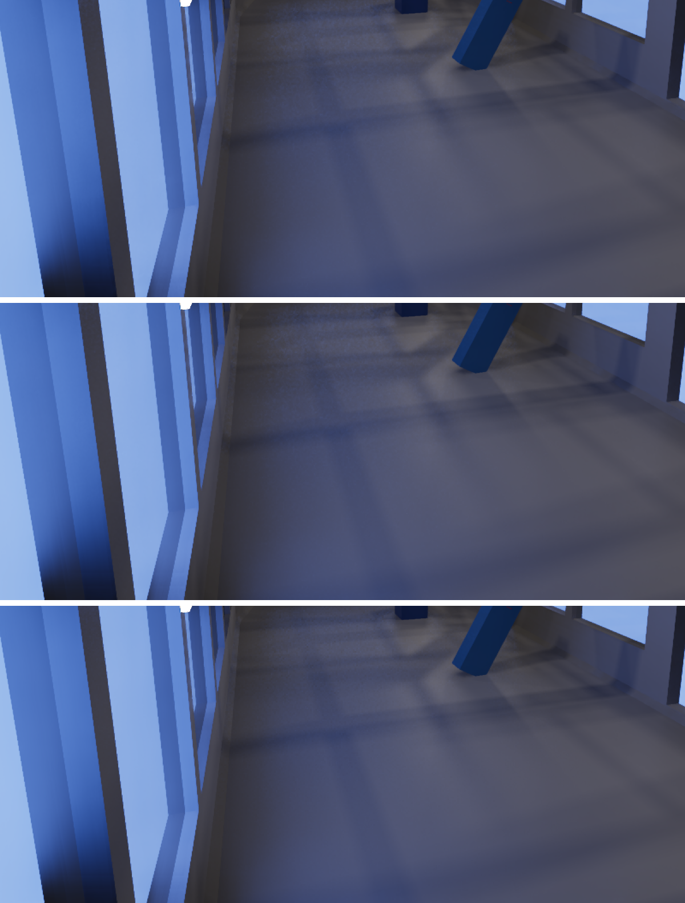
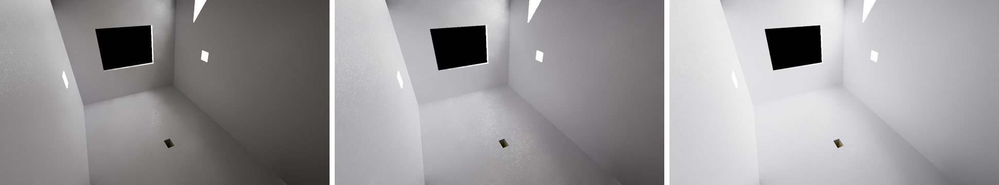

# What the region evidence buys and costs: Design X with and without it (a take for t0-qvm1)

The line orchestrator's question of 2026-11-22: what does region evidence buy, and what does it cost, so that the follow-up `t0-qvm1` can end with a repaired rule or with no rule. The region's drift test has three measured faults: false fires in a still scene (`t0-gumm`'s history map), a count that restarts on a moving render size (`t4f-71qp`), and a late start after a stop (`t0-3vwx`'s final walk). This take is no gate of the merge.

## The two codes

Both are the final code, the cap's commit `05a27262d` (Design X, light evidence restarting at `FullRateFrames` 8), built with `t0-3vwx`'s fitted probe patch and its region, dynamic-scale and history logs, and `t0-gumm`'s own-ray log and history dump (`t0-gumm-catch-up-spread/tools/builds.sh`):

- `xfd`: Design X as it is, with region evidence.
- `xfn`: the same with `t0-gumm-catch-up-spread/scratch-no-region-evidence.patch`: the region's drift test still runs and its log still lists the fires, but region evidence caps no history. For the images this is the rule turned off. Its cost is not measured here.

## The settled history lengths of the still cabin

`pics/history-map-rule-on-off.png`: the cabin of the switch film, lamps on, settled, at the constant scale 2/3, draw 190 (before the lamps go off at 193). Left the still at draw 190, right the slow diffuse history's length per render pixel (`t0-gumm-catch-up-spread/tools/histmap.py`).

| Code | Mean length | Under 8 draws | 8 to 31.5 draws | 31.5 or more (the cap of 32) |
|---|---|---|---|---|
| With region evidence | 28.35 draws | 1.9 % | 20.8 % | 77.4 % |
| Without region evidence | 31.40 draws | 1.9 % | 0.0 % | 98.1 % |

- With the rule, region-sized rectangles on the ceiling, the walls and the floor hold shorter histories: the region test's false fires cap a region at 8 draws, and its histories regrow.
- Without the rule, every pixel except the window openings (which show space and hold no history) reaches the cap.
- The rule-on numbers equal X5's map of `t0-gumm` to the digit: the cap of `05a27262d` does not act in a still.

## The walk's stop

Video: `pics/walk-rule-on-off.mp4`, with region evidence left and without it right, 260 draws (the walk's last 60 and the 200 after the stop). Both codes play back the card's walk log of Design X `05a27262d` from `t0-3vwx`'s final take (scale 0.949 on every draw of the video), so the numbers stand beside that film's. `tools/queue.sh`, its output in `queue.txt`.

| The center region's light after the stop, against the last frame | 0 draws | 20 draws | 40 draws |
|---|---|---|---|
| Design X with region evidence | +5.87 % | +4.61 % | +3.58 % |
| Design X without region evidence | +5.52 % | +4.27 % | +3.26 % |
| Main `454574bf8` (`t0-3vwx`'s final film) | +5.34 % | +3.73 % | +2.49 % |

- The rule-on run gives the final film's numbers to the digit.
- Without region evidence the trail after the stop is a little shorter, not longer: 0.32 to 0.35 points less light at each point. The region test starts only about 36 draws after the stop, so it cannot shorten this trail; the false fires before the walk leave shorter histories, which is the only difference the rule makes here. (Not measured: the history lengths at the stop.)
- The survey's settle after the stop, slowest region: 47 draws with region evidence (the final film: 47) and 53 without it (main: 25). Without it the whole image settles in 3 draws rather than 0, and the slow regions are the same ones (`r00` 50, `r02` 53, `r10` 39, `r12` 39, against 47, 47, 35, 36). So region evidence buys about 6 draws of the walk's settle and costs 0.3 points of its trail.

## The lamp switch

The survey's take of the fair lamp switch (`switch cabin`) at the constant scale 2/3, `sw-QD` with region evidence and `sw-QN` without it (`tools/queue.sh`, the survey's `regions.py` in `queue.txt`). "Settle" is the draws until the light stays within 5 % of its settled level, in the 200 draws after off and the 100 after on. "Level at 60" is the light 60 draws after the event against the settled level.

| Code | Off: whole, slowest region | On: whole, slowest region | Level at 60 after off | Level at 60 after on |
|---|---|---|---|---|
| With region evidence | 71, 82 | 34, 54 | 107.0 % | 98.2 % |
| Without region evidence | 189, none in 200 | 68, none in 100 | 122.5 % | 94.4 % |

- Without region evidence, the light trails the switch. 60 draws after off, the image is still 22.5 % too bright (the upper corners 139.6 % and 138.0 %), and only the lamp's own region and the middle column settle within 200 draws (`r01` 146, `r11` 171, `r21` 177). After on, only the bottom row settles within 100 draws (46 to 64).
- With region evidence, every region settles after off within 82 draws and after on within 54.
- So region evidence buys the switch's settle: about 120 draws of the whole image's settle after off, and every region's settle after both events. This is the case that the rule exists for. A light change that the block's own rays do not see (the corners, which the lamp lights only through bounce light) reaches those histories only through the region.

## The stills' daub against the clamps-off truth

`pics/exit-cabin-rule-on-off-truth.png`: the still exit-cabin at draw 132, the left wall and the floor (source pixels 240 to 1440 across, 560 to 1080 down). Top: with region evidence. Middle: without it. Bottom: the truth, Design X with both history clamps off (`TERTIUS_A_NO_CLAMP=1`). The survey's still part at the fixed scale 2/3 (`tools/stills.sh`: `s-QD`, `s-QN`, `s-QA`). The daub and the broad error are `daub.py`'s (`design-x-acceptance-2026-11-14/tools`) against the truth's long reference. The per-surface scores use hand-drawn regions of exit-cabin (`tools/surfaces/light.py`, which daub.py reads in place of its own region table).

| Still | Code | Daub | Broad | Walls | Floor | Specks | Blotch |
|---|---|---|---|---|---|---|---|
| exit-cabin | With region evidence | 0.0173 | 0.0135 | 0.0146 | 0.0125 | 0.1929 | 0.0179 |
| | Without it | 0.0153 | 0.0130 | 0.0120 | 0.0113 | 0.2025 | 0.0151 |
| | The truth (clamps off) | 0.0132 | 0.0104 | 0.0111 | 0.0098 | 0.1254 | 0.0141 |
| cabin-light-cabin | With region evidence | 0.0348 | 0.0482 | | | 0.1478 | 0.0160 |
| | Without it | 0.0320 | 0.0480 | | | 0.1774 | 0.0138 |
| | The truth (clamps off) | 0.0285 | 0.0481 | | | 0.1823 | 0.0119 |

- exit-cabin reproduces the per-scene table's numbers: Design X 0.0173, the truth 0.0132 (0.0131 there).
- **How much of the gap the false fires make:** of exit-cabin's gap of 0.0041 between Design X and the truth, region evidence makes 0.0020, about half. On the walls it makes 0.0026 of 0.0035 (three quarters), and on the floor 0.0012 of 0.0027. In cabin-light-cabin it makes 0.0028 of 0.0063. In a still nothing changes, so every fire there is false.
- The rest of the gap, 0.0021 in exit-cabin, is the clamps' own.
- Without region evidence the blotch is lower too (0.0151 against 0.0179), and the specks are a little higher (0.2025 against 0.1929; cabin-light-cabin 0.1774 against 0.1478).
- The ceiling region scores about 0.141 on all three codes, the truth too, so it measures the region's own content (bright window openings at its edge), not the rule. It is left out of the table.

## The bay film's trail

`pics/rect-bay-middle-still-on-off.png`: the film rect-bay's middle frame (the sunbeam narrows and goes out). Left: the still of the same state. Middle: the film with region evidence. Right: the film without it. t0-acxm's measure is the survey's own: the motion film rect-bay and the lag film bay-sun, at the fixed scale 2/3 (`tools/bay.sh`: `b-QD`, `b-QN`, `l-QD`, `l-QN`).

| Code | Film level | Film blotch | Flicker | Median lag | Largest lag | Lag error, median / largest |
|---|---|---|---|---|---|---|
| With region evidence | +1.09 | 0.232 | 0.00247 | 13.8 draws | 27.5 draws | 0.149 / 0.388 |
| Without it | +2.69 | 0.580 | 0.00091 | 42.9 draws | 123.5 draws | 0.296 / 0.623 |

- The level is the survey's median ratio of the film frame's light to the still's, minus 1: +2.69 means the film is 269 % too bright, which is the trail.
- These match t0-acxm's two sides (its R: lag 14.0 draws, error 0.150; its L without the remedy: 40.6 draws, error 0.354), on the newer code.
- Without region evidence the flicker is lower (0.00091 against 0.00247), because the histories stay long. That is the trail's other face.
- Both lag films fail the survey's lag error limit, with and without.

## What region evidence buys and costs

| Case | What it buys | What it costs |
|---|---|---|
| The bay film | The trail: median lag 13.8 draws against 42.9, film level +1.09 against +2.69 | Flicker 0.00247 against 0.00091 |
| The lamp switch | Every region's settle: whole image 71 draws after off against 189, the slowest region 82 against none in 200 | Nothing measured |
| The walk's stop | 6 draws of the slowest region's settle (47 against 53) | 0.3 points of the trail after the stop |
| The stills, where every fire is false | Nothing | About half of exit-cabin's daub gap to the truth (0.0020 of 0.0041), three quarters on its walls; 20.8 % of the still cabin's pixels hold 8 to 31.5 draws, against 0 % |

So the rule must stay: without it the switch and the bay trail. Its cost is the false fires in still scenes, which shorten histories and leave about half of the daub gap in exit-cabin. A repaired rule, as `t0-qvm1` asks, keeps the true fires of the switch and the bay and drops the false fires of the stills.
