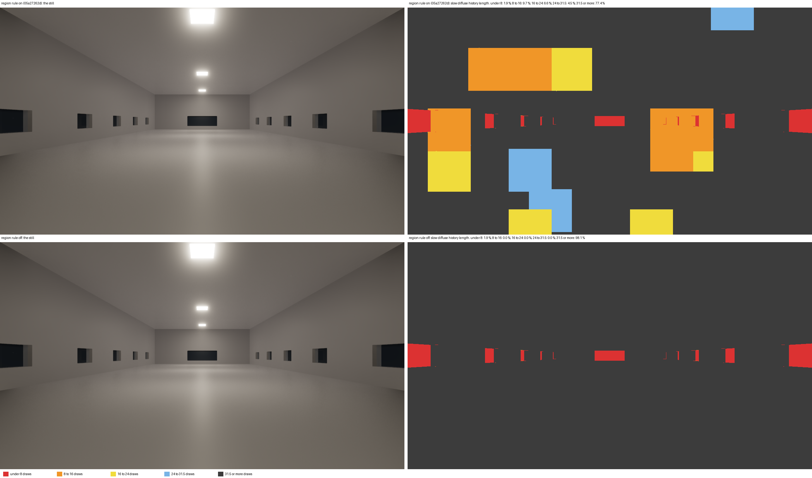

# What the region evidence buys and costs: Design X with and without it (a take for t0-qvm1)

The line orchestrator's question of 2026-11-22: what does region evidence buy, and what does it cost, so that the follow-up `t0-qvm1` can end with a repaired rule or with no rule. The region's drift test has three measured faults: false fires in a still scene (`t0-gumm`'s history map), a count that restarts on a moving render size (`t4f-71qp`), and a late start after a stop (`t0-3vwx`'s final walk). This take is no gate of the merge.

## The two codes

Both are the final code, the cap's commit `05a27262d` (Design X, light evidence restarting at `FullRateFrames` 8), built with `t0-3vwx`'s fitted probe patch and its region, dynamic-scale and history logs, and `t0-gumm`'s own-ray log and history dump (`t0-gumm-catch-up-spread/tools/builds.sh`):

- `xfd`: Design X as it is, with region evidence.
- `xfn`: the same with `t0-gumm-catch-up-spread/scratch-no-region-evidence.patch`: the region's drift test still runs and its log still lists the fires, but region evidence caps no history. For the images this is the rule turned off. Its cost is not measured here.

## The settled history lengths of the still cabin

`pics/history-map-rule-on-off.png`: the cabin of the switch film, lamps on, settled, at the constant scale 2/3, draw 190 (before the lamps go off at 193). Left the still at draw 190, right the slow diffuse history's length per render pixel (`t0-gumm-catch-up-spread/tools/histmap.py`).

| Code | Mean length | Under 8 draws | 8 to 31.5 draws | 31.5 or more (the cap of 32) |
|---|---|---|---|---|
| With region evidence | 28.35 draws | 1.9 % | 20.8 % | 77.4 % |
| Without region evidence | 31.40 draws | 1.9 % | 0.0 % | 98.1 % |

- With the rule, region-sized rectangles on the ceiling, the walls and the floor hold shorter histories: the region test's false fires cap a region at 8 draws, and its histories regrow.
- Without the rule, every pixel except the window openings (which show space and hold no history) reaches the cap.
- The rule-on numbers equal X5's map of `t0-gumm` to the digit: the cap of `05a27262d` does not act in a still.
