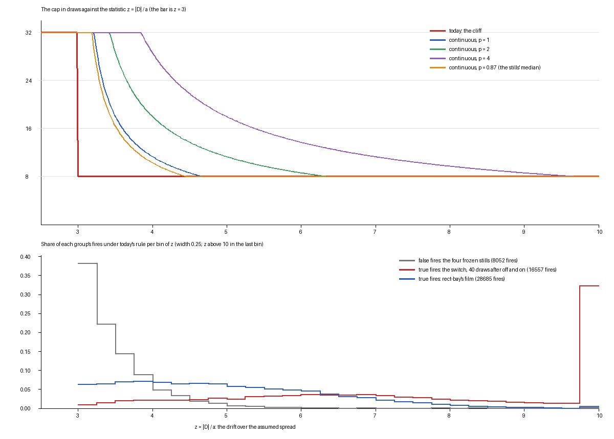

# The replay of the region drift test's repair candidates (t0-qvm1)

The ticket's note of 2026-11-23 sets out two designs for the repair of the region drift test, with every term defined: E (the measured spread) and C (a continuous cap). This take replays them and three more candidates on logged region lights, on the CPU, and decides nothing. No rule is built. The patches are scratch code and never go into `src`. Every new run is on main 165a964e7, the code of the logs.

## Terms

The terms are the ticket's. In short:

- x(t) = the region's light of draw t at one anchor: the mean luminance of the counted taps of its 17 x 17 blocks, over the exposure scale.
- W = 18 draws, the length of each window. P = the jitter's phase count at the render size: 18 at the scale 2/3, 25 at 1072 x 603.
- D(t) = (1 / W) * sum for i from 0 to W - 1 of (x(t - i) - x(t - i - P)). The older window is the W draws from t - P - W + 1 to t - P.
- s1 = the standard deviation (n - 1) of the older window. a = s1 * sqrt(2 / W), the assumed spread.
- m = the measured spread: m2 = m2 + (min(D * D, 9 * b * b) - m2) / N at every tested draw, from 0 after a restart, where b is the spread in use at the anchor's tested draw before.
- z = |D| / a, the test's statistic. The bar is 3 times the spread in use.
- The cap = the longest history length that an anchor allows the blocks of its region in the next draw, 8 to 32 draws.
- A tested anchor-draw = one anchor in one draw whose valid draws in a row reach P + W.

The candidates:

| Name | Detector | Response |
|---|---|---|
| none | none | every cap 32 |
| T | today: \|D\| > 3 a | the cliff: a cap of 8 |
| E4, E8, E16 | \|D\| > 3 b, b = max(a, m), N = 4, 8 or 16 times (P + W) | the cliff |
| C1, C2, C4, Cp | u = \|D\| - 3 a | n = (p * W * s1 / (sqrt(2) * u)) ^ (2/3), kept between 8 and 32, 32 where u <= 0; p = 1, 2, 4, or the still's measured median p |
| EC1, EC2, EC4, ECp | u = \|D\| - 3 b, with E8's b | the same continuous cap |
| K6 | \|D\| > 3 a at this tested draw and at the 5 tested draws before it | the cliff |

The model history of a render block (8 x 8 pixels) has a length L and a light y:

- L starts at 1 at the run's first draw and grows by 1 per draw to 32.
- L takes the smallest cap of the block's anchors (up to 9) of the draw before.
- y follows the logged light of the block's nearest anchor: y = y + (x - y) / L, at that anchor's valid draws.

`tools/replay.py` holds the candidates and the model.

## The runs and the logs

- `tools/builds.sh` builds `r2-main` (main 165a964e7 with the survey's probe, the history dump and the region log) and `r2-noreg` (the same with region evidence off).
- `scratch-region-log.patch` is t0-3vwx's region log, fitted to main: one of its two hunks no longer applied.
- `tools/still.py` and `tools/queue.sh` take the frozen stills as the survey's still part does: 28 captures of 33 draws each, the history kept through them, bloom off. Each run writes the region log of the whole run and dumps the history lengths at two draws.
- The full-picture runs are the still cabin on both builds, and the lamp hall (1072 x 603) and the bay (2/3) on main.
- The bounce runs show the bounce light alone (`TERTIUS_PROBE_SIGNAL=2`) at a fixed exposure of 0 stops. Their captures hold the probe's 24-bit log2 luminance of the HDR image after FSR and before the tone curve. They are the lamp hall, the bay, exit-cabin and the still cabin on main.
- The region logs are in `logs/`, gzipped. `logs/switch-rule` and `logs/switch-none` are t0-gbgj's `map-xfd` and `map-xfn`: the fair cabin switch at 2/3, with the rule and without it. exit-cabin, bay-sun and rect-bay come from `../t0-qvm1-region-off/logs/`.

## Part 1: the still cabin is a weak true drift at draw 190, frozen from about draw 400

From `tools/cabin.py`. Its output is `cabin.txt`.

| Measure | Main | Region evidence off |
|---|---|---|
| Short histories (under 31.5 draws), draw 190 / 890 | 21.13 % / 17.85 % | 0.04 % / 0.02 % |
| Fires per tested anchor-draw, draws 100-190 / 600-923 | 1.28 % / 0.76 % | 1.42 % / 0.75 % |
| Region light, draws 150-190 against the last 100 draws: median, median size, largest size | -0.31 %, 0.77 %, 5.20 % | -1.02 %, 1.20 %, 5.69 % |
| Median light per 100 draws against the last 100, from draw 100 | -0.54, -0.11, -0.04, +0.06, ... % | -1.44, -0.57, -0.22, +0.01, ... % |
| Grain (blotch / RMS) at v-s05 (draw 190) | 0.0065 / 0.0041 | 0.0112 / 0.0074 |
| Grain (blotch / RMS) at v-s26 (draw 890) | 0.0049 / 0.0030 | 0.0046 / 0.0028 |

- The same measure of a frozen light (draws 683 to 723 against the last 100) gives a median size of 0.84 % and a largest size of 5.6 %.
- The replayed test agrees with the logged answer at all 211,344 tested anchor-draws of each run.
- At draw 190, the region's light still rises: by 0.5 % with the rule and by 1.4 % without it. That settling is the region-off build's higher grain at draw 190. From about draw 400 the light is frozen. There, the region-off build has the lower grain, and main still holds 17.85 % short histories at a fire rate near the nominal 0.8 %.
- So each still's frozen part in part 2 is its draws from 400 to the end.

## Part 2: the replay

`tools/measure.py` runs every case. Its output is `replay.txt` and `replay.json`, and `tools/table.py` makes the table below.

`pics/cap-against-statistic.png` (`tools/chart.py`) has two panels:

- Top: the cap against z, for today's cliff and for the continuous cap at p = 1, 2 and 4, and at 0.87, the median of the four stills' measured p.
- Bottom: the share of the fires of today's rule per bin of z. The groups are the false fires of the four frozen stills, the switch's true fires in the 40 draws after off and on, and all of rect-bay's film.

The false fires sit between 3 and 4.5. Under the continuous cap at p = 1, a fire there costs 32 to 9 draws, not 8.

### The table

The short blocks are the share of the surface blocks whose model history is under 31.5 draws, as a mean over draws 400 to the end. The lamp hall's candidates pair at P = 25. The added noise is the mean over the surface blocks of sqrt(32 / L) - 1. The settles are in draws after the switch, on the log with the rule. The lags are in draws. The cabin's drift is the model light against the end level, over draws 100 to 199 and 200 to 299, on the log with the rule.

| Candidate | Short blocks: exit-cabin / lamp hall / bay / still cabin | Added noise, mean of the four | Switch off: whole, slowest region | Switch on: whole, slowest region | bay-sun lag: median, largest | rect-bay lag: median, largest | Cabin drift, model light 100-199 / 200-299 |
|---|---|---|---|---|---|---|---|
| none | 0.0 % / 0.0 % / 0.0 % / 0.0 % | 0.0000 | 133, 149 | none, none | 30.8, 33.2 | 31.2, 34.6 | -1.24 % / -0.25 % |
| T | 27.5 % / 19.7 % / 32.1 % / 23.3 % | 0.1135 | 74, 90 | 51, 59 | 7.2, 26.3 | 7.2, 27.0 | -0.92 % / -0.26 % |
| E4 | 5.6 % / 4.6 % / 6.6 % / 5.7 % | 0.0223 | 101, 110 | 67, 76 | 7.4, 31.3 | 29.1, 31.6 | -1.03 % / -0.23 % |
| E8 | 10.2 % / 7.5 % / 11.7 % / 9.9 % | 0.0398 | 96, 105 | 58, 69 | 7.2, 32.2 | 21.3, 31.7 | -0.94 % / -0.23 % |
| E16 | 18.7 % / 14.0 % / 22.2 % / 15.8 % | 0.0749 | 91, 104 | 52, 60 | 7.2, 26.7 | 18.2, 31.8 | -0.92 % / -0.23 % |
| C1 | 12.9 % / 9.1 % / 16.0 % / 10.5 % | 0.0317 | 80, 98 | 52, 59 | 7.5, 22.5 | 7.9, 31.0 | -1.04 % / -0.25 % |
| C2 | 7.0 % / 4.4 % / 9.5 % / 5.7 % | 0.0129 | 86, 104 | 55, 63 | 8.3, 26.1 | 10.5, 32.5 | -1.16 % / -0.24 % |
| C4 | 2.5 % / 1.2 % / 3.6 % / 1.9 % | 0.0035 | 97, 111 | 60, 69 | 11.8, 33.1 | 15.9, 34.2 | -1.20 % / -0.24 % |
| Cp | 17.9 % / 8.3 % / 20.5 % / 9.4 % | 0.0413 | | | | | |
| EC1 | 3.3 % / 2.2 % / 4.0 % / 3.1 % | 0.0065 | 101, 110 | 64, 73 | 7.5, 31.4 | 28.4, 31.6 | -1.10 % / -0.25 % |
| EC2 | 1.3 % / 0.7 % / 1.6 % / 1.3 % | 0.0020 | 104, 116 | 70, 76 | 8.6, 31.2 | 30.0, 32.5 | -1.17 % / -0.24 % |
| EC4 | 0.2 % / 0.1 % / 0.3 % / 0.4 % | 0.0006 | 110, 122 | 76, 83 | 12.1, 33.1 | 30.9, 34.2 | -1.20 % / -0.25 % |
| ECp | 5.5 % / 1.9 % / 5.9 % / 2.7 % | 0.0097 | | | | | |
| K6 | 2.6 % / 2.9 % / 3.7 % / 2.3 % | 0.0117 | 76, 96 | 52, 59 | 7.2, 29.1 | 7.3, 34.6 | -1.14 % / -0.24 % |

Cp and ECp use each still's own median p, and only the stills have a measured p.

### The model's check

- **The stills.** Today's rule T replays the logged fires exactly in every log at P = W = 18: exit-cabin 213,120 tested anchor-draws, the lamp hall 150,960, the bay 206,904, the still cabin 211,344, the switch 108,766, and g-lag and g-bay. T's model share of short blocks at the dump draws against the real dump's (a real block is short when its surface pixels' median length is under 31.5 draws):

  | Still | Draw | Model T | Real dump | The count's pixel share |
  |---|---|---|---|---|
  | exit-cabin | 630 / 890 | 26.64 / 15.87 % | 26.64 / 15.87 % | |
  | lamp hall (P = 18) | 630 / 890 | 10.94 / 21.16 % | 10.96 / 21.16 % | 10.95 % |
  | bay | 630 / 890 | 29.31 / 37.61 % | 29.31 / 37.61 % | 29.33 % |
  | still cabin | 190 / 890 | 21.05 / 17.79 % | 21.18 / 17.79 % | 21.13 % |

  So the block model of the length is exact to 0.13 points or better. In exit-cabin, the model runs on the old log g-exit (Design X `05a27262d`) and the dump comes from the new bounce run on main. They agree exactly, so the region test's fires repeat across the two builds there.
- **The switch.** T on the log with the rule settles after off in 74 draws (whole) and 90 (slowest region), against the measured 71 and 82. After on it settles in 51 and 59, against 34 and 54. On the log without the rule, no rule never settles within the windows, against the measured 189 and none in 200 after off. The cause is the end level. The logged light itself ends 4.4 % above the lamps-off control after off, and 6.0 % below the lamps-on control after on. The measure of 189 draws was of the whole picture, where the direct light settles at once. So the model fits the rule's side within 3 to 17 draws. It cannot reproduce the no-rule side, and its settles compare candidates only against T.
- **The lags.** T's model lag in bay-sun is 7.2 and 26.3 draws (median, largest), against the measured 13.8 and 27.5. No rule gives 30.8 and 33.2, against 42.9 and 123.5. The model lags less than the picture, because the logged light already carries the histories' lag through the bounce. So the lags compare candidates only against T.

### The lamp hall's two pairings

At 1072 x 603, today's two windows of 18 (T18) fire at 0.95 % of the tested anchor-draws, and the pairing at 25 (T25) fires at 1.09 %. Their short blocks over draws 400 to the end are 24.0 % and 19.7 %. The pairing at 25 does not lower the false rate in this still. So the jitter's remainder is not a visible part of the false fires at this scale.

### E's span

| Still | E4: false rate after the fill, fill | E8 | E16 |
|---|---|---|---|
| exit-cabin | 0.16 %, 287 draws | 0.29 %, 361 | 0.39 %, 499 |
| lamp hall (P = 25) | 0.10 %, 120 | 0.21 %, 276 | 0.50 %, 459 |
| bay | 0.20 %, 228 | 0.30 %, 400 | 0.51 %, 497 |
| still cabin | 0.19 %, 165 | 0.26 %, 404 | 0.43 %, 481 |

- The false rate is E's fires per tested anchor-draw from the first tested draw plus N to the end.
- The fill is the draws from the first tested draw until the median m over the anchors first reaches 90 % of its median over the run's last third. E16's span, 576 draws at P = 18, does not fill within these runs of 924 draws, so its numbers are early.

### rect-bay's weak fires and the cabin's weak drift

The caps that each candidate gives where today's rule fires (10, 50 and 90 %):

| Candidate | rect-bay's film | The still cabin's draws 100-299, log with the rule | The same, log without the rule |
|---|---|---|---|
| C1 | 8.0, 8.0, 21.3 | 8.0, 19.3, 32.0 | 8.0, 20.0, 32.0 |
| C2 | 8.0, 11.9, 32.0 | 8.0, 30.6, 32.0 | 8.0, 31.7, 32.0 |
| C4 | 11.3, 18.9, 32.0 | 9.7, 32.0, 32.0 | 9.7, 32.0, 32.0 |
| EC1 | 8.0, 32.0, 32.0 | 8.0, 24.0, 32.0 | 8.0, 23.0, 32.0 |
| EC2 | 12.0, 32.0, 32.0 | 8.0, 32.0, 32.0 | 8.0, 32.0, 32.0 |
| EC4 | 19.0, 32.0, 32.0 | 9.8, 32.0, 32.0 | 9.7, 32.0, 32.0 |
| E4 / E8 / E16 | | 8, 32, 32 / 8, 8, 32 / 8, 8, 8 | 8, 8, 32 / 8, 8, 32 / 8, 8, 8 |
| K6 | | 8, 32, 32 | 8, 32, 32 |

The cabin's drift, the median model light against the end level:

| Candidate | Log with the rule: 100-199 / 200-299 | Log without the rule |
|---|---|---|
| the logged light | -0.54 % / -0.11 % | -1.44 % / -0.57 % |
| none | -1.24 % / -0.25 % | -2.30 % / -0.83 % |
| T | -0.92 % / -0.26 % | -2.04 % / -0.77 % |
| C1 | -1.04 % / -0.25 % | -2.16 % / -0.80 % |
| C2 | -1.16 % / -0.24 % | -2.25 % / -0.81 % |
| K6 | -1.14 % / -0.24 % | -2.31 % / -0.80 % |

In draws 100 to 199, T's model light is 0.32 points closer to the end than no rule. C1 keeps 0.20 of those points, K6 0.10 and C2 0.08. Most of the rule's gain in the logged light (-0.54 % against -1.44 %) comes through the rays, which read the cut histories, and the replay cannot model that.

## p, measured

From `tools/pmeasure.py`. Its output is `p.json`.

- p = (the pixel's relative scatter at a full history) * sqrt(2 * 32) / (the region's relative s1).
- The pixel scatter is the standard deviation over the bounce run's captures v-s01 to v-s27, over the mean, per output pixel. A capture counts only where the model history of the pixel's block under T is 32 draws at the capture's shown draw. The median is taken over the pixels of the anchor's 17 x 17 blocks.
- The region's s1 is the median over its tested draws of s1 over the older window's mean.
- The pixels come from the HDR image after FSR and before the tone curve: after the accumulator, the diffuse filter, the composite's albedo and FSR's own history. They are not the accumulator's output. With 27 captures a pixel's scatter has an error of about 14 %.

| Still | p: 10 / 50 / 90 % over the anchors | Anchors | Median pixel scatter | Median region s1 |
|---|---|---|---|---|
| exit-cabin | 0.35 / 0.53 / 0.81 | 240 | 0.0099 | 0.1478 |
| lamp hall | 0.74 / 1.12 / 1.72 | 170 | 0.0083 | 0.0503 |
| bay | 0.45 / 0.61 / 0.95 | 233 | 0.0120 | 0.1540 |
| still cabin | 0.68 / 1.17 / 2.05 | 238 | 0.0088 | 0.0501 |

p is about 1 or less. It differs by a factor of about 2 between the stills, and by a factor of 2.3 to 3 between the 10th and 90th percentile anchors of one still. With each still's own median p, the continuous cap (Cp) leaves 8.3 to 20.5 % of the blocks short, more than C1 in the stills with p under 1. So the measured p does not support the larger p of C2 and C4.

### Can the spatial dispatch read the pixel's own noise?

Two values exist. Neither is built into a cap.

1. **The retained deviation, in the fast history's alpha.** `accumulate_temporal.comp:350-360` updates it each draw as the weighted standard deviation of the pixel's sample luminance over a window of 32 draws (`DeviationFrames`), and `:375` stores it. The diffuse filter's feedback step then replaces it with a bound: the shares' sum of its taps' deviations, `kept * abs(centerLight.a) + deviationSum` (`diffuse_filter_wavelet.glsl:86`, stored at `:94-95` where the slow history is at least `YoungFrames` long). The spatial dispatch already reads it as `own.a` (`accumulate_spatial.comp:132`, used for the clamp's box at `:158`).

   What it still lacks:
   - It is the scatter of one sample, not of the history's mean. The noise of a history of length n needs a division by sqrt(n).
   - After the feedback step it is a bound for taps of any correlation, so it overstates the noise of independent taps.
   - It does not see FSR's pooling.
   - It is per pixel, while the drift is per anchor. A cap from it would be per pixel, and the payload would change: the block would carry z or u / a in place of a cap.

2. **The filter's variance estimate.** The non-feedback steps write sqrt(kept^2 * variance + sum of share^2 * variance) into the filter's output alpha (`diffuse_filter_wavelet.glsl:80`): the paper's deviation for independent taps. That value lives only in the filter's working images, which the accumulation runs before. The spatial dispatch could read it only as the draw before's, from an image that it does not bind today. It also misses FSR.

## What the replay cannot say

- The logged light comes from a run under today's rule. The rays read the histories that the rule cut, so the logged light of every candidate but T carries T's effect. The switch and the still cabin have logs without the rule too, and they bracket it. bay-sun, rect-bay and exit-cabin have only the rule's log.
- The model history is a history of the region's light, not of a pixel after the filter and FSR. It has no light evidence and no reprojection test.
- The model's settles and lags compare candidates against T. They do not predict the picture's numbers (see "The model's check").
- p comes from the image after FSR. A design that uses p needs it at the accumulator's output.
- E16 does not fill its span within 924 draws.

## Files

- `scratch-history-dump.patch`, `scratch-no-region-evidence.patch`, `scratch-region-log.patch`: the scratch patches.
- `tools/`: builds.sh, still.py, queue.sh, replay.py, cabin.py, measure.py, pmeasure.py, chart.py, table.py.
- `logs/`: the region logs of the new runs and of the switch, gzipped (`replay.py` reads a `.f32.gz` beside its `.txt`). `measure.py`, `cabin.py` and `pmeasure.py` also read the runs' history dumps and captures in `/private/tmp/t0-5tyj/r2/runs/`. Those were deleted after this commit, so a rerun needs `queue.sh` first.
- `cabin.txt`, `replay.txt`, `replay.json`, `p.json`, `table.md`: the outputs.
- `pics/cap-against-statistic.png`: the chart.
