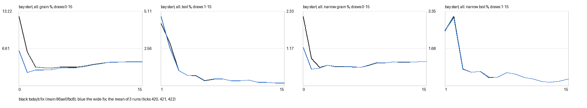
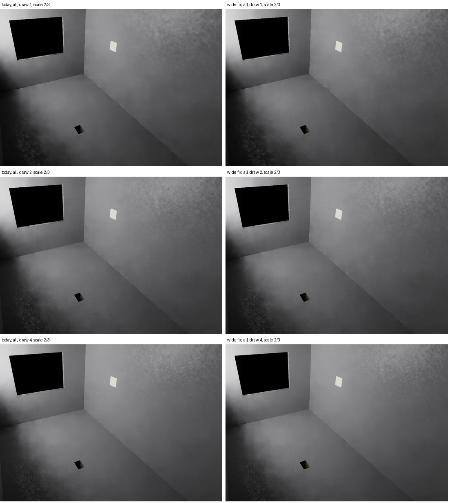
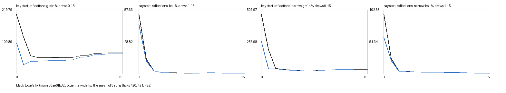
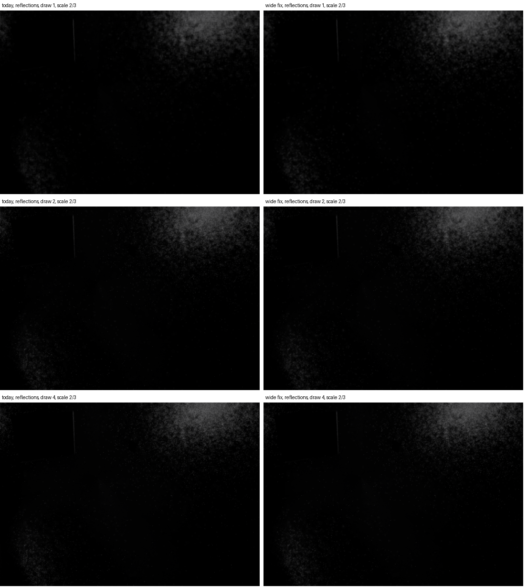
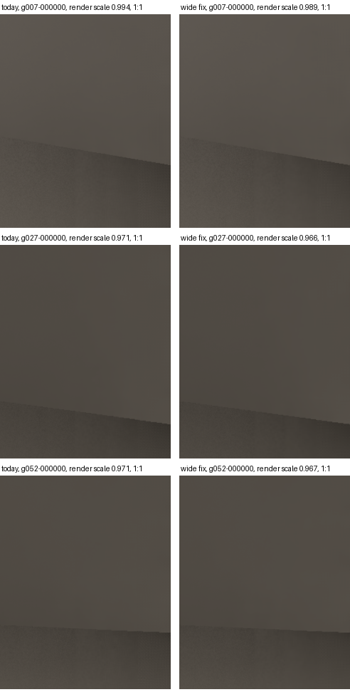
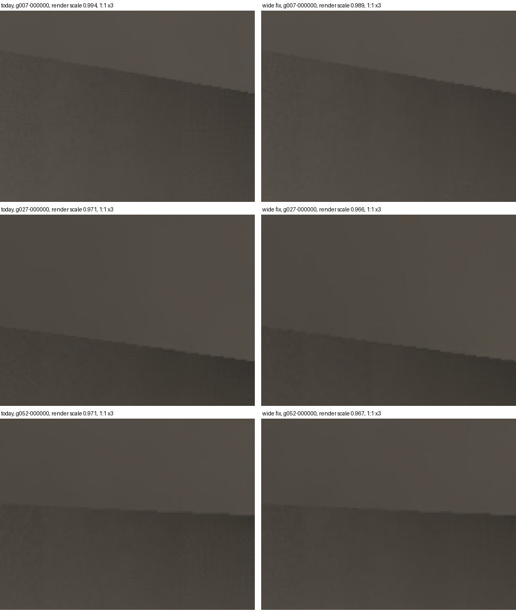
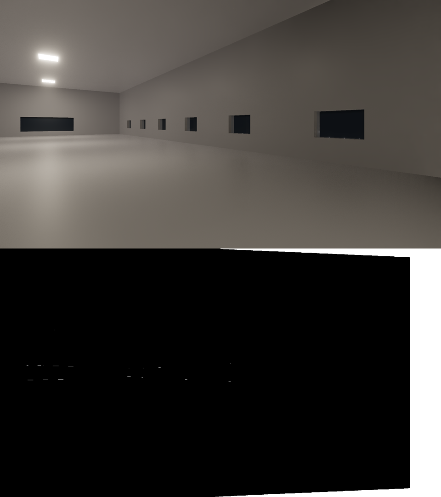

# The fix of short histories reads every pixel of each tapped block (t0-rs55, not merged)

The catch-up ray experiment `t0-gumm` found that the fix of short histories reads one pixel of four that hold independent samples ("The 36-tap fix" in `docs/research/t0-gumm-catch-up-spread`). This ticket built the fix that reads all four and measured it against main `86ae0fbc8`. The line orchestrator decided on 2026-11-23 (answer 96) that the fix is not merged. Under motion its gain shows only in a measure, and at a start it costs +1.7 ms on the dearest draw. The code stays here as `wide-fix.patch`. The branch's `src`, `tests` and `ARCHITECTURE.md` equal main `86ae0fbc8`.

## Terms

- A block is the screen tracer's 2 × 2 pixels, which start at an even column and row. A young block's pixels trace their own rays, so its four pixels hold four independent samples.
- The fix of short histories is step 3 of the spatial dispatch (`accumulate_spatial.comp`). While a pixel's slow history is shorter than `HistoryFixFrames` (4 draws), it replaces the history with the length-weighted mean of 3 × 3 taps `spacing` pixels apart, over the pixels that show the same surface. The spacing is 2^(3 − ⌊length⌋): 4 pixels at a length of 1, 2 at a length of 2, 1 at a length of 3.
- Today's fix reads the 9 tapped pixels. The wide fix reads every pixel of each tapped block while the spacing is 2 or more, up to 36 pixels. At a spacing of 1 it reads the same 9 pixels as today's fix.
- Grain is the noise of one picture: a crop's display-linear luminance minus its local mean, rms, over the crop's mean, in %. Boil is the change from one draw to the next of the same crop, in %. The narrow crop is t0-gumm's small crop of the bay's floor. The measures are those of t0-gumm's sweep table (`fairmeasure.py`, `tools/baysum.py`).
- The spread is the largest range of the three runs of one code, at the world's ticks 420, 421 and 422.
- The band of newly seen pixels is the pixels whose slow diffuse history is 1 to 3 draws long after a draw (`scratch-history-band.patch`). These are the pixels whose history the fix replaces.

## What the patch holds

`wide-fix.patch` is `git diff 86ae0fbc8 <the last code commit> -- src tests ARCHITECTURE.md`. It applies on main `86ae0fbc8`, and main has moved since. It holds:

- the wide read in `accumulate_spatial.comp` (`addToFix`, `FixSum`, and the loop over each tapped block's corners);
- `trace_block.glsl`, the tracer's named block (`TraceBlockPixels`, `traceBlockOf`, `traceBlockPixel`), which the plan, the tracer and the resolve read in place of their own `pixel >> 1` and `2 * block + corner`;
- seven new tests in `AccumulatorRenderTests.cs`, and two changed expectations: the isolated sample's repair (0.25) and the reflection guide's support (35/36, the fix pools 36 pixels and only the center has no hit);
- the text of the fix in ARCHITECTURE.md and the block's one place in the tracer's model.

The wide read, as it ran:

```glsl
FixSum fix = FixSum(slow * historyLength, guide * historyLength, historyLength);
for (int y = -1; y <= 1; y++)
    for (int x = -1; x <= 1; x++)
    {
        ivec2 tap = pixel + spacing * ivec2(x, y);
        if (spacing == 1)
            addToFix(fix, tap, pixel, key);
        else
            for (uint corner = 0u; corner < TraceBlockPixels; corner++)
                addToFix(fix, traceBlockPixel(traceBlockOf(tap), corner), pixel, key);
    }
slow = fix.light / fix.weight;
guide = fix.guide / fix.weight;
```

where

- `pixel` = the pixel whose short history the fix replaces.
- `slow`, `guide`, `historyLength` = the pixel's own slow history, reflection guide and length in draws, from the scratch image.
- `spacing` = the distance between the taps in pixels (4, 2 or 1).
- `tap` = the pixel that today's fix reads.
- `traceBlockOf(tap)` = the tap's block (`tap >> 1`, an arithmetic shift, so a tap at x = −1 lies in block −1, outside the image).
- `traceBlockPixel(block, corner)` = the block's pixel number `corner`, 0 to 3, row by row.
- `addToFix(fix, neighbor, pixel, key)` = adds the neighbor's light and guide times its length, and its length to the weight, unless the neighbor is the pixel itself, lies outside the images, or shows another surface than `key`.

## The bay's start: the whole picture

bay-sunbeam's view on the Mac, a frozen film from draw 0 at 1920 × 1080, the constant render scale 2/3 and the fixed exposure of −4.0 stops (t0-gumm's `fairrun.sh`). Today is main `86ae0fbc8` (build m0z), wide is the branch's `b63a96f67` (m1z), each with the same probe patches. 3 runs per side.

| Measure | Today | Wide | Change | Spread |
|---|---|---|---|---|
| Grain of draws 1 to 4 | 3.919 | 2.695 | −31 % | 0.041 |
| Grain of draw 0 | 12.24 | 6.19 | −49 % | 0.144 |
| Grain of draws 3 to 8 | 3.323 | 3.113 | −6 % | 0.031 |
| Grain of draws 9 to 15 | 4.163 | 4.127 | −1 % | 0.046 |
| Narrow grain of draws 1 to 4 | 0.668 | 0.575 | −14 % | 0.014 |
| Boil of draws 1 to 4 | 2.249 | 2.284 | +0.035 | 0.013 |
| Boil of draw 1 | 4.257 | 4.734 | +0.48 | 0.054 |
| Boil of draws 1 to 8 | 1.370 | 1.389 | +0.019 | 0.002 |
| Boil of draws 1 to 59 | 0.306 | 0.309 | +0.003 | 0.004 |
| Narrow boil of draws 1 to 4, of draw 1, of draws 1 to 8 | 1.738, 2.471, 1.121 | 1.730, 2.486, 1.117 | within the spread | 0.043, 0.124, 0.026 |

Grain per draw, draws 0 to 4: today 12.24, 5.97, 3.37, 3.19, 3.15; wide 6.19, 2.32, 2.78, 2.81, 2.87. Boil per draw, draws 1 and 2: today 4.26 and 2.94, wide 4.73 and 2.61. From draw 3 the boils are equal. The line orchestrator accepted the boil of draw 1 (+0.48) if the frames show no pop (answer 95). The pop check did not run (see "Not measured").



`pics/bay-start-all-chart.png`: per draw, the mean of the three runs. Black is today, blue the wide fix.



`pics/bay-start-all-strip.png`: the floor and the right wall at draws 1, 2 and 4 of the run at +0, today | wide fix, at 0.4 times size.

`pics/bay-start-floor-1to1.png` and `pics/bay-start-wall-1to1.png` show a floor region and a wall region at 1:1 at draws 0, 1 and 2. At draws 0 and 1, today shows a fine regular lattice of dots at the taps' spacing, and the wide fix shows none. The wide fix's draw 0 has coarser blotches. At draw 2 the two look alike. The difference shows at draws 0 and 1 without the labels.

The 24 × 24 block means of the wide fix differ from today's most at draw 1: by 1.06 to 1.28 % on the floor and the wall, against 0.40 to 0.56 % at draw 0 and about 0.25 % at draw 2 (`tools/boilparts.py`). So the pool changes the light of draw 1 at the scale of blocks, which agrees with the rise of draw 1's boil. The take with the diffuse filter off, which would test whether the filter carries that rise, did not run.

**The real form equals the scratch form.** The build xrz carries the real code on the scratch form's base (`check-real-fix-on-x5.patch` in place of t0-gumm's `scratch-wide-fix.patch`). Its run gives frames.series equal in all 200 rows to t0-gumm's `bay-wide-today` (xwz with `TERTIUS_X_WIDE_FIX=1`). m0z and m1z give exactly the measures of t0-gumm's xgz and xwz.

## The bay's start: the reflections alone

The same runs with `TERTIUS_PROBE_SIGNAL=3`, 3 runs per side.

| Measure | Today | Wide | Change | Spread |
|---|---|---|---|---|
| Grain of draws 1 to 4 | 75.09 | 40.48 | −46 % | 1.27 |
| Grain of draw 0 | 203.5 | 105.8 | −48 % | 2.54 |
| Grain of draws 3 to 8 | 56.29 | 46.33 | −18 % | 0.89 |
| Grain of draws 9 to 15 | 68.75 | 64.79 | −6 % | 1.57 |
| Narrow grain of draws 1 to 4 | 76.33 | 36.34 | −52 % | 2.36 |
| Narrow grain of draws 3 to 8 | 28.77 | 27.51 | −4 % | 0.30 |
| **Narrow grain of draws 9 to 15** | **35.00** | **36.04** | **+3 %** | **0.47** |
| Boil of draws 1 to 4 | 17.63 | 14.84 | −16 % | 1.02 |
| Boil of draw 1 | 53.37 | 44.20 | −17 % | 3.78 |
| Boil of draws 1 to 8 | 9.27 | 7.88 | −15 % | 0.51 |
| Boil of draws 1 to 59 | 1.631 | 1.439 | −12 % | 0.075 |
| Narrow boil of draws 1 to 4 | 31.95 | 21.98 | −31 % | 1.43 |
| Narrow boil of draw 1 | 95.08 | 58.08 | −39 % | 4.45 |
| Narrow boil of draws 1 to 8 | 17.45 | 12.44 | −29 % | 0.72 |

One measure is worse by more than the spread: the narrow crop's grain of draws 9 to 15, +1.04 points, +0.80 to +1.24 in the three paired runs. These draws come after the fix acts (from draw 4 every history is 4 draws long or more), so the difference is in what the histories inherit from draws 0 to 3. The strip shows no new speck.



`pics/bay-start-reflections-chart.png`: per draw, the mean of the three runs. Black is today, blue the wide fix.



`pics/bay-start-reflections-strip.png`: the reflections alone at draws 1, 2 and 4 of the run at +0, today | wide fix. At draw 1, today shows the taps' lattice, and the wide fix is smoother. At draws 2 and 4 the wide fix is smoother too, with no new bright pixel.

## The card: start and cut under the dynamic render scale

Cloud job wide2 on the RTX 2000 Ada (`tools/cardwide.sh`, `tools/cardwide-submit.sh`): 1920 × 1080 under `FrameTimeTarget(16.67, 0.5, 1)`, 2 rounds per code in alternating order after one warm-up run of each build. The start is t0-gumm's `start.json` (the cabin's person camera filmed from draw 0). The cut is t0-gumm's `cut.json` (the cut back to the person camera at draw 134 restarts every history). Read with `tools/cardwide.py`.

The render scale and the GPU span (ms) of draws 0 to 8 after the event:

| Event, code, round | Draw 0 | 1 | 2 | 3 | 4 | 5 | 6 | 7 | 8 |
|---|---|---|---|---|---|---|---|---|---|
| Start, today, r1 | 1.000, 28.74 | 0.929, 25.33 | 0.877, 23.20 | 0.838, 19.77 | 0.811, 18.99 | 0.793, 17.03 | 0.782, 16.16 | 0.777, 16.19 | 0.777, 13.47 |
| Start, today, r2 | 1.000, 28.58 | 0.929, 25.38 | 0.877, 23.20 | 0.838, 19.51 | 0.811, 18.81 | 0.793, 17.09 | 0.782, 16.00 | 0.776, 16.12 | 0.776, 13.29 |
| Start, wide, r1 | 1.000, 30.50 | 0.923, 26.61 | 0.866, 22.44 | 0.825, 19.00 | 0.797, 17.56 | 0.780, 16.96 | 0.770, 16.62 | 0.765, 16.39 | 0.765, 14.06 |
| Start, wide, r2 | 1.000, 30.30 | 0.923, 26.40 | 0.866, 22.19 | 0.825, 18.91 | 0.797, 18.15 | 0.779, 17.57 | 0.767, 15.93 | 0.762, 15.50 | 0.762, 13.28 |
| Cut, today, r1 | 0.991, 24.39 | 0.991, 25.94 | 0.975, 25.11 | 0.952, 24.22 | 0.929, 21.85 | 0.908, 22.14 | 0.888, 20.16 | 0.871, 19.82 | 0.858, 16.07 |
| Cut, today, r2 | 0.987, 24.75 | 0.987, 25.57 | 0.972, 24.92 | 0.951, 22.48 | 0.930, 23.14 | 0.910, 21.62 | 0.891, 21.69 | 0.874, 20.10 | 0.859, 16.40 |
| Cut, wide, r1 | 0.991, 25.96 | 0.985, 27.00 | 0.965, 26.28 | 0.940, 23.35 | 0.916, 21.54 | 0.895, 21.06 | 0.877, 20.09 | 0.862, 19.12 | 0.850, 15.83 |
| Cut, wide, r2 | 0.987, 26.20 | 0.982, 27.67 | 0.962, 25.30 | 0.938, 23.89 | 0.914, 21.74 | 0.893, 22.07 | 0.874, 20.05 | 0.859, 19.54 | 0.846, 16.37 |

| Event | Measure | Today r1, r2 | Wide r1, r2 |
|---|---|---|---|
| Start | Span of draw 0 at the scale 1.000 | 28.74, 28.58 ms | 30.50, 30.30 ms |
| Start | Spans of draws 1 and 2 | 48.53, 48.58 ms | 49.05, 48.59 ms |
| Start | Lowest render scale | 0.777, 0.776 | 0.765, 0.762 |
| Start | Draws below the scale of the rest | 53, 51 | 54, 51 |
| Cut | Spans of draws 1 and 2 | 51.05, 50.49 ms | 53.28, 52.97 ms |
| Cut | Lowest render scale | 0.851, 0.851 | 0.844, 0.840 |
| Cut | Draws below the scale of the rest | 43, 38 | 43, 41 |

At the start, draw 0 costs +1.7 ms with the wide fix at the same render scale 1.000. The dynamic scale then answers with a scale about 0.012 lower from draw 1 to draw 8. At the cut, draws 1 and 2 cost about +2.4 ms together. The extra cost lies in draws 0 to 3, inside the 8 dear draws of the announced dip `ter-bcwr`.

## The motion take

The motion take is the main take. Two films of the cabin's person camera (`scripts.py` writes `turn.json` and `walk.json`):

- the turn: the camera turns during draws 93 to 152 and stands from draw 153;
- the walk: the camera walks forward during draws 213 to 332 and stands from draw 333.

The pictures come from the Mac at 1920 × 1080 (`tools/motionrun.sh`, builds m0v and m1v with `scratch-history-band.patch`). Each side plays back its own card scale log of job motion1, round 1 (`cardwide.sh` under `FrameTimeTarget(16.67, 0.5, 1)`), and every run checks its size log against the card log: 0 draws of 333 and 533 at another scale. The spans come from separate Mac runs at the constant render scale 2/3, 5 paired rounds with the order of the codes rotating (`tools/queue-timing.sh`, `tools/spansmotion.py`). The card's own spans come from job motion1 (`tools/cardmotion.py`).

| Film | The band's share during the motion | The band's grain, today → wide | Draws lower with wide | Mac GPU span during the motion, today → wide (median of 5 rounds) | Wide − today, median of the paired rounds [range] | Card span during the motion, today r1, r2 → wide r1, r2 |
|---|---|---|---|---|---|---|
| Turn | 8.1 % | 4.16 → 3.89 % (−6.5 %) | 50 of 60 | 17.289 → 17.415 ms | +0.109 ms [−2.775, +0.160] | 17.24, 17.23 → 17.32, 17.11 ms |
| Walk | 0.01 % | 50.35 → 50.94 % | 56 of 116 | 16.391 → 16.358 ms | −0.032 ms [−0.615, +0.016] | 17.33, 17.24 → 17.37, 17.27 ms |

The paired difference over the 20 draws before the motion gives the Mac's noise: −0.055 ms for the turn and +0.024 ms for the walk. In the 60 draws after the turn, the band falls to 0.76 % and its grain is 16.66 → 16.40 %.

The walk shows almost nothing new: a forward walk keeps nearly every history, so the band is about 200 pixels, and its grain is noise. The fix barely acts in it.

**At 1:1 the band does not look visibly cleaner with the wide fix, in either film.** Without the labels I cannot tell the sides apart. Only at 3 times, at draw 100 of the turn, today's floor in the new strip shows a faint regular lattice of dots and the wide fix a soft mottle. At draws 120 and 145 the two look the same.



`pics/turn-band-1to1.png`: the turn at draws 100, 120 and 145 (g007, g027, g052), a 240 × 300 crop at the right edge, where the newly seen strip enters, at 1:1 with the runs' exposure. Left today, right the wide fix, with each side's render scale.



`pics/turn-band-1to1-x3.png`: the same draws, a 160 × 120 crop of the floor's edge in the strip, each pixel 3 times (nearest neighbor).



`pics/turn-band-mask.png`: the turn at draw 120 at half size (top) and its band in white (bottom). The band is a strip about 140 pixels wide at the leading edge, plus the edges of the window openings.

`pics/walk-band-1to1-x2.png`: the walk at draws 230, 260 and 300, the far wall where the band's few pixels lie, each pixel 2 times. The sides look the same.

`pics/turn-band-chart.png`: the band's grain and share per draw of the turn.

The videos, today | wide fix, each pane 1280 × 720, 60 frames a second, one draw per frame, the fixed exposure, H.264 `yuv420p` at CRF 12, the render scale and the render size under each label, and the draw counter in the corner:

- `pics/turn-today-wide.mp4`: draws 83 to 212, render scale 0.971 to 0.999 today and 0.966 to 0.999 wide;
- `pics/walk-today-wide.mp4`: draws 203 to 392, render scale 0.994 on both sides.

The check of `tools/videos.py` decodes each video and compares the 3 × 3 regions' luminance at three frames with the source PNGs: the largest difference is 0.73 % (turn) and 0.35 % (walk).

### The cost split

The probe build m2v (`scratch-probe-tap-key.patch`) tests each tap's surface once and lets the answer stand for its three block mates. It reads 9 surface keys in place of up to 36, and the same scratch texels. Its pictures are wrong where a block holds two surfaces. It is a probe, not a cheaper form. In the same 5 paired rounds:

| Film, window | Wide − today | Probe − today |
|---|---|---|
| Turn, the motion | +0.109 ms | +0.069 ms |
| Turn, the 20 draws before | −0.055 ms | −0.057 ms |
| Walk, the motion | −0.032 ms | −0.011 ms |

Under the turn, about 0.04 ms of the extra span is the mates' surface tests and about 0.07 ms is the reads of their light. Both lie inside the noise of about ±0.1 ms.

## The readers of the tracer's samples and of the scratch image

Every reader of a signal's sample image (the tracer's resolve writes it, one sample per pixel: the block's shared sample or the pixel's own) and of the scratch image (the temporal dispatch writes it, one history per pixel), read on the branch's code. While own rays exist, a reader that reads one pixel per block reads one of four independent samples there.

| Reader | File and line | What it reads | Pixels per block while own rays exist |
|---|---|---|---|
| The tracer's resolve | `screen_trace_resolve.comp:16` to `19` | The block's record at the block, or the pixel's own record at the pixel | Writes the samples, one record per pixel |
| The temporal dispatch, the blend | `accumulate_temporal.comp:262` | The sample at the pixel | Each pixel its own: right for a per-pixel history |
| The temporal dispatch, the mean of the young samples | `accumulate_temporal.comp:113` (`meanSampleLuminance`) | The samples of the 3 × 3 pixels around the pixel, 1 pixel apart | All four of each block it touches |
| The spatial dispatch, the pixel | `accumulate_spatial.comp:97` | The scratch history at the pixel | Each pixel its own |
| **The spatial dispatch, the fix of short histories, on main** | `accumulate_spatial.comp`, step 3 | The scratch history and the reflection guide of 3 × 3 taps 4 or 2 pixels apart | **One. The pooling fault, which stays on main because the wide fix is not merged** |
| The diffuse filter's variance | `diffuse_filter_variance.comp:16` and `26` | The fast histories of a dense 7 × 7 window | All four |
| The diffuse filter's wavelets | `diffuse_filter_wavelet.glsl:44` and `67` | The first step's taps 1 pixel apart in the slow history after the fix; each later step reads the step before | All four |
| **The region test's taps** | `region_drift.glsl:139` (`regionTapOf`) | The sample at pixel (4, 4) of each 8 × 8 block, 17 × 17 taps per region | **One: the even corner of one tracer block in four. The same pooling fault** |
| **The neighbor limit, a prototype, off by default** | `neighbor_limit_prototype.glsl:25` (specialization constant 9, `NeighborLimitPrototype`) | The samples of 8 neighbors 2 pixels apart, the references of a limit of the pixel's sample | **One: the corner of the pixel's own parity in each neighboring block. The same pattern** |
| The single diffuse history, a prototype | `accumulate_diffuse_single_temporal.comp:64` | The sample at the pixel, through the neighbor limit | Each pixel its own |
| The composite's reflection sharing, a prototype | `reflection_sharing_prototype.glsl` (`reflectionSharedAt`) | The slow reflection history of a dense 5 × 5 window. Its binding of the sample, `reflectionHitSample`, is declared and never read | All four |

The reflections take the same accumulation as the bounce light, so their readers are the rows of the temporal and the spatial dispatch, and the prototype of the composite.

Three readers read one pixel per block:

- The fix of short histories on main: the fault that this ticket measured.
- The region test reads one sample per 8 × 8 block. Its window spans 18 draws, and its noise estimate is the spread of the same taps over the older window, so the estimate matches what it reads: the one-in-four read costs samples, not a bias. While own rays exist, three quarters of the traced samples at its tap blocks go unread. The region test's repair waits on t0-qvm1's design note.
- The neighbor limit is off by default. Its 8 references come from 8 blocks, one pixel of each. It ranks references for a limit and does not pool them, so reading more would change the limit's rule, not repair a pool.

## Mutants

One `tools/mutate.py` list of 20 mutants on the changed lines of the shaders (`AccumulatorRenderTests` and, for the tracer, the screen tracer's test classes). Every changed line of the new loop ran under the tests: each mutant there either failed a test or has a reason below. A nix garbage collection of another session deleted the dev shell's MoltenVK and noise mask during the first run, so S12 to S20 ran again in a second list. S06 ran a third time against its new test.

| Id | Place | Change | Result |
|---|---|---|---|
| S01 | `accumulate_spatial.comp:85` | No skip of the pixel itself | Killed |
| S02 | `accumulate_spatial.comp:85` | No inside test | Survived: judgment call, below |
| S03 | `accumulate_spatial.comp:85` | No surface test | Killed |
| S04 | `accumulate_spatial.comp:88` | Light not weighted by length | Killed |
| S05 | `accumulate_spatial.comp:89` | Weight 1 per pixel | Killed |
| S06 | `accumulate_spatial.comp:91` | Guide not weighted by length | Killed by the new test `TheFixWeightsTheGuideOfEachTappedPixelByItsLength` (support 0.51 against 1) |
| S07 | `accumulate_spatial.comp:133` | Own pixel's weight 1 | Killed |
| S08 | `accumulate_spatial.comp:138` | Blocks only from spacing 4 | Killed |
| S09 | `accumulate_spatial.comp:138` | Never blocks (today's fix) | Killed |
| S10 | `accumulate_spatial.comp:138` | Blocks at spacing 1 too | Killed |
| S11 | `accumulate_spatial.comp:141` | Two corners of a block | Killed |
| S12 | `accumulate_spatial.comp:142` | The tap four times | Killed |
| S13 | `accumulate_spatial.comp:144` | One weight too many | Killed |
| S14 | `trace_block.glsl:15` | Division rounds toward 0 | Killed |
| S15 | `trace_block.glsl:21` | Corner order transposed | Survived: equivalent for the fix, judgment call for the tracer, below |
| S16 | `trace_block.glsl:21` | Block origin not doubled | Killed |
| S17 | `trace_block.glsl:10` | Three pixels per block | Killed |
| S18 | `screen_trace.glsl:382` | No turn: always from corner 0 | Survived: judgment call, below |
| S19 | `screen_trace_plan.comp:219` | The plan takes the pixel as the block | Killed |
| S20 | `screen_trace_resolve.comp:16` | The resolve takes the pixel as the block | Killed |

- S02: on this driver an image read outside the image returns 0, so the outside pixel's surface key has depth 0 and fails the surface test. The Vulkan spec leaves such a read undefined without `robustImageAccess`, so the inside test is needed, and no test on a driver that returns 0 can see it.
- S15: the fix sums all four corners, so their order changes only the order of the sum. The tracer's turn visits all four pixels of a block in any order. No test reads which pixel starts a block's ray in a given draw.
- S18: the turn is main's code, moved into the named block unchanged. No test reads which pixel of a block starts its ray, and `t2-8foa` holds the open question of the turn's parity.

## Not measured

The line orchestrator stopped these takes after the decision:

- the bay start's video (today | wide fix) and the check, draw by draw at full size, of whether draw 1 pops;
- the cabin's start and cut on the Mac, and the fair cabin switch;
- the take with the diffuse filter off, which would test whether the rise of draw 1's boil comes from the filter;
- the settled stills rect-lamps, bay-sunbeam, docking-bay and exit-cabin, bit for bit;
- the Mac's GPU spans of draws 0 to 8 after a start and a cut, in paired rounds (the card's are above);
- the full Checked and Release suites on the last code commit, and the review. The pre-commit hook's Checked tests passed on each code commit.

## Files

- `wide-fix.patch`: the code, the tests and the ARCHITECTURE.md text of the wide fix, on main `86ae0fbc8`.
- `check-real-fix-on-x5.patch`: the real form on the scratch form's base (build xrz).
- `scratch-history-band.patch`: `TERTIUS_X_HISTORY_DUMP`, the slow diffuse history's length of each draw in a range (builds m0v, m1v, m2v).
- `scratch-probe-tap-key.patch`: the cost probe (build m2v).
- `turn.json`, `walk.json`: the motion take's films (`tools/scripts.py`).
- `tools/`: the builds (`builds.sh`), the Mac queues (`queue-bay.sh`, `queue-motion2.sh`, `queue-timing.sh`, and `queue-cabin.sh`, `queue-motion.sh`, `queue-boil.sh`, which did not run), the runs (`motionrun.sh`), the card job (`cardwide.sh`, `cardwide-submit.sh`) and the readers of the results (`baysum.py`, `boilparts.py`, `band.py`, `sheet11.py`, `videos.py`, `cardwide.py`, `cardmotion.py`, `spans03.py`, `spansmotion.py`).
- Cloud spend: $0.11 of the $0.40 allowed.
