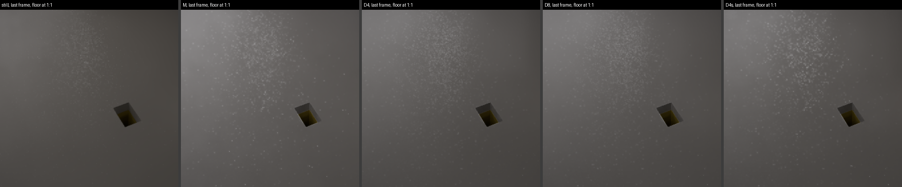
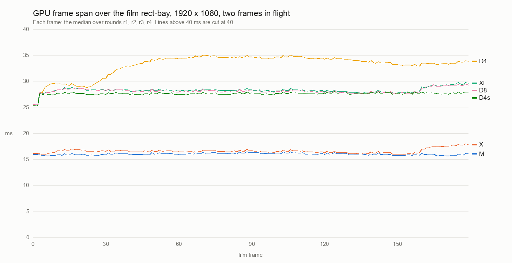

# The cost of the region's drift evidence in the bay film (t0-xdck)

The drift experiment (`t0-ion0`) made the region's moving light a second source of light evidence. That evidence closed the bay film's trail. This record measures what it costs in GPU time, and it measures two cheaper actions. It changes nothing in `src`, `tests` or `tools`. It uses the scratch probe of `t0-ion0` on `73f4a6548`, with two more scratch switches, and only the bay scenes: the film `rect-bay`, the lag film `bay-sun` and the still `bay-sunbeam`.

## The answers in short

| Question | Measured |
|---|---|
| 1. D4's frame span in the film | Median 33.87 ms against M's 16.05 ms and X's 16.55 ms: +17.8 ms against M and +17.3 ms against X. The drift test without action (Xt) is 28.25 ms. So the test itself costs +11.7 ms over X, and D4's action costs +5.6 ms over Xt. The action's cost is in the ray passes: +5.4 ms in the range from the ray plan to the diffuse rays. Highest span: D4 35.2 ms, M 16.6 ms (quiet rounds). |
| 2. D8 and D4s against main | D8's level is +0.86 / +0.31, main's +1.17 / +0.54. D8's blotch is 0.206 / 0.195, main's 0.245 / 0.231. D8's specks are 0.20 / 0.63, main's 0.18 / 1.28. bay-sun's lag error is 0.131 for D8 and 0.267 for main. D8's frame span is 0.15 ms below Xt's. D4s's level is +0.47 / +0.22, the same as D4's, and its frame span is 0.59 ms below Xt's. But D4s's specks are 0.44 / 3.61 in the film, against main's 0.18 / 1.28, and 0.20 against 0.06 in the still. |
| 3. The remedy's action | The numbers are in the two rows above and in the tables below. My reading follows. |

The values "a / b" are at the film's middle and last frame. M is main, X is the fix alone, and the other sides are defined in "The sides".

My reading:

- D8 is the action for the remedy. It keeps the film better than main by every measure and by the eye. Its action costs no measurable frame span (D8 − Xt = −0.15 ms, with spreads of 0.09 and 0.05 ms in the quiet rounds). It keeps less of the trail's cure than D4: the last frame's level is +0.31 against +0.23, and bay-sun's lag error is 0.131 against 0.102.
- D4 costs 5.6 ms in this film for a small gain over D8. Its own rays reach 54 % of the render pixels in each draw while the sunbeam moves.
- D4s fails the bar "no worse than main" by its bright specks. Its switch lowers the own-ray threshold for every pixel, so it also takes away the own rays of young histories. That is the likely cause of its specks, but this record does not test it.
- The drift test as the scratch probe builds it costs 11.7 ms. That cost is the probe's, not the remedy's. The probe computes the region's light at every render pixel, with 17 × 17 taps and a ring of 18 layers. The remedy needs the test only at each block's center pixel, 1 in 64 pixels. The cost of a test per block is not measured here. The remedy's design (`t0-acxm`) must measure it before it adopts the test.

## What the pictures show


`pics/rect-bay-frames.png`: the film `rect-bay` at its middle frame (top row) and last frame (bottom row), at 0.4 scale. The columns are the still of the same state, M, D4, D8 and D4s. In the middle frame, M's room is brighter than the still: the old light stays on the walls and the floor, which is the trail. D4, D8 and D4s are close to the still. In the last frame, M's walls and floor are still lighter than the still's. D4, D8 and D4s are close to the still's darker room. At this scale, no picture shows a blotch or a daub.



`pics/rect-bay-end-floor.png`: the floor above the hole in the last frame at 1:1, output pixels 700 to 1100 by 600 to 1000. The still holds a faint cloud of fine specks of its own. M shows denser and brighter specks over the whole floor, and a lighter band on the left, which is the trail. D4 and D8 show only faint, fine specks, near the still's. D4s shows a brighter and coarser cloud of specks above the hole than D4 and D8. By the bar, D4 and D8 pass, and D4s shows bright specks.


`pics/bay-sunbeam-floor.png`: the still `bay-sunbeam` at the automatic exposure, output pixels 480 to 980 by 520 to 1020 at 1:1. The columns are the reference (clamps off), M, X, D4, D8 and D4s. The reference is smooth. M shows a soft lighter cloud on the floor that the reference does not have, which is a daub. X, D4 and D8 show a smoother gradient with fine grain low on the floor. D4s shows slightly coarser grain than D4 and D8.



`pics/rect-bay-span-chart.png`: the GPU frame span of each film frame, the median over the four timing rounds. M and X stay near 16 ms. Xt, D8 and D4s stay near 28 ms, the cost of the scratch drift test. D4 rises from about 29 ms to 35 ms between film frames 25 and 50, where its own-ray share rises, and stays near 34 ms. X, Xt and D8 rise by about 1.5 ms after frame 158, where X's diffuse own-ray share rises to 22 %. D4s does not rise there, because it gives no own rays at that length.

## Terms

- The frame span = the GPU time of one frame, from its first time stamp to its last, in ms.
- A range sum = the sum of the GPU times of a range of consecutive passes in one frame (`--gpu-run`). "plan..rays" is the range from `ray plan` to `diffuse rays`: the ray plan and the two ray passes. "plan..accum" is the range from `ray plan` to `accumulate indirect specular`: also the resolve and the accumulation and filter passes. MoltenVK latches its time stamps late, so a single pass's time is not valid. A range sum and the frame span are valid.
- An own ray = a ray that a pixel traces for itself, in place of its block's shared ray. The own-ray share = the pixels with an own ray of a kind (reflection or diffuse), divided by all render pixels (1280 × 720).
- A history's length L = the count of draws that the bounce history averages. The fast cap = 4 draws. FullRateFrames = 8 draws.
- Light evidence = a block's sign that its light changed. The reader then cuts L. Regional evidence = light evidence from the drift test, rule Q3 of `t0-ion0`: the region's drift is above 3 standard deviations of its own noise.
- The level = the survey's median ratio of the film frame's blurred light to the still's, minus 1. +0.47 means 47 % too bright. The blotch = the survey's measure of soft patches against the still. Specks = the survey's count of bright single pixels per 10,000 visible pixels, without the specks that the still or the reference holds. The daub = the survey's measure of broad soft clouds against the reference.
- The lag error = the bay-sun lag film's median error of the light against the moving sunbeam's state.

## The sides

| Side | What it is | Switches beyond X (`tools/vars.sh`) |
|---|---|---|
| M | main `13f4714a9`, no probe | none, main's build |
| X | the fix alone: light evidence of a ray cuts L to the fast cap and keeps the box wide, no regional evidence | `TERTIUS_X_LIGHT_ACTION=cut TERTIUS_X_HALF_NEAREST=1` (X itself) |
| Xt | X with the drift test computed but not acting, only for the timing | the ring switches and `TERTIUS_X_DRIFT_ACT=0` |
| D4 | regional evidence cuts L to the fast cap, 4 draws, so its pixels trace own rays | the ring switches |
| D8 | regional evidence alone cuts L to 8 draws, FullRateFrames, so its blocks keep the shared ray | the ring switches and `TERTIUS_X_DRIFT_CUT=8` |
| D4s | as D4, but the plan gives an own ray only below 4 draws, in every pixel | the ring switches and `TERTIUS_X_FULL_RATE=4` |
| C4 | every bounce history held at 4 draws, the control of `t0-ion0` | `TERTIUS_X_DIFFUSE_CAP=4` |

The ring switches are `TERTIUS_X_REGION_WINDOW=18 TERTIUS_X_WINDOW_ALL=1 TERTIUS_X_DRIFT=8 TERTIUS_X_DRIFT_RULE=1 TERTIUS_X_DRIFT_SIGMAS=3`, rule Q3 of `t0-ion0`. Light evidence of a ray keeps its cut to the fast cap in every side.

D4s follows the ticket's definition: "a scratch switch that makes the plan give own rays only below the fast cap in this film". The existing switch `TERTIUS_X_FULL_RATE` does this, so D4s needs no new switch. Its side effect: the threshold falls for every pixel. So a young history also traces no own ray at 4 to 7 draws, and so does a history that a ray's evidence cut. D4s's own-ray share is 0.2 %, below X's 6 to 7 %. The plan cannot tell a history that the drift test cut from one that a ray's evidence cut, because the history stores no cause. So no cheaper switch gives "no own rays from regional evidence alone".

## The builds

The probe is `t0-ion0`'s fourth build on `73f4a6548` with three scratch additions. `scratch-probe-on-73f4a6548.patch` holds the whole probe.

The first addition is D8's cut. In `accumulate_spatial.comp`, the drift test's evidence alone cuts to its own length:

```glsl
        // SCRATCH (t0-xdck): the drift test's own cut length.
        if (probeDriftOnly && ProbeDriftCut > 0.0)
            cutLength = max(fastCap, ProbeDriftCut);
...
        historyLength = lightCuts
            ? min(historyLength, cutLength)
            : max(fastCap, historyLength * (1.0 - min(1.0, lag / parameters.antiLagShare)));
```

```glsl
    if (ProbeDriftRadius > 0 && ProbeDriftActs && (driftBits & (1u << uint(ProbeDriftRule))) != 0u)
    {
        // SCRATCH (t0-xdck): the evidence is the drift test's alone where no ray of the block gave light evidence.
        probeDriftOnly = evidence < LightEvidence;
        evidence = max(evidence, LightEvidence);
    }
```

where

- `probeDriftOnly` = whether the block's light evidence comes from the drift test alone, from no ray.
- `ProbeDriftCut` = the length in draws to which the drift test's evidence alone cuts L, specialization constant 29, from `TERTIUS_X_DRIFT_CUT`. 0 keeps the fast cap.
- `cutLength` = the length in draws to which light evidence cuts L in this draw.
- `fastCap` = the fast cap, 4 draws.
- `historyLength` = L, the bounce history's length in draws.
- `lightCuts` = whether light evidence cuts L in this draw.
- `lag`, `parameters.antiLagShare` = the anti-lag's measured lag and its share, which shorten L without light evidence.
- `ProbeDriftRadius` = the drift test's radius in blocks.
- `ProbeDriftActs` = whether the test acts. It is false for Xt.
- `ProbeDriftRule` = the test's rule, 1 for Q1 and Q3.
- `driftBits` = the block's drift flags, one bit per rule, from the block's center pixel.
- `evidence` = the block's evidence level, `LightEvidence` the level of light evidence.

The ray plan (`screen_trace_plan.comp`) gives the shared ray only to a pixel whose history reaches FullRateFrames:

```glsl
            if (historyLengthOf(r, kind) >= FullRateFrames && fits(p, c, kind))
                continue;
```

where

- `historyLengthOf(r, kind)` = L of the pixel's history of the kind, reflection or diffuse.
- `FullRateFrames` = 8 draws, and 4 under `TERTIUS_X_FULL_RATE=4` (D4s).
- `fits(p, c, kind)` = whether the block's chosen ray fits this pixel.
- `continue` = the pixel takes the block's shared ray. Otherwise it traces an own ray.

So under D8, a history that the drift test cuts to 8 draws still takes the shared ray.

The second addition is the own-ray count. `TERTIUS_X_OWN_COUNT=<folder>` makes the renderer read the plan's own-ray lists after each draw and write one line per draw: the draw, the reflection and diffuse own-ray counts, and the render size. `tools/ownshare.py` reads them. Main's build has no count, so M has no own-ray share.

The third addition is the span dump in `GpuTimingSummary.cs`. The switch is `TERTIUS_X_SPAN_DUMP=<file>`. When the run reports, after its timed loop, it writes each frame's GPU span and each requested range's sum per frame. Both builds have it: the probe through the patch, and main through `scratch-span-dump-on-13f4714a9.patch`. Main's timing build is `13f4714a9` with `tools/renderer-survey/probe.patch` and this patch. The survey's timing tool keeps only the mean, median and 95th percentile, so the highest span and the chart need the dump.

## The control

With `TERTIUS_X_DRIFT_CUT` and the own-ray count at their defaults, D4 is `t0-ion0`'s Q3. Its film gives +0.47 / +0.23 and blotch 0.122 / 0.148, equal to `t0-ion0`'s Q3. The control passes.

## The timing

The timing has four rounds on the Mac, at 1920 × 1080 with two frames in flight and `--video none`. Every run has the fixed exposure −0.648 stops, the survey's film exposure of M's image take. Each round held the exclusive GPU lock once, for 1 to 1.5 minutes, and ran each side alone, one after the other. Rounds r1 and r3 ran M X Xt D4 D8 D4s C4, and r2 and r4 ran the reverse order. Every run's clock was 1292.1 to 1296.0 MHz, so the clocks compare. Round 1 ran at a load of 10 to 56 on 10 cores. Rounds 2 to 4 ran at 2.5 to 5.4.

The table gives, per side, the median of the four runs' medians in ms. The spread in brackets is the highest minus the lowest run median. The highest columns give the highest single frame of any run.

| Side | Frame span | Highest, all rounds | Highest, rounds 2 to 4 | plan..rays | plan..accum |
|---|---|---|---|---|---|
| M | 16.046 (0.123) | 22.343 | 16.553 | 4.569 (0.025) | 9.203 (0.128) |
| X | 16.547 (0.097) | 18.179 | 18.118 | 4.802 (0.018) | 9.730 (0.046) |
| Xt | 28.249 (0.265) | 31.368 | 29.834 | 4.799 (0.041) | 21.371 (0.315) |
| D4 | 33.870 (0.716) | 36.862 | 35.187 | 10.235 (0.140) | 26.944 (0.659) |
| D8 | 28.101 (0.584) | 34.142 | 29.543 | 4.625 (0.072) | 21.201 (0.578) |
| D4s | 27.656 (0.456) | 28.611 | 28.322 | 4.181 (0.050) | 20.759 (0.464) |
| C4 | 20.373 (0.375) | 21.587 | 20.839 | 8.528 (0.131) | 13.523 (0.252) |

In rounds 2 to 4 alone, each side's spread is 0.05 to 0.12 ms. The larger spreads above come from round 1.

The differences of the medians in ms:

| Difference | Frame span | plan..rays | plan..accum |
|---|---|---|---|
| X − M | +0.50 | +0.23 | +0.53 |
| Xt − X | +11.70 | −0.00 | +11.64 |
| D4 − M | +17.82 | +5.67 | +17.74 |
| D4 − X | +17.32 | +5.43 | +17.21 |
| D4 − Xt | +5.62 | +5.44 | +5.57 |
| D8 − Xt | −0.15 | −0.17 | −0.17 |
| D4s − Xt | −0.59 | −0.62 | −0.61 |
| C4 − X | +3.83 | +3.73 | +3.79 |

Measured facts:

- Xt's whole cost over X lies in "plan..accum" outside "plan..rays": the accumulation passes, where the probe computes the drift test.
- D4's cost over Xt lies in "plan..rays": its own rays.
- D8's and D4s's frame spans lie within 0.6 ms of Xt's.
- X − M (+0.50 ms) holds the probe build's own overhead and the fix's action. This record does not separate them.

The ticket's earlier figure for the deck's camera cuts, where every pixel traces own rays, was a mean of 21.9 ms. It is a different scene and is given only for scale.

## The own rays

The table gives the own-ray share as a mean over film frames 0 to 59, 60 to 119, 120 to 179 and the whole film. Then it gives the share at the middle (89) and last (179) frame. Each cell gives reflection first, then diffuse:

| Side | 0-59 | 60-119 | 120-179 | Film | Frame 89 | Frame 179 |
|---|---|---|---|---|---|---|
| X | 0.077 / 0.056 | 0.077 / 0.049 | 0.057 / 0.071 | 0.071 / 0.058 | 0.080 / 0.050 | 0.101 / 0.221 |
| D4 | 0.393 / 0.329 | 0.675 / 0.705 | 0.567 / 0.583 | 0.545 / 0.539 | 0.678 / 0.702 | 0.579 / 0.600 |
| D8 | 0.066 / 0.057 | 0.039 / 0.050 | 0.034 / 0.072 | 0.047 / 0.060 | 0.041 / 0.052 | 0.066 / 0.223 |
| D4s | 0.002 / 0.002 | 0.002 / 0.002 | 0.002 / 0.002 | 0.002 / 0.002 | 0.002 / 0.002 | 0.002 / 0.002 |
| C4 | 0.088 / 0.724 | 0.101 / 0.724 | 0.057 / 0.724 | 0.082 / 0.724 | 0.104 / 0.724 | 0.087 / 0.724 |

C4's diffuse share stays at 0.724, the share of render pixels on a surface, because no diffuse history reaches 8 draws. So 0.724 is the highest share that this view allows. In the middle of the film, D4's diffuse share reaches 0.70, near that highest share. In the process's first draw, 32 draws before the film's first frame, the count shows 0.724 for both kinds in every side with a count. Every history is young there.

## The film and the lag film

| Side | Level mid / last | Blotch mid / last | Specks mid / last | bay-sun: lag in draws / lag error |
|---|---|---|---|---|
| M | +1.17 / +0.54 | 0.245 / 0.231 | 0.18 / 1.28 | 28.73 / 0.2672 |
| X | +1.86 / +1.91 | 0.383 / 0.484 | 0.16 / 0.10 | 29.72 / 0.2808 |
| D4 | +0.47 / +0.23 | 0.122 / 0.148 | 0.22 / 0.18 | 8.22 / 0.1019 |
| D8 | +0.86 / +0.31 | 0.206 / 0.195 | 0.20 / 0.63 | 13.34 / 0.1305 |
| D4s | +0.47 / +0.22 | 0.122 / 0.140 | 0.44 / 3.61 | 7.06 / 0.0908 |
| C4 | +0.43 / +0.18 | 0.102 / 0.101 | 0.21 / 0.29 | 8.34 / 0.0897 |

The survey counts specks only in stills. `tools/filmspecks.py` applies the survey's speck function to the film's two sampled frames, each against the still of the same state.

## The still bay-sunbeam

At the automatic exposure under today's jitter. The daub is against the reference A (clamps off).

| Side | Specks | Blotch | Daub | Walls | Floor |
|---|---|---|---|---|---|
| A, the reference | 0.07 | 0.0314 | 0.0148 | 0.0135 | 0.0199 |
| M | 0.06 | 0.0346 | 0.0312 | 0.0292 | 0.0373 |
| X | 0.06 | 0.0299 | 0.0208 | 0.0203 | 0.0224 |
| D4 | 0.06 | 0.0276 | 0.0212 | 0.0206 | 0.0230 |
| D8 | 0.06 | 0.0289 | 0.0213 | 0.0207 | 0.0230 |
| D4s | 0.20 | 0.0307 | 0.0243 | 0.0239 | 0.0253 |

D4 and D8 keep X's still. D4s triples the specks and raises the daub by 0.003.

## Files

- `tables-images.txt`: the image tables (`tools/measure.sh`). `tables-timing.txt`: the timing tables (`tools/timing-table.py`) and the load at each side's start. `spans.csv`: every run's span per film frame.
- `scratch-probe-on-73f4a6548.patch`: the whole probe. `scratch-span-dump-on-13f4714a9.patch`: main's span dump.
- `tools/vars.sh`: the sides. `tools/take.sh` and `tools/queue-1.sh`: the image takes through the survey.
- `tools/round.sh`, `tools/round-inner.sh` and `tools/timing-queue.sh`: the timing rounds. `tools/filmscript.py`: the film's script for the timing runs.
- `tools/ownshare.py`, `tools/filmspecks.py`, `tools/timing-table.py`, `tools/measure.sh`, `tools/pics.sh`, `tools/floorcrop.py` and `tools/spanchart.py`: the measures and the pictures.
- `tools/m.sh`: runs a script of this record, of `t0-ion0` or of an earlier record in the dev shell.
- `pics/`: the four pictures above.

The image takes ran through the survey with the shared GPU lock. Their frames are deleted after the record, so `measure.sh` and `pics.sh` print and draw only while the run folders exist. No cloud GPU was used.
