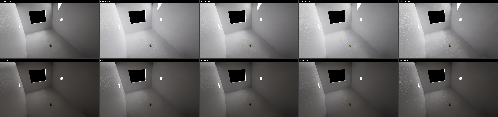
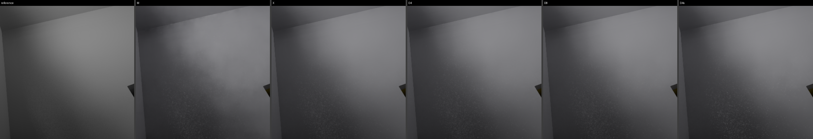

# The cost of the region's drift evidence in the bay film (t0-xdck)

The drift experiment (`t0-ion0`) made the region's moving light a second source of light evidence. That evidence closed the bay film's trail. This record measures its cost in GPU time, and it measures two cheaper actions. It changes nothing in `src`, `tests` or `tools`. It uses the scratch probe of `t0-ion0` on `73f4a6548` with four scratch additions. It uses only the bay scenes: the film `rect-bay`, the lag film `bay-sun` and the still `bay-sunbeam`.

## The answers in short

| Question | Measured |
|---|---|
| 1. D4's frame span in the film | D4's median is 33.87 ms, M's 16.04 ms and X's 16.54 ms. Paired by round, D4 − M is +17.83 ms (spread 0.60 ms) and D4 − X is +17.32 ms (spread 0.62 ms). Of that, the drift test without action (Xt) costs +11.74 ms over X (spread 0.20 ms). D4's action costs +5.63 ms over Xt (spread 0.47 ms), and +5.44 ms of it lies in the ray passes. D4's highest single frame is 35.2 ms, M's 16.7 ms (rounds 2 to 7). |
| 2. D8 and D4s against main, and at what frame span | D8 is better than main in level, blotch, last-frame specks and lag error. Its middle-frame specks (0.20 against 0.18) and its flicker (0.00256 against 0.00206) are slightly above main's, and its flicker is far below the survey's limit. D4s shows about three times main's bright specks in the last film frame. Neither side reaches a frame span near X's in this probe. The test itself costs 7.99 ms over X, even at block centers only (Xtc). D8's action costs −0.19 ms against Xtc (spread 0.04 ms), and D4's +5.63 ms (spread 0.03 ms). |
| 3. The remedy's action | The numbers are in the tables below. My reading follows. |

The values "a / b" are at the film's middle and last frame. A spread is the highest minus the lowest of the per-round values. M is main and X is the fix alone. "The sides" defines the other names.

My reading:

- D8 is the action for the remedy. Against main, D8's film has a lower level (+0.86 / +0.31 against +1.17 / +0.54) and less blotch. It has fewer specks in the last frame (0.63 against 1.28) and half the lag error (0.131 against 0.267). D8's specks in the middle frame (0.20 against 0.18) and its flicker (0.00256 against 0.00206) are close to main's. D8's action costs no GPU time over the test: −0.19 ms.
- D8 keeps less of the trail's cure than D4. Its last frame's level is +0.31 against D4's +0.23, its lag error 0.131 against 0.102, and its middle frame is visibly brighter. D4 buys this with 5.6 ms of own rays in this film.
- D8 as built does more than cut to 8 draws. Where the drift test gives evidence, the reader skips the anti-lag (see "The builds"). The anti-lag can shorten a history below 8 draws. This is a fact of the code. D8 traces fewer reflection own rays than X: 0.047 against 0.071 of the render pixels. It saves 0.19 ms in the ray passes. My reading: the skipped anti-lag causes both. It can also explain part of the trail that D8 keeps against D4. The remedy must choose whether its cut to 8 keeps the anti-lag.
- D4s fails the bar "no worse than main" by its bright specks. Its switch lowers the own-ray threshold for every pixel, so it also takes away the own rays of young histories. That is the likely cause of its specks, but this record does not test it.
- The drift test's cost is its execution, not its code: with its code in the shaders but run at no pixel (Xtn), the frame span equals X's (−0.03 ms, spread 0.15 ms). At every pixel, the test costs 11.7 ms. At block centers only, 1 pixel in 64, it still costs 8.0 ms. My reading: a GPU runs threads in groups of 32 that execute together. So one center pixel's loop of 289 taps holds its whole group of 32 threads, and the group's other threads wait. A test in its own pass, with one thread per block, can avoid that wait. This record does not measure such a pass. The remedy's design (`t0-acxm`) must build the test so and measure it before it adopts the test.

## What the pictures show



`pics/rect-bay-frames.png`: the film `rect-bay` at its middle frame (top row) and last frame (bottom row), at 0.4 scale. The columns are the still of the same state, M, D4, D8 and D4s. The mean gray of each tile, from 0 to 255, follows each name below.

- In the middle frame, every film is brighter than the still (119). M (161) and D8 (154) are both flat and bright on the left wall and the floor. D8 is close to M. D4 (141) and D4s (141) are darker but still brighter than the still. The still shows a clear sunlit band on the floor, which no film shows as clearly. D4s also shows visible grain on the left wall at this scale. This is the trail: the old light stays on the walls and the floor.
- In the last frame, M (85) is lighter than the still (68). D4 (74), D8 (76) and D4s (74) are close to the still.
- At this scale, no tile shows a blotch or a daub.


`pics/rect-bay-end-floor.png`: the floor above the hole in the last frame at 1:1, output pixels 700 to 1100 by 600 to 1000. The still itself shows a faint cloud of fine specks. M shows denser and brighter specks over the whole floor, and a lighter band on the left, which is the trail. D4 and D8 show a cloud of fine specks like the still's. D4s shows a brighter and coarser cloud of specks above the hole than D4 and D8. By the bar, D4 and D8 are no worse than the still, and D4s shows bright specks.



`pics/bay-sunbeam-floor.png`: the still `bay-sunbeam` at the automatic exposure, output pixels 480 to 980 by 520 to 1020 at 1:1. The columns are the reference (clamps off), M, X, D4, D8 and D4s. The reference is smooth. M shows a soft lighter cloud on the floor that the reference does not have, which is a daub. X, D4 and D8 show a smoother gradient with fine grain low on the floor. D4s shows slightly coarser grain than D4 and D8.


`pics/rect-bay-span-chart.png`: the GPU frame span of each film frame, the median over each side's timing runs. M and X stay near 16 ms. Xt, D8 and D4s stay near 28 ms, and D8c near 24.4 ms. D4 rises from about 29 ms to 35 ms between film frames 25 and 50, where its own-ray share rises, and stays near 34 ms. X, Xt, D8 and D8c rise by about 1.5 ms after frame 158, where X's diffuse own-ray share rises to 22 %. D4s does not rise there, because it gives no own rays at that length.

The film's flicker cannot be judged from these pictures, which show no consecutive frames. The survey's flicker numbers are in "The film and the lag film".

## Terms

- The frame span = the GPU time of one frame, from its first time stamp to its last, in ms.
- A range sum = the sum of the GPU times of a range of consecutive passes in one frame (`--gpu-run`). "plan..rays" is the range from `ray plan` to `diffuse rays`: the ray plan and the two ray passes. "plan..accum" is the range from `ray plan` to `accumulate indirect specular`. It also holds the resolve and the accumulation and filter passes. MoltenVK latches its time stamps late, so a single pass's time is not valid. A range sum and the frame span are valid.
- A paired difference = per round, one side's median minus another side's median in the same round, then the median over the rounds. Its spread is the highest minus the lowest per-round difference.
- An own ray = a ray that a pixel traces for itself, in place of its block's shared ray. The own-ray share = the pixels with an own ray of a kind (reflection or diffuse), divided by all render pixels (1280 × 720).
- A history's length L = the count of draws that the bounce history averages. The fast cap = 4 draws. FullRateFrames = 8 draws.
- Light evidence = a block's sign that its light changed. The reader then cuts L. Regional evidence = light evidence from the drift test, rule Q3 of `t0-ion0`: the region's drift is above 3 standard deviations of its own noise.
- A block = 8 × 8 render pixels, one workgroup of the accumulation pass. Its center pixel = local pixel (4, 4).
- The level = the survey's median ratio of the film frame's blurred light to the still's, minus 1. +0.47 means 47 % too bright. The blotch = the survey's measure of soft patches against the still. Specks = the survey's count of bright single pixels per 10,000 visible pixels, without the specks that the still or the reference holds. The daub = the survey's measure of broad soft clouds against the reference. The flicker = the survey's median over the frames of each pixel's change against its two neighbor frames.
- The lag error = the bay-sun lag film's median error of the light against the moving sunbeam's state.

## The sides

| Side | What it is | Switches (`tools/vars.sh`) |
|---|---|---|
| M | main `13f4714a9`, no probe | none, main's build |
| X | the fix alone: light evidence of a ray cuts L to the fast cap and keeps the box wide, no regional evidence | `TERTIUS_X_LIGHT_ACTION=cut TERTIUS_X_HALF_NEAREST=1` |
| Xt | X with the drift test run at every pixel but not acting, for the timing | X, the ring switches and `TERTIUS_X_DRIFT_ACT=0` |
| D4 | regional evidence cuts L to the fast cap, 4 draws, so its pixels trace own rays | X and the ring switches |
| D8 | regional evidence alone cuts L to 8 draws, FullRateFrames, so its blocks keep the shared ray | D4 and `TERTIUS_X_DRIFT_CUT=8` |
| D4s | as D4, but the plan gives an own ray only below 4 draws, in every pixel | D4 and `TERTIUS_X_FULL_RATE=4` |
| C4 | every bounce history held at 4 draws, the control of `t0-ion0` | X and `TERTIUS_X_DIFFUSE_CAP=4` |
| Xtc, D4c, D8c | Xt, D4 and D8 with the drift test run at block centers only | the side and `TERTIUS_X_DRIFT_CENTERS=1` |
| Xtn | Xt with the test's code in the shaders but run at no pixel, for the timing | Xt and `TERTIUS_X_DRIFT_CENTERS=2` |

The ring switches are `TERTIUS_X_REGION_WINDOW=18 TERTIUS_X_WINDOW_ALL=1 TERTIUS_X_DRIFT=8 TERTIUS_X_DRIFT_RULE=1 TERTIUS_X_DRIFT_SIGMAS=3`, rule Q3 of `t0-ion0`. Light evidence of a ray keeps its cut to the fast cap in every side.

D4s follows the ticket's definition: "a scratch switch that makes the plan give own rays only below the fast cap in this film". The existing switch `TERTIUS_X_FULL_RATE` does this, so D4s needs no new switch. Its side effect: the threshold falls for every pixel. So a young history also traces no own ray at 4 to 7 draws, and so does a history that a ray's evidence cut. D4s's own-ray share is 0.2 %, below X's 6 to 7 %. The plan cannot tell a history that the drift test cut from one that a ray's evidence cut, because the history stores no cause. So no cheaper switch gives "no own rays from regional evidence alone".

## The builds

The probe is `t0-ion0`'s fourth build on `73f4a6548` with four scratch additions. `scratch-probe-on-73f4a6548.patch` holds the whole probe.

The first addition is D8's cut. In `accumulate_spatial.comp`, the drift test's evidence alone cuts to its own length:

```glsl
        // SCRATCH (t0-xdck): the drift test's own cut length.
        if (probeDriftOnly && ProbeDriftCut > 0.0)
            cutLength = max(fastCap, ProbeDriftCut);
...
        historyLength = lightCuts
            ? min(historyLength, cutLength)
            : max(fastCap, historyLength * (1.0 - min(1.0, lag / parameters.antiLagShare)));
```

```glsl
    if (ProbeDriftRadius > 0 && ProbeDriftActs && (driftBits & (1u << uint(ProbeDriftRule))) != 0u)
    {
        // SCRATCH (t0-xdck): the evidence is the drift test's alone where no ray of the block gave light evidence.
        probeDriftOnly = evidence < LightEvidence;
        evidence = max(evidence, LightEvidence);
    }
```

where

- `probeDriftOnly` = whether the block's light evidence comes from the drift test alone, from no ray.
- `ProbeDriftCut` = the length in draws to which the drift test's evidence alone cuts L, specialization constant 29, from `TERTIUS_X_DRIFT_CUT`. 0 keeps the fast cap.
- `cutLength` = the length in draws to which light evidence cuts L in this draw.
- `fastCap` = the fast cap, 4 draws.
- `historyLength` = L, the bounce history's length in draws.
- `lightCuts` = whether light evidence cuts L in this draw. It is true wherever light evidence acts, so the second branch, the anti-lag, does not run there.
- `lag` = the anti-lag's measured lag of the pixel's light.
- `parameters.antiLagShare` = the lag at which the anti-lag cuts L fully to the fast cap.
- `ProbeDriftRadius` = the drift test's radius in blocks.
- `ProbeDriftActs` = whether the test acts. It is false for Xt.
- `ProbeDriftRule` = the test's rule, 1 for Q1 and Q3.
- `driftBits` = the block's drift flags, one bit per rule, from the block's center pixel.
- `evidence` = the block's evidence level.
- `LightEvidence` = the level of light evidence.

The ray plan (`screen_trace_plan.comp`) gives the shared ray only to a pixel whose history reaches FullRateFrames:

```glsl
            if (historyLengthOf(r, kind) >= FullRateFrames && fits(p, c, kind))
                continue;
```

where

- `historyLengthOf(r, kind)` = L of the pixel's history of the kind, reflection or diffuse.
- `FullRateFrames` = 8 draws, and 4 under `TERTIUS_X_FULL_RATE=4` (D4s).
- `fits(p, c, kind)` = whether the block's chosen ray fits this pixel.
- `continue` = the pixel takes the block's shared ray. Otherwise it traces an own ray.

So under D8, a history that the drift test cuts to 8 draws still takes the shared ray.

The second addition is the own-ray count. `TERTIUS_X_OWN_COUNT=<folder>` makes the renderer read the plan's own-ray lists after each draw, and write one line per draw. The line holds the draw, the reflection and diffuse own-ray counts, and the render size. The read follows the frame's submit and waits for the device, so it reads the lists of the draw that just ran. `tools/ownshare.py` reads the counts. Main's build has no count, so M has no own-ray share.

The third addition is the span dump in `GpuTimingSummary.cs`. The switch is `TERTIUS_X_SPAN_DUMP=<file>`. When the run reports, after its timed loop, it writes each frame's GPU span and each requested range's sum per frame. Both builds have it: the probe through its patch, and main through `scratch-span-dump-on-13f4714a9.patch`. Main's timing build is `13f4714a9` with `tools/renderer-survey/probe.patch` and this patch. The survey's timing tool keeps only the mean, median and 95th percentile, so the highest span and the chart need the dump.

The fourth addition, after the review, is `TERTIUS_X_DRIFT_CENTERS`, specialization constant 30, in `accumulate.glsl`:

```glsl
layout(constant_id = 30) const int ProbeDriftCenters = 0;
bool probeDriftCenter(ivec2 pixel)
{
    return ProbeDriftCenters == 1 && all(equal(pixel & 7, ivec2(4)));
}
```

```glsl
    if (ProbeDriftRadius > 0 && insideImages(pixel) && (ProbeDriftCenters == 0 || probeDriftCenter(pixel)))
        drift = driftAt(pixel);
```

where

- `ProbeDriftCenters` = 0 runs the test at every pixel, 1 only at block centers, 2 at no pixel.
- `probeDriftCenter(pixel)` = whether the pixel is a block's center and the switch is 1.
- `pixel` = the render pixel of this thread.
- `insideImages(pixel)` = whether the pixel lies inside the render images.
- `drift` = the pixel's drift test.
- `driftAt(pixel)` = the drift test at the pixel. It sums 17 × 17 taps 8 pixels apart and writes the sum into a ring of 36 draws. Then it tests the ring's two windows of 18 draws.

The ring's writer in the temporal pass, `storeRegionWindow`, returns early on the same condition. Only a block's center pixel gives the block its drift evidence, and a center's taps are centers too. So the switch changes no image: D4c and D8c repeat D4's and D8's level, blotch, specks, flicker and own-ray shares to the last printed digit.

## The control

The control is D4 on this ticket's build with `TERTIUS_X_DRIFT_CUT` and `TERTIUS_X_DRIFT_CENTERS` unset. That is `t0-ion0`'s Q3. The control take also ran the own-ray count, which only reads the lists after each draw. Its film gives +0.47 / +0.23 and blotch 0.122 / 0.148, equal to `t0-ion0`'s Q3. So the control passes, and the count does not change the image. Xt's film, also with the count, equals X's in every number.

## The timing

The timing has eight rounds on the Mac, at 1920 × 1080 with two frames in flight and `--video none`. Every run has the fixed exposure −0.648 stops, the survey's film exposure of M's image take. Each round held the exclusive GPU lock once, for 1 to 1.5 minutes, and ran each side alone, one after the other. The rounds alternate the order of the sides:

| Rounds | Order of the sides, then the reverse |
|---|---|
| r1, r2 and r3, r4 | M X Xt D4 D8 D4s C4 |
| r5, r6 | M X Xt Xtc D4c D8c |
| r7, r8 | M X Xt Xtc Xtn |

Every run's clock was 1292.1 to 1296.0 MHz, so the clocks compare. Round 1 ran at a load of 10 to 56 on 10 cores, and the other rounds at 2.0 to 5.4. Round 8 had single frames of 33 to 64 ms in M, X and Xt. They raise only the highest span of all rounds, not the medians.

The table gives, per side, the median of the runs' medians in ms. The spread in brackets is the highest minus the lowest run median. The highest column gives the highest single frame of rounds 2 to 7.

| Side | Runs | Frame span | Highest, rounds 2 to 7 | plan..rays | plan..accum |
|---|---|---|---|---|---|
| M | 8 | 16.035 (0.168) | 16.712 | 4.573 (0.058) | 9.195 (0.134) |
| X | 8 | 16.544 (0.134) | 18.118 | 4.798 (0.021) | 9.730 (0.095) |
| Xt | 8 | 28.275 (0.265) | 29.933 | 4.802 (0.041) | 21.392 (0.315) |
| D4 | 4 | 33.870 (0.716) | 35.187 | 10.235 (0.140) | 26.944 (0.659) |
| D8 | 4 | 28.101 (0.584) | 29.543 | 4.625 (0.072) | 21.201 (0.578) |
| D4s | 4 | 27.656 (0.456) | 28.322 | 4.181 (0.050) | 20.759 (0.464) |
| C4 | 4 | 20.373 (0.375) | 20.839 | 8.528 (0.131) | 13.523 (0.252) |
| Xtc | 4 | 24.545 (0.059) | 26.061 | 4.803 (0.008) | 17.644 (0.039) |
| D4c | 2 | 30.173 (0.050) | 31.370 | 10.245 (0.027) | 23.231 (0.032) |
| D8c | 2 | 24.358 (0.052) | 25.865 | 4.626 (0.010) | 17.469 (0.029) |
| Xtn | 2 | 16.535 (0.030) | 18.045 | 4.791 (0.009) | 9.760 (0.112) |

The paired differences in ms, with their spread in brackets, over the n rounds that ran both sides:

| Difference | n | Frame span | plan..rays | plan..accum |
|---|---|---|---|---|
| X − M | 8 | +0.51 (0.06) | +0.23 (0.06) | +0.52 (0.08) |
| Xt − X | 8 | +11.74 (0.20) | +0.00 (0.04) | +11.66 (0.30) |
| Xtc − X | 4 | +7.99 (0.11) | +0.01 (0.01) | +7.92 (0.10) |
| Xtn − X | 2 | −0.03 (0.15) | −0.00 (0.01) | +0.02 (0.20) |
| D4 − M | 4 | +17.83 (0.60) | +5.67 (0.12) | +17.75 (0.54) |
| D4 − X | 4 | +17.32 (0.62) | +5.43 (0.14) | +17.21 (0.61) |
| D4 − Xt | 4 | +5.63 (0.47) | +5.44 (0.10) | +5.57 (0.34) |
| D8 − Xt | 4 | −0.14 (0.33) | −0.17 (0.03) | −0.17 (0.27) |
| D4s − Xt | 4 | −0.59 (0.19) | −0.62 (0.02) | −0.61 (0.16) |
| D4c − Xtc | 2 | +5.63 (0.03) | +5.44 (0.03) | +5.58 (0.01) |
| D8c − Xtc | 2 | −0.19 (0.04) | −0.18 (0.01) | −0.18 (0.01) |
| C4 − X | 4 | +3.84 (0.31) | +3.73 (0.14) | +3.81 (0.24) |

Measured facts:

- The test's cost over X lies in "plan..accum" outside "plan..rays": the accumulation passes, where the probe runs the test. With the code present but run at no pixel (Xtn), the cost is gone.
- Each action's cost repeats with the test at block centers: D4 +5.63 ms, and D8 −0.14 ms against −0.19 ms. The center-only rounds have smaller spreads, so they give D8's saving more clearly.
- D4's and D4s's costs against the test lie in "plan..rays": D4's own rays cost time, and D4s's missing own rays save time.
- X − M (+0.51 ms) holds the probe build's own overhead and the fix's action. This record does not separate them.

The ticket's earlier figure for the deck's camera cuts, where every pixel traces own rays, was a mean of 21.9 ms. It is a different scene and is given only for scale.

## The own rays

The table gives the own-ray share as a mean over film frames 0 to 59, 60 to 119, 120 to 179 and the whole film. Then it gives the share at the middle (89) and last (179) frame. Each cell gives reflection first, then diffuse:

| Side | 0-59 | 60-119 | 120-179 | Film | Frame 89 | Frame 179 |
|---|---|---|---|---|---|---|
| X and Xt | 0.077 / 0.056 | 0.077 / 0.049 | 0.057 / 0.071 | 0.071 / 0.058 | 0.080 / 0.050 | 0.101 / 0.221 |
| D4 and D4c | 0.393 / 0.329 | 0.675 / 0.705 | 0.567 / 0.583 | 0.545 / 0.539 | 0.678 / 0.702 | 0.579 / 0.600 |
| D8 and D8c | 0.066 / 0.057 | 0.039 / 0.050 | 0.034 / 0.072 | 0.047 / 0.060 | 0.041 / 0.052 | 0.066 / 0.223 |
| D4s | 0.002 / 0.002 | 0.002 / 0.002 | 0.002 / 0.002 | 0.002 / 0.002 | 0.002 / 0.002 | 0.002 / 0.002 |
| C4 | 0.088 / 0.724 | 0.101 / 0.724 | 0.057 / 0.724 | 0.082 / 0.724 | 0.104 / 0.724 | 0.087 / 0.724 |

The two sides in each shared row have equal counts in every printed digit. C4's diffuse share stays at 0.724, the share of render pixels on a surface, because no diffuse history reaches 8 draws. So 0.724 is the highest share that this view allows. D4's share is 0.54 over the whole film. It is 0.33 to 0.39 in the first 60 frames and 0.68 to 0.70 in the middle 60 frames. In the process's first draw, 32 draws before the film's first frame, every side with a count shows 0.724 for both kinds. Every history is young there.

## The film and the lag film

| Side | Level mid / last | Blotch mid / last | Specks mid / last | Flicker / grain flicker | bay-sun: lag in draws / lag error |
|---|---|---|---|---|---|
| M | +1.17 / +0.54 | 0.245 / 0.231 | 0.18 / 1.28 | 0.00206 / 0.00642 | 28.73 / 0.2672 |
| X | +1.86 / +1.91 | 0.383 / 0.484 | 0.16 / 0.10 | 0.00102 / 0.00492 | 29.72 / 0.2808 |
| D4 | +0.47 / +0.23 | 0.122 / 0.148 | 0.22 / 0.18 | 0.00236 / 0.00762 | 8.22 / 0.1019 |
| D8 | +0.86 / +0.31 | 0.206 / 0.195 | 0.20 / 0.63 | 0.00256 / 0.00736 | 13.34 / 0.1305 |
| D4s | +0.47 / +0.22 | 0.122 / 0.140 | 0.44 / 3.61 | 0.00348 / 0.00828 | 7.06 / 0.0908 |
| C4 | +0.43 / +0.18 | 0.102 / 0.101 | 0.21 / 0.29 | 0.00291 / 0.00722 | 8.34 / 0.0897 |

Xt, D4c and D8c repeat X's, D4's and D8's film rows. They have no lag film. The survey's flicker limits are 0.006 and 0.05 for the grain, so every film passes them. The survey counts specks only in stills. `tools/filmspecks.py` applies the survey's speck function to the film's two sampled frames, each against the still of the same state.

## The still bay-sunbeam

At the automatic exposure under today's jitter. The daub is against the reference A (clamps off).

| Side | Specks | Blotch | Daub | Walls | Floor |
|---|---|---|---|---|---|
| A, the reference | 0.07 | 0.0314 | 0.0148 | 0.0135 | 0.0199 |
| M | 0.06 | 0.0346 | 0.0312 | 0.0292 | 0.0373 |
| X | 0.06 | 0.0299 | 0.0208 | 0.0203 | 0.0224 |
| D4 | 0.06 | 0.0276 | 0.0212 | 0.0206 | 0.0230 |
| D8 | 0.06 | 0.0289 | 0.0213 | 0.0207 | 0.0230 |
| D4s | 0.20 | 0.0307 | 0.0243 | 0.0239 | 0.0253 |

D4 and D8 keep X's still. D4s triples the specks and raises the daub by 0.003.

## Files

- `tables-images.txt`: the image tables (`tools/measure.sh`). Its last sections hold the takes after the review.
- `tables-timing.txt`: the timing tables (`tools/timing-table.py`) and the load at each side's start.
- `spans.csv`: every timing run's span per film frame, which `tools/spanchart.py` draws.
- `scratch-probe-on-73f4a6548.patch`: the whole probe. `scratch-span-dump-on-13f4714a9.patch`: main's span dump.
- `tools/vars.sh`: the sides. `tools/take.sh`, `tools/queue-1.sh`, `tools/queue-2.sh` and `tools/queue-3.sh`: the takes in their order.
- `tools/round.sh`, `tools/round-inner.sh` and `tools/timing-queue.sh`: the timing rounds. `tools/filmscript.py`: the film's script for the timing runs.
- `tools/ownshare.py`, `tools/filmspecks.py`, `tools/filmflicker.py`, `tools/timing-table.py`, `tools/measure.sh`, `tools/pics.sh`, `tools/floorcrop.py` and `tools/spanchart.py`: the measures and the pictures.
- `tools/m.sh`: runs a script of this record, of `t0-ion0` or of an earlier record in the dev shell.
- `pics/`: the four pictures above.

The image takes ran through the survey with the shared GPU lock. Their frames are deleted after the record, so `measure.sh` and `pics.sh` measure and draw only while the frames exist. `spanchart.py` needs only `spans.csv`. No cloud GPU was used.
