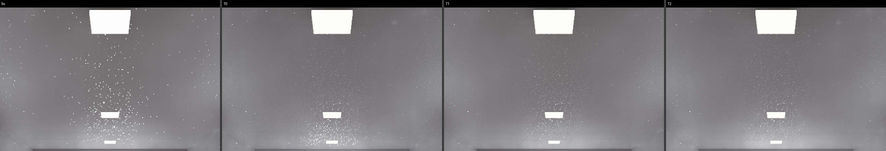
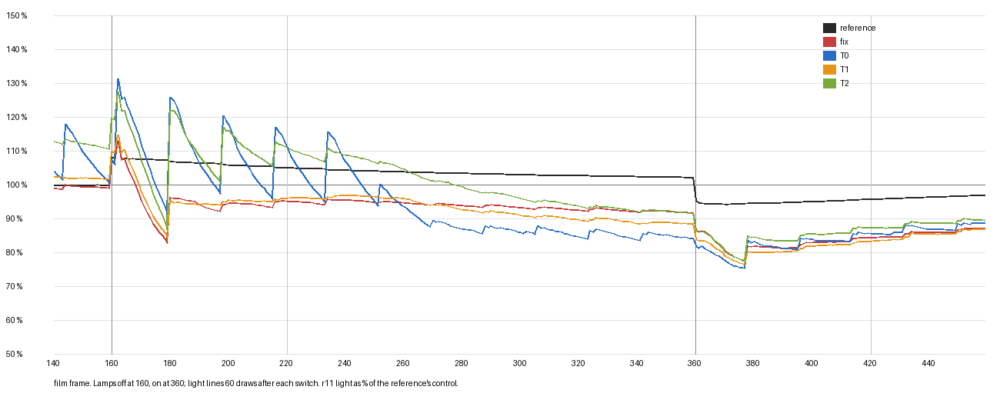

# Which measured spread gives the regional lag test its tolerance (t0-xlcu), 2026-11-15

This folder holds the takes of ticket `t0-xlcu`. All takes ran on this Mac from 03:57 to 05:31 local time, under the shared GPU lock. No take used the cloud.
The ticket's section "Design (line orchestrator, 2026-11-15)" holds the candidate rules and the three questions. `docs/research/t0-mzhr-regional-test-cycle/README.md` and `docs/research/t0-y46f-window-18-excess/README.md` define every term that this README does not define.

The short result: the regional test with the corrected 18-draw window does not close the bay film's trail, at 10 % or with a derived tolerance. It brings the film from the fix's +1.86 / +1.75 to about main's level, +1.36 / +0.64 against main's +1.18 / +0.53. The earlier result of "region, window 18" (+0.43 / +0.18) came from the bounce history held at 4 draws: a plain cap of 4 draws repeats it to every printed digit. Among the derived rules, T1 keeps the lamp hall still's light and stops the cabin center's swing under today's jitter. But it sees no light change in the cabin and loses the still under the long Halton sequence.

These are the first valid takes of the regional test with the 18-draw window in a film and in a switch.

## Terms

- The regional test, the taps, `x(q, t)`, `F(t)`, `R`, `d`, `S`, `n`, `lag` and `sr(q)`: as the ticket's section "The quantities" defines them.
- A pixel draw: one pixel in one draw.
- T0: the regional test at a tolerance of 10 %, the probe's tuned constant.
- T1: the tolerance 2 × (d / R) × sqrt(1/18 + 1/(2n − 1)), from the region's measured spread.
- T2: the tolerance 2 × sqrt(sum over taps of sr(q)² × (1/18 + 1/(2 n(q) − 1))) / R, from the spread that each history stores.
- T3: my own rule, T1 with `d` replaced by the spread of the successive differences of `F` (below).
- The variants of step 2. A: the reference, both clamps off. Fix: light evidence cuts the history and leaves the box wide (`TERTIUS_X_LIGHT_ACTION=cut`). T0, T1, T2: the fix with the regional test, window 18, the corrected window and the rule. Cap 4: the fix with the bounce history held at 4 draws and no regional test (`TERTIUS_X_DIFFUSE_CAP=4`).
- Main: the numbers of main in `t0-mzhr`'s tables. This ticket built no main.
- The long sequence: `TERTIUS_X_LONG_JITTER=1`, the Halton sequence over 746,496 draws.
- Mean length: the mean of the bounce history's length over the counted draws 297 to 920, every 7th (`lengths.py`). Below 8: the share of those pixel draws whose length is below 8 draws.
- Over Tn: the share of the surface pixel draws whose `lag` exceeds the tolerance Tn.

## The scratch switches

`scratch-probe-on-73f4a6548.patch` holds the corrected patch of `t0-y46f` and the changes below. It applies to commit `73f4a6548`.

| Switch | Effect | Default |
|---|---|---|
| `TERTIUS_X_REGION_RULE=<0..3>` | The tolerance: 0 `TERTIUS_X_REGION_TOL`, 1 T1, 2 T2, 3 T3. Specialization constant 18. | 0 |
| `TERTIUS_X_REGION_ACT=0` | The test computes its quantities but does not shorten any history. Specialization constant 19. | acts |
| `TERTIUS_X_REGION_COUNT=<folder>` | The count, below. Specialization constant 20. | off |
| `TERTIUS_X_REGION_COUNT_FROM`, `_TO`, `_EVERY` | The run draws that the count reads. A run draw is counted from 0 over every draw of the run, as `TERTIUS_PROBE_LAMP_OFF` counts. | 100, 300, 1 |

The derived rules act on the bounce light only. The reflections keep T0 under every rule, because their fast history's alpha holds the hit distance, not a retained deviation.

With rule 0, the test acting and the count off, the spatial dispatch keeps `t0-mzhr`'s code of the test unchanged. Every other setting takes a new path, `regionSpreadPath()`, which also writes the second ring.

### The second ring

The window ring of `t0-mzhr` has 19 layers for window 18. On the new path it has 18 more, layers 19 to 36, for `F`, and 5 more for the count. Each pixel inside the images writes its layer in every draw, also a sky pixel:

```glsl
vec2 storeRegionDraw(ivec2 pixel)
{
    int region = regionRadius();
    uint window = parameters.probeRegionWindow;
    if (region == 0 || window == 4u)
        return vec2(0.0);
    uint current = parameters.probeDraw % window;
    float draw = 0.0;
    for (int by = -region; by <= region; by++)
        for (int bx = -region; bx <= region; bx++)
        {
            ivec2 tap = pixel + 8 * ivec2(bx, by);
            if (insideImages(tap))
                draw += imageLoad(regionWindow, ivec3(tap, int(current))).r;
        }
    imageStore(regionWindow, ivec3(pixel, int(window + 1u + current)), vec4(draw));
    uint filled = min(parameters.probeDraw + 1u, window);
    ...
    float mean = sum / float(filled);
    ...
    float scale = exp2(clamp(exposureStops, -64.0, 64.0));
    return scale * vec2(sqrt(squares / float(filled - 1u)), sqrt(steps / (2.0 * float(filled - 1u))));
}
```

where

- `regionRadius()` = the test's radius in ray blocks, 8 (`TERTIUS_X_REGION`).
- `window` = the window in draws, 18.
- `current` = the ring layer of this draw, the draw index since the last reset modulo 18.
- `tap` = one of the 17 × 17 taps, 8 render pixels apart.
- `regionWindow` = the ring image. Layer `current` holds each pixel's `x` of this draw divided by this draw's exposure scale, which the temporal dispatch wrote before a barrier.
- `draw` = `F` of this draw divided by its exposure scale.
- `filled` = how many draws the spread covers: the draws since the reset, at most 18.
- `sum`, `mean` = the sum and the mean of the stored `F` over the `filled` layers. This draw's value comes from the register, the others from memory.
- `squares` = the sum of the squared differences from `mean`.
- `steps` = the sum of (F(t) − F(t − 1))² over the `filled` − 1 pairs of successive draws.
- `scale` = this draw's exposure scale.
- The result's `x` = `d`, the standard deviation of `F` with the divisor `filled` − 1, in this draw's scale. Its `y` = the successive-difference spread of T3.

### The test's quantities

```glsl
            vec4 slowTap = imageLoad(scratch, tap);
            slowSum += luminance(slowTap.rgb);
            fastSum += window == 4u ? luminance(imageLoad(fastHistory, tap).rgb)
                : imageLoad(regionWindow, ivec3(tap, int(window))).r;
            if (slowTap.a >= 1.0)
            {
                lengths += slowTap.a;
                surfaces += 1.0;
                float deviation = parameters.light == DiffuseLight ? imageLoad(fastHistory, tap).a : 0.0;
                storedVariance += deviation * deviation * (1.0 / float(window) + 1.0 / (2.0 * slowTap.a - 1.0));
            }
        }
    float fast = max(fastSum, LeastLuminance);
    float n = surfaces > 0.0 ? lengths / surfaces : 1.0;
    RegionTest test;
    test.lag = abs(slowSum - fastSum) / fast;
    float weights = sqrt(1.0 / float(window) + 1.0 / (2.0 * n - 1.0));
    test.spreadTolerance = RegionSigmas * spread.x / fast * weights;
    test.stepTolerance = RegionSigmas * spread.y / fast * weights;
    test.storedTolerance = RegionSigmas * sqrt(storedVariance) / fast;
```

where

- `scratch` = the slow history before this dispatch. Its alpha is the tap's length in draws.
- `slowSum` = `S`. `fastSum` = `R`, the sum of the taps' 18-draw means, the probe's fast sum.
- `slowTap.a >= 1.0` = the tap shows a surface. A sky tap adds 0 to both sums, as in the probe, and nothing to `n` or T2.
- `lengths`, `surfaces` = the sum of the taps' lengths and the count of surface taps. `n` = their mean.
- `deviation` = `sr(q)`, the alpha of the bounce light's fast history at the tap, in this draw's exposure scale. The reflections store none.
- `storedVariance` = the sum under T2's square root.
- `LeastLuminance` = 1e-4, the probe's least divisor.
- `RegionSigmas` = 2, the clamp box's standard deviations.
- `test.lag`, `test.spreadTolerance`, `test.storedTolerance`, `test.stepTolerance` = `lag`, T1, T2 and T3.

The test then shortens the history by the lag's excess over the rule's tolerance, as in the probe. It acts only where the length is above the fast cap, and only with `TERTIUS_X_REGION_ACT` unset:

```glsl
            float regionLag = max(regionTest.lag - regionTolerance(regionTest), 0.0);
            if (ProbeRegionActs)
                historyLength = max(fastCap, historyLength * (1.0 - min(1.0, regionLag / parameters.antiLagShare)));
```

where `regionTolerance` = 0.10 for the reflections and for rule 0, else T1, T2 or T3 of the bounce light. `antiLagShare` = the lag at which the length falls to the fast cap.

### The count

After each counted draw, the renderer reads back the five count layers of each signal's ring: `lag`, T1, T2, T3 and a flag (1 or 2 for a surface pixel, 0 for the sky). It appends every second render pixel of every second row, 640 × 360 halves per layer, to `<folder>/<process id>/<light>.f16`. `tools/count.py` reduces them per region: the whole image and the survey's 3 × 3 grid, `r<row><column>` from the top left. Each process of a survey run writes its own folder, and `count.py` takes the film's process, not the exposure run or the film's reference stills.

The quantities come from the slow histories before this draw's action, at every surface pixel. So the count also holds pixels whose length is at the fast cap, where the test does not act.

## The control runs

| Run | Compared with | Result |
|---|---|---|
| T0, lamp hall still at 4.08 stops, today's jitter | `t0-y46f`, the corrected window | 96.4 / 101.4 settled, 94.2 / 99.2 shown, mean length 27.09 / 21.97, below 8 6.5 / 25.1 %, all as in `t0-y46f` |
| T0, the same without jitter | `t0-y46f`, the corrected window | 97.8 / 101.9 settled, 95.8 / 98.3 shown, mean length 28.63 / 22.81, all as in `t0-y46f` |
| T0, both stills, second build (with T3) | first build | both PNGs of each still equal byte for byte |
| Step 1 count, second build | first build | every number of T0, T1 and T2 equal to the printed digit |
| T0 through the new path (rule 0, count on), today's jitter | T0 | 96.4 / 101.5. The PNGs differ: the shown still by 0.35 codes on average at 44 % of the pixels, the long mean by 0.23 codes. The arithmetic moved into a function, and the history's feedback carries the last bits on |
| `TERTIUS_X_REGION_ACT=0`, lamp hall still, automatic exposure | the fix of `t0-mzhr` | specks 6.01 under today's jitter and 3.25 without, as the fix |
| The fix, the reference: stills, cabin switch, bay film, bay-sun | `t0-mzhr` | every printed number equal, under all three jitters |

The second build added T3 after the first count. Every take in the tables below ran on the second build, with four exceptions. These are the control stills `t-A-e`, `t-T0-e`, `n-A-e` and `n-T0-e`, which the second build repeats byte for byte.

## Step 1: the count without action

Region, window 18, corrected window, the fix's action, `TERTIUS_X_REGION_ACT=0`. Stills at the automatic exposure, run draws 100 to 300, every 7th (29 draws). 7 has no common factor with 18, so the counted draws cover every jitter offset. Bounce light, whole image. Tolerances as 50th / 90th percentile.

| Take | Jitter | lag p50 / p90 / p99 | T1 | T2 | Over T0 | Over T1 | Over T2 | Over T3 |
|---|---|---|---|---|---:|---:|---:|---:|
| rect-lamps | today's | 0.046 / 0.180 / 0.545 | 0.135 / 0.599 | 0.097 / 0.443 | 20.7 % | 6.4 % | 16.2 % | 7.1 % |
| rect-lamps | none | 0.041 / 0.169 / 0.630 | 0.119 / 0.482 | 0.098 / 0.489 | 19.1 % | 8.4 % | 14.4 % | 9.0 % |
| bay-sunbeam | today's | 0.029 / 0.066 / 0.108 | 0.079 / 0.121 | 0.080 / 0.112 | 1.5 % | 5.6 % | 5.3 % | 6.3 % |
| bay-sunbeam | none | 0.029 / 0.066 / 0.108 | 0.079 / 0.121 | 0.080 / 0.112 | 1.6 % | 5.6 % | 5.4 % | 6.4 % |
| exit-cabin | today's | 0.027 / 0.065 / 0.107 | 0.076 / 0.116 | 0.076 / 0.112 | 1.5 % | 5.6 % | 5.6 % | 6.5 % |
| exit-cabin | none | 0.027 / 0.064 / 0.103 | 0.075 / 0.116 | 0.076 / 0.112 | 1.2 % | 5.3 % | 5.2 % | 6.2 % |
| rect-lamps, diffuse filter off | today's | 0.044 / 0.149 / 0.421 | 0.189 / 0.577 | 0.221 / 0.577 | 19.8 % | 3.1 % | 0.2 % | 3.5 % |

The filter-off take is a diagnostic of mine, not in the ticket. T3's medians stay within 0.004 of T1's in every still.

Cabin switch, today's jitter, only the switch run, every draw of film frames 140 to 419. d = the film frame minus the switch's frame, 160 for lamps off and 360 for lamps on. Over T0 / T1 / T2 / T3:

| Window | Whole image | r11 |
|---|---|---|
| before, frames 140 to 159 | 20.6 / 5.9 / 15.7 / 6.7 % | 25.9 / 21.6 / 32.6 / 25.9 % |
| off, d 0 to 5 | 20.3 / 4.7 / 11.0 / 5.5 % | 25.7 / 20.0 / 27.4 / 22.4 % |
| off, d 6 to 17 | 32.9 / 1.9 / 27.0 / 4.6 % | 46.4 / 6.3 / 56.0 / 22.6 % |
| off, d 18 to 35 | 24.0 / 5.8 / 12.7 / 7.0 % | 29.3 / 4.5 / 22.9 / 11.2 % |
| on, d 0 to 5 | 23.7 / 7.2 / 6.6 / 8.1 % | 29.2 / 24.3 / 12.6 / 25.6 % |
| on, d 6 to 17 | 26.0 / 4.1 / 8.7 / 5.9 % | 31.7 / 8.1 / 24.6 / 12.3 % |

Over the whole image, the T1 median is 0.136 before the switch. It is 0.198 at off d 6 to 17 and 0.190 at on d 6 to 17. The lag median is 0.045, 0.070 and 0.051.

Film `rect-bay`, today's jitter, its 180 frames. Whole image: lag 0.213 / 0.428 / 0.526, T1 median 0.084, T2 median 0.100. Over T0 / T1 / T2 / T3: 70.9 / 71.5 / 72.3 / 73.4 %. r11: 75.1 / 75.2 / 76.2 / 76.6 %.

The reflections keep T0 in every rule. Over T0 for them is 9.4 to 71.0 % of the whole image in the stills, 71.0 % in the lamp hall under today's jitter. `tables-step1.txt` holds every region and both signals.

### Rule T3

I added T3 after the first count. Reason: T1's share fell after the lamps went off, and a step of `F` inside the window raises the standard deviation by about half the step. The successive differences count the step only once. The count does not confirm the reason. T3's median stays within 0.02 of T1's in every window of the switch. In r11 after the lamps go off, 22.6 % exceed T3 against 6.3 % for T1. But that is still below T3's own 25.9 % before the switch. So T3 shows no more power than T1, and I took no step 2 takes of it.

## Step 2: each rule acting

### Lamp hall still at 4.08 stops

Light as % of the same jitter's reference, ceiling / walls, settled (shown in brackets). Then the bounce history's mean length and its share below 8 draws, ceiling / walls.

| Variant | Today's jitter | Length | Below 8 | No jitter | Length | Below 8 |
|---|---|---|---|---|---|---|
| fix | 96.0 / 99.5 (87.1 / 84.9) | 32.00 / 31.26 | 0.0 / 2.3 % | 96.9 / 99.9 (93.8 / 94.0) | 32.00 / 31.36 | 0.0 / 2.0 % |
| T0 | 96.4 / 101.4 (94.2 / 99.2) | 27.09 / 21.97 | 6.5 / 25.1 % | 97.8 / 101.9 (95.8 / 98.3) | 28.63 / 22.81 | 3.7 / 25.7 % |
| T1 | 96.6 / 100.7 (89.3 / 89.3) | 31.90 / 29.26 | 0.0 / 5.3 % | 97.4 / 101.0 (94.9 / 96.7) | 31.54 / 28.71 | 0.1 / 6.8 % |
| T2 | 99.4 / 105.1 (95.7 / 99.7) | 29.38 / 29.27 | 2.3 / 4.5 % | 97.3 / 100.3 (94.7 / 95.9) | 29.67 / 30.43 | 2.3 / 2.6 % |

Long sequence: the fix 96.9 / 99.4 (92.2 / 91.4), length 32.00 / 31.30. T0 96.7 / 99.1 (95.4 / 96.5), length 28.23 / 22.22, below 8 3.7 / 25.4 %. T1 101.2 / 108.1 (98.5 / 104.7), length 31.13 / 27.56, below 8 0.4 / 7.4 %.

### Lamp hall still, noise

Automatic exposure, draw 132. Specks per 10,000 visible pixels and blotch from the survey. Daub and broad error from `daub.py` against the same jitter's reference.

| Variant | Jitter | Specks | Blotch | Daub | Daub ceiling / walls | Broad |
|---|---|---:|---:|---:|---|---:|
| reference | today's | 12.16 | 0.1064 | 0.0416 | 0.0462 / 0.0265 | 0.0956 |
| fix | today's | 6.01 | 0.0933 | 0.0403 | 0.0455 / 0.0268 | 0.0913 |
| T0 | today's | 9.36 | 0.0557 | 0.0391 | 0.0433 / 0.0286 | 0.0922 |
| T1 | today's | 7.34 | 0.0739 | 0.0386 | 0.0433 / 0.0270 | 0.0693 |
| T2 | today's | 7.43 | 0.0543 | 0.0389 | 0.0421 / 0.0271 | 0.1053 |
| reference | none | 6.95 | 0.0536 | 0.0322 | 0.0307 / 0.0155 | 0.0441 |
| fix | none | 3.25 | 0.0553 | 0.0322 | 0.0305 / 0.0162 | 0.0943 |
| T0 | none | 8.26 | 0.0530 | 0.0322 | 0.0341 / 0.0180 | 0.1054 |
| T1 | none | 7.73 | 0.0517 | 0.0306 | 0.0300 / 0.0171 | 0.1019 |
| T2 | none | 6.86 | 0.0437 | 0.0309 | 0.0310 / 0.0156 | 0.0993 |

### Crops of the lamp hall's ceiling, today's jitter



`pics/rect-lamps-ceiling-today.png`: output pixels 640 to 1280 by 0 to 420 at full size, the shown still at draw 132 at the automatic exposure. From the left: the fix, T0, T1 and T2. I looked at it before I read the numbers.

- The fix shows scattered large bright specks in a cone under the far lamps, and single specks over the whole ceiling.
- T0 has smaller specks, but many more of them under the far lamps: a dense grain of bright pixels around the lowest lamp.
- T1 has the finest and sparsest grain of the four under the far lamps. The rest of its ceiling is smooth.
- T2 looks like T1, with a little more grain near the lamps.
- T0, T1 and T2 show a faint round lighter patch near the top right, right of the near lamp. The fix does not.

### Cabin switch

`switch.py` of this folder adds one column to `t0-mzhr`'s copy: still lo / hi, the lowest and highest level of r11 over frames 140 to 159, as % of the reference's lamps-on control. Settle counts in draws, levels in % of the reference's control.

Today's jitter:

| Variant | Settle slowest off / on | whole | r11 | Level 60 off, whole / r11 | Level 60 on, whole / r11 | Dip on r11 | Still lo / hi r11 |
|---|---|---|---|---|---|---|---|
| reference | none / 97 | 74 / 39 | 63 / 37 | 105.7 / 105.0 | 96.1 / 95.8 | 94.3 at 10 | 100.0 / 100.0 |
| main (`t0-mzhr`) | 75 / 52 | 36 / 24 | 20 / 49 | 89.2 / 92.2 | 81.6 / 73.4 | 68.0 at 17 | not computed |
| fix | 66 / none | 12 / 27 | 56 / none | 96.0 / 95.2 | 90.4 / 84.5 | 77.6 at 17 | 98.7 / 100.0 |
| T0 | 54 / 56 | 14 / 23 | 23 / 56 | 100.8 / 110.8 | 90.8 / 85.7 | 75.4 at 17 | 100.7 / 117.8 |
| T1 | 63 / 94 | 12 / 36 | 63 / 94 | 96.5 / 96.1 | 90.1 / 83.3 | 76.6 at 17 | 101.7 / 102.4 |
| T2 | 50 / 73 | 12 / 32 | 38 / 73 | 101.0 / 111.0 | 91.1 / 87.4 | 77.3 at 17 | 110.5 / 113.6 |
| cap 4 | 46 / 23 | 20 / 15 | 20 / 18 | 104.7 / 119.7 | 93.7 / 91.4 | 76.0 at 17 | 94.0 / 128.1 |

No jitter:

| Variant | Settle slowest off / on | whole | r11 | Level 60 off, whole / r11 | Level 60 on, whole / r11 | Still lo / hi r11 |
|---|---|---|---|---|---|---|
| reference | none / none | 78 / 34 | 186 / 91 | 106.0 / 112.7 | 96.4 / 93.5 | 100.0 / 100.0 |
| fix | 122 / 27 | 44 / 9 | 122 / 27 | 100.0 / 110.7 | 95.6 / 97.1 | 100.6 / 100.6 |
| T0 | 105 / 31 | 32 / 10 | 105 / 30 | 100.7 / 111.2 | 96.8 / 97.8 | 102.1 / 102.2 |
| T1 | 112 / 37 | 40 / 10 | 112 / 30 | 100.8 / 111.2 | 95.9 / 97.5 | 101.8 / 101.9 |
| T2 | 110 / 38 | 42 / 9 | 110 / 28 | 100.4 / 110.9 | 95.9 / 97.5 | 101.6 / 101.7 |

Long sequence:

| Variant | Settle slowest off / on | whole | r11 | Level 60 off, whole / r11 | Level 60 on, whole / r11 | Still lo / hi r11 |
|---|---|---|---|---|---|---|
| reference | none / none | 86 / 48 | 104 / 81 | 106.5 / 107.0 | 95.7 / 93.9 | 100.0 / 100.0 |
| fix | 171 / 92 | 92 / 16 | 171 / 92 | 102.0 / 112.8 | 92.4 / 87.0 | 97.8 / 99.1 |
| T0 | 84 / 72 | 48 / 21 | 57 / 72 | 99.9 / 100.9 | 92.2 / 85.7 | 95.0 / 102.2 |
| T1 | 94 / 81 | 46 / 24 | 52 / 81 | 103.4 / 114.7 | 92.2 / 85.8 | 105.4 / 116.8 |



`pics/cabin-r11-today.png`: r11 of each switch run over frames 140 to 459, as % of the reference's control in the same lamp state, today's jitter. I looked at it first.

- Before the switch, T0 has teeth every 18 draws, from about 100 to 118 %. T2 lies at about 110 to 113 % with no teeth. T1 and the fix lie flat at about 100 to 102 %.
- After the lamps go off, T0 rises at once to 131 %. Then it falls in teeth every 18 draws until about frame 250, from about 125 to 95 %. T2 follows T0's teeth at a smaller size until about frame 215, then decays smoothly. It stays above the other variants and near the reference until frame 330. T1 and the fix fall to about 85 % by frame 179 and then lie flat at 93 to 96 %. From about frame 260, T0 lies lowest, near 84 to 88 %.
- After the lamps come on, every variant but the reference falls to about 75 to 80 % at frame 377. Then each rises in steps every 18 draws, to about 87 to 90 % by frame 459. The reference lies at 94 to 97 %.

### Film rect-bay

Today's jitter. Level and blotch at the middle frame / the last frame.

| Variant | Level | Blotch |
|---|---|---|
| main (`t0-mzhr`) | +1.18 / +0.53 | 0.245 / 0.231 |
| fix | +1.86 / +1.75 | 0.370 / 0.488 |
| T0 | +1.36 / +0.64 | 0.321 / 0.321 |
| T1 | +1.41 / +0.60 | 0.303 / 0.325 |
| T2 | +1.43 / +0.62 | 0.306 / 0.327 |
| cap 4 | +0.43 / +0.18 | 0.102 / 0.101 |
| `t0-mzhr`'s broken "region, window 18" | +0.43 / +0.18 | 0.102 / 0.101 |

### Lag film bay-sun

Today's jitter. Median lag in draws / median lag error.

| Variant | bay-sun |
|---|---|
| main (`t0-mzhr`) | 28.55 / 0.2644 |
| fix | 26.93 / 0.2679 |
| T0 | 21.40 / 0.2230 |
| T1 | 23.45 / 0.2303 |
| T2 | 21.72 / 0.2173 |
| cap 4 | 8.31 / 0.0892 |
| `t0-mzhr`'s broken "region, window 18" | 8.41 / 0.0910 |

## Answers

### Question 1: in a still, how large is each derived tolerance against 10 %, and how often does the lag exceed it?

Measured (step 1, bounce light, whole image):

- T1's median: 0.135 and 0.119 in the lamp hall (today's jitter, none), 0.079 in the bay, 0.076 and 0.075 in the exit cabin. Its 90th percentile: 0.599 and 0.482, 0.121, 0.116.
- T2's median: 0.097 and 0.098 in the lamp hall, 0.080 in the bay, 0.076 in the exit cabin. Its 90th percentile: 0.443 and 0.489, 0.112, 0.112.
- Over T0: 20.7 and 19.1 % in the lamp hall, 1.5 and 1.6 % in the bay, 1.5 and 1.2 % in the exit cabin.
- Over T1: 6.4 and 8.4 %, 5.6 and 5.6 %, 5.6 and 5.3 %.
- Over T2: 16.2 and 14.4 %, 5.3 and 5.4 %, 5.6 and 5.2 %.
- Lamp hall with the diffuse filter off: over T0 19.8 %, over T1 3.1 %, over T2 0.2 %.

My reading: in the bay and the exit cabin, the two derived tolerances have medians of 0.075 to 0.080, near 10 %. So there they fire more often than T0. In the lamp hall they are wider than 10 %. There T1 cuts the still's false share from about 20 % to 6 to 8 %. T1 lets through 5 to 8 % of the pixel draws in every scene and under both jitters. Two standard deviations of a normal spread let through 4.6 %. So T1's false share does not depend on the scene, which is what a derived tolerance is for. T2 does depend on the scene: in the lamp hall it lets 14 to 16 % through, and with the filter off 0.2 %. So the filter narrows the retained deviation that T2 reads. The still's lag itself does not come from the filter's write-back: with the filter off, 19.8 % still exceed 10 %.

### Question 2: with a derived tolerance acting, does the still keep the fix's light and specks, and does the cabin's center stop swinging before the switch?

Measured:

- Lamp hall light, today's jitter: T1 96.6 / 100.7, T2 99.4 / 105.1, T0 96.4 / 101.4, the fix 96.0 / 99.5. No jitter: T1 97.4 / 101.0, T2 97.3 / 100.3, T0 97.8 / 101.9, the fix 96.9 / 99.9. Long sequence: T1 101.2 / 108.1, T0 96.7 / 99.1, the fix 96.9 / 99.4.
- Mean bounce length on the walls, today's jitter: T1 29.26, T2 29.27, T0 21.97, the fix 31.26 draws. Long sequence: T1 27.56, T0 22.22.
- Specks, today's jitter: T1 7.34, T2 7.43, T0 9.36, the fix 6.01. Blotch: 0.0739, 0.0543, 0.0557, 0.0933. Daub: 0.0386, 0.0389, 0.0391, 0.0403. Broad: 0.0693, 0.1053, 0.0922, 0.0913.
- r11 over frames 140 to 159, today's jitter: T1 101.7 to 102.4 %, T2 110.5 to 113.6 %, T0 100.7 to 117.8 %, the fix 98.7 to 100.0 %. No jitter: all four within 100.6 to 102.2 %. Long sequence: T1 105.4 to 116.8 %, T0 95.0 to 102.2 %.

My reading: under today's jitter, T1 keeps the still's light within 1.2 points of the fix and stops the cabin center's swing: its range before the switch is 0.7 points, against 17.1 for T0. Its specks lie between the fix's and T0's. T2 also has no teeth before the switch. But it holds the cabin center 10 to 14 % above the reference, and the lamp hall's walls 5.1 points above it. T2's high light comes with long histories (29.3 draws on the walls), so the length effect of `t8-69v7` does not explain it. I did not find its cause. Under the long sequence T1 fails both: the walls stand 8.1 points above the reference and the cabin's center swings from 105.4 to 116.8 %. There T0 keeps the still (96.7 / 99.1) and swings less (95.0 to 102.2 %). So no rule keeps the still under both jitters.

### Question 3: does the corrected test close the bay film's trail, at 10 % and with a derived tolerance?

Measured, today's jitter:

- Bay film, level middle / last: T0 +1.36 / +0.64, T1 +1.41 / +0.60, T2 +1.43 / +0.62. Main +1.18 / +0.53, the fix +1.86 / +1.75. Blotch: T0 0.321 / 0.321, T1 0.303 / 0.325, T2 0.306 / 0.327, main 0.245 / 0.231.
- Cap 4: +0.43 / +0.18 and blotch 0.102 / 0.101, equal to `t0-mzhr`'s "region, window 18" to every printed digit.
- Cabin settle, slowest off / on: T0 54 / 56, T1 63 / 94, T2 50 / 73. Main 75 / 52, the fix 66 / none. Cap 4 46 / 23, and `t0-mzhr`'s broken window 39 / 25.
- Cabin level 60 draws after the lamps return, r11: T0 85.7 %, T1 83.3 %, T2 87.4 %, main 73.4 %, the fix 84.5 %, cap 4 91.4 %. After the lamps go off: T0 110.8 %, T1 96.1 %, T2 111.0 %, the fix 95.2 %.
- bay-sun, median lag / lag error: T0 21.40 / 0.2230, T1 23.45 / 0.2303, T2 21.72 / 0.2173. Main 28.55 / 0.2644, the fix 26.93 / 0.2679, cap 4 8.31 / 0.0892.
- Step 1: in the bay film all rules see the change at 71 to 73 % of the pixel draws. In the cabin, the share over T1 falls below its still level after both switches. It is 1.9 % at off d 6 to 17 against 5.9 % before. Over T2 it rises after the lamps go off (r11 56.0 % against 32.6 %) and falls after they come on (12.6 %).

My reading: no. The corrected test does not close the bay film's trail at 10 % or with a derived tolerance. It takes the film from the fix's trail back to main's: the middle frame stays 0.18 to 0.25 above main, the last frame 0.07 to 0.11 above. In bay-sun it lowers the lag error by 0.03 to 0.05 against main. The three rules differ by at most 0.07 in the film's level and 0.013 in the lag error. So the tolerance is not the limit here: in the film, every tolerance lies far below the trail's lag (median 0.21). What limits the test is how far it shortens the history, by the excess over the anti-lag share, and only down to the fast cap.

The earlier gain of "region, window 18" came from the history's length alone. Cap 4 without any test repeats its film exactly, and its bay-sun lag error within 0.002. Cap 4's settle counts differ from the broken window's only in the slowest region after the lamps go off (46 against 39). The whole image and r11 match (20 / 15 and 20 / 18). In the broken build the reflections had the regional test, and cap 4 has none. So the films' gain needs a short bounce history, and a short history costs the still. `t0-y46f` measured 2 to 7 % more light in a still with cap 4. Here the cabin center swings from 94.0 to 128.1 % before the switch.

In the cabin, T1 sees no light change and settles the lamps-on window slower than main (94 against 52 draws). T2 sees the lamps go off but not come on. That is the warning of section 8.1 again: a tolerance from the measured spread follows the spread up after a change and silences the test.

This result is the question for Alexis that the ticket names. No derived rule keeps the films' gain, because no rule of the test has one. And T1, the best rule in the stills under today's jitter, silences the test in the cabin.

## Changes to the ticket's design

- I added T3, my own rule, after the first count (section "Rule T3"). The count did not support it, so it has no step 2 takes.
- The derived rules act on the bounce light only. The reflections keep T0, because they store no retained deviation for T2. T1 follows the same scope, so that T1 and T2 compare on the same signal.
- The count stores every second render pixel of every second row, a quarter of the pixels. So a switch take's raw count stays near 1 GB.
- `n` and T2 skip sky taps, because a sky tap holds length 0. Both sums keep the sky taps at 0, as the probe does.
- The best derived rule for the long sequence is T1. Reasons: under today's jitter it keeps the still's light within 1.2 points of the fix and stops the cabin center's swing. T2 holds the cabin center 10 to 14 % high and the lamp hall's walls 5 points high. The films do not separate them.
- I took the filter-off count and the cap 4 lag film beyond the ticket. Each took one minute.

## What I did not take

- Main. The ticket compares with `t0-mzhr`'s numbers of main.
- The cause of the still's lag in the lamp hall and the cabin. 19 to 21 % of the pixel draws exceed 10 % there, with the test not acting, also with the filter off.
- The cause of the spread's rise after a switch, which silences T1. T3 shows that the step itself is not the main cause.
- The cause of T2's light above the reference under today's jitter with long histories.
- T2 under the long sequence.

## Notes

- The new path at rule 0 repeats the old path to 0.1 point, not byte for byte. T1 and T2 run on the new path and T0 on the old one. So a difference of 0.1 point between T0 and a derived rule is within this noise.
- Step 1's count of the cabin switch and of the bay film runs on the fix's action with the test not acting. After a switch, light evidence still cuts the histories there.

## Files

| File | Content |
|---|---|
| `scratch-probe-on-73f4a6548.patch` | The scratch probe with every switch of `t0-mzhr`, `t0-y46f` and this ticket, for commit `73f4a6548` |
| `tables-step1.txt` | The printed output of `count.py` for every take of step 1, every region and both signals |
| `tables.txt` | The printed output of `tools/measure.sh`: the control and every take of step 2 |
| `pics/` | The chart of r11 over the cabin switch and the crop sheet of the lamp hall's ceiling |
| `tools/take.sh` | One survey run with the probe and environment switches, into `/private/tmp/t0-xlcu/runs/<name>`. A run with a result is kept, so that a stopped queue resumes |
| `tools/queue-c.sh`, `queue-1.sh`, `queue-1d.sh`, `queue-2.sh`, `queue-3.sh` | The takes in the order that they ran: the control, step 1, the diagnostic and the control on the second build, step 2, the long sequence |
| `tools/count.py` | The count's reduction per region, for stills, the switch and the film |
| `tools/switch.py` | `t0-mzhr`'s copy with the still state's range of r11 |
| `tools/stills.py` | The survey's specks and blotch of a still |
| `tools/measure.sh` | Prints every table of `tables.txt` |
| `tools/pics.sh` | Makes the two pictures of `pics/` |
| `tools/m.sh` | Runs a measuring script in the dev shell. A script of this folder wins over the one of `t0-y46f`, which wins over the one of `t0-mzhr` |

`light.py`, `lengths.py` and `whole.py` are `t0-y46f`'s. `daub.py`, `films.py`, `lags.py`, `levelchart.py` and `sheet.py` are `t0-mzhr`'s. To build the probe, apply the patch to a scratch worktree of `73f4a6548`. Then build `src/Tertius.Demo` in Release into `/private/tmp/t0-xlcu/out-x/probe-bin`, as `tools/renderer-survey.py probe-build` does. The scripts name this ticket's worktree, `/Users/alexispurslane/.t3/worktrees/tertius/t3-c3911144`, and the run folders in `/private/tmp/t0-xlcu`. To run them again, change those paths.
