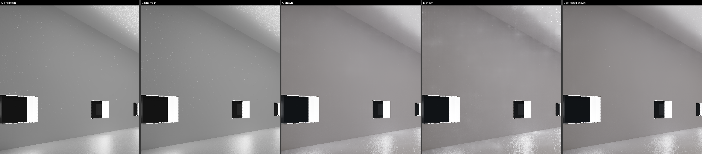
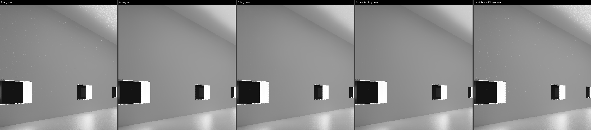

# Why region, window 18 shows more light than the reference in a still (t0-y46f), 2026-11-14

This folder holds the takes of ticket `t0-y46f`. All takes ran on this Mac from 22:29 to 23:48 local time, under the shared GPU lock. No take used the cloud.
The ticket's section "Design (line orchestrator, 2026-11-14)" holds the questions. `docs/research/t0-mzhr-regional-test-cycle/README.md` defines every term that this README does not define.

The short result: region, window 18 does not run the 18-draw test on the diffuse signal. A bug in the scratch probe holds every diffuse history at the fast cap of 4 draws. A diffuse history of 4 draws holds 2 to 7 % more light than one of 32 draws. This also holds with both clamps off, no regional test and no own rays. With the bug corrected, the excess on the walls falls from 6.5 to 1.9 points. It falls further as the tolerance rises.

## Terms

- A to G: the variants of the ticket's table. A is the reference, and B is the own-ray reference. C is region, window 18. D is C with no own rays, and E is C with all own rays. F is the fix with all own rays, and G is the tolerance sweep of D.
- Shown: the survey still's capture at draw 132. Settled, or the long mean: the mean of the survey still's last 20 captures, draws 297 to 924.
- Light: `light.py`'s light of a region as % of A's long mean under the same jitter. The regions are the ceiling and the walls of the lamp hall, and the whole image and r11 of the cabin. Each is cut to the smooth pixels of A's long mean.
- Whole image: `whole.py`'s light over every pixel of the long mean, without the cut to smooth pixels. A filter that only moves light between pixels keeps it.
- Length: the alpha of a pixel's slow history, its length in draws. The ray plan traces an own ray where the length is below `FullRateFrames`, 8 draws.
- Below 8: the share of the counted pixel draws whose length is below 8 draws. Mean length: the mean of the length over the same pixel draws.
- Cap N: the new switch `TERTIUS_X_DIFFUSE_CAP=N`. It holds the diffuse history's length at most N draws at every pixel, without any test.
- The corrected window: the new switch `TERTIUS_X_WINDOW_ALL=1`. The diffuse signal then writes its 18-draw window, as the specular signal always did.
- Long still: a still of 180 captures in place of 28, with the long mean over draws 5,313 to 5,940 (`tools/long.py`).
- Bounce, reflections: the image of one light signal alone, `TERTIUS_PROBE_SIGNAL=2` and `3`.

## The scratch switches

`scratch-probe-on-73f4a6548.patch` holds the patch of `t0-mzhr` and the changes below. It applies to commit `73f4a6548`.

| Switch | Effect | Default |
|---|---|---|
| `TERTIUS_X_MOST_WEIGHT=<w>` | `MostRayWeight` of `screen_trace.glsl`, the cap of a ray's weight in the resolve, as specialization constant 15. | 4 |
| `TERTIUS_X_LENGTHS=<folder>` | The count of history lengths, below. | off |
| `TERTIUS_X_LENGTHS_FROM=<d>`, `TERTIUS_X_LENGTHS_EVERY=<k>`, `TERTIUS_X_LENGTHS_BELOW=<n>` | The first counted draw index, the step between counted draws, and the length that "below" counts under. | 297, 1, 8 |
| `TERTIUS_X_WINDOW_ALL=1` | The diffuse signal's temporal dispatch writes the window ring, as specialization constant 16. | off |
| `TERTIUS_X_DIFFUSE_CAP=<N>` | Cap N, as specialization constant 17. | 0, no cap |

### The count of history lengths

After each counted draw, the renderer reads back the slow history of each screen-tracer signal. It adds the alpha to two sums per pixel:

```csharp
float length = values[4 * i + 3];
sums.Length[i] += length;
sums.Below[i] += length < ProbeLengthsFullRate ? 1.0 : 0.0;
```

where

- `length` = the pixel's length in draws, the alpha of its slow history.
- `values` = the slow history image of the signal (`TemporalSignal.Slow(0)`), RGBA16F at the render size of 1280 x 720, read as floats.
- `i` = the pixel's index, row by row from the top.
- `ProbeLengthsFullRate` = the value of `TERTIUS_X_LENGTHS_BELOW`, 8 draws.
- `sums.Length`, `sums.Below` = the two sums of the pixel.

It writes the mean length and the share below 8 per pixel to `<folder>/<diffuse|specular>.f32`. `tools/lengths.py` reads each region's mask at the output pixel nearest to the center of each render pixel. Every take counted every 7th draw from draw 297, which is 90 draws to draw 920. The step 7 has no common factor with the jitter's cycle of 18 draws, so the counted draws cover every offset of the cycle.

### The corrected window and cap N

The accumulation pipelines of a signal received no specialization constants unless a prototype was on. The patch now always passes them:

```csharp
Constants = new ShaderConstants(EnvironmentMap: false)
{
    NeighborLimitPrototype = limitIncoming,
    ReflectionSharingPrototype = reflectionDistanceHistory,
},
```

where

- `ShaderConstants` = the record of the renderer's specialization constants. Its rows also carry the scratch constants 12 to 17, read from their environment switches.
- `EnvironmentMap` = constant 0, whether an environment map exists. The accumulation does not read it.
- `NeighborLimitPrototype`, `ReflectionSharingPrototype` = constants 9 and 10, the two prototypes.
- `limitIncoming`, `reflectionDistanceHistory` = the values of the two prototypes, both off in every take.

With every environment switch unset, each constant keeps the value that a missing constant gives. The control runs below repeat C and A byte for byte. One switch now reaches the accumulation where it did not under `t0-mzhr`: `TERTIUS_X_LEAST_MOTION` (constant 13, `sample_age.glsl`). No take here sets it. A take with it on this patch measures more than the same take on the `t0-mzhr` patch.

The temporal dispatch writes the window in the diffuse signal too:

```glsl
#ifdef TERTIUS_LIGHT_AGE
    // SCRATCH (t0-mzhr): the sample that the histories took, or the fast history where the pixel took none.
    storeRegionWindow(pixel, hasSample ? luminance(sampled) : luminance(fast));
#else
    // SCRATCH (t0-y46f, TERTIUS_X_WINDOW_ALL): the same window for a signal without the light-age variant.
    if (probeWindowAll)
        storeRegionWindow(pixel, hasSample ? luminance(sampled) : luminance(fast));
#endif
```

where

- `TERTIUS_LIGHT_AGE` = the define of the light-age shader variants. The specular signal's temporal dispatch has it. The diffuse signal's does not (the window bug below).
- `pixel` = the render pixel of the invocation.
- `hasSample` = true where the pixel took a finite sample in this draw.
- `sampled` = the pixel's sample of this draw, in this draw's exposure scale.
- `fast` = the pixel's fast history after this draw's blend.
- `luminance` = the Rec. 709 luminance of a color.
- `storeRegionWindow` = the function of `t0-mzhr` that writes the sample's luminance into the ring and the ring's mean into layer 18.
- `probeWindowAll` = specialization constant 16, true under `TERTIUS_X_WINDOW_ALL=1`.

The declaration of `regionWindow` moved out of `#ifdef TERTIUS_LIGHT_AGE` in `accumulate.glsl`. The signal layout holds its binding 13 for every signal whenever the renderer's history mode keeps the light age, which it does in every take.

Cap N acts in the spatial dispatch, just before the slow history's store:

```glsl
if (ProbeDiffuseCap > 0.0 && parameters.light == DiffuseLight)
    historyLength = min(historyLength, ProbeDiffuseCap);
```

where

- `ProbeDiffuseCap` = specialization constant 17, the N of `TERTIUS_X_DIFFUSE_CAP`.
- `parameters.light` = the signal of the dispatch. `DiffuseLight` is the bounce signal.
- `historyLength` = the length that the dispatch stores in the slow history's alpha, after the clamp, the anti-lag and the regional test.

## The control runs

Each build at the default of its new switches must repeat the earlier build's images. The first build repeats `t0-mzhr`'s numbers.

| Run | Compared with | Result |
|---|---|---|
| C, no jitter, first build | `t0-mzhr`, region, window 18 | 100.8 / 106.5 settled and 101.5 / 107.2 shown, as in `t0-mzhr` |
| C, today's jitter, fourth build | `t0-mzhr`, region, window 18 | 99.5 / 105.8 settled and 102.8 / 111.5 shown, as in `t0-mzhr` |
| C with the count of lengths, first build | C, first build | both PNGs equal byte for byte |
| A with the count of lengths, second build | A, first build | both PNGs equal byte for byte |
| C and A, second, third and fourth builds | C and A, first build | all PNGs equal byte for byte. `same.py`: 13 of 13 values equal for C |
| A through `long.py` with 28 captures | A through the survey | both PNGs equal byte for byte |

The third build had the window and cap switches, but its accumulation pipelines did not receive the constants. Its takes of the corrected window and of cap 4 equaled C and the fix to every printed digit. I found the cause, built the fourth build, and took them again (`tools/queue-q5.sh`). Only the fourth build's takes are in the tables.

## The takes

`tables.txt` holds the printed output of `tools/measure.sh` for every take. All lamp hall takes are the still `rect-lamps` at 4.08 stops.

### Lamp hall, no jitter

Light as % of A, ceiling / walls.

| Variant | Switches | Settled | Shown |
|---|---|---|---|
| A, the reference | clamps off | 100.0 / 100.0 | 95.9 / 94.0 |
| B, the own-ray reference | A, `FULL_RATE=1000` | 99.9 / 100.0 | 95.8 / 94.0 |
| A, weight cap off | A, `MOST_WEIGHT=1e30` | 100.0 / 100.0 | 95.9 / 94.0 |
| C, region, window 18 | as in `t0-mzhr` | 100.8 / 106.5 | 101.5 / 107.2 |
| D, no own rays | C, `FULL_RATE=0` | 100.8 / 106.8 | 101.7 / 107.6 |
| E, all own rays | C, `FULL_RATE=1000` | 100.8 / 106.5 | 101.4 / 107.1 |
| the fix | `LIGHT_ACTION=cut` | 96.9 / 99.9 | 93.8 / 94.0 |
| F, the fix, all own rays | the fix, `FULL_RATE=1000` | 96.7 / 99.9 | 93.7 / 93.8 |
| G, D at tolerance 20 % | | 100.8 / 106.8 | 101.7 / 107.6 |
| G, D at tolerance 40 % | | 100.7 / 106.7 | 101.5 / 107.6 |
| G, D at tolerance 80 % | | 100.5 / 106.7 | 101.3 / 107.6 |
| C, clamps off | C, `NO_CLAMP=1` | 101.2 / 106.6 | 101.8 / 107.1 |
| C, corrected window | C, `WINDOW_ALL=1` | 97.8 / 101.9 | 95.8 / 98.3 |
| D, corrected window | D, `WINDOW_ALL=1` | 98.0 / 102.1 | 95.8 / 98.3 |
| the fix, cap 4 | the fix, `DIFFUSE_CAP=4` | 100.8 / 106.6 | 101.5 / 107.4 |
| A, cap 4 | A, `DIFFUSE_CAP=4` | 104.2 / 106.8 | 103.5 / 107.1 |
| A, cap 8 | A, `DIFFUSE_CAP=8` | 103.7 / 106.0 | 102.2 / 104.5 |
| A, cap 16 | A, `DIFFUSE_CAP=16` | 102.5 / 103.9 | 99.6 / 100.1 |

The switches are the `TERTIUS_X_` and `TERTIUS_A_` switches without their prefix.

### History lengths, lamp hall, no jitter

Below 8 / mean length in draws, ceiling and walls.

| Variant | Diffuse, ceiling | Diffuse, walls | Specular, ceiling | Specular, walls |
|---|---|---|---|---|
| A, B, A with the weight cap off | 0.0 % / 32.00 | 2.0 % / 31.36 | 0.0 % / 609.5 | 2.0 % / 597.3 |
| C | 100.0 % / 4.00 | 100.0 % / 3.92 | 37.0 % / 44.40 | 26.2 % / 51.77 |
| D | 100.0 % / 4.00 | 100.0 % / 3.92 | 35.6 % / 41.89 | 25.8 % / 47.79 |
| E | 100.0 % / 4.00 | 100.0 % / 3.92 | 37.2 % / 114.37 | 26.0 % / 184.81 |
| the fix | 0.0 % / 32.00 | 2.0 % / 31.36 | 0.7 % / 104.31 | 2.3 % / 84.02 |
| F | 0.0 % / 32.00 | 2.0 % / 31.36 | 0.5 % / 496.35 | 2.1 % / 511.85 |
| G, tolerance 20 % | 100.0 % / 4.00 | 100.0 % / 3.92 | 24.3 % / 49.69 | 14.6 % / 54.80 |
| G, tolerance 40 % | 100.0 % / 4.00 | 100.0 % / 3.92 | 6.6 % / 70.48 | 3.9 % / 70.00 |
| G, tolerance 80 % | 100.0 % / 4.00 | 100.0 % / 3.92 | 0.8 % / 100.84 | 2.4 % / 80.15 |
| C, clamps off | 100.0 % / 4.00 | 100.0 % / 3.92 | 31.5 % / 126.29 | 19.6 % / 206.16 |
| C, corrected window | 3.7 % / 28.63 | 25.7 % / 22.81 | 37.2 % / 44.28 | 26.4 % / 51.81 |
| the fix, cap 4 | 100.0 % / 4.00 | 100.0 % / 3.92 | 0.7 % / 103.87 | 2.3 % / 83.47 |
| A, cap 4 | 100.0 % / 4.00 | 100.0 % / 3.92 | 0.0 % / 609.5 | 2.0 % / 597.3 |

A's specular mean of 609.5 draws is the mean of the draw index plus 1 over the counted draws 297 to 920. The clamps-off specular history has no cap, as ticket `t0-izfl` reports.

### Per signal and over the whole image, lamp hall, no jitter

Light as % of A of the same signal. Settled ceiling / walls, then the whole image.

| Variant | Bounce | Bounce, whole image | Reflections | Reflections, whole image |
|---|---|---|---|---|
| C | 104.3 / 107.9 | 105.2 % | 113.5 / 108.8 | 54.9 % |
| A, cap 4 | 104.3 / 107.9 | 105.2 % | 111.3 / 109.2 | 103.5 % |

All signals together, whole image: C 97.8 %, D 98.2 %, the fix 93.9 % and the corrected window 95.0 %. The fix with cap 4 gives 97.6 %. A with cap 4 gives 104.1 %, with cap 8 103.7 % and with cap 16 102.4 %.

### The diffuse filter off, lamp hall, no jitter

`TERTIUS_DIFFUSE_FILTER=off` in both runs.

| Variant | Settled, as % of A with the filter off | Whole image |
|---|---|---|
| A, filter off | 100.0 / 100.0 | 100.0 % |
| A, cap 4, filter off | 84.6 / 84.5 | 84.1 % |

A with the filter off is 91.7 / 99.6 % of A with the filter on, and 95.7 % over the whole image. The section "Scene light" repeats this pair without the tone curve.

### Long stills, lamp hall, no jitter

Settled light as % of A's long still, over draws 5,313 to 5,940:

| Variant | Settled |
|---|---|
| A, survey still (draws 297 to 924) | 98.9 / 99.5 |
| A, long still | 100.0 / 100.0 |
| A, cap 4, survey still | 103.0 / 106.3 |
| A, cap 4, long still | 103.9 / 106.6 |
| C, survey still | 95.6 / 106.0 |
| C, long still | 95.8 / 106.1 |

Against A's survey still, the long stills give A 100.9 / 100.5, A with cap 4 105.0 / 107.1 and C 101.1 / 106.7. A's specular mean length over the counted draws is 5,611 draws, the mean draw index plus 1.

The two tables use different masks of smooth pixels, because `light.py` cuts each region to the smooth pixels of its truth. That is why C's ceiling reads 95.6 % against A's long still and 100.8 % against A's survey still.

### Lamp hall, today's jitter

Light as % of A under today's jitter.

| Variant | Settled | Shown | Diffuse below 8, ceiling / walls | Diffuse mean length |
|---|---|---|---|---|
| A | 100.0 / 100.0 | 89.1 / 84.3 | 0.0 % / 2.3 % | 32.00 / 31.26 |
| B | 99.7 / 99.4 | 88.1 / 84.1 | 0.0 % / 2.3 % | 32.00 / 31.26 |
| C | 99.5 / 105.8 | 102.8 / 111.5 | 100.0 % / 100.0 % | 4.00 / 3.91 |
| D | 99.2 / 106.0 | 100.7 / 109.8 | 100.0 % / 100.0 % | 4.00 / 3.91 |
| C, corrected window | 96.4 / 101.4 | 94.2 / 99.2 | 6.5 % / 25.1 % | 27.09 / 21.97 |
| A, cap 4 | 104.1 / 106.8 | 104.0 / 110.3 | 100.0 % / 100.0 % | 4.00 / 3.91 |

### Cabin, no jitter

Still `exit-cabin` at 1.0 stops. At 1.0 stops the median code of A's long mean is 146 of 255. Only 0.4 % of the pixels lie above code 240, and these are the lamps. At 2.0 stops 17.7 % lie above code 240, at 3.0 stops 28.4 %. So I chose 1.0 stops. Light as % of A, whole smooth image / r11, then the whole image.

| Variant | Settled | Shown | Whole image | Diffuse below 8 / mean length, whole |
|---|---|---|---|---|
| A | 100.0 / 100.0 | 102.9 / 102.8 | 100.0 % | 0.0 % / 32.00 |
| B | 99.9 / 99.5 | 102.8 / 102.4 | 99.8 % | 0.0 % / 32.00 |
| C | 101.5 / 101.4 | 104.3 / 104.5 | 101.4 % | 100.0 % / 4.00 |
| D | 101.6 / 101.7 | 104.4 / 104.9 | 101.5 % | 100.0 % / 4.00 |
| C, corrected window | 99.7 / 99.4 | 102.7 / 102.4 | 99.7 % | 0.0 % / 31.97 |
| A, cap 4 | 101.8 / 102.0 | 104.5 / 104.9 | 101.7 % | 100.0 % / 4.00 |

### Scene light, lamp hall, no jitter

`tools/scene.py` renders the survey still with the survey's probe options. So each capture holds log2 scene luminance in 24 bits. `tools/scenelight.py` takes the mean scene luminance of the last 20 captures, with no tone curve between the renderer and the mean. Its regions are `light.py`'s, cut to the smooth pixels of A's scene-light long mean. Settled ceiling / walls as % of A in scene light, then the whole image, and `light.py`'s settled shares for comparison:

| Variant | Scene light | Whole image | `light.py` |
|---|---|---|---|
| A | 100.0 / 100.0 | 100.0 % | 100.0 / 100.0 |
| C | 100.9 / 104.8 | 98.4 % | 100.8 / 106.5 |
| the fix | 98.8 / 99.9 | 96.7 % | 96.9 / 99.9 |
| C, corrected window | 99.3 / 101.4 | 97.2 % | 97.8 / 101.9 |
| A, cap 4 | 102.3 / 105.0 | 101.9 % | 104.2 / 106.8 |
| A, filter off | 97.7 / 100.8 | 97.4 % | 91.7 / 99.6 |

With the filter off, against A with the filter off in scene light: A with cap 4 gives 94.8 / 89.8, whole image 84.9 %. `light.py` gave 84.6 / 84.5 and 84.1 %.

So with the diffuse filter on, the tone curve bends `light.py`'s shares by up to 1.9 points on the ceiling. On the walls it bends them by up to 1.8 points. With the filter off, the histories are noisier. Then it bends them by up to 6.0 points for A and 10.2 points for the cap of 4 draws, both on the ceiling. Every sign of the findings holds in scene light.

### Sweep with the corrected window, lamp hall, no jitter

| Variant | Settled | Diffuse below 8, walls | Diffuse mean length, walls |
|---|---|---|---|
| D, corrected window, tolerance 10 % | 98.0 / 102.1 | 24.6 % | 23.00 |
| D, corrected window, tolerance 20 % | 97.7 / 101.5 | 14.0 % | 25.60 |
| D, corrected window, tolerance 40 % | 97.3 / 100.8 | 6.0 % | 28.94 |
| D, corrected window, tolerance 80 % | 97.1 / 100.3 | 3.0 % | 30.70 |
| E, corrected window | 98.0 / 102.1 | 26.2 % | 22.69 |

## The window bug

`HistoryInstrumentation.cs` names the shaders of the light-age variant:

```csharp
public static readonly ShaderVariant LightAge = new(Suffix: "_lightage", Shaders: ["accumulate_spatial.comp"]);
```

where

- `LightAge` = the variant that a signal with the half-precision history mode takes where the renderer keeps the light age (`TemporalSignal.HistoryShader`). The diffuse signal is such a signal.
- `Suffix` = the ending of the variant's compiled shader names.
- `Shaders` = the shaders that have the variant. The temporal dispatch `accumulate_temporal.comp` is not one of them.

So the diffuse signal's spatial dispatch has `TERTIUS_LIGHT_AGE` and reads the window's mean at its taps. But its temporal dispatch has no `TERTIUS_LIGHT_AGE` and never writes the window. The regional test then compares the slow sum with a fast sum that is not the samples' mean. It fires at every diffuse pixel and holds the length at the fast cap of 4 draws.

In C, the diffuse length is below 8 draws at 100.0 % of the counted pixel draws, on the ceiling and on the walls. The mean is 4.00 and 3.92 draws. This holds at the tolerances 10, 20, 40 and 80 %. With the corrected window, the mean is 28.63 and 22.81 draws. The specular signal's temporal dispatch has the precise variant, which has `TERTIUS_LIGHT_AGE`, so its window was right in `t0-mzhr`. Bug ticket `t8-r6dw` records this. Every `t0-mzhr` take of region, window 18 measured a diffuse history held at 4 draws.

## Crops



`pics/rect-lamps-wall-no-jitter.png`: output pixels 0 to 560 by 120 to 720 at full size, no jitter, 4.08 stops. From the left: A's long mean, B's long mean, C's shown still, D's shown still and the corrected window's shown still. The long means are the survey's gray luminance images, and the shown stills are in color. So the brightness of a gray tile and of a color tile does not compare well.

- A and B look the same: a smooth gray wall with scattered single bright pixels. The ceiling at the top right holds a dense field of bright pixels.
- C shows a smooth wall with no single bright pixels and a slight warm tone. The floor's reflections at the bottom show a coarse grain.
- D looks like C, but the wall has soft darker and lighter patches, about 20 to 50 pixels across. The ceiling band at the top right has soft bright blotches. A faint block grid shows on the left of the wall.
- The corrected window is as smooth as C and looks slightly darker.



`pics/rect-lamps-wall-long-means.png`: the same crop, all five tiles long means in gray. From the left: A, C, D, the corrected window and A with cap 4. A and A with cap 4 keep the scattered bright pixels of the clamps-off history. C, D and the corrected window have none. I cannot see the differences of 2 to 7 % in light between the tiles. The numbers above measure them.

## Answers

### Question 1: do the own rays of short histories cause the excess of region, window 18?

Measured:

- No jitter, settled ceiling / walls: C 100.8 / 106.5, D 100.8 / 106.8, E 100.8 / 106.5.
- Today's jitter: C 99.5 / 105.8, D 99.2 / 106.0.
- Cabin, whole smooth image / r11: C 101.5 / 101.4, D 101.6 / 101.7.
- History lengths in C, no jitter: the diffuse length is below 8 draws at 100.0 % of the ceiling and wall pixel draws. Its mean is 4.00 / 3.92 draws. The specular length is below 8 at 37.0 % / 26.2 %, mean 44.40 / 51.77 draws.
- In the fix: diffuse below 8 at 0.0 % / 2.0 %, mean 32.00 / 31.36. Specular below 8 at 0.7 % / 2.3 %, mean 104.30 / 83.99.

My reading: no. With no own rays from short histories (D), the excess stays within 0.3 points of C. The count shows why C traces so many own rays: every diffuse history in C stays at 4 draws, because of the window bug. So in C, every diffuse sample of the ceiling and the walls comes from an own ray. In D none does, and the light is the same.

### Question 2: do own rays carry more light than block rays when no test and no clamp act?

Measured:

- B against A, no jitter: 99.9 / 100.0. Today's jitter: 99.7 / 99.4. Cabin: 99.9 / 99.5.
- A with the weight cap off (`MostRayWeight` at 1e30), no jitter: 100.0 / 100.0. Its PNGs differ from A's, but its light equals A's to the printed digit.
- F against the fix: 96.7 / 99.9 against 96.9 / 99.9.

My reading: no. B stays within 0.6 points of A in every take. So the reference is not low because of block rays, and the weight cap of 4 does not take light from them. If B stands more than 2 points above A, the ticket asks for the weight-cap take. B does not, but I took it anyway, because it took one minute. The `fits` test needs no take. B traces an own ray at every pixel that starts a ray kind, so B does not use `fits`, and B equals A.

### Question 3: what excess remains that the rays do not explain, and does it fall with the tolerance?

Measured:

- E against B, no jitter: 100.8 / 106.5 against 99.9 / 100.0, so 0.9 / 6.5 points.
- The sweep G, settled: 100.8 / 106.8 at 20 %, 100.7 / 106.7 at 40 %, 100.5 / 106.7 at 80 %. The diffuse length stays at 4 draws in all three. The share of specular pixel draws below 8 falls from 24.3 % / 14.6 % to 0.8 % / 2.4 %.
- C with both clamps off: 101.2 / 106.6.
- The fix with cap 4, no regional test: 100.8 / 106.6. C is 100.8 / 106.5.
- A with cap 4, clamps off, no regional test: 104.2 / 106.8. Cap 8: 103.7 / 106.0. Cap 16: 102.5 / 103.9. Today's jitter, cap 4: 104.1 / 106.8. Cabin, cap 4: 101.8 / 102.0.
- Long stills over draws 5,313 to 5,940, against A's survey still: A 100.9 / 100.5, A with cap 4 105.0 / 107.1.
- Bounce alone, A with cap 4: 104.3 / 107.9, whole image 105.2 %. Reflections alone: 111.3 / 109.2, whole image 103.5 %.
- Diffuse filter off: A with cap 4 is 84.6 / 84.5 of A, whole image 84.1 %. In scene light it is 94.8 / 89.8, whole image 84.9 %.
- The corrected window: C 97.8 / 101.9 without jitter, 96.4 / 101.4 under today's jitter, 99.7 / 99.4 in the cabin. Its diffuse mean length is 28.63 / 22.81 draws.
- The corrected window against the fix: +0.9 / +2.0 points without jitter (the fix 96.9 / 99.9). Under today's jitter +0.4 / +1.9, against the fix's 96.0 / 99.5 of `t0-mzhr`'s table. I did not take the fix under today's jitter.
- The sweep G with the corrected window is D at the tolerances 10, 20, 40 and 80 %. It gives 98.0 / 102.1, 97.7 / 101.5, 97.3 / 100.8 and 97.1 / 100.3. On the walls, its diffuse length is below 8 draws at 24.6, 14.0, 6.0 and 3.0 % of the pixel draws. The mean lengths are 23.00, 25.60, 28.94 and 30.70 draws.
- E with the corrected window: 98.0 / 102.1, against B 99.9 / 100.0.
- In scene light (the section below): C 100.9 / 104.8, A with cap 4 102.3 / 105.0, the corrected window 99.3 / 101.4.

My reading of the build with the broken window: there, the excess does not fall with the tolerance. The reason is that the diffuse test fires at every pixel draw at every tolerance. So the sweep G of the ticket cannot test a selection bias on that build. The test does not cause the excess: the fix with cap 4 and no test repeats C to 0.1 point. The excess comes from the diffuse history's length alone. A diffuse history held at 4 draws holds more light than one of 32 draws. This shows in the bounce signal and in the reflections, which read the bounce light at their hits. It grows as the cap falls (16, 8, 4 draws), it stays over 5,900 draws, and it needs no clamp. So it is not a slow rise of the reference either: A rises by only 0.9 / 0.5 points from draw 924 to draw 5,940.

A still's long mean must not depend on the history's length. So one of the two lengths gives the wrong light, and a still cannot tell which. The filter takes point to the diffuse filter's loop: with the filter off, the cap of 4 draws gives less light, not more. In scene light, which no tone curve bends, it gives 94.8 / 89.8 % of A with the filter off. Over the whole image it gives 84.9 %. The filter's first dispatch feeds its light back into the slow history, and the rays read the filtered light at their hits. So a step in that loop depends on the length. Bug ticket `t8-69v7` records this. The engine itself cuts a diffuse history to 4 draws after light evidence. So the young histories after a light change show this bias.

The cause of the ticket's excess is therefore a chain. The window bug holds every diffuse history at 4 draws. A 4-draw diffuse history holds 2 to 7 % more light: 2.3 / 5.0 in scene light, 4.2 / 6.8 by `light.py`. With the window corrected, region, window 18 stands 1.9 points above A on the walls without jitter and 1.4 under today's jitter. Its ceiling falls below A, to 97.8 and 96.4. It stands above the fix everywhere: by 0.9 / 2.0 points without jitter and by 0.4 / 1.9 under today's jitter.

The corrected window's remainder on the walls falls with the tolerance, from 2.1 points at 10 % to 0.3 points at 80 %. Its diffuse histories below 8 draws fall with it, from 24.6 % to 3.0 % of the wall pixel draws. E with the corrected window equals D with the corrected window, so the rays do not cause the remainder either. Two causes fit these numbers, and a still cannot separate them. One is a selection bias of the test. The other is the length effect above, because the test shortens more histories at a low tolerance. The caps give a scale for the second. A cap of 16 draws adds 3.9 points on the walls, and the corrected window's wall histories have a mean of 23.0 draws.

## Changes to the ticket's design

- I added the switches `TERTIUS_X_WINDOW_ALL` and `TERTIUS_X_DIFFUSE_CAP`. I added the takes of each signal alone, the whole image, the filter off, the caps of 8 and 16 draws and the long stills. Reason: the count of lengths showed every diffuse history of C at 4 draws at every tolerance, which none of the ticket's candidates explained.
- The accumulation pipelines now always take the specialization constants. Reason: without that, constants 16 and 17 did not reach them.
- The count's threshold is its own switch, `TERTIUS_X_LENGTHS_BELOW`, not `TERTIUS_X_FULL_RATE`. Reason: in D and E the full rate is 0 or 1000, and the table must count below 8 draws in every variant.
- I took the weight-cap take, although B did not stand 2 points above A.
- I took the cabin also with the corrected window and with cap 4, and the lamp hall under today's jitter with the same two.
- E and F under today's jitter are not taken. The ticket asks for A to D.

## What I did not take

- The films, as the ticket says. The corrected window changes every `t0-mzhr` film of region, window 18, and bug ticket `t8-r6dw` asks to take them again.
- The step of the diffuse filter's loop that depends on the length. Bug ticket `t8-69v7` holds the takes above as its evidence.
- The reflections' whole image of C, 54.9 % of A. C's reflections stand 13.5 / 8.8 points above A in the smooth regions. But they lose 45 % over the whole image, where the floor's reflections of the lamps dominate. I did not look further, because the question concerns the smooth regions.

## Limits of the measures

- `light.py` and `whole.py` invert the Hable curve on the survey's long mean. That long mean is a mean of display luminance. So a share is the share of the inverted mean, not the mean of the scene light. Where the curve bends, a noisier pixel gives a lower inverted mean. `t0-mzhr` used the same measure, so its numbers compare with these. The section "Scene light" measures the main variants without the tone curve. There the shares differ by up to 1.9 points with the diffuse filter on, and by up to 10.2 points with it off.
- The long means of the lamp hall cover 20 captures. Two runs of the same build give equal PNGs, so a difference between builds is not noise of the run. But a difference of a few tenths of a point between variants can be noise of the 20 captures.

## Files

| File | Content |
|---|---|
| `scratch-probe-on-73f4a6548.patch` | The scratch probe with every switch of `t0-mzhr` and of this ticket, for commit `73f4a6548` |
| `tables.txt` | The printed output of `tools/measure.sh` for every take |
| `pics/` | The two crop sheets of the lamp hall's wall |
| `tools/take.sh` | One survey run with the probe and environment switches, into `/private/tmp/t0-y46f/runs/<name>` |
| `tools/long.py`, `tools/longtake.sh` | A still of more captures than the survey's 28, and one such run |
| `tools/queue-q1.sh` to `queue-q9.sh` | The takes in the order that they ran. `queue-q4.sh` ran on the third build, and its takes are not in the record. `queue-q9.sh` holds the takes of the review's fixes |
| `tools/light.py` | `t0-mzhr`'s copy with the cabin's regions, the whole image and r11 |
| `tools/lengths.py` | The count of history lengths per signal and region |
| `tools/whole.py` | The light over every pixel, and the share of clipped pixels |
| `tools/scene.py`, `tools/scenetake.sh`, `tools/scenelight.py` | A survey still in scene light, one such run, and the light of its regions |
| `tools/codes.py` | The gray codes of the cabin's long means, which chose its exposure |
| `tools/pics.sh` | Makes the two crop sheets of `pics/` |
| `tools/m.sh`, `tools/measure.sh` | Runs a measuring script in the dev shell. Prints every table |

The scripts ran from this ticket's worktree, `/Users/alexispurslane/.t3/worktrees/tertius/t3-8868de59`, with the run folders in `/private/tmp/t0-y46f`. `take.sh`, `longtake.sh`, `scenetake.sh`, `m.sh` and the queues name these paths. To run them again, change those paths to your checkout and to your run folder, and copy `take.sh` and `m.sh` to the run folder. `same.py` and `sheet.py` are the unchanged scripts of `docs/research/t0-mzhr-regional-test-cycle/tools/`, and `m.sh` runs them from there. To build the probe, apply the patch to a scratch checkout of `73f4a6548`. Then build `src/Tertius.Demo` in Release into `/private/tmp/t0-y46f/out-x/probe-bin`, as `tools/renderer-survey.py probe-build` does.
