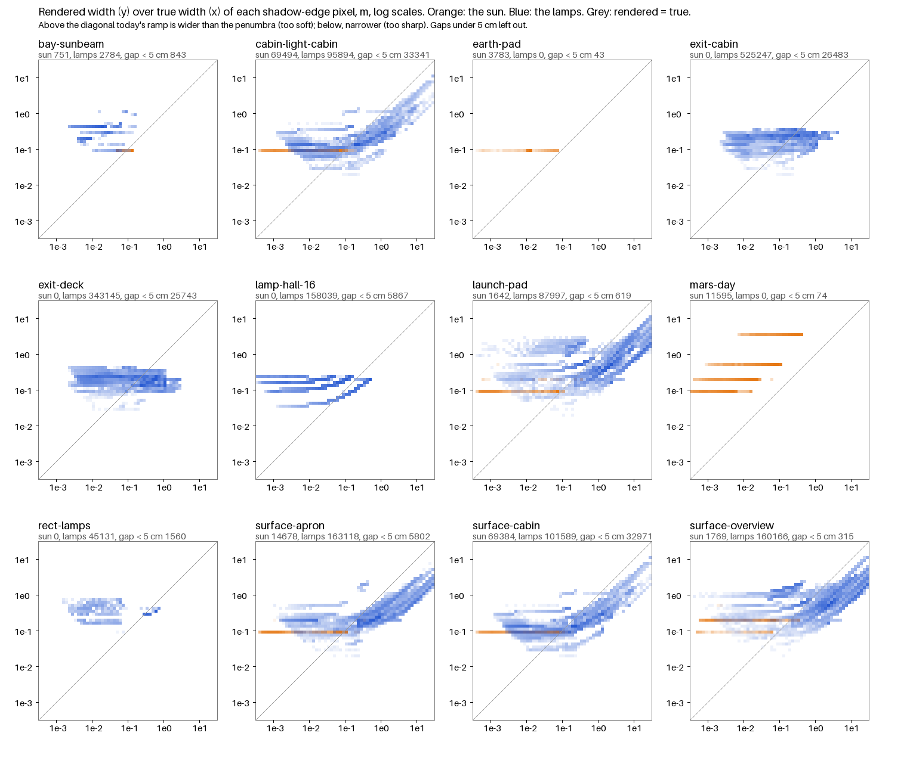
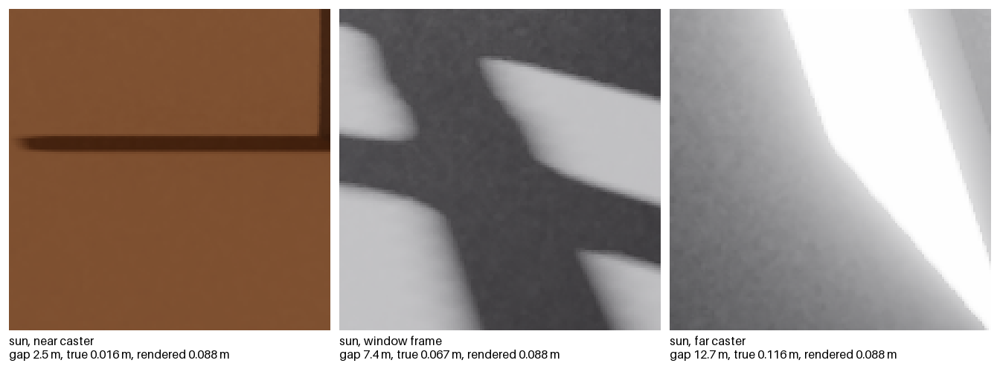
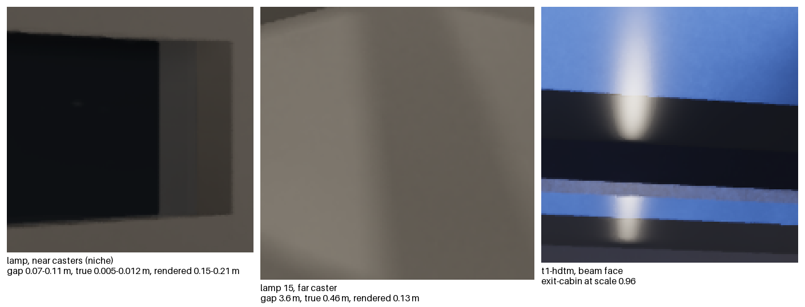

# The softness of today's shadow edges against the penumbra (t1-af5w, step 1)

This record measures how wide today's filter makes each shadow edge, and how wide the light's real penumbra is at the
same pixel. It changes no engine code and proposes no design. Design L's rule stays as built: the sun's share is
`lightOutsideShadow(lit)`, which goes from 0 to 1 between the lit fractions 5/8 and 1.

## Terms

- **The gap** is the distance in m, along the light's direction, between the caster's edge and the receiver.
- **The light's angular size** is the full angle in rad. The sun's is 0.00915 at the Earth and 0.0061 at Mars. A
  lamp's is the emitter's largest width over its distance from the caster.
- **The true width** is the gap times the angular size, in m.
- **The rendered width** is the width in m at the receiver over which today's filter takes the light's share from 0 to
  1. For the cascades it is 1.5 texels of the cascade (0.088 m in cascade 0, 0.19 m in cascade 1, 0.48 m in cascade 2
  and 3.5 m in cascade 3). For a tile it is 4 texels at the receiver, `texelPerMeter × near / ndc.z` each.
- **An edge pixel** of a light is a pixel whose share of that light lies strictly between 0 and 1. A pixel on the
  edges of two lights counts for the first light in the light loop.
- **Rendered / true** is the rendered width over the true width. Above 1 the edge is too soft, under 1 too sharp.

## The method

`patches/edge-probe.patch` (after main's `tools/renderer-survey/probe.patch` and the ter-bcwr record's
`scratch-takes-build.patch`) adds a probe under `TERTIUS_EDGE_PROBE` to `pathVisibility`. For the first light whose
share lies in (0, 1), it writes two vec4 into the direct targets, and the host reads them back as `edge-a.f32` and
`edge-b.f32`:

- The gap comes from the mean depth of the blocking texels in the filter's 5 × 5 window. A second gap comes from the
  window's nearest caster: `TileLookup.bounds.y` for a tile, and the largest blocking depth for a cascade.
- The rendered width, the light's angular size, the caster's distance and the emitter's widths come from the same
  lookup.

`patches/edge-probe-v2.patch` (after v1) writes, for addition 3, the blocking texels' mean distance from the
receiver's plane, sin θ and the window's depth spread. For addition 2 it writes a mask of the lights that took a shadow
lookup at the pixel, and `lights.txt`, the GPU light list.

`tools/views.py` writes the 12 views (`tools/views/`). Each one cuts a demo script at the frame of its case.
`tools/probe.sh` runs them under the shared GPU lock at 1280 × 720 on the M1 Max. Take 1 is v1 and take 2 is v2, both
on 39238b763. `tools/edges.py`, `tools/summary.py`, `tools/widthchart.py`, `tools/lamptable.py`, `tools/selfsep.py` and
`tools/boxstat.py` read the takes. `pics/edges.json` holds the per-light percentiles of take 1.

## Item 1: the gap, the true width and the rendered width per view and light

From `tools/summary.py` on take 1. The light classes are the sun, the 1.2 × 1.2 m rect panels, the 0.15 × 0.5 m rect
panels and the 0.1 m spheres of `lamp-hall-16`. "Too sharp" is the share of the class's edge pixels with rendered /
true under 0.5, and "too soft" the share above 2.

| View | Light | Edge px | Gap p10 / p50 / p90, m | True p50, m | Rendered p50, m | Rendered / true p10 / p50 / p90 | Too sharp | Too soft |
|---|---|---:|---|---:|---:|---|---:|---:|
| bay-sunbeam | sun | 781 | 5.3 / 12 / 16 | 0.112 | 0.088 | 0.61 / 0.78 / 1.8 | 0% | 4% |
| bay-sunbeam | 1.2 m panels | 3597 | 0.022 / 0.15 / 0.64 | 0.009 | 0.284 | 8.1 / 29 / 130 | 0% | 98% |
| cabin-light-cabin | sun | 70219 | 0.16 / 2.5 / 8.5 | 0.022 | 0.088 | 1.1 / 3.9 / 60 | 0% | 64% |
| cabin-light-cabin | 1.2 m panels | 3331 | 1.5 / 11 / 16 | 2.118 | 0.252 | 0.12 / 0.12 / 0.46 | 90% | 8% |
| cabin-light-cabin | 0.15 x 0.5 m panels | 125179 | 0.013 / 0.42 / 14 | 0.030 | 0.128 | 0.26 / 3.4 / 120 | 24% | 54% |
| earth-pad | sun | 3826 | 1.2 / 1.4 / 5.8 | 0.013 | 0.088 | 1.7 / 7 / 7.7 | 0% | 87% |
| exit-cabin | 1.2 m panels | 449255 | 0.16 / 2.6 / 5.9 | 0.209 | 0.249 | 0.31 / 1.2 / 18 | 18% | 35% |
| exit-cabin | 0.15 x 0.5 m panels | 102475 | 0.045 / 8.7 / 15 | 0.644 | 0.198 | 0.16 / 0.3 / 36 | 57% | 26% |
| exit-deck | 1.2 m panels | 245365 | 0.051 / 0.9 / 6.6 | 0.068 | 0.227 | 0.14 / 3.7 / 48 | 26% | 55% |
| exit-deck | 0.15 x 0.5 m panels | 123523 | 3.1 / 5.7 / 10 | 0.455 | 0.174 | 0.18 / 0.38 / 0.68 | 67% | 3% |
| lamp-hall-16 | 0.1 m spheres | 163906 | 0.17 / 2.7 / 9.3 | 0.037 | 0.160 | 0.48 / 4 / 87 | 11% | 66% |
| launch-pad | sun | 1868 | 0.046 / 0.17 / 8.1 | 0.002 | 0.088 | 1.2 / 56 / 210 | 0% | 78% |
| launch-pad | 1.2 m panels | 1690 | 4.8 / 9.2 / 11 | 2.237 | 0.170 | 0.074 / 0.076 / 0.13 | 98% | 1% |
| launch-pad | 0.15 x 0.5 m panels | 86700 | 9.2 / 29 / 160 | 2.191 | 0.581 | 0.069 / 0.25 / 2.1 | 76% | 10% |
| mars-day | sun | 11669 | 0.21 / 2.8 / 34 | 0.017 | 0.480 | 7.4 / 21 / 130 | 0% | 100% |
| rect-lamps | 1.2 m panels | 46691 | 0.15 / 4.7 / 8.8 | 0.377 | 0.308 | 0.61 / 0.77 / 44 | 0% | 23% |
| surface-apron | sun | 16401 | 0.049 / 0.19 / 9.1 | 0.002 | 0.088 | 1.1 / 51 / 200 | 0% | 65% |
| surface-apron | 1.2 m panels | 6408 | 2.1 / 8.1 / 15 | 1.331 | 0.233 | 0.12 / 0.16 / 0.83 | 83% | 4% |
| surface-apron | 0.15 x 0.5 m panels | 160789 | 0.35 / 8.7 / 54 | 0.629 | 0.219 | 0.075 / 0.35 / 16 | 67% | 14% |
| surface-cabin | sun | 70147 | 0.15 / 2.3 / 8.5 | 0.021 | 0.088 | 1.1 / 4.1 / 62 | 0% | 65% |
| surface-cabin | 1.2 m panels | 3064 | 1.2 / 11 / 16 | 2.097 | 0.251 | 0.12 / 0.13 / 0.59 | 90% | 9% |
| surface-cabin | 0.15 x 0.5 m panels | 130733 | 0.014 / 0.88 / 14 | 0.063 | 0.127 | 0.26 / 2.3 / 120 | 26% | 51% |
| surface-overview | sun | 1832 | 0.093 / 2.1 / 8.3 | 0.019 | 0.189 | 2.2 / 9.1 / 200 | 0% | 91% |
| surface-overview | 1.2 m panels | 1607 | 4.1 / 8.9 / 10 | 2.234 | 0.169 | 0.074 / 0.075 / 0.13 | 97% | 1% |
| surface-overview | 0.15 x 0.5 m panels | 158811 | 14 / 37 / 150 | 2.554 | 0.743 | 0.07 / 0.23 / 6.4 | 75% | 15% |

`pics/width-chart.png`: one panel per view. Each shows the density of edge pixels by true width (across) and rendered
width (up), both from 10^-3.5 to 10^1.5 m. The diagonal is rendered = true. `pics/map-exit-cabin.png` maps rendered /
true over exit-cabin's pixels.

The reading:

- **The sun** is never too sharp in the measured views. In the cabins and on the pads it is too soft at contact: the
  median gap is 0.2 to 2.8 m, so the true width is 2 to 22 mm against a ramp of 88 mm. Only bay-sunbeam's far edges
  (gaps of 5 to 16 m) come near 1.
- **The 1.2 m panels** are 6 to 13 times too sharp (median) where their casters are 5 to 15 m away (the cabins, the
  pads, the apron). In bay-sunbeam, where the caster is 0.02 to 0.6 m away, they are 8 to 130 times too soft.
- **The 0.15 × 0.5 m panels** split by gap. With far casters (exit-cabin, exit-deck, launch-pad, surface-apron,
  surface-overview, median gaps of 5.7 to 37 m) the median is 2.6 to 4.3 times too sharp. In the cabins (median gaps of
  0.4 to 0.9 m) the median is 2.3 to 3.4 times too soft, and the 90th percentile 120 times.
- **The 0.1 m spheres** are mostly too soft, with a median of 4 times.

## Item 2: does the emitter's size reach the shader, and does `TileLookup.bounds` give the gap?

The emitter's size reaches the shader for every shape, in `GpuLight` (`FrameResources.GpuLightsOf`):

| Field | Holds |
|---|---|
| `intensityKind.w` | The kind: point 0, spot 1, tube 2, rect 3 |
| `spotRadius.y` | The emitter's radius R, for a point, a spot and a tube (a sphere's radius, a tube's radius) |
| `directionCosOuter.xyz` | A tube's half segment, a rect's half width (vector), a spot's axis (and `.w` the cosine of the outer angle) |
| `halfHeight.xyz` | A rect's half height (vector) |
| `shadow.x` / `.y` / `.z` | The slot (3 = the atlas tiles, 0 = none), the first tile view, the count of tile views |

`SceneBatcher.EmitterHalfExtent` is CPU-only and sizes the light's reach. A sphere's extent is R. A tube's is its half
segment and R. A rect's is its half width and half height, and the rect's axis is the cross product of the two
vectors.

`TileLookup.bounds` holds the least (x) and the greatest (y) reversed depth of the filter's window (`shadow_bounds.comp`).
So `bounds.y` is the window's nearest caster to the light, and `d × ndc.z / bounds.y` is its distance from the light.
Over all views, at the lamps' edge pixels with a gap above 5 cm (1,683,110 pixels), the gap from `bounds.y` over the
gap from the blockers' mean is 1.00 / 1.002 / 1.29 (10th / 50th / 90th percentile), and within 20 % at 88 % of the
pixels. The sun's cascades have no bounds image. The same quantity from the probe's own window (the largest blocking
depth) is 1.00 / 1.03 / 1.52, within 20 % at 77 % (173,096 pixels). So `bounds.y` gives the gap that a blocker search
gives at most lamp edges, with no extra read. Where it differs, the nearest caster is nearer the light than the mean,
so the gap from `bounds.y` is the larger, and its width the softer.

## Item 3: the register counts of the candidates

From `tools/shader_registers.py` on the M1 Max, with `patches/regs-*.diff` applied to 39238b763's shaders. The limit
is register 115: from 116 on, the GPU keeps 384 fragment threads resident in place of 448, which costs 0.10 to 0.36 ms of
the direct pass in every view (tools/README.md, "The registers of the direct shaders"). Every variant only narrows
design L's ramp (the width factor is clamped to 0.25 to 1), so no light enters a shadow.

| Variant | What it adds | `direct.frag` | `direct_key_fill.frag` | Instructions of `direct_key_fill.frag` |
|---|---|---|---|---|
| base | nothing (39238b763) | r112 | r115 | 23022 |
| A | the tile ramp from `bounds.y` and the emitter's radius over the caster's distance | r113 | r116, 1 over | 23254 |
| B | a 4-gather blocker search in the cascades and the ramp from its gap | r127 | r127 | 25686 |
| C | the cascades' ramp width as a parameter of `lightOutsideShadow`, from a uniform | r112 | r115 | 22998 |

## Item 4: stills with a frozen world and a settled exposure

`tools/stills.sh` takes three captures (a, b, c) of each view with a frozen world at render scale 2/3 (exit-cabin at
0.96) and keeps `exposure.json` (`exposure/<view>.json`). Every view's exposure moved by at most 0.0001 stops between
the captures, so each is settled. The stops of capture a:

| View | Stops |
|---|---|
| cabin-light-cabin | −7.7556 |
| bay-sunbeam | −4.1228 |
| rect-lamps | 3.9094 |
| exit-deck | 0.7238 |
| exit-cabin at 0.96 | −0.4472 |
| lamp-hall-16 | 5.0279 |
| mars-day | −8.3062 |

The stills are in `/private/tmp/t0-gbgj/af5w-stills/<view>/{a,b,c}.png`, 34 MB, and the record keeps only the crops.
The crops are 1:1 boxes of capture a, scaled 3× with no smoothing (`tools/crops.py`). The numbers under each crop are
the medians of the probe's edge pixels in the same box (`tools/boxstat.py` on take 1).

`pics/crops-sun.png`, the sun:

1. mars-day, x 1020, y 520, 144 px: a ledge's shadow, a near caster. The box's 117 edge pixels have a median gap of
   2.5 m, a true width of 0.016 m and a rendered width of 0.088 m: 5.7 times too soft. The line reads as a soft contact
   shadow.
2. cabin-light-cabin, x 780, y 640, 144 px: the window frame's shadow on the floor. Gap 7.4 m, true 0.067 m, rendered
   0.088 m: 1.3 times.
3. bay-sunbeam, x 241, y 237, 144 px: the sunbeam's edge from a far caster. Gap 12.7 m, true 0.116 m, rendered
   0.088 m: 0.76 times, a little too sharp.

`pics/crops-lamp.png`, the lamps:

1. rect-lamps, x 21, y 469, 144 px: the niche, near casters of lamps 1, 3 and 4. Gaps of 0.07 to 0.17 m, true 0.005 to
   0.012 m, rendered 0.15 to 0.37 m: 12 to 46 times too soft. The niche's inner edges show as soft bands.
2. exit-deck, x 1180, y 690, 160 px: lamp 15 (a 1.2 m panel) with a far caster. Gap 3.6 m, true 0.46 m, rendered
   0.13 m: 3.7 times too sharp. The edge is a clear line, where the true penumbra is about half a metre wide.
3. exit-cabin at 0.96, x 1100, y 90, 150 px: t1-hdtm's crop, the lamp's light running down the beam's face.

**The gap where the receiver is its own only caster (t1-hdtm).** On the beam's face (x 1140, y 150, 60 px), the edge
pixels are lamp 17's, a 0.15 × 0.5 m panel. Their gap reads 0.078 m, with a true width of 0.006 m and a rendered width
of 0.095 m. Take 2 shows that the blocking texels lie 0.006 m from the receiver's plane (the depth bias), at sin θ 0.98
(grazing), and that the window holds cleared texels (a depth spread of 60,000 texels). So the window's only caster is
the face itself, seen at grazing light, and the gap reads 8 cm, not 0. A gap-driven ramp would read this self-shadow as
a contact edge of 8 cm.

## Addition 1: the sun's least ramp after design L, and the gain at contact

Not measured. No record holds the least ramp that hides the texel grid after design L. Before L, with a symmetric
filter, t8-rjno measured that a reach of 1 texel (a ramp of about 1 texel) crawled as a staircase at 5 m, that a reach
of 1.5 texels showed a faint wave, and that "the reach that hides the texel grid is above 1.5 texels". Design L's ramp
is 1.5 texels, 0.088 m in cascade 0. If the least ramp is 1 texel (0.058 m), the sun's edge at contact can narrow by at
most 3 cm. If it is 1.5 texels, it cannot narrow at all. So the sun gains a few cm at most.

## Addition 2: the lamps that are too sharp, and what a tile and a lookup cost

A lamp is listed when its true width is at least 2 × its rendered width at 10 % or more of its edge pixels
(`tools/lamptable.py` on takes 1 and 2). "Lookups" is the count of pixels where the shader took a shadow lookup of that
lamp, from take 2's mask, over the view's 921,600 pixels. Every listed lamp has 6 tile views (a cube).

| View | Lamps listed | Shape and size | Too sharp at | Lookups |
|---|---|---|---|---|
| bay-sunbeam, earth-pad, mars-day, rect-lamps | none | | | |
| cabin-light-cabin, surface-cabin | 1, 2 | rect 1.2 × 1.2 m | 94 to 95 % | 54 to 62 % |
| cabin-light-cabin, surface-cabin | 3, 4, 5, 6 | rect 0.15 × 0.5 m | 20 to 47 % | 47 to 55 % |
| exit-cabin | 0, 14, 15, 16 | rect 1.2 × 1.2 m | 16 to 83 % | 32 to 65 % |
| exit-cabin | 17, 18, 19, 20 | rect 0.15 × 0.5 m | 48 to 67 % | 54 to 62 % |
| exit-deck | 0, 14, 15 | rect 1.2 × 1.2 m | 37 to 88 % | 40 to 92 % |
| exit-deck | 17, 18, 19, 20 | rect 0.15 × 0.5 m | 58 to 82 % | 25 to 61 % |
| lamp-hall-16 | 3, 7, 12, 13 | point (sphere) r 0.05 m | 14 to 16 % | 42 % |
| launch-pad | 1, 2 | rect 1.2 × 1.2 m | 98 to 99 % | 36 % |
| launch-pad | 20, 21, 22, 23 | rect 0.15 × 0.5 m | 70 to 88 % | 12 to 31 % |
| surface-apron | 1, 2 | rect 1.2 × 1.2 m | 79 to 100 % | 64 % |
| surface-apron | 20, 21, 22, 23 | rect 0.15 × 0.5 m | 57 to 89 % | 20 to 51 % |
| surface-overview | 1, 2 | rect 1.2 × 1.2 m | 98 to 99 % | 69 % |
| surface-overview | 20, 21, 22, 23 | rect 0.15 × 0.5 m | 64 to 83 % | 28 to 53 % |

The per-lamp rows, with each lamp's edge pixels, are in the output of `tools/lamptable.py`.

The costs, from existing numbers only (ARCHITECTURE.md, "Local shadows" and "The scenes and the cost of the shadows"):

- **One more tile** takes 1 MB of atlas (512² D32) and 0.5 MB of bounds (RG32F at half size). The default atlas holds
  64 tiles. A drawn tile costs about 0.04 ms on the M1 Max, with 10 to 82 casters. A cached tile costs nothing to draw.
  So one more cube of 6 tiles costs 9 MB, and up to 0.24 ms in a frame that redraws all six.
- **One more `tileLitFraction` lookup** per lamp: on 2026-10-26, 16 shadowed point lamps cost the lighting pass 2.3 ms
  more than unshadowed ones at 1080p, where every pixel saw every lamp. That is about 0.14 ms per lamp's 16 taps. It was
  measured before the bounds skip (ter-mfyv). Since then, only the pixels between the window's bounds take the taps, so
  the cost is lower by a share that no record holds.

## Addition 3: does anything separate a self-shadow from a contact edge at a gap under 5 cm?

`tools/selfsep.py` on take 2 takes the edge pixels with a gap under 5 cm. It labels each pixel "area" when more than 40
of the 81 pixels around it also have a gap under 5 cm (a self-shadowed surface), and "line" otherwise (a contact
edge). For each reading it finds the one split that labels the most pixels right. The baseline is the share of the
larger group.

| View | Gap < 5 cm px | Area | Line | Plane residual | sin θ | Depth spread | Baseline |
|---|---:|---:|---:|---:|---:|---:|---:|
| cabin-light-cabin | 33341 | 13197 | 20144 | 60 % | 66 % | 61 % | 60 % |
| surface-cabin | 32971 | 13151 | 19820 | 60 % | 66 % | 60 % | 60 % |
| exit-cabin | 26483 | 12039 | 14444 | 68 % | 71 % | 61 % | 55 % |
| exit-deck | 25743 | 8925 | 16818 | 65 % | 67 % | 70 % | 65 % |
| lamp-hall-16 | 5867 | 221 | 5646 | 94 % | 94 % | 94 % | 96 % |
| surface-apron | 5802 | 473 | 5329 | 90 % | 90 % | 90 % | 92 % |
| rect-lamps | 1560 | 295 | 1265 | 80 % | 79 % | 81 % | 81 % |
| bay-sunbeam, earth-pad, launch-pad, mars-day, surface-overview | 43 to 843 | 0 | all | | | | |

- The plane residual is the blocking texels' mean distance from the receiver's plane, in texels. Its median is 0.3 to
  1.0 texels in both groups: the blockers lie on the receiver's plane, within the bias, at nearly all of these pixels.
- sin θ (the light's angle to the surface) is 0.9 to 1.0 in both groups.
- The depth spread of the window is sometimes about 10^6 texels. That is `bounds.x` = 0: cleared texels in the window.

No reading separates the two groups. The best split beats the baseline by at most 16 points (sin θ in exit-cabin), and
it never beats it in the views where one group dominates. So `bounds.x` against `bounds.y`, sin θ and the plane test
do not tell a self-shadow from a contact edge at gaps under 5 cm.

## Addition 4: which `GpuLight` fields hold the emitter's extent and axis

| Shape | Extent | Axis |
|---|---|---|
| Rect | `directionCosOuter.xyz` (the half width, a vector) and `halfHeight.xyz` (the half height, a vector) | The cross product of the two vectors. Both vectors give the rect's in-plane axes |
| Tube | `directionCosOuter.xyz` (the half segment, a vector) and `spotRadius.y` (the radius R) | `directionCosOuter.xyz` |
| Sphere (point) | `spotRadius.y` (the radius R) | None |

A spot keeps its axis in `directionCosOuter.xyz` and its radius in `spotRadius.y`.

## A finding for its own ticket: the far cascades' ramp in mars-day

In mars-day the sun's 11,669 edge pixels split almost evenly over the four cascades (2,896, 2,914, 2,970 and 2,889).
Design L's ramp of 1.5 texels is 0.48 m in cascade 2 and 3.5 m in cascade 3, against true widths of 0.0013 / 0.017 /
0.21 m (10th / 50th / 90th percentile). This is the cascades' texel size, not the gap-dependent softness of this ticket,
so the numbers above leave it out of any design. Ticket `t58-7645` holds it.

## Tools

- `tools/views.py`, `tools/views/`: the 12 views.
- `tools/probe.sh <bin> <out> [view...]`: a probe take under the shared GPU lock.
- `tools/edges.py <take>`: the per-light percentiles and `edges.json`.
- `tools/summary.py <take>`: the table of item 1.
- `tools/widthchart.py <take> <png>`, `tools/edgemap.py <take> <view> <png>`: the chart and the map.
- `tools/lamptable.py <take 1> <take 2>`, `tools/widelamps.py`: addition 2.
- `tools/selfsep.py <take 1> <take 2>`: addition 3.
- `tools/stills.sh <bin> <out> <view>[@scale]...`, `tools/crops.py`, `tools/boxstat.py`, `tools/findedge.py`: the
  stills, the crops and the numbers in a box.
- `patches/edge-probe.patch`, `patches/edge-probe-v2.patch`: the scratch probe. Never commit it to src.
- `patches/regs-*.diff`: the register variants of item 3, on the shaders of 39238b763.

The takes are in `/private/tmp/t0-gbgj/edge-take1` and `/private/tmp/t0-gbgj/edge-take2`.

## Part 0 of the probe: the narrow half

The design note "Two designs" in t1-af5w defines the narrow half: the share is `clamp(0.5 + (lit - 0.5) * 4 / w, 0, 1)`,
with w the footprint's width in tile texels. w is the true width from the gap of `TileLookup.bounds.y`, clamped to the
least ramp and 4. The trust rule keeps w at 4 where the trusted gap is 0 or less. The trusted gap is the gap less the
own-plane span (3 tan θ texels) and the depth bias (0.5 + 2.5 tan θ texels). Between 0 and one span, w fades to the true
width. The emitter's size is the side of the square with its projected area as the caster sees it.

### The register counts

From `tools/shader_registers.py` on the M1, on main 72426c219 (main: `direct.frag` r112, `direct_key_fill.frag` r115).
The variants are `patches/part0-regs-*.diff`.

| Form | `direct.frag` | `direct_key_fill.frag` |
|---|---|---|
| A second `tileLookupOf` after the taps (`part0-regs-refetch.diff`), trust off or on | r127 | r127 |
| 4 / w computed in `tileLookupOf` as one float of `TileLookup`, trust off (`v11` form) | r115 | r115 |
| The same, trust on, as the note's fade or as one line in the gap (`v10`) | r115 | r117 |
| Trust on, tan θ from `dot(geometricNormal, L)` after the bounds fetch (`v14`) | r114 | r117 |
| Trust on in `tileShadow`, with the true width and the gap as two floats out of the lookup (`v15`) | r116 | r116 |
| The same, both packed as two halves in one uint (`v16`) | r116 | r116 |

A hard switch in place of the fade, a constant emitter side, tan θ = sin θ, a constant tan θ, and sin θ folded into two
constants before the fetch all give r117. A rule with no sin θ gives r115, and the same rule with one multiply by sin θ
gives r117. So the cost is the live range of the receiver's angle across the bounds fetch.

### The acne

`ALitFloorUnderASpotLightHasNoAcne`, differing pixels, from `patches/part0-acne-counts.patch` (the test writes its
counts):

| Case | main | Trust on, least 1, 1.5 and 2 | Trust off, least 1.5 |
|---|---|---|---|
| 4 m, 60°, a turn of 45° | 4 of 25,784 | 4 | 0 |
| 12 m, 60°, a turn of 45° | 2 of 135,815 | 2 | 0 |
| The other three cases | 0 | 0 | 0 |

### The stills

One binary of `patches/part0-narrow-half.patch` draws every column: `TERTIUS_X_TILE_LEAST_RAMP` unset draws main, a
positive value is the least ramp with trust on, and a negative value is the least ramp with trust off.
`tools/fixedstills.sh` renders each view at the fixed exposure of capture a in `exposure/<view>.json`.
`tools/compare.py` makes the sheets in `pics/part0/`: 1:1 crops at 3 times, nearest, with the columns main, trust on at
1, 1.5 and 2, and trust off at 1.5.

- `beam-face.png`: with trust on, every least ramp equals main, and t1-hdtm's leak stays. With trust off, the lit patch
  ends at the beam's edge, and most of the leak is gone.
- `deck-far.png`: exit-deck's lamp 15 with a far caster does not change in any column.
- `niche.png`, `cabin-contact.png`, `hall-foot.png`, `hall-pillar.png`, `hall-floor.png`: no visible change, and no
  texel staircase at a least ramp of 1.
- `deck-window-frame.png`: one of the places with the most change, a thin lit strip on a frame edge.
- `deck-frame-trust-off.png` (main, trust on 1.5, trust off 1.5): trust off adds a soft darker band across the frame's
  face, a sharper self-shadow in grazing light.

The share of each frame's pixels that differ from main by more than 4 of 255:

| View | Trust on, 1 | Trust on, 1.5 | Trust on, 2 | Trust off, 1.5 |
|---|---|---|---|---|
| exit-deck | 0.24 % | 0.18 % | 0.12 % | 0.43 % |
| exit-cabin at 0.96 | 0.09 % | 0.08 % | 0.07 % | 0.17 % |
| rect-lamps | 0.02 % | 0.02 % | 0.01 % | 0.02 % |
| lamp-hall-16 | 0.00 % | 0.00 % | 0.00 % | 0.01 % |
| cabin-light-cabin | 0.00 % | 0.00 % | 0.00 % | 0.00 % |

The changes lie on thin lines where walls and frames meet the floor. The edges that the measure found too soft are
mostly receivers within one own-plane span of their caster, so the trust rule keeps today's width at them, and the
remap rarely acts.

## Part 1 of the probe: the wide half (in progress)

`patches/part1-pyramid.patch` (on main 72426c219, with the back-face line's export files for the reference) holds every
form below. One binary draws all of them under `TERTIUS_X_PYRAMID = 1000 form + 100 debug + mode`:

- form: 0 the nearest caster by fetches of the bounds levels, 1 the same filtered bilinearly, 2 the blockers' mean from
  the moments (dropped: w saturates at 64 texels).
- debug: 1 the bleed against an 8 × 8 PCF of the same footprint, 2 that PCF in place of the moments, 3 w / 64, 4 one,
  5 one where cap 8 takes its reads.
- mode: 1 plain moments (fraction: the cut b), c ≥ 2 exponential moments of exp(c z), 90 cap 8 (64 corner means), 91 cap
  16 (the 8 × 8 PCF at min(w, 16)).

The bounds image becomes RGBA32F, 384 × 256 per layer: level 0 (the window bounds and the moments of 2 × 2 texels) and
levels 1 to 4 packed beside it. `LocalShadowPass` writes them for every tile view in every frame.

### What the stills show

The sheets are in `pics/part1/`. The reference is Blender Cycles on an export of exit-deck's capture a, with the
back-face line's `cycles_scene.py`: direct light only (`REF_MAX_BOUNCES=0`), no sun, Earth black, 2,048 samples.

- The moments (plain, b up to 0.4, and exponential at c = 40) let light through at the deck's wall base, and they draw
  hard stripes and steps on the cabin's floor (`cap-cabin-floor.png`).
- Form 0's width is constant over each coarse bounds texel, and deck-far's hard patch follows it (`width-deck-far.png`).
  Form 1's width is smooth.
- The 8 × 8 PCF at form 1's full width washes the floors out as much as the moments do. So that wash-out is the width.
- The reference's lamp shadows on the deck are broad and soft (`ref-deck-far.png`, `ref-deck-floor.png`). Cap 8 and cap
  16 have its shape, and main's edges are too sharp. At the wall base the reference has a black contact band with sharp
  edges, which every column draws as a soft grey band (`ref-deck-wall-base.png`).

### Registers and time

| Form | `direct.frag` | `direct_key_fill.frag` |
|---|---|---|
| Moments, form 0, no debug code | r116 | r116 |
| Moments, form 1, no debug code | r116 | r116 |
| Cap 8, form 1 | r127 | r127 |
| Cap 8 with its 64 reads replaced by one value | r116 | r119 |

The direct pass's median GPU time over the 3 captures of one still, on a loaded machine (load 8 to 11), in ms:

| Column | exit-deck (render scale 2/3) | exit-cabin (0.96) |
|---|---|---|
| main | 4.02 | 7.45 |
| moments, form 1 | 4.73 | 8.79 |
| 8 × 8 PCF at form 1's w | 5.69 | 11.05 |
| cap 8 | 6.20 | 11.94 |
| cap 16 | 6.03 | 11.88 |

Cap 8 takes its 64 reads for at least one lamp at 92.5 % of exit-deck's pixels and 99.6 % of exit-cabin's.
