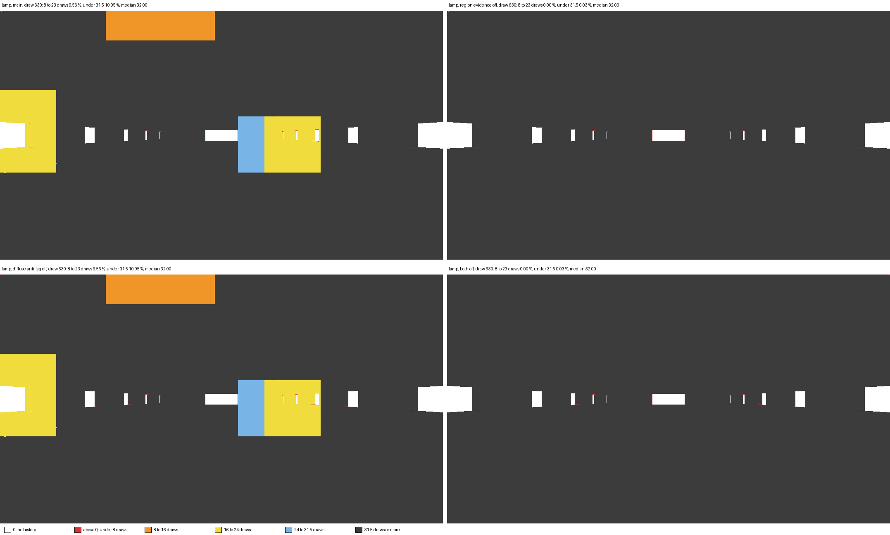
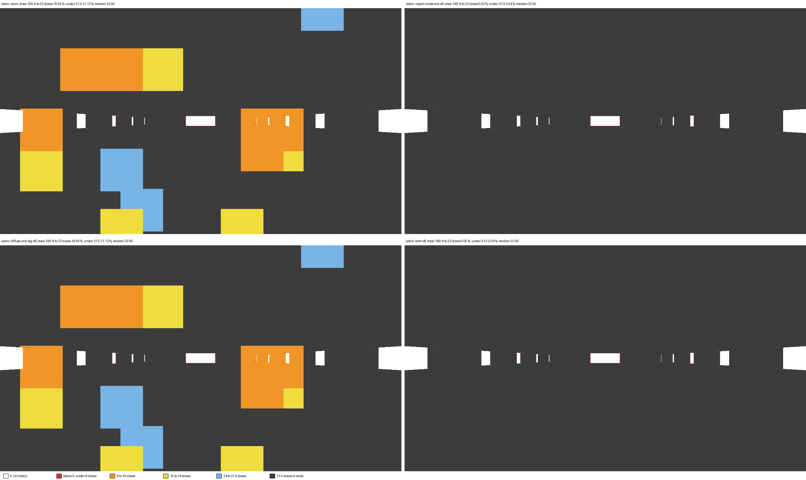
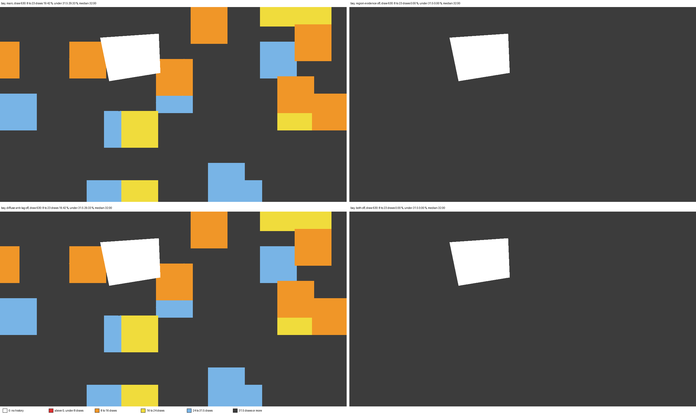

# Short diffuse histories in a still, by writer, on main after Design X (t1-g1jd, step 1)

t1-g1jd found 8.1 % of the lamp hall's surface pixels with a diffuse history of 8 to 23 draws, and named the anti-lag after the clamp as their writer. That count ran on base 3549d3283, before Design X. This take counts the short histories again on main ae4364022, after Design X, and splits them by writer with four builds. It only counts. It changes no rule and designs no fix. The patches are scratch code and never go into `src`.

## Terms

- L is the length of a pixel's slow diffuse history in draws: the alpha of `ScreenTraceSignals.Diffuse.Slow(0)`, as one draw left it. The cap is 32.
- A surface pixel is a render pixel with L above 0. A pixel with L = 0 holds no history: the sky, or an emitter such as a lamp's tube.
- "8 to 23" counts the surface pixels with L from 8 to 23 draws, both included: t1-g1jd's range.
- "Under 31.5" counts the surface pixels with L under 31.5 draws: the region take's range. A pixel in this range is short.
- A writer is a rule that shortens a history. Two are tested here:
  - the anti-lag after the clamp, `accumulate_spatial.comp:179` on the probed tree, for the diffuse signal;
  - region evidence, which caps a block's history at `FullRateFrames` (8 draws) when the region's drift test fires.
- Draw n is the renderer's frame number n, counted from 0 at the run's first draw.

## The builds

`tools/builds.sh` builds each one from main ae4364022 with the survey's probe patch and `scratch-history-dump.patch`, through the build script of the Design X acceptance record:

| Build | Extra patch | What it changes |
|---|---|---|
| g1-main | none | main as it is |
| g1-noreg | `scratch-no-region-evidence.patch` | the drift test runs, and its evidence caps no history |
| g1-noal | `scratch-no-diffuse-antilag.patch` | the anti-lag skipped for the diffuse signal only |
| g1-none | both | both writers off |

`scratch-history-dump.patch` adds `TERTIUS_X_HISTORY_DUMP=<folder>:<draw>`. The draw after the listed draw writes L over the render size as float32.

The anti-lag skip, as built:

```glsl
        float antiLagged = parameters.light == DiffuseLight ? historyLength
            : max(fastCap, historyLength * (1.0 - min(1.0, lag / parameters.antiLagShare)));
        historyLength = evidence == LightEvidence || evidence == RegionEvidence ? min(antiLagged, FullRateFrames) : antiLagged;
```

where

- `historyLength` = L before this step, after the reprojection.
- `lag` = the luminance of the clamp's move of the slow history, over the mean of the 3 x 3 fast histories.
- `parameters.antiLagShare` = the move at which the length falls to the fast cap.
- `fastCap` = the fast history's largest length, 4 draws.
- `evidence` = the block's strongest evidence of a change: `LightEvidence` from a light change, `RegionEvidence` from the drift test.
- `FullRateFrames` = 8 draws, the cap that evidence sets.

## The stills

`tools/still.py` takes each still as the survey's still part does: a frozen world, 28 captures of 33 draws each, the history kept through the captures (`TERTIUS_PROBE_STILL_CONTINUES=1`), bloom off. `tools/queue.sh` runs every view on every build twice (r1, r2).

| View | Source | Render size | Dump draw |
|---|---|---|---|
| Lamp hall | the survey's still rect-lamps (scripts/rect-lamps.json, frame 240) | 1072 x 603 (scale 0.5584, as in t1-g1jd) | 630 |
| Still cabin | the survey's switch case cabin (scene orbit, camera person, 60 ticks), lamps on, as in t0-qvm1 | 1280 x 720 (scale 2/3) | 190 |
| Bay | the survey's still bay-sunbeam (scene demo-surface, camera bay-camera, 420 ticks) | 1280 x 720 (scale 2/3) | 630 |

`tools/count.py` makes the table, the writer sets, the grain and the sheets. Its full output is `count.txt`.

## The count

Shares are of the surface pixels. The medians are 32 in every build and view.

| View | Build | 8 to 23 | Under 31.5 |
|---|---|---|---|
| Lamp hall | main | 60,625 (9.56 %) | 69,488 (10.95 %) |
| | region evidence off | 19 (0.00 %) | 175 (0.03 %) |
| | anti-lag off | 60,625 (9.56 %) | 69,488 (10.95 %) |
| | both off | 19 (0.00 %) | 175 (0.03 %) |
| Still cabin | main | 149,820 (16.56 %) | 191,157 (21.13 %) |
| | region evidence off | 23 (0.00 %) | 328 (0.04 %) |
| | anti-lag off | 149,820 (16.56 %) | 191,157 (21.13 %) |
| | both off | 23 (0.00 %) | 328 (0.04 %) |
| Bay | main | 172,902 (19.42 %) | 261,034 (29.33 %) |
| | region evidence off | 0 | 0 |
| | anti-lag off | 172,902 (19.42 %) | 261,034 (29.33 %) |
| | both off | 0 | 0 |

The surface pixels are 634,438 in the lamp hall, 904,514 in the still cabin and 890,112 in the bay.

## The writers

Each writer's own share is a set of pixels. A pixel is short because of the anti-lag when it is short with region evidence off and not short with both off. The region's set is built the same way. The overlap is short in both sets.

| View | Anti-lag alone | Region evidence alone | Overlap | Neither (short with both off) |
|---|---|---|---|---|
| Lamp hall | 0 | 69,313 (10.93 %) | 0 | 175 (0.03 %) |
| Still cabin | 0 | 190,829 (21.10 %) | 0 | 328 (0.04 %) |
| Bay | 0 | 261,034 (29.33 %) | 0 | 0 |

Region evidence writes every short history but a few hundred. Its pixels lie in whole rectangles: the region blocks whose drift test fired falsely in a frozen world (sheets below). The few pixels that neither writer shortens are thin rims at the lamps' tubes. Their writer is probably the reprojection's history test (`signals.glsl:106`, `holdsHistory`). This take did not test it.

The anti-lag shortens no diffuse history at the dump draw:

- In the lamp hall and the bay, the length map of g1-noal is equal bit for bit to the map of g1-main.
- In the still cabin, 2 pixels differ, by 0.03 draws at most (main 10.875 and 17.906, g1-noal 10.883 and 17.938).

The line still runs for the diffuse signal. The captures of g1-noal differ from those of g1-main in all three views, so the anti-lag moved the light at other draws. In the bay, the specks rose from 0.0248 to 0.0297 with the anti-lag off.

## Repeat

The two runs of each build are equal bit for bit in every view: the dump and all 28 captures, 29 files each. The spread of each share between r1 and r2 is 0.000 points.

## Grain, as a by-product

The grain is the survey's blotch score and its RMS, and the specks, of the capture that holds the dump draw, against the mean of the captures v-s08 to v-s27 of the same run. Each value is one capture of one run.

| View | Capture | Main: blotch, RMS, specks | Region evidence off | Anti-lag off |
|---|---|---|---|---|
| Lamp hall | v-s19 | 0.0053, 0.0034, 0.0048 | 0.0049, 0.0031, 0.0048 | as main |
| Still cabin | v-s05 | 0.0065, 0.0041, 0.0048 | 0.0112, 0.0074, 0.0048 | as main |
| Bay | v-s19 | 0.0217, 0.0139, 0.0248 | 0.0190, 0.0125, 0.0248 | 0.0216, 0.0139, 0.0297 |

With region evidence off, the grain falls in the lamp hall and the bay, as full-length histories predict. In the still cabin it rises from 0.0065 to 0.0112. That capture's draws 165 to 197 sit early in the run, and this take does not explain the rise.

## The sheets

Each sheet shows the length maps of r1 of the four builds: main top left, region evidence off top right, anti-lag off bottom left, both off bottom right. White is a pixel with no history (L = 0).







## What differs from t1-g1jd

- The base: t1-g1jd counted on 3549d3283, before Design X. This take counts on main ae4364022, after Design X with the clamp's σ fix of tc-8142.
- The capture: this take keeps the history through the still's 28 captures, and dumps draw 630 of that run.
- The writer: on 3549d3283, the anti-lag shortened 8.1 % of the lamp hall's surface pixels, scattered over every open surface. On main it shortens none at the dump draw. Region evidence now shortens 10.93 % of the lamp hall, 21.10 % of the still cabin and 29.33 % of the bay, in whole blocks.
- The ticket's title names the anti-lag. On main the anti-lag is not the writer of the short histories in these stills.

## Not measured

- The reflections' history. The dump patch reads only the diffuse signal's slow history. A count of the reflections needs a new patch.
- The draws at which the anti-lag still moves the light, and by how much.
- Why the drift test fires in a frozen world. t0-gumm and t0-qvm1 saw the same false fires.

## Files

- `scratch-history-dump.patch`, `scratch-no-region-evidence.patch`, `scratch-no-diffuse-antilag.patch`: the scratch patches.
- `tools/builds.sh`, `tools/still.py`, `tools/queue.sh`, `tools/count.py`: the tools.
- `count.txt`: the output of `count.py`.
- `pics/sheet-*.png`: the sheets.
- `bay-film-exposure.json`: the exposure per frame of the bay film of the stills of main 0688b36c6, an earlier take of this session.

The raw runs in `/private/tmp/t0-5tyj/g1jd/runs/` (the dumps and the captures) were deleted after this commit.
