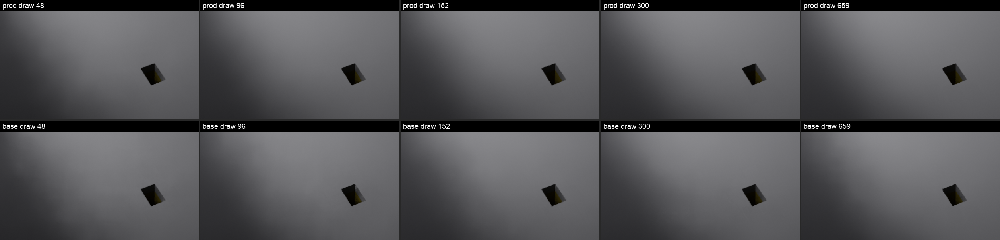
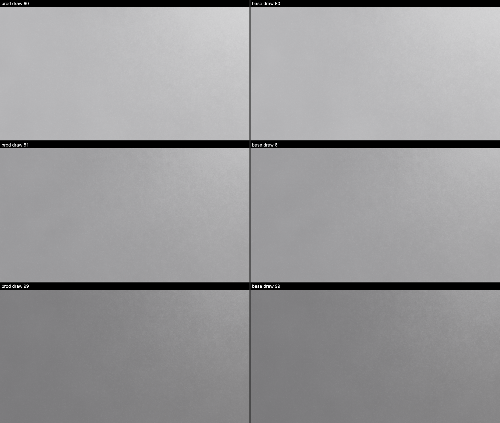
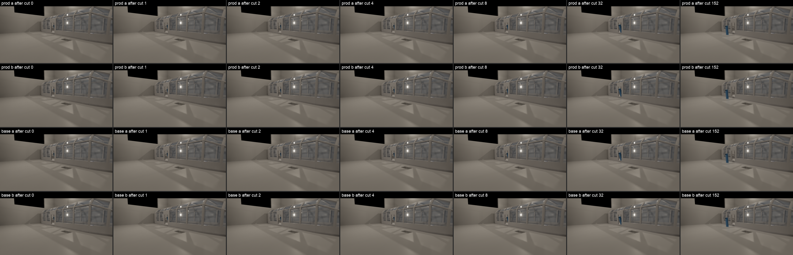

# The production check of t1-yi11: change gate, signed neighbors and a diffuse cap of 128

This record checks the production code of t1-yi11 (commit `8081c945d`) in the real renderer, against the review base
`3cfcfd2b3`. The review base has the same `src/` as `7dae0342b`, the baseline that the ticket names. The pictures and
numbers below come from 2026-11-24, on this Mac (Apple M-series GPU, MoltenVK).

Terms, as in `docs/plans/bounce-light-confidence.md`, section 8.7:

- **prod** is the production code: diffuse cap 128, the change gate in `regionRing.a`, the open gate's signed test and
  the closed gate's signed neighbor Welch test.
- **base** is the review base: diffuse cap 32 and the old region test, which answers on every anchor at every tested draw
  and has no gate.
- **Gray** is the mean 8-bit sRGB gray (0 to 255) of an output picture of 1920 x 1080.
- **Blob** is the band from 3 to 36 px of a picture, less its own take's late mean (draws 660 to 1,610, every 50th),
  as a standard deviation over a region, in units of the late mean's level there. The band is a Gaussian blur of sigma 3
  minus a Gaussian blur of sigma 36, on display-linear luminance. A smaller blob means a smoother, quieter image.
- **Answer** is a nonzero signed value in `regionRing.b` of one anchor at one draw. An anchor-draw is **tested** when the
  anchor has 36 valid draws in a row, so the test can run.

## Builds

The takes need a frozen world, kept frames of a film, the survey's lamp switch and a log of the region ring. Clean
binaries have none of these. So both sides of every take use a probe build:
[`tools/build.sh`](tools/build.sh) archives the commit, applies that commit's `tools/renderer-survey/probe.patch` and
[`tools/harness.py`](tools/harness.py), and builds the demo in Release. Neither patch touches a region rule, and both
sides get the same patches. No probe or switch is in `src/`.

The timing uses clean Release binaries: the worktree's own demo at `8081c945d`, and the read-only baseline binary of
worktree `t3-09c31e02` (its `src/` equals `3cfcfd2b3`'s).

Every take renders 1920 x 1080 at the headless render scale 2/3, under `tools/gpu-lock.sh --shared` (the timing: the
exclusive lock).

## Results

| Check | prod against base | Verdict |
|---|---|---|
| Frozen bay, -4.089 stops, settled (draws 640 to 659) | Blob 1.05 to 2.4 times lower in all four regions | Better |
| Frozen bay, diffuse signal alone, settled | Blob 2.4 to 3.0 times lower in all four regions | Better |
| Frozen bay, automatic exposure, settled | Blob 1.05 to 2.2 times lower in all four regions | Better |
| Frozen bay, false answers | 24 answers in 378,392 tested anchor-draws, none in draws 0 to 300 (base: 3,961, 851 of them in draws 0 to 300) | Better |
| Frozen bay, warm-up | The diffuse signal's sunlit patch has a larger blob at draw 48 (0.070 against 0.037), smaller from draw 152 on | Known cost |
| Walk with lamp switch | Same pictures. The switched light's excess drains slower after the walk: 1.41 against 0.50 gray at stand frame 156 | Known cost |
| Turned rect-bay | No anchor rectangles at 1:1. Largest 96 px tile difference 7.1 gray. Lag of at most 2.7 gray of the whole frame in film draws 33 to 45, gone by draw 60 | Known cost |
| Fair cabin switch | Settle: off 84 and on 49 draws (base 81 and 54). Both fail the survey's settle bar of 60, as before | Same |
| True camera cut | The frames after the cut are byte-identical for two different camera histories before it, in both builds. No ghost | Pass |
| Frame time and accumulate + filter | accumulate + filter 0.036 ms slower (median of 6 paired rounds), frame span 0.045 ms, inside its spread | Small cost |

## Frozen bay

`bay-sunbeam`: demo-surface's bay camera after 420 ticks, then 1,660 draws of a frozen world from the first draw
(capture n is draw n). The take keeps a few draws early and every 50th late, and logs the region ring at every draw.

Blob, mean of draws 640 to 659:

| Exposure, signal | Build | Sunlit patch | Back wall | Floor | Right wall |
|---|---|---:|---:|---:|---:|
| -4.089 stops, full image | prod | 0.0052 | 0.0035 | 0.0051 | 0.0183 |
| -4.089 stops, full image | base | 0.0069 | 0.0083 | 0.0104 | 0.0192 |
| -4.089 stops, diffuse alone | prod | 0.0098 | 0.0038 | 0.0043 | 0.0027 |
| -4.089 stops, diffuse alone | base | 0.0291 | 0.0090 | 0.0111 | 0.0081 |
| automatic, full image | prod | 0.0054 | 0.0024 | 0.0042 | 0.0110 |
| automatic, full image | base | 0.0059 | 0.0053 | 0.0075 | 0.0115 |

The right wall of the full image keeps its blob in both builds. That band comes from a signal other than the bounce
light: the diffuse signal alone has a blob of 0.0027 there.

The level of each region at draw 659 (display-linear luminance) differs from base by 0.1 % to 1.6 %. The largest
difference is the back wall of the diffuse signal: 0.1812 against 0.1841, 1.6 % darker.

The warm-up is slower at cap 128. The diffuse signal's sunlit patch has a blob of 0.0695 at draw 48 (base 0.0368) and
0.0131 at draw 300 (base 0.0346). The full image at draw 48: 0.0156 against 0.0104.

Answers of the region ring, from draw 36 to 1,659 (240 anchors):

- prod: 24 answers (16 up, 8 down), in three short runs: draws 406 to 409, 882 to 885 and 1,313 to 1,317, each on 2 to 4
  neighboring anchors. None in draws 0 to 300. Apart from the one anchor below, every established anchor stays closed after its first 8
  valid draws.
- base: 3,961 answers, 851 of them in draws 0 to 300.
- One anchor of prod (row 4, column 7) loses its valid draw about every 18 draws. Each loss holds its gate open at 0, so
  it never closes. But it never reaches 36 valid draws in a row either, so it never answers. Six anchors (rows 2 to 3,
  columns 6 to 9) never have a valid draw and stay unestablished.

[`bay-floor-dif.png`](bay-floor-dif.png): the floor of the diffuse signal alone, 1:1, draws 48, 96, 152, 300 and 659,
prod above base. Base shows blotches from draw 152 on. Prod shows a smooth gradient.



## Walk with a lamp switch

The survey's cabin walk: the person camera after 60 ticks, a still, 160 frames standing, 120 frames walking (key W),
200 frames standing, at 4.08 stops. In the switch run, the lamps of `z:-12:4` go off at walk frame 60. In the control
run, they are off from draw 0. The difference of the two runs is the light that the switch leaves behind.

Whole-frame gray of the switch run less the control run:

| Frame | prod | base |
|---|---:|---:|
| walk 65 | 21.37 | 21.19 |
| walk 115 | 5.55 | 5.31 |
| stand 0 | 5.02 | 4.76 |
| stand 40 | 3.60 | 2.88 |
| stand 80 | 2.50 | 1.48 |
| stand 120 | 1.77 | 0.80 |
| stand 156 | 1.41 | 0.50 |

During the walk the two builds are the same within 0.3 gray. After the walk stops, prod's excess drains at the pace of
the 128-draw history. The ticket accepts this transient cost. In the pictures the two builds look the same, and prod's
floor is smoother ([`walk-floor.png`](walk-floor.png): stand frames 0, 40 and 120 at 1:1).

Answers in the switch run: prod 454 (135 up, 319 down), base 1,499.

## Turned rect-bay

rect-bay's film (the sunbeam leaves the bay, 180 frames) after 200 frozen draws of its first state, with the camera
turned 90 degrees left. The sun patch is behind the camera, so no pixel on screen has an observed cause. Only the bounce
light changes. The take compares prod and base at every 3rd film frame.

- At 1:1, neither build shows anchor rectangles ([`turned-rect-bay-1to1.png`](turned-rect-bay-1to1.png): draws 60, 81
  and 99). The mean step of the prod-minus-base difference across the 96 px tile boundaries is 0.0111 gray, and 0.0104
  gray halfway between them. So the boundaries carry no step.
- The largest 96 px tile difference is 7.13 gray, at film draw 36. No frame passes 8 gray.
- prod is brighter than base while the light first falls: +2.0 to +2.7 gray of the whole frame in film draws 33 to 45,
  +0.3 at draw 60, and +0.05 or less from draw 81 on. The closed gate needs its Welch statistic to reach the seed bar
  first, so it answers a few draws later than base's test.
- Every prod answer is down (27,623). No anchor opens its gate, because no tap sees an observed cause. Base answers
  26,258 times.



## Fair cabin switch

The survey's fair cabin switch (`cabin`): three runs (switch, lamps always off, lamps always on), at 4.08 stops.

| Build | Off: region draws | On: region draws | Off: whole draws | On: whole draws | Failed |
|---|---:|---:|---:|---:|---|
| prod | 84 | 49 | 72 | 32 | settle |
| base | 81 | 54 | 71 | 34 | settle |

Both builds fail the survey's settle bar of 60 draws when the lamps go off. prod is 3 draws slower off
and 5 draws faster on. In the film ([`cabin-switch.png`](cabin-switch.png): film frames 165, 200, 260, 365 and 400),
the two builds look the same.

## True camera cut

demo-exit: the person leaves the ship for 399 ticks under camera a (cabin-camera) or camera b (the scene's own camera),
then a camera cut to deck-camera and a film of 160 frames, at 1.0 stops.

- In each build, the film frames after the cut are byte-identical for a and b, from frame 0 through frame 152. So no
  light from before the cut reaches a frame after it.
- Between prod and base, the largest 96 px tile difference is 0.00 gray through frame 32 after the cut, and at most
  0.30 gray from frame 40 on.



## Timing

[`tools/timing.py`](tools/timing.py) ran 6 paired rounds of clean Release binaries under the GPU lock's exclusive mode,
in the order prod, base, then base, prod, and so on. One take is bay-sunbeam: the bay camera after 420 ticks, then a
film of 600 frames one tick apart, with no image (`--video none`) and two frames in flight. Each take started at a
1-minute load under 8. The loads at the starts were 3.26 to 5.99. The demo's `gpu-timings.json` gives the median of
each take. MoltenVK's time of the pass "accumulate indirect diffuse" alone is not valid, so the table gives its sum with
"filter indirect diffuse". The region test runs in the first of the two.

Per build, over the 6 takes (ms per draw):

| Build | Frame span median: q1, median, q3 | accumulate + filter median: q1, median, q3 |
|---|---|---|
| prod | 15.472, 15.488, 15.508 | 2.840, 2.844, 2.847 |
| base | 15.430, 15.456, 15.464 | 2.804, 2.811, 2.813 |

prod less base, per round (ms):

| Measure | q1 | Median | q3 |
|---|---:|---:|---:|
| Frame span median | 0.012 | 0.045 | 0.080 |
| accumulate + filter median | 0.026 | 0.036 | 0.041 |

- prod's accumulate + filter is slower than base's in all 6 rounds, by 0.024 to 0.044 ms. That is about 1.3 % of the
  pair. The change adds three things to that pass: the gate, the sums of squares of both windows, and the closed
  gate's neighbor reads. These takes cannot split the cost between them.
- The frame span differs by less than its own spread between rounds of one build (base: 15.385 to 15.480 ms).
- The takes did not record the GPU clock (no calibration binary), so the numbers are at the clock that the Mac chose.
  Six rounds on one machine, beside other agents' work at a low load.

## Files

- [`hardening.md`](hardening.md): the full suites, lavapipe, the coverage of the changed C# lines and the listed
  mutants with the triage of their survivors.
- [`metrics.json`](metrics.json): every number above, per take (`bay`, `bayauto`, `walk`, `turned`, `switch`, `cut`,
  `timing`).
- The pictures: `bay-floor-dif.png`, `walk-floor.png`, `turned-rect-bay-1to1.png`, `cabin-switch.png`,
  `camera-cut.png`.
- [`tools/`](tools/): the tool code of this check. `build.sh` and `harness.py` make the probe builds, `takes.py` and
  `all-takes.sh` render the takes, `measure.py` makes the numbers and sheets, and `timing.py` runs the paired timing.
  The raw takes lived in /private/tmp/t1-yi11-prod and are deleted.

To make the takes again, from the worktree's root:

```bash
bash docs/research/t1-yi11-region-evidence/production/tools/build.sh prod 8081c945d
bash docs/research/t1-yi11-region-evidence/production/tools/build.sh base 3cfcfd2b3
nix develop --command python3 -I docs/research/t1-yi11-region-evidence/production/tools/takes.py bay prod dif
bash docs/research/t1-yi11-region-evidence/production/tools/all-takes.sh walk turned switch cut bayauto
nix develop --command python3 -I docs/research/t1-yi11-region-evidence/production/tools/measure.py bay
nix develop --command python3 -I docs/research/t1-yi11-region-evidence/production/tools/timing.py /private/tmp/t1-yi11-prod/timing 6
```

The tools name their folders under /private/tmp/t1-yi11-prod and the worktree path
`/Users/alexispurslane/.t3/worktrees/tertius/t3-c3911144`. Change these to run them from another checkout.
