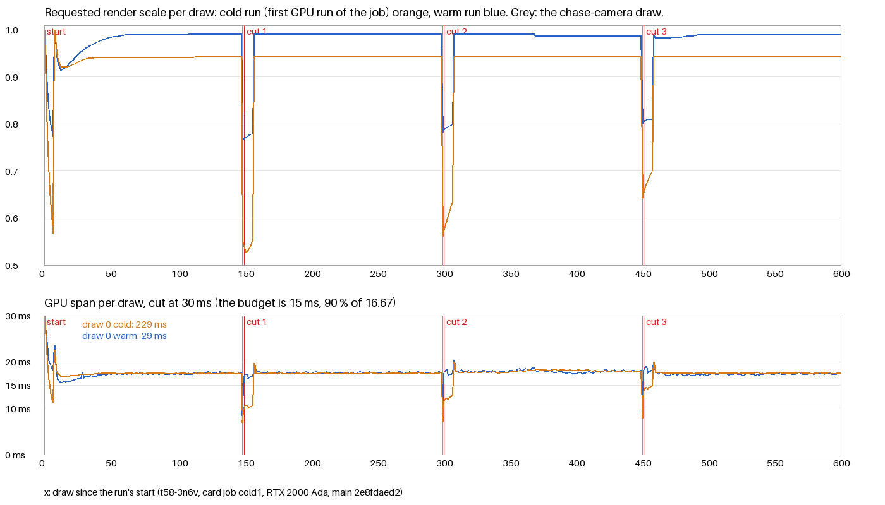
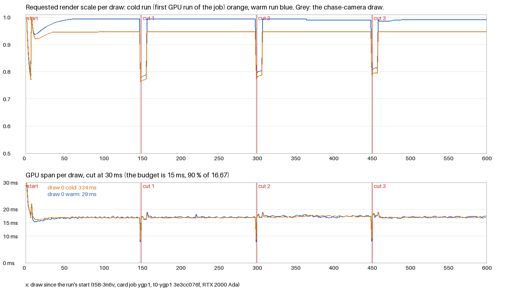

# The cold start of the render scale's catch-up kind (t58-3n6v)

On the first GPU run of a card job, draw 0 costs about 230 ms (t58-phgr). That draw is the first measurement of the
catch-up kind, so it becomes that kind's whole cost model (ter-bcwr). This check measures what it does to the catch-up
draws of the later cuts. It builds no fix.

## Terms

- The **cold run** is the first GPU run of the job's process tree, with no warm-up run before it. The **warm run** is
  the same script, run right after it in the same job.
- A draw's **kind** is catch-up for its first 8 draws after a reset, and ordinary after (`FrameHistory.CatchUpDraws`).
- The **request** is the render scale that a draw asks for, from the size log. The **drawn size** is the render size
  that the draw drew.
- The **span** is the draw's GPU time in ms, from the time log. A **pass time** is one pass's GPU time in that draw,
  from the pass log of `pass-log.patch`.
- The **budget** is 90 % of the target of 16.67 ms: 15 ms.

## The job

Job `cold1` on the RTX 2000 Ada, main 2e8fdaed2, 128 s of execution, $0.0317 (`tools/submit.sh`, `tools/cold.sh`).
The build carries main's `tools/renderer-survey/probe.patch`, the ter-bcwr record's `scratch-takes-build.patch` (the
size log, the time log, the first filmed draw and `TERTIUS_X_FRAME_TIME_TARGET`) and this record's `pass-log.patch`.
The script `tools/cold.json` films the cabin's person camera from draw 0 for 150 draws. Then it does three times: one
draw on the chase camera, then 150 draws on the person camera. Both camera changes are resets: the chase draws are
150, 301 and 452, and the cuts back to the person camera are draws 151, 302 and 453. The target is
`FrameTimeTarget(16.67, 0.5, 1)` at 1920 × 1080.

nvidia-smi, as `cold.sh` logged it:

| When | Power state | SM clock | Memory clock | Wall time of the run |
|---|---|---|---|---|
| Before the cold run | P8 | 210 MHz | 405 MHz | |
| After the cold run | P0 | 2475 MHz | 7001 MHz | 56 s, 603 draws |
| After the warm run | P0 | 2370 MHz | 7001 MHz | 16 s, 603 draws |

The NVIDIA shader cache (`~/.cache/nvidia/GLCache`) did not exist before the cold run and existed after it.

## Draw 0

Draw 0 costs 229.0 ms in the cold run and 29.4 ms in the warm run. Every pass is 8 to 30 times dearer:

| Pass | Cold, ms | Warm, ms |
|---|---|---|
| diffuse rays | 60.21 | 5.78 |
| reflection rays | 50.55 | 4.84 |
| direct light | 21.43 | 2.14 |
| screen trace resolve | 19.75 | 0.67 |
| ray plan | 11.85 | 0.78 |
| accumulate indirect diffuse | 10.20 | 0.71 |
| environment faces | 9.34 | 0.94 |
| depth pyramid | 7.14 | 0.59 |

Draw 1 is already normal: 24.7 ms cold, 26.0 ms warm. The pipelines compile on the CPU before draw 0, which the 40 s
of extra wall time and the new shader cache show. The ratio of the clocks, 2475 / 210 = 11.8, fits the ratio of the
passes. So draw 0 is a draw from rest at the idle clock, not a draw that compiles.

## The catch-up request at each cut

| Cut | Cold request | Warm request | Gap | Cold: span, drawn size | Warm: span, drawn size |
|---|---|---|---|---|---|
| 1 (draw 151) | 0.538 | 0.770 | 0.232 | 10.4 to 10.7 ms, 1008 × 567 to 1056 × 594 | 16.7 to 17.4 ms, 1472 × 828 to 1488 × 837 |
| 2 (draw 302) | 0.571 | 0.787 | 0.216 | 11.2 to 12.9 ms, 1088 × 612 to 1216 × 684 | 17.1 to 18.4 ms, 1504 × 846 to 1536 × 864 |
| 3 (draw 453) | 0.653 | 0.805 | 0.152 | 13.6 to 15.0 ms, 1248 × 702 to 1344 × 756 | 17.6 to 19.1 ms, 1536 × 864 to 1552 × 873 |

So draw 0 holds the catch-up draws of the three cuts at 0.53 to 0.70. Those draws stay 0 to 4.6 ms under the budget,
so they draw smaller than the card needs. The start's own catch-up draws fall to 0.567 by draw 7, against 0.772 warm.

The gap at the end of each cut's 9 catch-up draws (the chase draw and 8 person draws) is 0.228, 0.165 and 0.110. Cut 1
does not close it, because the cheap chase draw moved the request down. A geometric fit over cuts 2 and 3 gives a ratio
of 0.69 per cut, and a gap under 0.02 at about cut 8. This is an extrapolation, not a measurement.

`cold-scale.png`: above, the requested scale per draw, the cold run in orange and the warm run in blue. Red lines mark
the start and the three cuts back to the person camera. Grey lines mark the chase draw before each cut. Below, the span
per draw, cut at 30 ms.

## A second cold effect

The cold run's ordinary request rests at 0.943 for the whole run, and the warm run's at 0.992. At the same view the
cold process draws more slowly for its whole life. In draws 120 to 149 the span is the same, 17.6 ms cold and 17.7 ms
warm, at 1808 × 1017 cold and 1904 × 1071 warm. FSR 3.1 runs at the output size and takes 1.76 ms cold and 1.40 ms
warm. Accumulate indirect diffuse takes 0.89 ms cold and 0.75 ms warm. Draws 580 to 602 show the same. This is
t1-80jd, and draw 0 does not cause it.

## The fix: the first draw is no measurement (t0-ygp1)

The controller now takes no measurement from the first draw that it recorded, in either kind (t0-ygp1, commit
3e3cc076f). Job `ygp1` repeats the cold check on that commit: 130 s of execution, $0.0319, the same script and the
same order, cold run first with no warm-up. The card was at P8 and 210 MHz before the cold run again, and draw 0 cost
334.0 ms cold against 28.8 ms warm.

| Cut | Cold request | Warm request | Gap |
|---|---|---|---|
| 1 (draw 151) | 0.766 | 0.781 | 0.015 |
| 2 (draw 302) | 0.779 | 0.795 | 0.017 |
| 3 (draw 453) | 0.792 | 0.808 | 0.016 |

The catch-up request is within 0.02 of the warm run's at every cut, against gaps of 0.152 to 0.232 before the fix. The
start's catch-up draws fall to 0.771 by draw 7, against 0.788 warm. The rest of the gap is the cold process's slower
drawing (t1-80jd): its ordinary request still rests at 0.948 against 0.992 warm at the run's end.

`cold-scale-fix.png`: the same chart as `cold-scale.png`, of job `ygp1`.

## Tools

- `tools/submit.sh [job name] [commit]`, `tools/cold.sh`, `tools/cold.json`: the card job.
- `pass-log.patch`: the scratch pass log (`TERTIUS_X_PASS_LOG`), one line per draw with each pass's GPU time. Never
  commit it to src. t0-xwdz can use it too.
- `tools/coldsum.py <out/card>`: the tables of the requests, sizes and spans around each event.
- `tools/coldchart.py <out/card> <png> [label]`: the chart.

The logs are in `/private/tmp/t0-gbgj/cloud-bcwr/cold1` and `/private/tmp/t0-gbgj/cloud-bcwr/ygp1`.
