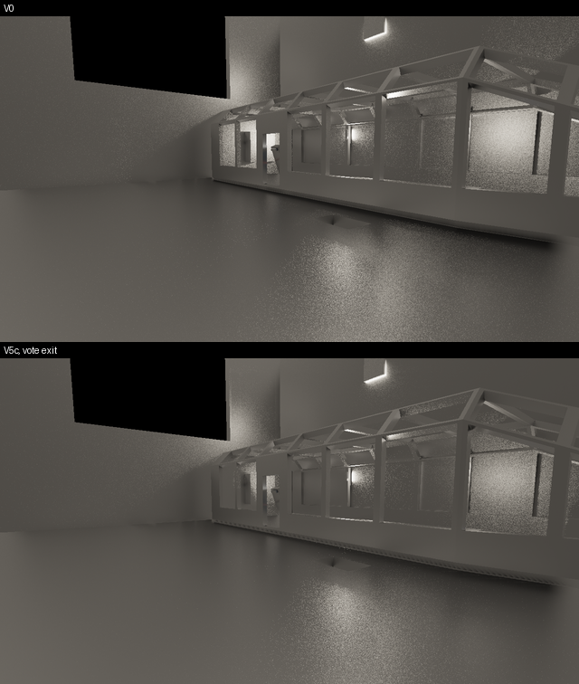
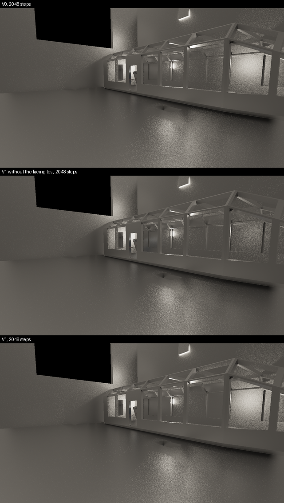
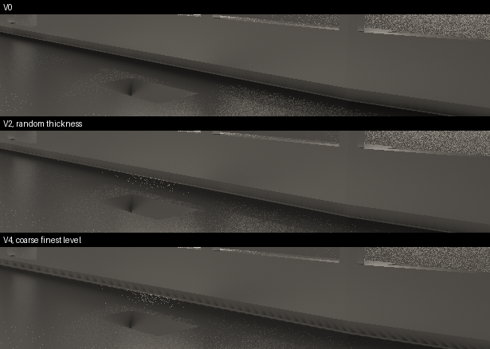
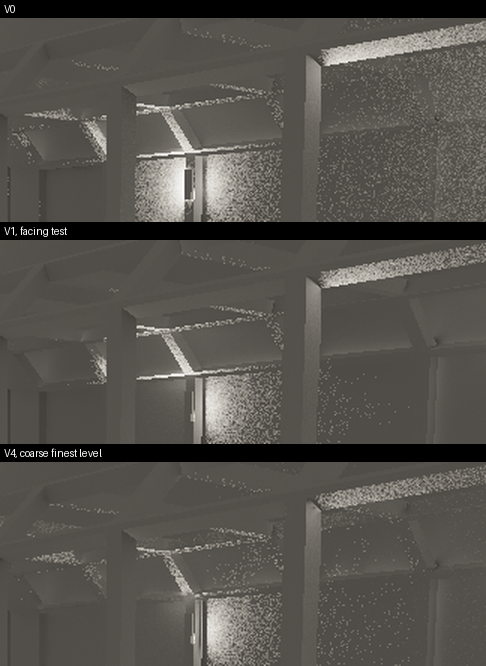
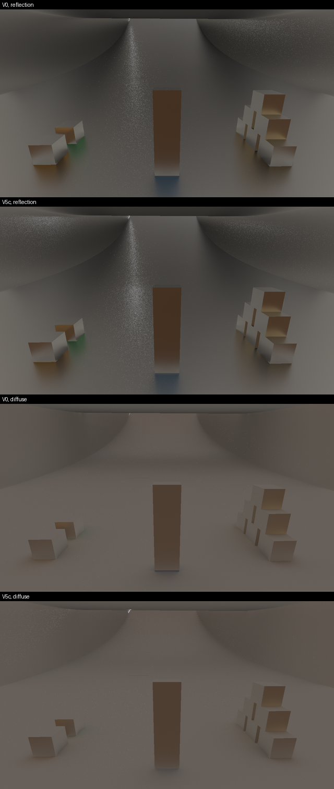

# Spike: the leanest screen trace that is correct on average (ter-8hbi)

No variant fits the budget. The fastest variant, V5c, traces the design's rays and reads the environment map for its misses in 2.67 to 3.14 ms. That is at a render size of 1280 x 720, with own rays for 10 % of the pixels. The two trace dispatches have about 1.1 ms. So V5c is 2.4 to 2.9 times too slow, and its converged images are 4 to 20 % away from today's trace in the mean.

V5c's time goes into lanes that wait. A subgroup of 32 rays runs as long as its longest walk. The lanes do a step of their own in only 53 to 58 % of the subgroup's lane steps. A further 10 to 27 % of the steps cross cells behind a surface one pixel at a time. The arithmetic units limit the walk, not the memory.

V1, the lean walk with the design's thickness and step counts, takes 5.7 to 5.8 ms against 9.0 to 9.1 ms for today's trace. Its converged images are within 1.7 % of today's trace on the floor view and 6.5 to 9.5 % darker on the deck view. The flat slab of V1 darkens the deck by 18 %, and V1's facing test brings back 12 % of it. Every later step of the ladder buys time with a systematic error, an error that accumulation does not average away. The recommendation for the screen tracer is at the end of this report.

## Terms

- Today's trace: `traceRay` of `reflection.glsl`, the trace that ter-toaw timed ([trace-timing-spike.md](trace-timing-spike.md)). It is variant V0.
- Block ray: the one ray of a kind that each 2 x 2 block of pixels traces, from the block's chosen pixel ([temporal-renderer.md](../../plans/temporal-renderer.md), "The ray budget").
- Own ray: a ray that a pixel traces for itself.
- Ray kind: diffuse or reflection.
- Walk: the steps of one ray through the pyramid. A step reads one texel.
- Nearest pyramid: a mip chain in which a texel holds the largest inverse view depth w = 1 / depth of the pixel centers under it. That is the nearest surface.
- Thickness κ: the depth of the slab behind a surface, as a share of the depth. A slab runs from w to w / (1 + κ).
- Flat slab: V1's surface at the finest level. It has one depth over its whole cell, the depth of the pixel's center.
- Step cap: the most steps that a walk takes. A walk that reaches it ends as a miss.
- Subgroup: the lanes that the GPU runs in lockstep, 32 on the M1 Max.
- Lane share: the lanes' own steps divided by the lane steps that their subgroups run. A subgroup runs its longest walk's steps times its lanes.
- Random error: an error with zero mean over frames. Accumulation averages it away.
- Systematic error: an error with a nonzero mean over frames. Accumulation keeps it.
- Converged image: the running mean of many draws of the same still view.
- Tile bias: the mean signed difference of two converged images over tiles of 16 x 16 pixels, as a share of V0's mean ("The converged error").
- Miss reads: the read of the environment map for each miss, mixed into the ray's light by the edge fade. A timed run takes them with `--trace-spike-miss-reads on`.

## Result

### Time, hits and error per variant

The times are the busy medians over 120 frames of the trace dispatch of each kind, in ms, as round 1 / round 2. The hit share is the share of the rays that start and hit a surface. The FLIP and the tile bias compare the converged image after 1024 draws with V0's. A pair a / b gives the value of the reflection rays and of the diffuse rays. A row "with miss reads" is the variant above it with the map read of every miss. Its images equal the row above, because the converge mode always reads the map.

Deck view, own rays for 10 % of the pixels:

| Variant | Reflection (ms) | Diffuse (ms) | Sum (ms) | Hit share | FLIP | Tile bias |
|---|---:|---:|---:|---|---|---|
| V0, today's trace | 5.93 / 5.99 | 3.12 / 3.13 | 9.05 / 9.12 | 49.4 % / 22.8 % | 0.044 / 0.044 (noise) | ±1.6 % / ±1.4 % (noise) |
| V0 with miss reads | 6.20 / 6.21 | 3.09 / 3.09 | 9.29 / 9.30 | | | |
| V1, lean walk | 4.32 / 4.27 | 1.50 / 1.50 | 5.82 / 5.76 | 46.9 % / 20.1 % | 0.034 / 0.049 | −6.5 % / −9.5 % |
| V1 with miss reads | 4.43 / 4.41 | 1.53 / 1.53 | 5.96 / 5.93 | | | |
| V2, random κ | 4.63 / 4.66 | 1.52 / 1.52 | 6.15 / 6.18 | 45.4 % / 18.9 % | 0.045 / 0.052 | −6.8 % / −9.8 % |
| V2 with V3's caps | 2.41 / 2.40 | 1.23 / 1.41 | 3.64 / 3.81 | 40.3 % / 17.0 % | 0.061 / 0.063 | −13.8 % / −11.4 % |
| V3, random start and caps | 1.76 / 2.48 | 0.92 / 1.37 | 2.68 / 3.85 | 40.3 % / 17.0 % | 0.061 / 0.063 | −13.8 % / −11.4 % |
| V4, coarse finest level | 2.80 / 2.69 | 1.60 / 1.48 | 4.40 / 4.18 | 42.7 % / 18.9 % | 0.068 / 0.059 | −18.9 % / −9.5 % |
| V5a, 16-bit pyramid | 2.81 / 2.51 | 1.55 / 1.33 | 4.36 / 3.84 | 42.6 % / 18.9 % | 0.068 / 0.059 | −19.2 % / −9.7 % |
| V5b, persistent lanes | 24.58 / 24.48 | 8.14 / 8.11 | 32.72 / 32.60 | 42.7 % / 18.9 % | 0.068 / 0.059 | −18.9 % / −9.5 % |
| V5c, vote exit | 1.60 / 1.64 | 0.97 / 0.97 | 2.57 / 2.61 | 38.8 % / 16.4 % | 0.079 / 0.075 | −20.4 % / −11.6 % |
| V5c with miss reads | 1.68 / 1.69 | 0.99 / 1.12 | 2.67 / 2.81 | | | |

Floor view, own rays for 10 % of the pixels:

| Variant | Reflection (ms) | Diffuse (ms) | Sum (ms) | Hit share | FLIP | Tile bias |
|---|---:|---:|---:|---|---|---|
| V0, today's trace | 5.37 / 5.36 | 3.68 / 3.68 | 9.05 / 9.04 | 55.4 % / 32.2 % | 0.025 / 0.015 (noise) | ±0.7 % / ±0.2 % (noise) |
| V0 with miss reads | 7.14 / 5.55 | 4.65 / 3.64 | 11.79 / 9.19 | | | |
| V1, lean walk | 4.01 / 4.01 | 1.69 / 1.69 | 5.71 / 5.70 | 55.0 % / 31.4 % | 0.023 / 0.013 | +1.7 % / +0.6 % |
| V1 with miss reads | 4.65 / 4.21 | 1.89 / 1.74 | 6.54 / 5.95 | | | |
| V2, random κ | 4.41 / 4.55 | 1.72 / 1.73 | 6.12 / 6.28 | 53.9 % / 30.0 % | 0.035 / 0.023 | +2.7 % / +1.5 % |
| V2 with V3's caps | 1.87 / 2.96 | 1.11 / 1.64 | 2.98 / 4.59 | 52.7 % / 26.9 % | 0.038 / 0.035 | +2.7 % / +2.6 % |
| V3, random start and caps | 2.45 / 2.47 | 1.49 / 1.35 | 3.94 / 3.82 | 52.7 % / 27.0 % | 0.038 / 0.035 | +2.7 % / +2.6 % |
| V4, coarse finest level | 3.12 / 3.11 | 1.83 / 1.82 | 4.94 / 4.94 | 52.2 % / 26.8 % | 0.055 / 0.042 | +6.0 % / +3.7 % |
| V5a, 16-bit pyramid | 2.75 / 3.02 | 1.54 / 1.80 | 4.29 / 4.82 | 52.1 % / 26.8 % | 0.055 / 0.042 | +6.0 % / +3.7 % |
| V5b, persistent lanes | 25.98 / 25.93 | 9.73 / 9.68 | 35.71 / 35.61 | 52.2 % / 26.8 % | 0.055 / 0.042 | +6.0 % / +3.7 % |
| V5c, vote exit | 1.59 / 1.73 | 1.14 / 1.23 | 2.73 / 2.96 | 48.1 % / 24.8 % | 0.071 / 0.048 | +7.8 % / +4.2 % |
| V5c with miss reads | 1.82 / 1.77 | 1.32 / 1.25 | 3.14 / 3.02 | | | |

The V0 row's FLIP and tile bias compare V0 with a second run of V0 that uses other random numbers. That is the noise that remains after 1024 draws. Its tile bias is the mean absolute difference, and its signed mean is 0.1 % or less.

Own rays for 25 % of the pixels, the fastest variant:

| View | Variant | Reflection (ms) | Diffuse (ms) | Sum (ms) |
|---|---|---:|---:|---:|
| Deck | V5c | 2.27 / 2.29 | 1.37 / 1.38 | 3.64 / 3.68 |
| Deck | V5c with miss reads | 2.54 / 2.49 | 1.48 / 1.57 | 4.02 / 4.06 |
| Floor | V5c | 2.69 / 2.55 | 2.11 / 1.74 | 4.80 / 4.29 |
| Floor | V5c with miss reads | 2.47 / 2.22 | 1.77 / 1.64 | 4.24 / 3.86 |

The two rounds of one setting differ by up to 2.60 ms (V0 with miss reads on the floor). Seven of the 28 settings differ by more than 0.5 ms ("Limits"). The groups of the ladder keep their order in every round: V0, then V1 and V2, then V2 with caps to V5a, then V5c. V5b is far behind. Inside the group V2 with caps to V5a, the order changes between rounds. In one round each, V3 on the deck and V2 with caps on the floor came within 0.25 ms of V5c.

The miss reads cost 0.06 to 0.41 ms in 10 of the 12 pairs of runs. Two runs on the floor gave more: 0.83 ms for V1, and 2.74 ms for V0 in the round with the largest spread.

### Each simplification, random or systematic

The tile biases in this table are the change that the step itself makes, as signed shares of V0's mean. They give the deck's reflection / diffuse light, then the floor's. The noise is 0.1 % or less in the signed mean.

| Step | Simplification | Error | Evidence |
|---|---|---|---|
| V1 | One depth per texel, and a flat slab of κ = 0.1 at the finest level, in place of today's surface rebuild at level 0 | Systematic. A flat slab at a steep pixel stands in front of the pixel's real surface. So rays that leave a steep surface at a low angle hit it. The jitter of the render grid moves the slab from frame to frame. But a hit depends on the slab's place in a nonlinear way, so its mean is not today's surface. A converge run with jitter is the test that can change this classification. The renderer has no jitter yet. | With full walks and without the facing test: −18.2 % / −10.4 %, +2.1 % / +1.8 %. On the deck, its rays hit 16,516 and 19,205 surfaces per frame that face away from the ray. V0's rays hit 10,748 and 14,269 ("V1's difference from today's trace"). |
| V1 | The facing test: a hit on a surface that faces away from the ray is no hit, and the walk goes on | Systematic, on purpose. It removes most of the flat slab's error. | With full walks: +12.0 % / +4.1 %, −0.4 % / −1.0 %. |
| V1 | A walk behind a slab crosses one finest cell per step. A cell of one depth cannot show that the ray passes behind every slab under it | None at full length. Under the step cap it ends more walks than today's trace ends. | 43 % / 23 % of V1's steps on the deck and 21 % / 17 % on the floor cross cells behind a slab. V1 caps 4.2 % / 16.8 % of its walks on the deck and 1.0 % / 11.6 % on the floor. Its caps cost −0.4 % / −11.8 %, 0.0 % / +0.8 %. V0's caps cost 0.0 % / −8.6 %, 0.0 % / +1.0 % of V0's own image. |
| V2 | κ per ray, from an exponential distribution of mean 0.1 | Systematic. The choice of κ is random, but a hit does not depend linearly on κ, so the mean result is not V1's. The rare thick slab adds sparkles that remain after 1024 draws. | −0.3 % / −0.3 %, +1.0 % / +0.9 %, and a higher FLIP. 6 to 10 % slower than V1. No gain. |
| V3 | A random start, up to one pixel past the origin's pixel | No measurable error and no measurable time. | V3 against V2 with the same caps: 0.0 % in all four images. The times of the two settings overlap within the noise. |
| V3 | Step caps of 96 reflection steps and 48 diffuse steps (V0 to V2: 256 and 64) | Systematic. A capped walk ends as a miss and reads the environment map. | −6.9 % / −1.5 %, 0.0 % / +1.1 %. On the deck, 15 % of the reflection walks and 21 % of the diffuse walks reach the cap. 18,856 and 25,286 of them hit within 4,096 steps. With the caps alone, V2's sum on the deck falls from 6.2 ms to 3.6 to 3.8 ms. |
| V4 | Finest level 2 for diffuse rays and level 1 for rough reflection rays, once the walk leaves the origin's cell | Systematic. A slab of 4 x 4 or 2 x 2 pixels stands in front of pixels of other depths and normals. | −5.1 % / +1.9 %, +3.3 % / +1.1 %. The dashed band along the base of the cabin wall follows the cell grid. Part of V0's speckles in the cabin come back. The time does not change beyond the noise. |
| V5a | The nearest pyramid in R16F in place of R32F | Negligible in the two views. Half floats keep w to 1 part in 2,048 for depths up to 16 km. | −0.3 % / −0.2 %, 0.0 % / 0.0 %. The time equals V4's within the noise. The depth range of R16F is in "V5: GPU techniques". |
| V5b | Persistent lanes: a subgroup refills its idle lanes with new rays | None. The images match V4's to 1e-5. | 7 to 8 times slower than V4 ("V5: GPU techniques"). |
| V5c | Vote exit: once at most an eighth of a subgroup's walks still go on, the rough ones among them end as misses | Systematic. The walk ends early on a rule, not at random. | −1.5 % / −2.1 %, +1.8 % / +0.4 %. On the deck, the vote ends 22,682 reflection walks and 23,359 diffuse walks per frame. Of all the walks that V5c's caps and vote end, 46 % / 37 % hit within 4,096 steps. The sum falls by 38 to 45 % against V4. |

The sign of a variant's bias depends on the view. On the deck, a miss reads a darker environment than the cabin's lit surfaces, so more misses darken the image. On the floor view, the environment is brighter than the surfaces that the rays hit, so more misses brighten it.

### V1's difference from today's trace

V1 differs from V0 in three ways. Its surface is the flat slab, it has the facing test, and its walk reaches its cap more often. At full length, both walks find the first slab that the ray meets, so the walks differ only in their steps. The parts come from four extra count runs per view: V0 and V1 at 2,048 steps for both kinds, and V1 without its facing test, at 2,048 steps and at the design's steps. At 2,048 steps no walk of V1 reaches its cap. A walk of V0 that misses at 2,048 steps also misses at 4,096. Each part is a difference of two converged images, as a signed share of V0's mean, so the parts add up to V1's tile bias.

| Part | Deck reflection | Deck diffuse | Floor reflection | Floor diffuse |
|---|---:|---:|---:|---:|
| V1's caps: V1 against V1 at 2,048 steps | −0.4 % | −11.8 % | 0.0 % | +0.8 % |
| The facing test: V1 at 2,048 steps against V1 without the test at 2,048 steps | +12.0 % | +4.1 % | −0.4 % | −1.0 % |
| The flat slab: V1 without the facing test against V0, both at 2,048 steps | −18.2 % | −10.4 % | +2.1 % | +1.8 % |
| V0's caps: V0 at 2,048 steps against V0 | 0.0 % | +8.6 % | 0.0 % | −1.0 % |
| Sum: V1 against V0, the tile bias of the table | −6.5 % | −9.5 % | +1.7 % | +0.6 % |

With full walks, V1 against V0 is −6.2 % / −6.3 % on the deck and +1.6 % / +0.8 % on the floor. Without its facing test, V1 at full walks hits about as often as V0 at full walks: 150,045 against 150,059 reflection hits on the deck. But it hits other surfaces. 16,516 of its hits face away from the ray, against V0's 10,748. Those are the flat slab's hits on steep pixels, and the facing test rejects them.

The −6.2 % that remains has two possible sources. V0 reads the light of 10,748 reflection hits and 14,269 diffuse hits per frame on surfaces that face away from the ray. That is a leak through the backs of surfaces. And V1's flat slab differs from today's surface rebuild on the hits that face the ray. The spike cannot split the two, because today's trace has no facing test to turn on.

The image of the deck's reflection light shows the three runs at 2,048 steps ("The images").

### Why these caps, levels and κ

V2's distribution. The exponential distribution is the distribution of the most entropy among positive values with a given mean. So it fixes the mean of 0.1 and assumes nothing else. One draw costs one logarithm: κ = −0.1 ln(1 − u). The data show that the right mean of κ is not enough: the mean result differs from V1's, because a hit is a nonlinear function of κ.

V3's caps. The earlier report's step experiment showed that today's reflection rays find 97 % of their hits within 128 steps. Its diffuse rays find 56 % within 32 steps. V2's own step counts on the deck agree: 83 % of its reflection hits come within 64 steps and 93 % within 128, and 61 % of its diffuse hits within 32 steps. A sweep of three caps on the deck chose 96 and 48. Its times are rough, from 10 frames with the count mode on.

| Caps: reflection, diffuse | Reflection (ms) | Diffuse (ms) | Capped walks | FLIP after 1024 draws |
|---|---:|---:|---|---|
| 128, 64 | 2.25 | 1.27 | 35,573 / 54,572 | 0.055 / 0.052 |
| 96, 48 | 1.80 | 1.03 | 45,296 / 62,494 | 0.061 / 0.063 |
| 64, 32 | 1.67 | 0.92 | 57,227 / 84,240 | 0.084 / 0.090 |

From 128 and 64 to 96 and 48, the time falls by 0.69 ms and the FLIP rises by 0.006 / 0.011. From 96 and 48 to 64 and 32, the time falls by only 0.24 ms and the FLIP rises by 0.023 / 0.027. So 96 and 48 is the knee.

V4's levels. A sweep on the deck tried three pairs of finest levels, diffuse and rough reflection, with the caps of V3:

| Levels: diffuse, rough | Reflection (ms) | Diffuse (ms) | Capped walks | FLIP after 1024 draws |
|---|---:|---:|---|---|
| 1, 1 | 1.93 | 1.08 | 32,780 / 57,138 | 0.068 / 0.061 |
| 2, 1 | 1.95 | 1.13 | 32,780 / 49,704 | 0.068 / 0.059 |
| 2, 2 | 1.90 | 1.13 | 18,757 / 49,704 | 0.072 / 0.059 |

Diffuse level 2 caps fewer walks than level 1 and gives a lower FLIP, at the same time within the noise of these runs. Rough level 2 caps 14,023 fewer reflection walks than level 1, but its FLIP is higher and its time is the same. So V4 takes 2 and 1. The roughness bound of 0.25 is a guess that the spike did not sweep. It keeps the coarse level away from the sharpest reflections, where a cell's edge shows most. V4 adds a systematic error at this bound, and the report recommends against V4. So the bound does not change the recommendation.

### Which variant fits the budget

The budget gives the whole screen tracer 0.8 to 1.7 ms ([temporal-renderer.md](../../plans/temporal-renderer.md), section 11). The tracer runs the ray plan, the two trace dispatches and the resolve. The misses' plain map reads are part of the trace. The corrected read of ticket 8 has its own row in the budget.

- The plan's stand-in takes 0.19 to 0.26 ms alone, in the counter runs ("The counters").
- The resolve is not built. It is one invocation per pixel with a few reads, like the plan, so this report takes 0.3 ms for it.

So the two trace dispatches get about 1.7 − 0.3 − 0.3 = 1.1 ms, at the budget's high end. At its low end of 0.8 ms, almost nothing remains.

No variant fits. The fastest, V5c with miss reads, takes 2.67 to 3.14 ms at 10 % own rays, 2.4 to 2.9 times the 1.1 ms. At 25 % own rays it takes 3.86 to 4.24 ms. V1 with miss reads takes 5.93 to 6.54 ms, 5.4 to 5.9 times the 1.1 ms.

These times still leave out a cost. A hit of the design reads about six values: the direct light, the emission, the light mark and the histories ([trace-timing-spike.md](trace-timing-spike.md)). The spike's hit reads the direct image, the distance and the normal.

### Where the best variant's time goes

On the deck, V5c with miss reads costs 5.5 to 5.6 ns per reflection ray and 3.3 to 3.7 ns per diffuse ray. Today's trace costs 20 ns and 10 ns, without miss reads. On the floor, V5c with miss reads costs 5.5 to 5.6 ns and 3.9 to 4.1 ns. At this cost, the 216,798 to 230,400 block rays of each kind alone take 1.9 to 2.2 ms, with no own ray.

The counters show that the walk is limited by arithmetic, not by memory. The ALU, the arithmetic units, is the top limiter at 70 % for V5c's reflection rays and 86 % for its diffuse rays. The reads are 9.0 to 9.6 GB/s, a small part of the M1 Max's bandwidth.

The count mode measures where the steps go. For each subgroup that ends its walks together, it records the lanes and the longest walk. It also counts the steps that cross a finest cell behind a slab.

| View | Variant | Kind | Mean steps | Mean longest walk of a subgroup | Lane share | Steps behind a slab |
|---|---|---|---:|---:|---:|---:|
| Deck | V1 | Reflection | 45.8 | 157.8 | 28 % | 43 % |
| Deck | V1 | Diffuse | 25.4 | 60.0 | 42 % | 23 % |
| Deck | V4 | Reflection | 30.5 | 80.4 | 37 % | 28 % |
| Deck | V4 | Diffuse | 20.7 | 46.5 | 45 % | 20 % |
| Deck | V5c | Reflection | 28.8 | 53.1 | 53 % | 27 % |
| Deck | V5c | Diffuse | 19.9 | 35.0 | 57 % | 20 % |
| Floor | V1 | Reflection | 33.6 | 122.3 | 27 % | 21 % |
| Floor | V1 | Diffuse | 26.7 | 61.2 | 44 % | 17 % |
| Floor | V4 | Reflection | 27.1 | 70.8 | 37 % | 13 % |
| Floor | V4 | Diffuse | 21.2 | 46.4 | 46 % | 14 % |
| Floor | V5c | Reflection | 25.4 | 42.3 | 58 % | 10 % |
| Floor | V5c | Diffuse | 20.4 | 36.7 | 56 % | 13 % |

What the table shows:

- The subgroups are full. They hold 31.9 to 32.0 lanes on average. So in these views, blocks without a chosen pixel at the sky or the screen's edge cost little.
- The lanes wait. In V4, a subgroup's longest walk is 2.2 to 2.7 times its mean walk. The lane share measures this wait directly, however the long walks spread over the screen. The vote of V5c ends the longest walks of rough rays. It raises the lane share from 37 to 46 % to 53 to 58 %.
- The walks behind slabs take steps. In V1's walks at full length, 56 % / 62 % of the steps on the deck cross cells behind a slab. A pyramid of the nearest depth alone cannot skip them.

Two bounds follow, under the assumption that a subgroup's time follows its lane steps. A refill of idle lanes that cost nothing makes V4 at most 2.7 and 2.2 times faster on the deck: about 1.0 ms for the reflection rays and 0.7 ms for the diffuse rays. The same bound for V1 gives about 1.2 ms and 0.6 ms. Both bounds still exceed the 1.1 ms with the miss reads added. So a working refill alone does not bring V4 or V1 into the budget. The steps behind slabs are the other measured loss.

## The images

Each image is the running mean of 1024 draws of the still view, as the converge mode writes it ("Method"). For display, it maps x to x / (1 + x) with a gamma of 2.2. These are the light that the rays bring back, not the final frame.



The deck view's reflection light, V0 above and V5c below. V5c is darker in the cabin's windows and along the cabin's base, where more of its rays end as misses.



The deck view's reflection light, with walks of up to 2,048 steps: V0, V1 without its facing test, and V1. Without the facing test, the flat slabs catch the rays that leave the cabin's steep surfaces at a low angle. The windows then lose most of the light of the cabin's interior. The facing test brings much of it back. V1 is still darker than V0 in the windows.



The base of the cabin wall in the reflection light. V2 adds sparkles above the floor hatch, from the rare thick slabs of the random κ. V4 adds a dashed band along the base of the wall, which follows the grid of the coarse pyramid level.



The cabin in the diffuse light. In V0, the back wall inside the cabin is bright with speckles. A diffuse ray from that wall goes up into the roof. Its first hit on the screen is the roof's lit top, which faces away from the ray. V0 reads the top's light through the roof. V1 rejects that hit, and the ray goes on and mostly misses. V4's coarse slabs bring part of the speckles back.



The floor view, V0 and V5c, reflection above and diffuse below. V5c is slightly brighter, because its extra misses read a bright environment. The pillar's reflection light fades toward its base.

## The counters

The table holds one run each of V0, V1 and V5c. Each ran on the deck at 10 % own rays, with the GPU counters on and no miss reads. The V0 run comes from the first batch of the spike. V0's walk did not change since. The V1 and V5c runs come from the final build. The times are busy medians in ms.

| Variant | Kind | Time (ms) | Top limiter | Second limiter | Read (GB/s) | Write (GB/s) |
|---|---|---:|---|---|---:|---:|
| V0 | Reflection | 6.07 | ALU 59 % | Last level cache 10 % | 6.0 | 0.4 |
| V0 | Diffuse | 3.09 | ALU 65 % | Last level cache 15 % | 6.6 | 0.6 |
| V1 | Reflection | 4.28 | ALU 67 % | Last level cache 8 % | 7.8 | 0.5 |
| V1 | Diffuse | 1.50 | ALU 84 % | Last level cache 15 % | 10.4 | 1.2 |
| V5c | Reflection | 1.71 | ALU 70 % | Last level cache 14 % | 9.6 | 1.0 |
| V5c | Diffuse | 1.07 | ALU 86 % | Last level cache 16 % | 9.0 | 1.7 |

The plan's stand-in takes 0.19 ms alone in the V0 run, 0.25 ms in the V1 run and 0.26 ms in the V5c run. The pyramid build takes less than 0.01 ms alone, because it runs beside the direct light.

## V5: GPU techniques

Each technique is measured on V4. Each uses only features of core Vulkan that NVIDIA, RADV, ANV and lavapipe offer.

| Variant | Technique | Vulkan feature | Result |
|---|---|---|---|
| V5a | The nearest pyramid in R16F | A storage image of `VK_FORMAT_R16_SFLOAT` with the `r16f` qualifier, which needs `shaderStorageImageExtendedFormats` | Same time, same images in the two views |
| V5b | Persistent lanes: each subgroup owns an equal run of the rays. Once half of its lanes or all of them are idle, it refills them by ballot | `GL_KHR_shader_subgroup_ballot`, `VK_SUBGROUP_FEATURE_BALLOT_BIT` of Vulkan 1.1, in the compute stage | Same images, 7 to 8 times slower |
| V5c | Vote exit, above | The same ballot | 38 to 45 % faster than V4, systematic |

The count mode also uses `GL_KHR_shader_subgroup_arithmetic`, `VK_SUBGROUP_FEATURE_ARITHMETIC_BIT`, for the longest walk of a subgroup. The timed pipelines hold no count code.

R16F keeps the slab's precision only in a range of depths. The pyramid stores w = 1 / z. Half floats keep w to 1 part in 2,048 down to w = 2⁻¹⁴, a depth of 16 km. Past about 1,700 km, the step between two half floats is larger than the slab of 10 %. Past about 34,000 km, w rounds to 0, and the walk reads the cell as sky. The two views hold no surface past 100 m. A space game has surfaces far past these depths, so the tracer keeps R32F.

V5b went through three forms. A global queue with atomic counters took 25 ms and lost the device in the converge mode. Fixed runs per subgroup took 53 ms, and 24 ms with the refill at 16 idle lanes. Fixed lists per lane took 23.7 ms. The time grows with the number of workgroups: 256 workgroups took 24 ms, 4,096 took 34 ms and 16,384 took 63 ms. The spike did not find the cause. So V5b does not test persistent lanes, and the result says nothing against them. Two suspects remain:

1. The runs. Each subgroup takes an equal run of the rays in the row order of the blocks (`tracePersistent` in `trace_spike.glsl`). At 16,384 workgroups, a run holds about 9 rays per subgroup of 32 lanes, so most lanes idle from the start. This fits the time that grows with the workgroups.
2. The branches. Each step of the loop holds the finish of a ray and the refill of a lane, and the lanes diverge on both.

The refill threshold now follows `gl_SubgroupSize`, half of the subgroup, so it keeps its meaning on subgroups of 8, 16 or 64 lanes.

V5c's vote counts every lane that still walks, smooth or rough, as SSSR's `MinTraversalOccupancy` counts the active lanes. The rough walks end once at most one in eight of the lanes that started a walk in the subgroup still walk. In a full subgroup of 32 lanes, that is 4 lanes, SSSR's count. The share keeps the rule's meaning at other subgroup sizes. It also keeps a subgroup that starts few walks, at the sky or the screen's edge, from ending its rough walks after one step. The first form of the vote counted only the rough lanes and used an absolute 4. The corrected vote gives about the same time and bias: 2.57 to 2.96 ms against 2.43 to 3.07 ms before the fix, and −20.4 % against −20.7 % on the deck's reflection light.

## Method

### The code

The spike builds on ter-toaw's trace spike ([trace-timing-spike.md](trace-timing-spike.md)), on the branch `ter-8hbi-lean-trace-spike`. Its code is in the commits 1ebcac5fb, e998174ce, 7c9461a1f, a35f0a7ff, cc14a71c7, a6607f258 and 7fc6164b7. It is never merged. The demo's option `--trace-spike-variant` takes 0, 1, 2, 3, 4, 5a, 5b or 5c. The variant reaches the shaders as specialization constant 4. Three bits of the same constant carry the miss reads (`--trace-spike-miss-reads on`), the facing test (`--trace-spike-facing-test off`) and the count mode.

- `Shaders/lean_trace.glsl` holds the walk of V1 and later. It follows AMD's `FFX_SSSR_HierarchicalRaymarch` of the FidelityFX SDK v1.1.4. A free cell sends the walk up a level. A cell with a nearer surface sends it down, to where the ray reaches that depth. At the finest level, a ray that meets the slab hits, and a ray that passes behind it crosses the cell at the same level. The facing test rejects a hit on a pixel whose surface faces away from the ray. SSSR's `FFX_SSSR_ValidateHit` rejects such a hit too, but ends the ray there. V1 lets the walk go on.
- `Shaders/trace_spike_pyramid*.comp` build the nearest pyramid. It is padded to whole cells of 256 pixels, so 1280 x 720 becomes 1280 x 768, with 9 levels. Its w comes from `inverseDepthAlong` of `depth_pyramid.glsl`, the function that today's pyramid also calls.
- `Shaders/trace_spike.glsl` traces the block rays and the own rays of each kind, as ter-toaw's spike does. A hit reads today's direct image. A miss reads the environment map in the converge mode and in a timed run with miss reads: `environmentLobe` at roughness 0.5 for a diffuse ray, `environmentSpecular` for a reflection ray, times the exposure scale. The hit and the miss mix by today's edge fade.
- `Spike/TraceSpike.cs` records the passes: the pyramid, the plan, the reflection rays and the diffuse rays.

### The ray counts

Each 2 x 2 block with a lit pixel traces one diffuse ray and one reflection ray from its chosen pixel. That gives 216,798 blocks on the deck and 230,400 on the floor. The plan's stand-in gives each other pixel of the block an own ray of a kind with the probability min(4/3 · share, 1). So 10 % of all pixels trace own rays on average. The block's chosen pixel never traces an own ray of the same kind, as the randomness rule asks. The stand-in draws its own rays at random, not from the history as the design's plan does.

### The timed runs

`tools/trace-spike/timed-run.sh` records 120 frames by `tools/gpu-trace.sh --no-counters` under the GPU lock `/tmp/tertius-gpu-measure.lock`. It takes the lock before the run and removes it on every exit. Each run uses the Release demo of commit a6607f258, headless, at 1280 x 720 with `--video none`. The deck view starts at frame 399 of `scripts/demo-exit.json`, and the floor view at frame 2552.

The batch ran two rounds from 16:08:03 to 16:57:19 on 2026-11-03. Round 1 ran the deck, then the floor. Each view ran its settings in the order of the tables: the ladder from V0 to V5c, each variant followed by its row with miss reads. V5c and V5c with miss reads at 25 % came last. Round 2 ran the floor, then the deck, each in the reverse order. Each log starts and ends with the line of uptime. The 1-minute load at the starts of the runs was 2.88 to 33.94.

xctrace hung at the end of three runs, which left no pass times: the floor's V1 with miss reads, and the deck's V3 and V1 with miss reads, all in round 2. They were repeated later in round 2.

### The counts

`tools/trace-spike/count-run.sh` runs the same views with the count mode on, from a script of `demo-exit.json` that ends at the view's frame. The trace then counts, per frame and kind, the rays, the hits, the capped walks, the steps and the hits that face away. It also counts the steps behind a slab and the walks that the cap or the vote ended. And it records how long the lanes of a subgroup wait for its longest walk. A walk that misses walks on in the count mode, without its cap and without the vote, up to 4,096 steps. A hit then is a lost hit. Today's trace hides where its walk ended, so for V0 a miss walks again from its start. Atomic counters slow these runs, so they give no times. `tools/trace-spike/counts.py` makes the count table. The count runs used the same build. They ran from 17:12:37 to 17:26:06, at a 1-minute load of 8.44 at the start and 8.35 at the end.

### The converged error

At the end of a count run, the converge mode repeats the trace over the last frame's images, with the device idle. Each draw advances the draw index, so each draw takes new random numbers. With an own-ray share of 1, every pixel that traces a kind gets exactly one sample of that kind per draw: the block ray at the chosen pixel and an own ray at the others. The trace writes each ray's estimate into a running mean in RGBA32F. For a diffuse ray, the estimate is the light. For a reflection ray, it is the light times F · G2 / G1 over the specular factor. Every variant uses the same estimator and the same last frame of each view. The mode writes the mean after 64 and 1024 draws, as PNG and PFM.

- FLIP compares the PNGs with V0's by the `Flip` of the snapshot tests, through `TraceSpikeFlipTool`.
- The tile bias, by `tools/trace-spike/bias.py`, compares the PFMs. It takes the mean luminance of each tile of 16 x 16 pixels, which averages most of the noise away. It reports the mean signed difference, as a share of V0's mean.
- A second run of V0 with draw indices 1,000,000 higher gives the noise that remains.

FLIP after 1024 draws mixes both errors. The draws of V1 and V0 share their random numbers, so their noise is partly the same. That is why V1's FLIP on the deck's reflection light, 0.034, is below the noise of 0.044. The tile bias measures the systematic error alone.

FLIP after 64 draws, for the record:

| View | Noise | V1 | V2 | V3 | V4 | V5a | V5b | V5c |
|---|---|---|---|---|---|---|---|---|
| Deck | 0.073 / 0.072 | 0.030 / 0.037 | 0.045 / 0.040 | 0.056 / 0.048 | 0.061 / 0.049 | 0.061 / 0.049 | 0.061 / 0.049 | 0.072 / 0.060 |
| Floor | 0.038 / 0.033 | 0.018 / 0.013 | 0.032 / 0.023 | 0.035 / 0.035 | 0.050 / 0.042 | 0.050 / 0.042 | 0.050 / 0.042 | 0.069 / 0.048 |

### The tests

`TraceSpikeConvergeTests` checks the converge mode on a floor before a glowing block:

- Two converges of V0 give the same images.
- For V0 and V1, a mirror's reflection of the block after 16 draws equals a single draw's, to 1 %.
- On a rough floor, the converged images of 4 draws equal the mean of 4 single draws at the same draw indices, to 1e-5. A mutant that keeps the last sample in place of the mean fails this test and passes the other two.

Each test failed on a mutant made for it, and passed on the real code.

## Limits

1. Only the M1 Max was measured, and only two views of one demo.
2. The machine was busy, at a 1-minute load of up to 33.94 during the timed batch. Two rounds of one setting differ by up to 2.60 ms. A time difference under 0.5 ms between two variants is not a result. The GPU's clock state was not recorded.
3. V0 is the reference, but V0 has errors of its own, such as its hits on surfaces that face away from the ray. A difference from V0 is not an error against the truth.
4. The plan is a random stand-in, and the resolve is not built. Their times are estimates ("Which variant fits the budget"). The spike's hits read fewer values than the design's hits.
5. The renderer has no jitter of the render grid yet. So the converged images cannot show which errors of a still view jitter turns random.
6. A first batch for this review ran on commit cc14a71c7. Its timed shaders held the count mode's code behind a branch that a timed run never takes. That code slowed V1 by about 0.5 ms on the deck. Commit a6607f258 compiles the code out of the timed pipelines, and every time in this report comes from that build. The first batch is in `captures/8hbi/review-cc14a71`, outside the repository.
7. The spike raised `GpuTimer.MaxPasses` from 31 to 39, because its four passes did not fit.
8. V1's difference from V0 at full walks is −6.2 % on the deck's reflection light. It mixes V0's leak through the backs of surfaces with the flat slab's own error. The spike cannot split them.

## How to repeat the runs

Build the Release demo, then run each command in the dev shell (`nix develop --command bash -c '<command>'`):

```
dotnet build src/Tertius.Demo -c Release
bash tools/trace-spike/timed-run.sh captures/8hbi/review/runs/deck-10-v5cm-r1 399 0.10 --trace-spike-variant 5c --trace-spike-miss-reads on
TRACE_SPIKE_COUNTERS=1 bash tools/trace-spike/timed-run.sh captures/8hbi/review/runs/counters-deck-10-v5c 399 0.10 --trace-spike-variant 5c
python3 -I tools/trace-spike/analyze.py captures/8hbi/review/runs/deck-10-v5cm-r1
TERTIUS_TRACE_SPIKE_DRAWS=64,1024 bash tools/trace-spike/count-run.sh captures/8hbi/review/counts/deck-10-v1-long-nofacing <deck script> 0.10 --trace-spike-variant 1 --trace-spike-steps 2048,2048 --trace-spike-facing-test off
python3 -I tools/trace-spike/counts.py captures/8hbi/review/counts/deck-10-v1-long-nofacing
```

The count runs take a script of `demo-exit.json` that ends at the view's frame: 399 for the deck, 2552 for the floor. For the noise run, set `TERTIUS_TRACE_SPIKE_DRAW_OFFSET=1000000` and use variant 0. The tile biases of the split of V1's difference come from pairs of runs, for example `bias.py captures/8hbi/review/counts 1024 v1-long:v1 v1-long-nofacing:v1-long`. For FLIP, list the pairs in a file, one line of "reference test heat-map" paths each, and run:

```
TERTIUS_TRACE_SPIKE_FLIP=<list> dotnet test --project tests/Tertius.Rendering.Tests -c Checked --filter-class "*TraceSpikeFlipTool*"
```

`bias.py` and `sheet.py` need numpy and Pillow. Their docstrings give the `nix shell` command that provides them.

## Recommendation

For the screen tracer's traversal (ter-gayt):

1. Take V1's walk from `lean_trace.glsl`: stackless, one read per step, with the design's thickness of 0.1 and its facing test. It is 1.6 times faster than today's trace. Without the facing test, its flat slab darkens the deck by 18 %.
2. Keep one owner of the depth pyramid. `DepthPyramid` and its RG32F pyramid stay the one store. Its R channel already holds the nearest w of each cell, which the lean walk reads. The walk also needs a level 0 of one w per pixel. The pyramid gains it, or the walk derives it from the distance target through `inverseDepthAlong`. The spike's separate R32F pyramid goes. Until the old builder goes, both builders call `inverseDepthAlong`, as they do on this branch.
3. Measure two changes next, because each keeps the average: neither adds a systematic error.
   - A walk over the near and the far bound of each cell, today's RG32F texel, one read per step. It crosses a cell whose whole slab the ray passes behind in one step. That removes most of the 43 % / 23 % of V1's steps on the deck that cross cells behind a slab.
   - A refill of idle lanes that works. V1's lanes do a step of their own in only 27 to 44 % of the lane steps. V5b's failure has two named suspects ("V5: GPU techniques"), and a corrected test of persistent lanes is an open option.
4. Leave out V2's random κ, V3's random start, V4's coarse finest level and V5a's R16F pyramid. V2 and V4 add a systematic error, V3 changes nothing, and R16F loses the slab past 1,700 km.
5. The step caps and the vote exit are the only measured ways to the remaining time. Both are systematic. A random end of long walks in place of the cap keeps the mean, but the spike did not build it. At a step count, a whole subgroup ends its walks with a probability q. An ended walk gives 0, not the miss's light, and a walk that goes on weights its result by 1 / (1 − q). The mean stays the mean of the full walk, at the cost of more noise.

Even with every simplification, the trace takes 2.4 to 2.9 times its share of the budget. So the budget needs a decision before ticket 4 starts. The choices that the data supports:

- Fewer rays. At V5c's cost per ray with miss reads, the 1.1 ms covers about 113,000 to 125,000 rays of each kind. That is about half of the design's block rays. For example, each block traces a diffuse ray in one frame and a reflection ray in the next.
- A larger share of the frame for the trace.
- The bias of caps and the vote, as V5c measures it: 4 to 20 % in the mean.
