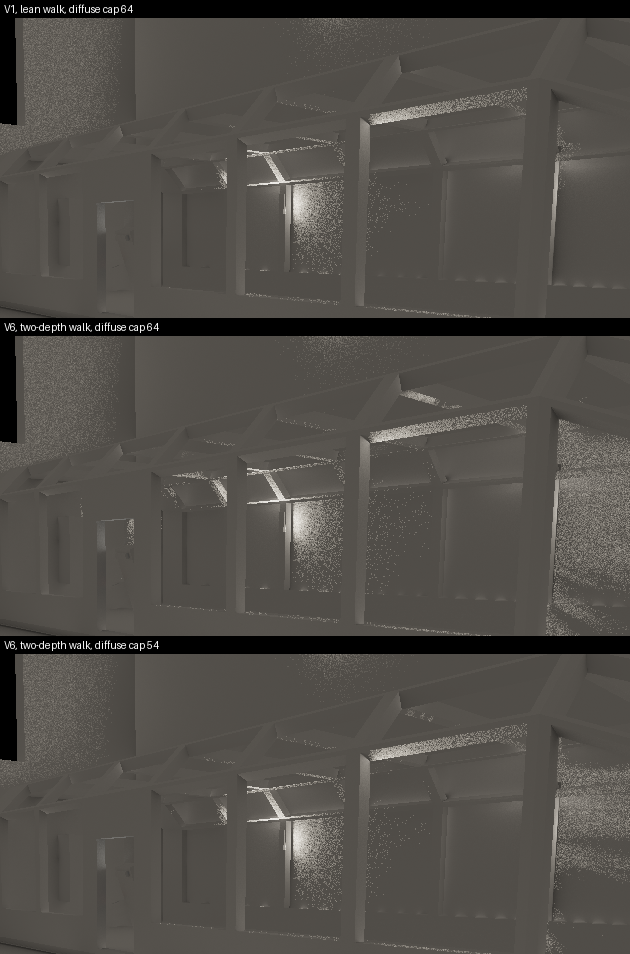
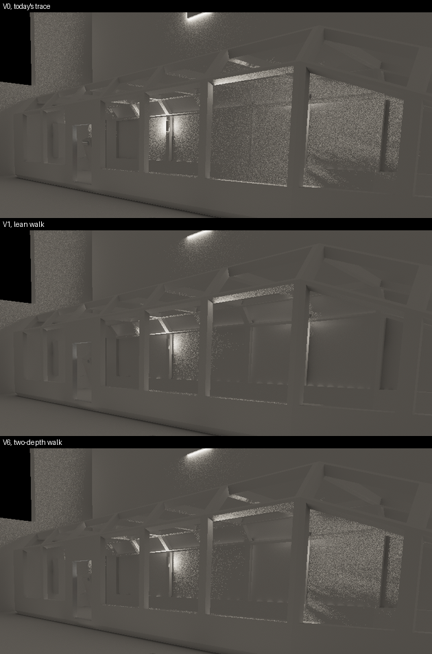
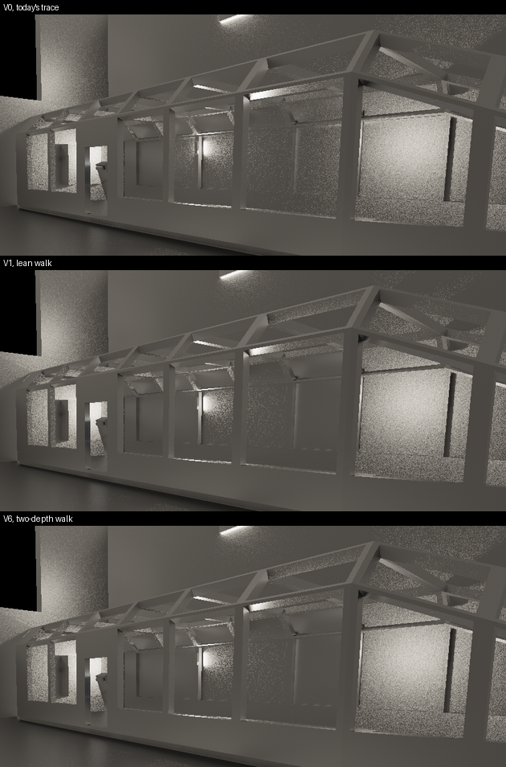

# Spike: where the trace's and FSR's GPU time goes, and the two-depth walk (ter-sftw)

V6, the two-depth walk, is the fastest walk that keeps V1's images, also at the GPU's top clock of 1296 MHz, at which a game in a window runs. The continuation of 2026-11-04 timed V1 and V6 there, with the clock recorded beside every run ("V6 and V1 at the top clock"). With miss reads at 10 % own rays, V6 takes 3.93 ms on the deck and 3.50 ms on the floor, and V1 takes 4.57 ms and 4.42 ms. V6's reflection rays take 20 to 32 % less time than V1's. Its diffuse rays take 0.025 to 0.057 ms more, 2 to 4 %. The first run's larger diffuse differences of up to 0.56 ms came from runs at changing clock levels.

Time is the SIMD steps times the time per SIMD step. In the trace, V6's step costs 3 to 10 % more than V1's step, for both kinds of rays. V6 removes 24 to 37 % of the reflection rays' SIMD steps, and that saving outweighs the step's cost. It removes none of the diffuse rays' SIMD steps, because the diffuse cap of 64 steps sets the longest walk of 76 to 88 % of the subgroups, with V1 and with V6 alike ("Why V6's diffuse steps cost more"). In the minimal walk, the two-channel read and V6's extra tests cost 7 to 10 % of a step, and level 0 in a separate image costs 5 to 7 %. With a diffuse cap of 62 steps, V6's images are as good as V1's at 64 steps in both views, and its diffuse rays take V1's time, −0.5 to +1.2 %. A cap of 54 steps matches V1's tile bias on the deck only, and it saves 0.10 to 0.19 ms against V1. On the floor, it raises the diffuse tile bias from V1's +0.6 % to +1.4 % ("V6 at V1's image quality"). So the recommendation is one walk with V6 for both kinds, not the split walk ("Recommendation"). V6 still takes 3.0 to 4.9 times the 1.1 ms that the budget leaves for the two trace dispatches.

The first run's results follow the continuation's. Its times come from runs at a lower clock that the run did not record, and they read 1.3 to 1.4 times the continuation's.

The walk is the trace's time. Without its setup and its shading, the walk alone takes 93 to 109 % of the whole trace. The same minimal walk takes 2.88 ms in native Metal and 3.57 ms in GLSL through MoltenVK. Its GLSL reads the ray's record in a form that keeps the reads out of MoltenVK's loop. So MoltenVK costs 19 % of that walk. In the plain GLSL form, MoltenVK's code reads the record from memory at each step, and the walk takes 5.48 ms. On the frame of the dump, V1's walk takes about 0.85 ms more than the minimal walk through MoltenVK. That is our code's share, and its cause is not found. Even the native minimal walk takes 2.6 times the budget for V1's steps.

FSR's accumulate pass and the trace share no cause. FSR's accumulate is at the ALU limit with real float work, and ter-7m38 already measured and declined its 16-bit build. The direct accumulation waits on a cause that these counters do not show. The recommendation and the budget decision are at the end of this report.

## Terms

The terms of [lean-trace-spike.md](lean-trace-spike.md) hold here: V0 to V5c, block ray, own ray, walk, step cap, subgroup, lane share, converged image, tile bias and miss reads. The new terms:

- V6, the two-depth walk: V1's walk over a pyramid that holds two depths per cell, with V1's facing test and κ = 0.1.
- Two-depth pyramid: today's RG32F pyramid of `DepthPyramid`, read as the near w and the far w times the back share. A new finest image adds the center w of each pixel.
- Steps behind slabs: the steps at the finest level whose ray passes behind the slab of the cell.
- Skipped cell: a cell above the finest level that V6 crosses in one step, because the ray passes behind every slab in it.
- Split mode: the trace in three passes per kind, the ray setup, the walk and the shading, with the ray's state in a buffer between them.
- Ray setup: the work before the walk. It picks the ray, draws its direction and makes its walk.
- Shading: the work after the walk. It reads the hit's light or the miss's environment map and writes the images.
- Record: the 96 bytes of a ray's walk that the split mode keeps per slot between its passes.
- Words form: a read of the record as six `uvec4` words, with each float field through `uintBitsToFloat`.
- SOL walk (speed-of-light walk): a minimal V1 walk over a frame's dumped records and pyramid, with no setup and no shading.
- Hand MSL: the SOL walk written by hand in Metal's shading language.
- MoltenVK's MSL: the Metal code that MoltenVK makes from the SPIR-V of a GLSL shader.
- Record-once MSL: MoltenVK's MSL of the SOL walk, edited by hand to read the record once before the loop.
- Batched form: a SOL timing of command buffers that hold 20 rounds of the four dispatches each.
- Clock level: one of the speeds at which the GPU runs. The same work takes a different time at each level.
- Clock probe: the pass "depth pyramid finest", whose fixed work shows the clock level of a timed run.
- Occupancy: the counter "Compute Occupancy", the share of a core's thread slots that hold threads.
- Threads per threadgroup: the most threads that the Metal compiler allows in a threadgroup of the kernel. If the kernel needs many registers, it falls below 1024.
- Lane slot: one lane for one step of its subgroup. A subgroup of 32 lanes runs 32 lane slots per step of its longest walk.
- SIMD step: one step of a subgroup, which is 32 lane slots.
- Top clock: the GPU's highest state, 1296 MHz. A game in a window runs at it when the GPU limits the frame rate ([gpu-calibration.md](gpu-calibration.md), "The clock of a window run").
- Repeated trace: the trace of each kind run 20 times inside its pass, one repeat after the other (`--trace-spike-repeat 20`). It keeps the GPU busy, so the GPU stays at the top clock. One trace's time is the pass's time divided by 20.
- Span clock: the mean clock over the GPU's active time in `gpu-clock`'s samples between the lines `timed-start` and `timed-end`, as main's `tools/gpu-calibration/analyze.py` takes it.
- Kept run: a timed run whose sum of both kinds lies within 2 % of the fastest run of its setting, or a round of a SOL form within 2 % of its fastest round (`tools/sftw/kept.py` (on the branch ter-sftw-profiling-spike)). The other runs shared the GPU with another process.
- Subgroup at the cap: a subgroup whose longest walk ends at the kind's cap.
- SOL form: one of four forms of the SOL walk that differ in one part of the step: v1, v1-two-channel, v6 and v6-one-image ("Why V6's diffuse steps cost more").

## Result

### V6 and V1 at the top clock

These times come from the repeated trace: each kind's trace runs 20 times in its pass, so the GPU stays busy, as in a game whose GPU limits the frame rate. Each run films 60 frames, headless at 1280 × 720, with miss reads, and `gpu-clock` samples the clock every 100 ms beside it. One trace's time is the median over the frames of the pass's time, divided by 20. Each setting ran 8 times in 8 rounds, under the GPU lock, in the order of the table in odd rounds and in the reverse order in even rounds, so V1 and V6 alternate. The table gives the median of the kept runs, with their range in brackets. The last two columns give the span clock of the kept runs with its range, and their median clock without the first 0.3 s of each span, when the clock still climbs.

| View | Own rays | Variant | Reflection (ms) | Diffuse (ms) | Sum (ms) | Runs kept of 8 | Span clock (MHz) | Clock after 0.3 s (MHz) |
|---|---|---|---|---|---|---:|---|---:|
| Deck | 10 % | V1 | 3.388 [3.382, 3.392] | 1.183 [1.181, 1.186] | 4.571 [4.563, 4.577] | 4 | 1290 [1290, 1291] | 1296 |
| Deck | 10 % | V6 | 2.700 [2.695, 2.702] | 1.225 [1.225, 1.226] | 3.925 [3.920, 3.928] | 5 | 1290 [1286, 1291] | 1296 |
| Deck | 10 % | V6, diffuse cap 54 | 2.700 [2.696, 2.704] | 1.080 [1.078, 1.082] | 3.779 [3.775, 3.786] | 6 | 1289 [1289, 1290] | 1295 |
| Deck | 25 % | V1 | 4.749 [4.739, 4.758] | 1.632 [1.630, 1.636] | 6.381 [6.369, 6.392] | 6 | 1292 [1292, 1293] | 1296 |
| Deck | 25 % | V6 | 3.694 [3.685, 3.719] | 1.689 [1.686, 1.708] | 5.384 [5.372, 5.409] | 6 | 1291 [1289, 1292] | 1296 |
| Deck | 25 % | V6, diffuse cap 54 | 3.694 [3.689, 3.699] | 1.479 [1.478, 1.481] | 5.173 [5.169, 5.180] | 5 | 1292 [1291, 1292] | 1295 |
| Floor | 10 % | V1 | 3.093 [3.087, 3.158] | 1.323 [1.320, 1.326] | 4.415 [4.409, 4.484] | 7 | 1290 [1289, 1292] | 1296 |
| Floor | 10 % | V6 | 2.150 [2.142, 2.166] | 1.348 [1.345, 1.353] | 3.498 [3.487, 3.519] | 7 | 1289 [1288, 1291] | 1296 |
| Floor | 10 % | V6, diffuse cap 54 | 2.150 [2.142, 2.164] | 1.196 [1.192, 1.198] | 3.346 [3.335, 3.361] | 7 | 1289 [1285, 1291] | 1296 |
| Floor | 25 % | V1 | 4.267 [4.259, 4.274] | 1.828 [1.823, 1.831] | 6.098 [6.084, 6.103] | 7 | 1292 [1291, 1293] | 1296 |
| Floor | 25 % | V6 | 2.902 [2.894, 2.936] | 1.865 [1.862, 1.893] | 4.767 [4.759, 4.830] | 5 | 1291 [1290, 1292] | 1296 |
| Floor | 25 % | V6, diffuse cap 54 | 2.897 [2.890, 2.899] | 1.642 [1.637, 1.645] | 4.538 [4.529, 4.542] | 6 | 1290 [1286, 1290] | 1296 |

The runs left out took 4 to 74 % longer than the kept runs, at the same clock. Their logs list test hosts of other sessions, which render on the GPU without the GPU lock. The median of all 8 runs differs from the median of the kept runs by at most 0.04 ms, except for V1 on the deck at 10 %: 4.93 ms against 4.57 ms, where 4 of its 8 runs shared the GPU. `tools/sftw/top-table.py` (on the branch ter-sftw-profiling-spike) prints both medians.

What the times show:

- V6's reflection rays take 0.69 to 1.37 ms less than V1's: 20 % and 22 % less on the deck, 30 % and 32 % less on the floor.
- V6's diffuse rays take more than V1's in all four settings: 0.042 ms (3.6 %) and 0.057 ms (3.5 %) on the deck, 0.025 ms (1.9 %) and 0.037 ms (2.0 %) on the floor. The ranges of V1's and V6's kept runs do not overlap in any of the four settings, so these differences are real, and small.
- V6's sum of both kinds is 14 to 22 % below V1's, in every setting.
- V6 with the diffuse cap of 54 takes 0.10 to 0.19 ms less than V1 for the diffuse rays, 9 to 10 %. Its reflection rays take V6's time, because the reflection cap stays at 256. At this cap, V6's diffuse images match V1's on the deck only ("V6 at V1's image quality").

The first run's 120-frame times read 1.28 to 1.41 times these for V1 and V6 at 10 % own rays: for example 4.41 against 3.39 ms for V1's reflection rays on the deck, and 1.87 against 1.35 ms for V6's diffuse rays on the floor. Its 25 % deck runs gave V6's diffuse rays 0.31 to 0.56 ms more than V1's, at the first run's noise limit of 0.5 ms. At the top clock, the difference is 0.057 ms.

The batch of the fix stage ("V6 at V1's image quality") also timed V5c, the vote exit, at the top clock, with miss reads. Each cell gives the median of the kept runs with their range, and the kept runs of 8. The median span clock was 1285 to 1288 MHz, and 1295 to 1296 MHz after 0.3 s.

| View | Own rays | Reflection (ms) | Diffuse (ms) | Sum (ms) | Runs kept of 8 |
|---|---|---|---|---|---:|
| Deck | 10 % | 1.288 [1.286, 1.308] | 0.782 [0.780, 0.791] | 2.069 [2.066, 2.099] | 8 |
| Deck | 25 % | 1.780 [1.778, 1.786] | 1.094 [1.093, 1.100] | 2.874 [2.871, 2.884] | 7 |
| Floor | 10 % | 1.290 [1.287, 1.292] | 0.948 [0.944, 0.950] | 2.238 [2.234, 2.242] | 7 |
| Floor | 25 % | 1.779 [1.776, 1.783] | 1.322 [1.317, 1.337] | 3.103 [3.093, 3.119] | 8 |

The first run's sums of V5c at 10 % own rays, 2.68 to 3.19 ms, read 1.30 to 1.45 times these.

### Why V6's diffuse steps cost more

A walk's time is its SIMD steps times the time per SIMD step. A subgroup runs as many steps as its longest walk, so the SIMD steps of a dispatch are the sum over its subgroups of their longest walk. The count mode gives the SIMD steps per frame over the same 60 frames as the timed runs ("longest steps"). The table divides the time of one trace by them.

| View | Own rays | Variant | Kind | SIMD steps per frame | ns per SIMD step | Steps per walk | Capped walks |
|---|---|---|---|---:|---:|---:|---:|
| Deck | 10 % | V1 | Reflection | 1,491,037 | 2.27 | 45.8 | 12,886 |
| Deck | 10 % | V6 | Reflection | 1,134,417 | 2.38 | 34.7 | 1,613 |
| Deck | 10 % | V1 | Diffuse | 570,164 | 2.07 | 25.3 | 50,837 |
| Deck | 10 % | V6 | Diffuse | 573,188 | 2.14 | 24.9 | 39,295 |
| Deck | 10 % | V6, cap 54 | Diffuse | 497,222 | 2.17 | 23.5 | 46,344 |
| Deck | 25 % | V1 | Reflection | 2,203,287 | 2.16 | 45.8 | 18,420 |
| Deck | 25 % | V6 | Reflection | 1,666,531 | 2.22 | 34.7 | 2,308 |
| Deck | 25 % | V1 | Diffuse | 816,764 | 2.00 | 25.3 | 72,613 |
| Deck | 25 % | V6 | Diffuse | 820,530 | 2.06 | 24.9 | 56,133 |
| Deck | 25 % | V6, cap 54 | Diffuse | 710,782 | 2.08 | 23.5 | 66,200 |
| Floor | 10 % | V1 | Reflection | 1,385,804 | 2.23 | 38.7 | 4,794 |
| Floor | 10 % | V6 | Reflection | 875,288 | 2.46 | 31.3 | 332 |
| Floor | 10 % | V1 | Diffuse | 620,033 | 2.13 | 29.2 | 46,029 |
| Floor | 10 % | V6 | Diffuse | 616,004 | 2.19 | 28.1 | 25,281 |
| Floor | 10 % | V6, cap 54 | Diffuse | 531,563 | 2.25 | 27.1 | 36,845 |
| Floor | 25 % | V1 | Reflection | 2,023,230 | 2.11 | 38.7 | 6,842 |
| Floor | 25 % | V6 | Reflection | 1,275,758 | 2.27 | 31.3 | 473 |
| Floor | 25 % | V1 | Diffuse | 890,904 | 2.05 | 29.2 | 65,719 |
| Floor | 25 % | V6 | Diffuse | 885,660 | 2.11 | 28.1 | 36,087 |
| Floor | 25 % | V6, cap 54 | Diffuse | 762,574 | 2.15 | 27.1 | 52,601 |

The steps and walks are means per frame over the 61 frames of the count run: the 60 filmed frames and the frame of its one converged draw. The count mode's lane slots are not used, because their 32-bit sum over the frames wraps for V1's reflection rays on the deck at 25 %. 32 times the SIMD steps gives the lane slots.

The two kinds pay about the same for V6's step and differ in the steps that V6 saves:

| View | Own rays | Kind | V6's SIMD steps against V1's | V6's ns per SIMD step against V1's | V6's time against V1's |
|---|---|---|---:|---:|---:|
| Deck | 10 % | Reflection | −23.9 % | +4.8 % | −20.3 % |
| Deck | 10 % | Diffuse | +0.5 % | +3.4 % | +3.6 % |
| Deck | 25 % | Reflection | −24.4 % | +2.8 % | −22.2 % |
| Deck | 25 % | Diffuse | +0.5 % | +3.0 % | +3.5 % |
| Floor | 10 % | Reflection | −36.8 % | +10.3 % | −30.5 % |
| Floor | 10 % | Diffuse | −0.6 % | +2.8 % | +1.9 % |
| Floor | 25 % | Reflection | −36.9 % | +7.6 % | −32.0 % |
| Floor | 25 % | Diffuse | −0.6 % | +2.9 % | +2.0 % |

The diffuse rays save no SIMD steps because of their cap. The SOL walk counts the subgroups at the cap on the dumped frame of each setting (the table of the SOL forms' times in "The two causes, each alone"). With the cap of 64 diffuse steps, 76 to 88 % of the diffuse subgroups hold a walk that ends at the cap, with V1 and with V6: 76.1 % and 76.2 % on the deck at 10 %. Such a subgroup runs 64 steps however short V6 makes its other walks. V6 ends fewer diffuse walks at the cap, 39,295 against 50,837 on the deck, but most subgroups at the cap keep at least one. The share of the diffuse subgroups at the cap stays the same on the deck, and it falls from 85.9 % to 79.1 % and from 87.7 % to 81.4 % on the floor. The reflection cap of 256 binds 20 to 35 % of V1's reflection subgroups and 3 to 11 % of V6's. So V6's shorter walks shorten the reflection subgroups, and they save 24 to 37 % of the SIMD steps.

So the explanation that the counts and times support: V6's step costs 3 to 10 % more than V1's in the trace, in both kinds. The reflection rays save more steps than that, and the diffuse rays save none under their cap. With the diffuse cap of 54, V6 saves 13 to 14 % of V1's diffuse SIMD steps, and its diffuse rays become faster than V1's.

#### The two causes, each alone

The SOL walk tests the two candidate causes of the dearer step, each alone, on the frames that `tools/sftw/dump-batch.sh` (on the branch ter-sftw-profiling-spike) dumped from V1's split runs: the deck and the floor, at 10 % and 25 % own rays. Each dump holds the records, the nearest pyramid, V6's depth pyramid and its finest level of the same frame. Each SOL form reads the record in the words form:

| Form | Walk | Images | What it isolates |
|---|---|---|---|
| v1 | V1's walk | The nearest pyramid, R32F | The reference |
| v1-two-channel | V1's walk and steps, plus V6's extra tests: the screen's far edges and whether the ray passes behind the cell's slab, whose count goes into the outcome | An RG32F copy of the nearest pyramid | Cause (a): the two-channel read and the extra tests |
| v6 | V6's walk, as `twoDepthStep` | Level 0 from the R32F finest level, levels 1 and up from mip `level − 1` of the RG32F depth pyramid | The trace's V6 |
| v6-one-image | V6's walk and steps | One RG32F image whose mip m holds level m, level 0 as (w, w) | Cause (b): level 0 in a separate image |

`tools/sftw/sol-forms.py (on the branch ter-sftw-profiling-spike) check` compared each form's outcomes with the walk pass of the trace's split mode. v1 and v1-two-channel found the hits of V1's split walk, and v6 and v6-one-image those of V6's split walk, on every ray of the 8 dispatches, at a largest hit distance of 0.0000 pixels. v1-two-channel took v1's steps on every ray, and v6-one-image took v6's. So each pair does the same work, and a difference of their times is the cost of the one part in which they differ.

The SOL forms ran in the batched form, per kind: 30 command buffers of 20 rounds each, after 5 s of warm-up, beside `gpu-clock`. Each of the 32 runs repeated in 5 rounds under the GPU lock, in reverse order in even rounds. A round is kept by the rule of the top-clock runs: its time lies within 2 % of the fastest round of its run (`tools/sftw/kept.py` (on the branch ter-sftw-profiling-spike)). Each cell gives the median of one round over the kept rounds, their range in brackets, and the number of kept rounds of 5 in parentheses. The 30 rounds left out of 160 took 3 to 86 % longer.

| View | Kind | v1 (ms) | v1-two-channel (ms) | v6 (ms) | v6-one-image (ms) | SIMD steps, v1 / v6 | Subgroups at the cap, v1 / v6 |
|---|---|---|---|---|---|---:|---:|
| Deck, 10 % | Reflection | 2.463 [2.455, 2.492] (4) | 2.641 [2.635, 2.644] (4) | 2.304 [2.298, 2.312] (5) | 2.149 [2.144, 2.151] (4) | 1,500,347 / 1,136,796 | 33.7 % / 10.8 % |
| Deck, 10 % | Diffuse | 0.969 [0.965, 0.971] (3) | 1.066 [1.065, 1.067] (5) | 1.187 [1.182, 1.200] (5) | 1.133 [1.128, 1.133] (4) | 569,787 / 572,690 | 76.1 % / 76.2 % |
| Deck, 25 % | Reflection | 3.497 [3.496, 3.499] (2) | 3.759 [3.753, 3.772] (3) | 3.227 [3.218, 3.248] (3) | 3.020 [3.019, 3.020] (3) | 2,208,728 / 1,669,042 | 34.9 % / 11.0 % |
| Deck, 25 % | Diffuse | 1.340 [1.339, 1.349] (3) | 1.478 [1.476, 1.492] (3) | 1.646 [1.643, 1.658] (4) | 1.570 [1.567, 1.572] (4) | 816,813 / 820,321 | 77.8 % / 77.6 % |
| Floor, 10 % | Reflection | 2.100 [2.093, 2.101] (4) | 2.237 [2.234, 2.276] (4) | 1.842 [1.841, 1.852] (5) | 1.728 [1.724, 1.729] (3) | 1,304,815 / 890,106 | 20.1 % / 3.0 % |
| Floor, 10 % | Diffuse | 1.066 [1.065, 1.067] (4) | 1.153 [1.148, 1.170] (5) | 1.268 [1.267, 1.276] (5) | 1.203 [1.200, 1.204] (4) | 617,985 / 614,694 | 85.9 % / 79.1 % |
| Floor, 25 % | Reflection | 2.931 [2.923, 2.932] (4) | 3.139 [3.133, 3.146] (5) | 2.549 [2.546, 2.556] (5) | 2.408 [2.388, 2.434] (4) | 1,913,249 / 1,302,148 | 21.3 % / 3.2 % |
| Floor, 25 % | Diffuse | 1.453 [1.449, 1.454] (4) | 1.588 [1.584, 1.590] (5) | 1.764 [1.762, 1.770] (5) | 1.669 [1.667, 1.676] (5) | 889,537 / 885,195 | 87.7 % / 81.4 % |

The clock of the same kept rounds, in MHz: the median span clock with its range, then the median without each span's first sample. That first sample holds the end of the warm-up, which submits each dispatch alone. Without it, the median clock was 1285 to 1296 MHz in every cell.

| View | Kind | v1 (MHz) | v1-two-channel (MHz) | v6 (MHz) | v6-one-image (MHz) |
|---|---|---|---|---|---|
| Deck, 10 % | Reflection | 1295 [1289, 1296]; 1296 | 1276 [1263, 1279]; 1296 | 1278 [1260, 1292]; 1296 | 1275 [1252, 1296]; 1296 |
| Deck, 10 % | Diffuse | 1237 [1235, 1244]; 1296 | 1208 [1187, 1229]; 1296 | 1226 [1198, 1254]; 1291 | 1238 [1210, 1269]; 1292 |
| Deck, 25 % | Reflection | 1294 [1291, 1296]; 1296 | 1287 [1283, 1296]; 1296 | 1269 [1269, 1289]; 1296 | 1282 [1277, 1294]; 1296 |
| Deck, 25 % | Diffuse | 1232 [1208, 1279]; 1285 | 1258 [1235, 1274]; 1296 | 1259 [1237, 1284]; 1295 | 1246 [1245, 1270]; 1296 |
| Floor, 10 % | Reflection | 1271 [1264, 1292]; 1296 | 1262 [1261, 1270]; 1291 | 1270 [1241, 1275]; 1295 | 1262 [1223, 1286]; 1296 |
| Floor, 10 % | Diffuse | 1217 [1209, 1232]; 1296 | 1233 [1220, 1257]; 1296 | 1280 [1210, 1292]; 1295 | 1220 [1211, 1246]; 1296 |
| Floor, 25 % | Reflection | 1287 [1268, 1296]; 1296 | 1290 [1283, 1294]; 1296 | 1283 [1254, 1295]; 1292 | 1274 [1258, 1296]; 1296 |
| Floor, 25 % | Diffuse | 1267 [1229, 1278]; 1296 | 1232 [1227, 1278]; 1291 | 1274 [1242, 1276]; 1295 | 1240 [1224, 1266]; 1294 |

The same times per SIMD step, in ns:

| View | Kind | v1 | v1-two-channel | v6 | v6-one-image | Cause (a) | Cause (b) | The rest of V6's step |
|---|---|---:|---:|---:|---:|---:|---:|---:|
| Deck, 10 % | Reflection | 1.64 | 1.76 | 2.03 | 1.89 | +0.12 (+7 %) | +0.14 (+7 %) | +0.13 |
| Deck, 10 % | Diffuse | 1.70 | 1.87 | 2.07 | 1.98 | +0.17 (+10 %) | +0.09 (+5 %) | +0.11 |
| Deck, 25 % | Reflection | 1.58 | 1.70 | 1.93 | 1.81 | +0.12 (+7 %) | +0.12 (+6 %) | +0.11 |
| Deck, 25 % | Diffuse | 1.64 | 1.81 | 2.01 | 1.91 | +0.17 (+10 %) | +0.09 (+5 %) | +0.10 |
| Floor, 10 % | Reflection | 1.61 | 1.71 | 2.07 | 1.94 | +0.10 (+7 %) | +0.13 (+6 %) | +0.23 |
| Floor, 10 % | Diffuse | 1.72 | 1.87 | 2.06 | 1.96 | +0.14 (+8 %) | +0.11 (+5 %) | +0.09 |
| Floor, 25 % | Reflection | 1.53 | 1.64 | 1.96 | 1.85 | +0.11 (+7 %) | +0.11 (+6 %) | +0.21 |
| Floor, 25 % | Diffuse | 1.63 | 1.79 | 1.99 | 1.89 | +0.15 (+9 %) | +0.11 (+5 %) | +0.10 |


Cause (a) is v1-two-channel minus v1, as a share of v1. Cause (b) is v6 minus v6-one-image, as a share of v6. The rest is v6-one-image minus v1-two-channel: the part of V6's step that neither cause covers, such as its other control flow and the levels that its lanes read. These two forms take different steps, so only their times per SIMD step compare.

What the SOL forms show:

- Cause (a) costs 7 to 10 % of a V1 step: 0.10 to 0.17 ns per SIMD step. It costs the diffuse rays more than the reflection rays in all four settings. Its count of steps behind a slab adds one select and one add per step, which V6's own step does not make, so this cost is an upper bound.
- Cause (b) costs 5 to 7 % of a V6 step: 0.09 to 0.14 ns per SIMD step. One RG32F image saves V6's reflection rays 0.11 to 0.21 ms and its diffuse rays 0.05 to 0.10 ms in the SOL walk.
- The rest of V6's step costs 0.09 to 0.23 ns per SIMD step. The spike did not split it further.
- In the SOL walk, V6's step costs 20 to 29 % more than V1's, and V6's diffuse rays take 19 to 23 % more than V1's. In the trace, V6's step costs 3 to 10 % more. The trace's V1 step costs 0.36 to 0.63 ns more than the SOL walk's v1, and the trace's V6 step 0.05 to 0.39 ns more than the SOL walk's v6. The trace's figures come from its 60 timed frames, and the SOL walk's from the dumped frame of the same view. So the trace's own code adds more per step to V1 than to V6, and the shares of the two causes in the trace are smaller than in the SOL walk. One difference in that code: V1's `leanStep` updates the finest level of V4 in every step, and `twoDepthStep` does not. The spike did not test whether that difference is the cause.

### V6 at V1's image quality

V6 caps fewer diffuse walks than V1, so its images lose fewer hits at the same cap. This section looks for the diffuse cap at which V6's images have V1's tile bias at 64 steps, with the tile bias of the first run: the mean signed difference of the 16 × 16 tiles' luminance from V0, after 1024 draws, as a share of V0's mean tile luminance (`tools/trace-spike/bias.py` (on the branch ter-sftw-profiling-spike)). The converge runs of `tools/sftw/cap-batch.sh` ran V6 at 10 % own rays with the reflection cap of 256 and the diffuse caps below. V0 and V1 are the first run's runs. V6 at 64 steps ran again, and its images equal the first run's V6 to 0.000 in the tile bias. The fix stage of the continuation added the caps 58, 60 and 62.

| Diffuse cap | Deck, diffuse | Floor, diffuse |
|---|---:|---:|
| V1 at 64 | −9.5 % (9.9 %) | +0.6 % (0.6 %) |
| V6 at 64 | −7.1 % (7.3 %) | +0.7 % (0.7 %) |
| V6 at 62 | −7.5 % (7.7 %) | +0.8 % (0.8 %) |
| V6 at 60 | −8.0 % (8.2 %) | +0.9 % (0.9 %) |
| V6 at 58 | −8.4 % (8.6 %) | +1.0 % (1.1 %) |
| V6 at 56 | −8.9 % (9.1 %) | +1.2 % (1.2 %) |
| V6 at 54 | −9.5 % (9.6 %) | +1.4 % (1.5 %) |
| V6 at 52 | −10.0 % (10.2 %) | +1.6 % (1.7 %) |
| V6 at 48 | −11.2 % (11.4 %) | +2.2 % (2.4 %) |
| V6 at 40 | −13.5 % (13.8 %) | +4.2 % (4.6 %) |
| V6 at 32 | −15.2 % (15.7 %) | +7.1 % (7.8 %) |
| V6 at 24 | −16.3 % (17.4 %) | +10.3 % (11.6 %) |

Each cell gives the signed tile bias and, in brackets, the mean absolute tile difference. The reflection images do not change with the diffuse cap: −6.2 % on the deck and +1.6 % on the floor at every cap.

The two views set different caps:

- On the deck, V6 at 54 steps has V1's tile bias at 64 steps, −9.5 %. Directly against V1, its tile bias is +0.1 % (1.7 %).
- On the floor, every cap below 64 moves V6 away from V0, and away from V1. Directly against V1, V6's tile bias is +0.1 % (0.2 %) at 64, +0.2 % (0.3 %) at 62, +0.3 % (0.4 %) at 60, +0.5 % (0.6 %) at 58 and +0.8 % (0.9 %) at 54. The floor's noise, between two runs of V0, is ±0.2 % in the diffuse rays ("V6, the two-depth walk"). So at 54 steps the floor's diffuse tile bias is 2.3 times V1's, and the difference from V1 is 4 times the noise.
- The lowest cap at which V6 is as good as V1 in both views, within the floor's noise, is 62 steps. There, the deck's tile bias is −7.5 %, better than V1's −9.5 %.

The fix stage timed V6 at 62 steps at the top clock, beside V1, V6 at 64 and V5c, in 8 more alternating rounds of `tools/sftw/top-batch.sh` (on the branch ter-sftw-profiling-spike) under the GPU lock (`captures/sftw/top/review-table.md`). Each cell gives the diffuse rays' time of one trace, the median of the kept runs with their range, and the kept runs of 8. The median span clock of the kept runs was 1285 to 1292 MHz in every setting, and their median clock after 0.3 s 1295 to 1296 MHz.

| View | Own rays | V1 at 64 (ms) | V6 at 64 (ms) | V6 at 62 (ms) | V6 at 62 against V1 |
|---|---|---|---|---|---:|
| Deck | 10 % | 1.185 [1.182, 1.203] (7) | 1.226 [1.224, 1.228] (6 of 7) | 1.199 [1.196, 1.215] (6) | +0.014 ms (+1.2 %) |
| Deck | 25 % | 1.632 [1.630, 1.635] (6) | 1.687 [1.686, 1.709] (7) | 1.647 [1.645, 1.651] (6) | +0.015 ms (+0.9 %) |
| Floor | 10 % | 1.326 [1.319, 1.347] (7) | 1.348 [1.346, 1.353] (7) | 1.319 [1.317, 1.325] (8) | −0.007 ms (−0.5 %) |
| Floor | 25 % | 1.827 [1.821, 1.831] (8) | 1.864 [1.860, 1.868] (8) | 1.822 [1.818, 1.829] (8) | −0.005 ms (−0.3 %) |

One run, V6 on the deck at 10 % in round 6, is left out before the kept rule. Its pass stamps moved: its "depth pyramid" reads 0.096 ms against 0.28 ms in the other rounds, and its "trace spike pyramid" 0.24 ms against 0.016 ms. Its reflection time read 4 % below every other run, so the kept rule took it as the fastest run and kept only it. `tools/sftw/top-table.py` (on the branch ter-sftw-profiling-spike) takes such a run as an argument and prints it below the table. The kept ranges of the first batch lie within 0.1 to 2 %, so no such run set a reference there. This batch's V1 and V6 at 64 steps agree with the first batch's to 0.02 ms in every sum.

At 62 steps, V6's diffuse rays take V1's time: the ranges overlap on the deck at 10 % and on the floor at 10 % and 25 %, and the differences lie within 0.015 ms. They are 0.027 to 0.042 ms faster than V6 at 64 steps.

At 54 steps, V6's diffuse rays take 1.080 ms on the deck at 10 % own rays, against V1's 1.183 ms and V6's 1.225 ms at 64 steps ("V6 and V1 at the top clock"). At equal image quality on the deck, V6's diffuse rays are 9 % faster than V1's, at 10 % and at 25 % own rays: 0.103 and 0.153 ms. The SIMD steps fall by 13 to 14 % against V1's, and the time per SIMD step stays V6's. On the floor, the same cap saves 0.127 and 0.186 ms against V1, but at the higher diffuse tile bias of +1.4 %.



The cabin on the deck in the diffuse light, V1 at 64 steps above, then V6 at 64 steps, then V6 at 54 steps. The crop is 630 × 300 pixels of the frame at full resolution. V6 at 64 steps brings back light inside the cabin and on its far wall, which V1's cap cuts off. V6 at 54 steps loses most of it again and looks close to V1. Each image is the running mean of 1024 draws, mapped as in the first run's images.

### V6, the two-depth walk

The times are the busy medians over 120 frames of each kind's trace dispatch, in ms. They have miss reads and read as round 1 / round 2. The hit share is the share of the rays that start and hit. FLIP and the tile bias compare the converged image after 1024 draws with V0's. A pair a / b gives the reflection rays and the diffuse rays.

Deck view, own rays for 10 % of the pixels:

| Variant | Reflection (ms) | Diffuse (ms) | Sum (ms) | Hit share | FLIP against V0 | Tile bias against V0 |
|---|---:|---:|---:|---|---|---|
| V0, today's trace | 6.23 / 6.23 | 3.10 / 3.09 | 9.33 / 9.32 | 49.4 % / 22.8 % | 0.044 / 0.044 (noise) | ±1.6 % / ±1.4 % (noise) |
| V1, lean walk | 4.41 / 4.43 | 1.52 / 1.53 | 5.93 / 5.96 | 46.9 % / 20.1 % | 0.034 / 0.049 | −6.5 % / −9.5 % |
| V5c, vote exit | 1.68 / 1.82 | 1.00 / 1.20 | 2.68 / 3.01 | 38.8 % / 16.4 % | 0.079 / 0.075 | −20.4 % / −11.6 % |
| V6, two-depth walk | 3.51 / 3.54 | 1.58 / 1.58 | 5.09 / 5.12 | 47.6 % / 20.4 % | 0.032 / 0.038 | −6.2 % / −7.1 % |

Floor view, own rays for 10 % of the pixels:

| Variant | Reflection (ms) | Diffuse (ms) | Sum (ms) | Hit share | FLIP against V0 | Tile bias against V0 |
|---|---:|---:|---:|---|---|---|
| V0, today's trace | 5.59 / 5.59 | 3.66 / 3.64 | 9.25 / 9.24 | 55.4 % / 32.2 % | 0.025 / 0.015 (noise) | ±0.7 % / ±0.2 % (noise) |
| V1, lean walk | 4.18 / 4.19 | 1.73 / 1.73 | 5.91 / 5.92 | 55.0 % / 31.4 % | 0.023 / 0.013 | +1.7 % / +0.6 % |
| V5c, vote exit | 1.92 / 1.78 | 1.27 / 1.26 | 3.19 / 3.03 | 48.1 % / 24.8 % | 0.071 / 0.048 | +7.8 % / +4.2 % |
| V6, two-depth walk | 3.03 / 2.91 | 1.87 / 1.82 | 4.90 / 4.73 | 55.1 % / 31.0 % | 0.022 / 0.014 | +1.6 % / +0.7 % |

Own rays for 25 % of the pixels, with miss reads:

| View | Variant | Reflection (ms) | Diffuse (ms) | Sum (ms) |
|---|---|---:|---:|---:|
| Deck | V1 | 5.04 / 5.48 | 1.62 / 1.88 | 6.66 / 7.36 |
| Deck | V6 | 4.54 / 4.42 | 2.18 / 2.19 | 6.72 / 6.60 |
| Floor | V1 | 5.19 / 5.07 | 2.27 / 2.32 | 7.46 / 7.39 |
| Floor | V6 | 3.68 / 3.72 | 2.43 / 2.43 | 6.11 / 6.15 |

The V0 row's FLIP and tile bias compare V0 with a second run of V0 with other random numbers, as in the lean trace spike. The values of V0, V1 and V5c in these tables come from new runs. Their tile biases and hit shares equal the lean trace spike's to the digits shown. The converge mode gives every pixel one sample per draw at any own-ray share. So the converged images of the 25 % runs equal those of the 10 % runs, and their FLIP and tile bias are the same.

V6 against V1 directly, after 1024 draws: FLIP 0.005 / 0.018 on the deck and 0.002 / 0.006 on the floor. The tile bias is +0.3 % / +2.4 % on the deck and −0.1 % / +0.1 % on the floor.

What the times show:

- At 10 % own rays, V6's sum of both kinds is 14 to 20 % below V1's. Its reflection rays are 20 to 31 % faster.
- At 25 % own rays on the floor, V6's sum is 17 to 18 % below V1's.
- At 25 % own rays on the deck, V6's sum is 6.72 / 6.60 ms against V1's 6.66 / 7.36 ms. So V6 gains nothing in round 1, and 0.76 ms in round 2.
- V6's diffuse rays are slower in every run. They take 0.05 to 0.14 ms more at 10 % own rays. At 25 %, they take 0.11 to 0.16 ms more on the floor and 0.31 to 0.56 ms more on the deck. The last difference reaches this report's noise limit of 0.5 ms.

The batch of the fix stage repeats V1, V5c and V6 at 10 % own rays from a later build ("The parts of the trace"). On the deck, its sums of both kinds are 5.92 / 5.96 ms for V1 and 5.16 / 5.11 ms for V6. On the floor, they are 5.91 / 5.89 ms and 4.61 / 4.65 ms. They agree with the tables above to 0.12 ms.

The count runs show what V6 changes. All the runs here use the design's caps of 256 reflection steps and 64 diffuse steps, except the rows "at 2,048 steps".

| View | Variant | Kind | Capped walks | Steps per walk | Steps behind slabs | Skipped cells | Lane share | Lost hits |
|---|---|---|---:|---:|---:|---:|---:|---:|
| Deck | V1 | Reflection | 12,717 | 45.8 | 43.0 % | 0 | 28.1 % | 3,239 |
| Deck | V1 | Diffuse | 50,997 | 25.4 | 23.1 % | 0 | 42.3 % | 20,196 |
| Deck | V6 | Reflection | 1,614 | 34.8 | 4.2 % | 7.8 % | 28.2 % | 1,087 |
| Deck | V6 | Diffuse | 39,423 | 24.9 | 2.4 % | 6.2 % | 41.3 % | 19,099 |
| Deck | V1 at 2,048 steps | Reflection | 0 | 60.9 | 56.3 % | 0 | 19.2 % | 0 |
| Deck | V1 at 2,048 steps | Diffuse | 0 | 64.0 | 62.1 % | 0 | 16.6 % | 0 |
| Deck | V6 at 2,048 steps | Reflection | 0 | 35.1 | 4.2 % | 7.8 % | 26.8 % | 0 |
| Deck | V6 at 2,048 steps | Diffuse | 0 | 33.1 | 5.2 % | 8.2 % | 23.2 % | 0 |
| Floor | V1 | Reflection | 3,366 | 33.6 | 20.5 % | 0 | 26.5 % | 493 |
| Floor | V1 | Diffuse | 37,295 | 26.7 | 16.6 % | 0 | 43.7 % | 8,932 |
| Floor | V6 | Reflection | 314 | 29.6 | 0.8 % | 2.7 % | 33.4 % | 145 |
| Floor | V6 | Diffuse | 24,345 | 25.7 | 1.3 % | 4.0 % | 42.3 % | 10,058 |
| Floor | V1 at 2,048 steps | Reflection | 0 | 35.1 | 23.6 % | 0 | 22.6 % | 0 |
| Floor | V1 at 2,048 steps | Diffuse | 0 | 38.6 | 38.0 % | 0 | 17.7 % | 0 |
| Floor | V6 at 2,048 steps | Reflection | 0 | 29.7 | 0.8 % | 2.7 % | 32.6 % | 0 |
| Floor | V6 at 2,048 steps | Diffuse | 0 | 28.6 | 3.1 % | 4.1 % | 25.1 % | 0 |

A lost hit is a capped walk that hits in the count mode's walk on to 4,096 steps. The subgroups hold 31.9 to 32.0 lanes on average in every run.

What the counts show:

- At 2,048 steps, V6 finds V1's hits. On the deck, both hit 145,611 reflection rays and 81,087 diffuse rays per frame. On the floor, the counts differ by one hit. The converged images of the two agree to 0.000 in the tile bias. So V6 changes only the steps, as the design intends.
- V6 crosses most of the cells behind slabs in one step. The share of steps behind slabs falls from 43 % / 23 % to 4.2 % / 2.4 % on the deck. A reflection walk on the deck takes 34.8 steps in place of 45.8.
- V6 caps fewer walks, so it loses fewer hits. That moves its images toward V0. The caps cost V6 −0.1 % / −9.4 % on the deck, against V1's −0.4 % / −11.8 %.
- The lanes still wait. V6's lane share is 28 % / 41 % on the deck, about V1's. V6 shortens the long walks and the short ones alike, so the ratio of a subgroup's longest walk to its mean walk stays.
- V6 saves nothing on the diffuse rays under the cap. The diffuse cap of 64 steps sets the longest walk of most subgroups. V6's diffuse lane slots on the deck are 18.31 million per frame, against V1's 18.21 million. So each V6 diffuse step costs more than a V1 step.
- The reflection rays gain because their cap of 256 steps binds less often. V6's reflection lane slots on the deck are 36.3 million per frame, against V1's 47.9 million.

Two parts of V6's step can make it cost more than V1's, and the first run did not measure either alone. First, a V6 step reads a two-channel texel and makes more tests. Second, the pyramid's level 0 lives in a second image. `twoDepthStep` reads level 0 from `DepthFinest` (R32F) and the levels above it from the RG32F pyramid, as mip `level − 1`. When the lanes of a subgroup are at different levels, the subgroup issues both fetches. One RG32F image whose mip 0 holds level 0 needs one fetch per step. But it changes the mips that V0's readers use. The continuation measured each part alone ("Why V6's diffuse steps cost more").



The cabin on the deck in the diffuse light, V0 above, then V1, then V6. V6 brings back part of the speckled light inside the cabin, which V1's diffuse cap cuts off. These are walks that reach the cabin's lit interior within 64 steps in V6 but not in V1. V6 has V1's facing test, so none of its hits face away from the ray. Outside the cabin, V1 and V6 look the same.



The cabin on the deck in the reflection light, V0, V1 and V6. V1 and V6 are almost the same: their tile bias differs by 0.3 %. Both are darker than V0 in the windows, as the lean trace spike found for V1.

Each image is the running mean of 1024 draws of the still view. For display, it maps x to x / (1 + x) with a gamma of 2.2. These are the light that the rays bring back, not the final frame.

### The record's reads

The first form of the split mode read its record as one struct, `RayRecord record = rayRecords.records[slot]`. glslang turns that load into one load per field before the walk's loop. SPIRV-Cross then writes each plain buffer load again at each use of its value. So MoltenVK's MSL of the walk read the record's fields from device memory at each step. In MoltenVK's dump of V1's four split kernels, 36 or 37 of the 48 or 49 accesses of the record sat inside a loop. The SOL walk's GLSL copies each field into a local before the loop, and its MSL still read the record 20 times inside the loop.

A bitcast is an operation of its own, and SPIRV-Cross keeps its result in a register. The words form reads the record through one: the buffer holds `uvec4 words[]`, and each float field comes from `uintBitsToFloat`. A value that comes straight from a buffer load must reach the loop only through another operation. An example is the record's `uvec4` state, which a comparison before the loop reads. The bytes of a record do not change.

With the words form, MoltenVK's dump of the four split kernels holds 19 or 20 accesses of the record each, and none inside a loop. No other device buffer has an access inside a loop in these kernels. In the first form's kernels too, the record was the only device buffer with accesses inside a loop. One MSL file serves every specialization of a kernel, and only the split walk reads the record. So the whole trace never read a device buffer inside its loop. MoltenVK's MSL of the SOL walk in the words form holds 7 accesses of the record, and none inside a loop. `tools/sol-walk/loop-reads.py` counts these accesses.

The SOL walk's batched times measure the cost of the reads in the loop. The walk in the plain form takes 5.48 ms through MoltenVK, and 3.57 ms in the words form. So the reads in the loop cost 1.91 ms, 35 % of the plain form's time. The record-once MSL and MoltenVK's MSL of the words form both take 3.40 ms on the native host. So the words form removes the whole cost that the hand edit of the MSL removes.

### The parts of the trace

The split mode traces each kind in three passes: the ray setup, the walk and the shading. Between them, the trace keeps each ray's record and its walk's outcome in buffers. Its walk reads the record in the words form. The table gives the busy medians in ms, as round 1 / round 2, with miss reads at 10 % own rays over 120 frames. "Whole" is the trace in one pass from the same batch. The batch ran from commit 8d7c812b1.

| View | Variant | Kind | Whole | Setup | Walk | Shading | Sum of the parts |
|---|---|---|---:|---:|---:|---:|---:|
| Deck | V1 | Reflection | 4.39 / 4.43 | 0.16 / 0.16 | 4.24 / 4.24 | 0.21 / 0.21 | 4.61 / 4.61 |
| Deck | V1 | Diffuse | 1.53 / 1.53 | 0.15 / 0.15 | 1.59 / 1.59 | 0.15 / 0.15 | 1.89 / 1.89 |
| Deck | V5c | Reflection | 1.71 / 1.78 | 0.20 / 0.17 | 1.80 / 1.64 | 0.23 / 0.20 | 2.23 / 2.00 |
| Deck | V5c | Diffuse | 1.00 / 1.15 | 0.17 / 0.15 | 1.01 / 0.92 | 0.17 / 0.14 | 1.36 / 1.22 |
| Deck | V6 | Reflection | 3.58 / 3.53 | 0.16 / 0.16 | 3.57 / 3.55 | 0.21 / 0.21 | 3.94 / 3.93 |
| Deck | V6 | Diffuse | 1.58 / 1.58 | 0.15 / 0.15 | 1.73 / 1.73 | 0.15 / 0.15 | 2.03 / 2.03 |
| Floor | V1 | Reflection | 4.18 / 4.17 | 0.17 / 0.17 | 3.74 / 3.88 | 0.25 / 0.25 | 4.15 / 4.29 |
| Floor | V1 | Diffuse | 1.73 / 1.73 | 0.15 / 0.15 | 1.77 / 1.80 | 0.21 / 0.21 | 2.13 / 2.16 |
| Floor | V5c | Reflection | 2.06 / 1.77 | 0.18 / 0.23 | 1.89 / 1.90 | 0.28 / 0.29 | 2.34 / 2.42 |
| Floor | V5c | Diffuse | 1.49 / 1.26 | 0.18 / 0.18 | 1.39 / 1.39 | 0.24 / 0.24 | 1.80 / 1.80 |
| Floor | V6 | Reflection | 2.84 / 2.88 | 0.17 / 0.17 | 2.81 / 2.94 | 0.25 / 0.25 | 3.23 / 3.37 |
| Floor | V6 | Diffuse | 1.77 / 1.76 | 0.15 / 0.15 | 1.90 / 1.91 | 0.21 / 0.22 | 2.26 / 2.27 |

The sums of both kinds per variant, view and round:

| View | Variant | Whole (ms) | Walk alone (ms) | Sum of the parts (ms) | Parts minus whole (ms) |
|---|---|---:|---:|---:|---:|
| Deck | V1 | 5.92 / 5.96 | 5.83 / 5.83 | 6.50 / 6.50 | +0.58 / +0.54 |
| Deck | V5c | 2.71 / 2.93 | 2.81 / 2.56 | 3.59 / 3.22 | +0.88 / +0.29 |
| Deck | V6 | 5.16 / 5.11 | 5.30 / 5.28 | 5.97 / 5.96 | +0.81 / +0.85 |
| Floor | V1 | 5.91 / 5.90 | 5.51 / 5.68 | 6.28 / 6.45 | +0.37 / +0.55 |
| Floor | V5c | 3.55 / 3.03 | 3.28 / 3.29 | 4.14 / 4.22 | +0.59 / +1.19 |
| Floor | V6 | 4.61 / 4.64 | 4.71 / 4.85 | 5.49 / 5.64 | +0.88 / +1.00 |

The parts do not add up to the whole. Their sum exceeds the whole by 0.29 to 1.19 ms. The walk alone takes 93 to 109 % of the whole, and it is within 0.40 ms of the whole in all 12 pairs. So the walk is the trace's time. The setup and the shading take 0.6 to 0.9 ms for both kinds as passes of their own. Inside the whole trace, they cost almost nothing. Their work probably fills the time in which the walk's lanes wait. A trace without its setup and its shading saves no measurable time.

The first form of the split mode had the record's reads in the loop. It gave walk times of 4.56 / 5.43 ms for V1's reflection rays on the deck. The words form gives 4.24 / 4.24 ms.

Floor V5c's round 1 ran at a lower clock level than its round 2: its clock probe took 0.029 ms against 0.025 ms ("The clock levels").

### The clock levels

The GPU's clock changes during a run. The first run had no tool that shows it without root access. main's `gpu-clock` of ter-3ug8 reads it without root, and the continuation records it beside every run ("V6 and V1 at the top clock"). A pass with a fixed amount of work shows the change. The spike's finest-level pass, "depth pyramid finest", is such a pass. It takes 0.024 to 0.025 ms in most runs of the 120-frame batch, and 0.027 to 0.029 ms in three of them. In the 10-frame runs on the frames of the dump, it takes 0.019 ms. There, the trace takes about 1.3 times less than in the 120-frame runs. One 10-frame run of the split mode took 0.024 ms for the probe and 1.3 times longer for its walk. So the probe and the trace move together, by the steps of the GPU's clock.

The SOL walk's first timing put each dispatch in a command buffer of its own and waited for it. The GPU then idles between dispatches. Its times fell into several levels, with ratios of about 1.25 and 1.5. The level changed in stretches of about 40 rounds, in every setting and in both hosts, also after a warm-up of 5 s. Its median and its 10th percentile then disagree by up to 50 %.

The batched form keeps the GPU busy, as a frame of the demo does. In it, each setting repeats to 0.01 ms across the two rounds, and its median equals its 10th percentile to 0.02 ms. This report takes the SOL walk's times from the batched form. The per-dispatch times are in "Method".

### The speed-of-light walk

The SOL walk reads the records, the pyramid and the normals that the split mode dumped from one frame of V1 on the deck. It runs the four dispatches of that frame: the reflection block rays, the reflection own rays, the diffuse block rays and the diffuse own rays. It writes each ray's hit, its position, its entry share and its steps. `compare.py` checked seven of the ten batched settings in both rounds: all but the fast math of Vulkan, of MoltenVK's MSL and of the record-once MSL. Each finds the same hits as V1's walk pass on every ray. Their step totals differ from V1's by at most 2 of 21.2 million. The outcomes of the other three were deleted for disk space before the check.

The table gives one round of the four dispatches in the batched form, as the median over 30 batches of 20 rounds, in ms. The rounds ran from commit 6e658a994, after 5 s of warm-up per setting, the second round in reverse order.

| Setting | Round 1 | Round 2 |
|---|---:|---:|
| Vulkan: the GLSL walk through MoltenVK, default math | 5.480 | 5.482 |
| Vulkan with `MVK_CONFIG_FAST_MATH_ENABLED=1` | 5.566 | 5.566 |
| Vulkan, the words form | 3.572 | 3.575 |
| Hand MSL, safe math | 2.878 | 2.880 |
| Hand MSL, fast math | 2.726 | 2.729 |
| MoltenVK's MSL on the native host, safe math | 5.313 | 5.312 |
| MoltenVK's MSL on the native host, fast math | 5.260 | 5.263 |
| Record-once MSL, safe math | 3.397 | 3.408 |
| Record-once MSL, fast math | 3.156 | 3.157 |
| MoltenVK's MSL of the words form on the native host, safe math | 3.397 | 3.401 |

The steps from the hand MSL to the GLSL walk through MoltenVK:

| Step | From (ms) | To (ms) | Difference (ms) |
|---|---:|---:|---:|
| MoltenVK's runtime: Vulkan against MoltenVK's MSL on the native host, words form | 3.57 | 3.40 | 0.17 |
| MoltenVK's runtime: the same, plain form | 5.48 | 5.31 | 0.17 |
| The record's reads in the loop: MoltenVK's MSL against the record-once MSL | 5.31 | 3.40 | 1.91 |
| The rest of MoltenVK's code: the record-once MSL against the hand MSL | 3.40 | 2.88 | 0.52 |
| MoltenVK's share of the words form: Vulkan against the hand MSL | 3.57 | 2.88 | 0.69, 19 % of 3.57 |
| MoltenVK's share of the plain form: Vulkan against the hand MSL | 5.48 | 2.88 | 2.60, 47 % of 5.48 |

The trace never reads a device buffer inside its loop ("The record's reads"). So the words form is the SOL walk that compares with the trace, and MoltenVK's share of the trace's walk is about 19 %: 0.17 ms of runtime and 0.52 ms of other generated code.

Fast math changes little. It gives −0.15 ms for the hand MSL and −0.24 ms for the record-once MSL. It gives −0.05 ms for MoltenVK's MSL, which already calls `fast::` functions, and +0.09 ms for Vulkan. The default of MoltenVK behaves like safe math.

The native hand walk takes 2.88 ms for V1's steps on the deck, 2.6 times the 1.1 ms of the budget. So a native Metal backend alone does not bring the walk into the budget.

### Our code's share

Our code's share is V1's walk alone minus the SOL walk through MoltenVK in the words form, over the same view. The 120-frame runs start at frame 399 of `scripts/demo-exit.json`. The dump is the last of the 10 frames of the lean trace spike's deck script. So a batch of the fix stage timed V1's whole and split trace over those 10 frames, which span about 0.17 s of the demo. It ran in two rounds, from commit 6860e9216.

| Run | Clock probe (ms) | Whole (ms) | Walk alone (ms) | Setup and shading (ms) |
|---|---:|---:|---:|---:|
| Whole, round 1 | 0.019 | 3.39 + 1.16 = 4.54 | | |
| Split, round 1 | 0.024 | | 4.20 + 1.59 = 5.79 | 0.67 |
| Split, round 2 | 0.019 | | 3.21 + 1.21 = 4.42 | 0.56 |
| Whole, round 2 | 0.019 | 3.40 + 1.16 = 4.56 | | |

Each cell gives the reflection rays plus the diffuse rays. The split's round 1 ran at a lower clock level, so this report takes its round 2. At the probe's level of 0.019 ms, V1's walk alone takes 4.42 ms, and the SOL walk through MoltenVK takes 3.57 ms. So our code adds about 0.85 ms, 19 % of the walk. The whole trace, 4.55 ms, is 0.98 ms above the SOL walk.

This share rests on two measures of one run each, and on one assumption. The assumption is that the batched SOL walk runs at the clock level of the probe's 0.019 ms, the fastest level that the probe showed. If the SOL walk ran at a lower level, our code's share is larger.

The cause of the 0.85 ms is not occupancy. The split walk pass allows 1024 threads per threadgroup, and the whole trace's reflection kernel allows 512. Both take the same time ("The parts of the trace"). The two walks do the same steps over the same images and differ only in their code: the trace's `LeanWalk` and `leanStep`, its kernel with every mode behind function constants, and its own-ray list. The spike did not find which of them costs the time.

### The compiled code

The table profiles the three passes of step 2. The times are the busy medians of the counter runs, in ms. The counters slow a run, so these times are not comparable with the timed runs. The threads per threadgroup come from `MTLComputePipelineState` of MoltenVK's MSL. The counters are the means over the samples inside the pass.

| Pass | Build | Time (ms) | Threads per threadgroup | Threadgroup memory | Occupancy | Top limiter | ALU use | F32 use | Buffer read limiter |
|---|---|---:|---:|---:|---:|---|---:|---:|---:|
| V1's reflection trace, deck | bdaf279fb | 4.40 | 512 | 0 B | 17.9 % | ALU 64 % | 51.8 % | 6.9 % | 0.0 % |
| V1's diffuse trace, deck | bdaf279fb | 1.52 | 640 | 0 B | 24.5 % | ALU 81 % | 58.8 % | 8.6 % | 0.0 % |
| V1's reflection walk alone, first form, deck | bdaf279fb | 4.44 | 1024 | 0 B | 26.0 % | Last level cache 47 % | 37.6 % | 4.7 % | 27.7 % |
| V1's diffuse walk alone, first form, deck | bdaf279fb | 1.97 | 1024 | 0 B | 28.9 % | Last level cache 66 % | 33.7 % | 4.2 % | 57.0 % |
| V1's reflection walk alone, words form, deck | 8d7c812b1 | 4.20 | 1024 | 0 B | 25.5 % | ALU 64 % | 48.1 % | 6.6 % | 1.2 % |
| V1's diffuse walk alone, words form, deck | 8d7c812b1 | 1.59 | 1024 | 0 B | 28.3 % | ALU 72 % | 50.1 % | 7.0 % | 3.0 % |
| FSR's accumulate, 1280 x 720 to 1920 x 1080 | 6e658a994 | 1.67 | 512 | 0 B | 18.3 % | ALU 92 % | 72.7 % | 42.0 % | 0.0 % |
| The direct accumulation, deck | af4cef60d | 1.19 | 1024 | 0 B | 48.4 % | ALU 44 % | 37.7 % | 18.5 % | 0.0 % |

The build is the commit that the run's binaries equal. FSR's counter run of the first version, from the same FSR code, gave 1.674 ms, 18.2 % occupancy and the same limiters to 0.1 points.

V1's four trace kernels allow 512 threads per threadgroup for the reflection block rays and 768 for the reflection own rays. They allow 640 for the diffuse block rays and 832 for the diffuse own rays. V5c and V6 give the same four values. Each walk pass alone, of all three variants, allows 1024. So the setup and the shading need the registers that limit the whole kernel. The walk pass alone runs at 25.5 % / 28.3 % occupancy, against 17.9 % / 24.5 % for the whole trace. In the words form, its buffer read limiter is 1.2 % / 3.0 %, against 27.7 % / 57.0 % in the first form. Its ALU limiter is about the whole trace's. So the counters agree with the dumped MSL: the walk no longer reads its record in the loop.

The counters give no count of instructions. The table below reads the counter of ALU use in one way for all three passes. It is the share of the ALU's issue cycles in use over the pass. The M1 Max has 32 cores with 4 SIMD groups of 32 lanes each, at up to 1.296 GHz. So the ALU use times the time times 32 × 4 × 1.296 GHz gives the ALU cycles in use. The table divides them by the SIMD steps of the count runs, or by the SIMD groups of a pass. These are cycles derived from the time, not counted instructions, and they assume the top clock.

| Pass | ALU cycles in use | Divided by | Cycles per unit |
|---|---:|---:|---:|
| V1, reflection, deck | 378 million | 1.50 million SIMD steps | 252 per SIMD step |
| V1, diffuse, deck | 149 million | 0.57 million SIMD steps | 261 per SIMD step |
| V5c, reflection, deck | 131 million | 0.50 million SIMD steps | 261 per SIMD step |
| V6, reflection, deck | 283 million | 1.13 million SIMD steps | 249 per SIMD step |
| FSR's accumulate | 202 million | 64,800 SIMD groups | about 3,100 per SIMD group |
| The direct accumulation, deck | 74 million | 28,800 SIMD groups | about 2,600 per SIMD group |

The only count from the source is the hand MSL's loop: about 40 arithmetic operations and one texel read per step. The trace's 250 cycles per SIMD step are six times that count. The direct accumulation's 2,600 cycles per SIMD group are also far above its 240 lines of MSL with one loop of four taps. So the counter counts more than issued instructions, for example the cycles of long operations or of waits. Under this one reading, the instructions per step stay unmeasured, and the table gives only an upper bound.

FSR's accumulate pass differs from the two others in its F32 use. Its F32 use is 42.0 % and its ALU limiter 92.1 %, so it does float math for a large part of its time. The trace's F32 use is 5 to 9 %, and the direct accumulation's is 18.5 %.

FSR's per-pass times add up to its whole upscale. `tools/sftw/fsr-rounds.sh` (on the branch ter-sftw-profiling-spike) timed both forms in two interleaved rounds from commit 6860e9216, without counters. The whole upscale took 3.385 / 3.127 ms by its median, and the sum of the 8 passes' medians took 3.448 / 3.061 ms. Accumulate took 1.478 / 1.387 ms, 43 to 45 % of the sum. The counter run's sum of 3.80 ms is higher, because the counters slow the run. ter-7m38 measured 2.7 to 2.8 ms for the whole upscale. These rounds are 0.3 to 0.6 ms above that, at a 1-minute load of 4.3 to 4.6, which fits a lower clock level.

Three measures need Xcode's GUI: the register count, any spills, and the cost of each line of a shader. They come from the shader profiler of a GPU frame capture. The offline Metal compiler is not installed (`xcodebuild -downloadComponent MetalToolchain`), and the spike did not install it, because that is the user's decision ("Recommendation"). This report gives the closest measures instead. The threads per threadgroup fall with the registers. MoltenVK's MSL shows where the reads sit. A spill to memory goes through buffer reads, and the whole trace's buffer read limiter is 0.0 %. So the whole trace probably does not spill, but this is an inference.

`tools/sftw/gpu-capture.sh` (on the branch ter-sftw-profiling-spike) recorded three Metal GPU captures through MoltenVK's automatic capture, from 23:48 to 23:50. The trace's and the SOL walk's come from the build of 6e658a994, and the direct accumulation's from the archive at af4cef60d. Xcode opens them, and its shader profiler gives the registers, the spills and the cost per line:

- `captures/sftw/gputrace/trace-v1.gputrace` (on the branch ter-sftw-profiling-spike), 883 MB: V1 with miss reads at 10 % own rays, over the 10 frames of the dump's script.
- `captures/sftw/gputrace/direct-accumulation.gputrace` (on the branch ter-sftw-profiling-spike), 2.9 GB: the archive's demo of the direct light over the same frames.
- `captures/sftw/gputrace/sol-walk.gputrace` (on the branch ter-sftw-profiling-spike), 715 MB: the SOL walk in the plain form, one round.

Each capture holds the whole lifetime of the device. MoltenVK's narrower scope takes one presented frame, and the headless demo presents none. The spike recorded no capture of FSR's pass timing tool. A capture writes its file at the end of the device. After the direct accumulation's capture, the disk had 745 MB free. The spike did not open the captures, because their shader profiler needs Xcode's GUI.

What the three passes share:

- Their registers limit the trace's reflection kernel and FSR's accumulate to 512 threads per threadgroup. Both run at about 18 % occupancy. But the walk alone at 1024 threads per threadgroup takes the time of the whole trace, so the occupancy does not limit the walk.
- FSR's accumulate computes near the ALU's limit, with high F32 use. The walk and the direct accumulation do not.
- The direct accumulation is not limited: 1024 threads and 48 % occupancy. Its reads are 28 GB/s, a small part of the M1 Max's bandwidth, and no counter is above 44 %.
- MoltenVK's code costs the SOL walk 19 % in the words form. The spike measured this share only for the walk.

So no single cause covers the three passes.

## Method

### The code

The spike builds on the lean trace spike, on the branch `ter-sftw-profiling-spike`. Its code is never merged. The commits:

- 7dd247c3d merges main into the spike. The trace spike's specialization constant moved from 4 to 5, because main's `writesMotion` took 4.
- d71b549a0 holds the spike code: V6, the split mode and the dump of a frame's rays.
- bdaf279fb and 34125e9b9 hold the tool code: the batches, the SOL walk, FSR's pass timing and the tables.
- a129e2761 holds the spike code of the fix stage: the split walk's words form, and the finest level as a pass of its own, `DepthFinestPass`.
- 8d7c812b1, 6e658a994 and 6860e9216 hold the tool code of the fix stage: the SOL walk's words form, its warm-up and its batched form, the split and dumped-frame batches, `loop-reads.py`, `fsr-rounds.sh` and `gpu-capture.sh`.
- c988232d3 holds the continuation's spike code and tool code: the repeated trace, V6's images in the dump, the SOL forms and the scripts of "The continuation's runs".

The demo's option `--trace-spike-variant 6` selects V6, and `--trace-spike-split on` selects the split mode.

- V6 extends `DepthPyramid` and adds no second builder. `Shaders/depth_pyramid_finest.comp` writes the new finest image, R32F at the screen size. It holds the center w of each pixel from `inverseDepthAlong`, and 0 for the sky. Levels 1 and up read today's RG32F pyramid as the near w and the far w times the back share, as `tracedCellBounds` of V0 does. `twoDepthStep` in `Shaders/lean_trace.glsl` is V6's step. A ray in front of a cell, or behind every slab in it, crosses the cell and goes up a level. A ray that meets a slab goes down a level to where it enters the slab. The top level is the smaller of the pyramid's levels and 8.
- `DepthFinestPass` writes the finest image after `DepthPyramidPass`, in every frame with reflections and for every variant. Only it writes the image. Before a129e2761, the same dispatch ran inside the pass "depth pyramid".
- The split mode runs three passes per kind: "trace spike <kind> setup", "... walk" and "... shade". The setup writes a record of 96 bytes per slot, and the walk writes an outcome of 16 bytes. Bits 12 and 13 of the specialization constant select the part, so each pass compiles out the other parts. The split mode exists for V1, V5c and V6.
- `TERTIUS_TRACE_SPIKE_RAYS=<folder>` with the split mode on dumps the last frame's records, outcomes, pyramid and normals at the demo's exit.
- `tools/sol-walk/` (on the branch ter-sftw-profiling-spike) holds the SOL walk: `sol_walk.comp` in GLSL, `sol_walk.metal` in MSL, and `sol-walk.swift`, a native Metal host that times either MSL. `TraceSpikeSolTool` in `tests/Tertius.Rendering.Tests` times the GLSL walk through MoltenVK with raw Vulkan, with the engine's compiler flags. `TERTIUS_SOL_DEFINE=SOL_RECORD_WORDS` selects the words form.
- `Fsr3PassTimingTool` times each of FSR's 8 passes from 1280 x 720 to 1920 x 1080, through a hook after each FSR dispatch.

### The timed runs

`tools/sftw/batch.sh` (on the branch ter-sftw-profiling-spike) ran two rounds of `tools/trace-spike/timed-run.sh` from 18:45:00 to 19:11:36 on 2026-11-03, with the Release demo of commit d71b549a0. Each run recorded 120 frames by `tools/gpu-trace.sh --no-counters` under the GPU lock, headless, at 1280 x 720 with `--video none`. The deck view starts at frame 399 of `scripts/demo-exit.json`, and the floor view at frame 2552. Round 1 ran the deck, then the floor, each in the order of `batch.sh`. Round 2 ran the floor, then the deck, each in the reverse order. Each log starts and ends with the line of uptime. The 1-minute load at the starts of the runs was 1.75 to 31.25.

xctrace hung at the end of four runs, which left no pass times: the deck's V6 in round 1, and the floor's V1 at 25 %, the floor's V5c split and the deck's V1 split in round 2. They were repeated from 19:11:48 to 19:15:25, after round 2. `tools/sftw/analyze.py` (on the branch ter-sftw-profiling-spike) makes the table of the times.

The fix stage's split batch (`BATCH=split`) ran the whole and the split trace of V1, V5c and V6 in the same way. It ran from 23:01:40 to 23:16:40, with the Release demo of commit 8d7c812b1. Each run's build log shows an up-to-date build. The 1-minute load at the starts of the runs was 1.93 to 7.46. xctrace hung at the end of two runs of round 1, the deck's V1 split and the deck's V6. They were repeated from 23:17:22 to 23:18:38, after round 2. The dumped-frame batch (`BATCH=dumpframe`) ran from 23:39:07 to 23:40:49, with the demo build of 6e658a994, whose engine code equals 8d7c812b1's.

### The speed-of-light runs

The dump came from a split run of V1 on the deck: frame 10 of a script that films the deck after 399 ticks, at 18:26:27. It holds 230,400 block slots and 86,065 own rays of the reflection kind, and 230,400 block slots and 86,419 own rays of the diffuse kind. It came from the first form of the spike commit, 22ecbc6b1. Its two amends to d71b549a0 changed only the C# structure that the pre-commit hook asked for. The walk's outcomes of the dump are the reference of the comparison. The words form does not change the record's bytes, so the dump serves both forms.

`tools/sftw/sol-rounds.sh` (on the branch ter-sftw-profiling-spike) ran the ten settings under the GPU lock, in two rounds, the second in reverse order. Each setting first runs untimed rounds for 5 s. The batched rounds (`TERTIUS_SOL_BATCH=20`, 30 batches) ran from 23:24:13 to 23:26:56, from commit 6e658a994: the Release test project and `captures/sftw/bin/sol-walk` were built from it. In both hosts, a batch is one command buffer of 20 rounds, and each dispatch starts after the one before it ends: by a pipeline barrier in the Vulkan tool, and by one serial compute encoder in the native host. The Vulkan tool times a batch by two timestamps, and the native host by the command buffer's GPU start and end. MoltenVK's MSL of the SOL walk came from runs of `TraceSpikeSolTool` with `MVK_CONFIG_SHADER_DUMP_DIR`. `tools/sol-walk/load-once.py` makes the record-once MSL from it. `tools/sol-walk/compare.py` compares the outcomes with V1's.

The per-dispatch rounds (400 rounds per setting) ran from 22:58:25 to 23:01:25, from commit 8d7c812b1. Each cell gives the sum of the four dispatches' 10th percentiles / their medians, in ms.

| Setting | Round 1 | Round 2 |
|---|---|---|
| Vulkan, default math | 5.49 / 7.28 | 6.87 / 9.01 |
| Vulkan, fast math | 7.29 / 8.31 | 6.54 / 7.44 |
| Vulkan, the words form | 4.69 / 5.85 | 4.67 / 5.93 |
| Hand MSL, safe math | 3.80 / 5.61 | 3.77 / 4.73 |
| Hand MSL, fast math | 3.54 / 5.33 | 3.60 / 4.47 |
| MoltenVK's MSL, safe math | 5.30 / 7.07 | 5.33 / 7.14 |
| MoltenVK's MSL, fast math | 6.96 / 7.69 | 5.25 / 6.99 |
| Record-once MSL, safe math | 4.48 / 5.12 | 4.48 / 4.58 |
| Record-once MSL, fast math | 4.17 / 5.21 | 4.17 / 5.26 |
| MoltenVK's MSL of the words form, safe math | 4.48 / 5.27 | 4.48 / 4.94 |

From these, MoltenVK's share of the words form is 19 % by the 10th percentiles, 4.68 against 3.79 ms. By the medians, it is 12 %, 5.89 against 5.17 ms. Its runtime share is 0.20 ms and 0.79 ms. The two statistics disagree because the clock level changes during these runs ("The clock levels"). The batched form removes the disagreement, and it gives 19 % and 0.17 ms.

The report's first version used rounds of the per-dispatch form from 19:51 and 20:20, with 120 rounds and 20 rounds of warm-up. Their builds are not known: the native host was built at 19:26, before bdaf279fb, and the Release test build of that time was later replaced. Their numbers no longer appear here. By the 10th percentiles, they gave 5.46 ms for Vulkan and 3.78 ms for the hand MSL. That is a MoltenVK share of 30.8 % for the plain form.

### The counter runs and the MSL

`tools/sftw/counter-batch.sh` (on the branch ter-sftw-profiling-spike) ran V1, V1 split, V5c, V5c split and V6 on the deck with miss reads and the GPU counters on. The runs went from 20:21:27 to 20:47:06. The Release demo was built from commit bdaf279fb, whose engine change is only FSR's hook, which the demo does not set. `tools/sftw/counter-table.py` makes the counter tables. The fix stage's counter run of V1 split, with the words form, ran from 23:41:44 to 23:45:51, from the demo build of 8d7c812b1.

`tools/sftw/fsr-counters.sh` (on the branch ter-sftw-profiling-spike) recorded `Fsr3PassTimingTool` with the counters on: 360 upscales, of which the last 300 count. The first run, from 21:09:41 to 21:11:48, had a build that the spike did not record. The FSR code and the timing tool are the same in every commit from bdaf279fb to 6860e9216. The fix stage ran it again from 23:46:00 to 23:48:14, from the build of 6e658a994. `tools/sftw/fsr-rounds.sh` ran its rounds from 23:45:51 to 23:46:00, from the same build.

The direct accumulation ran from a git archive of the branch `ter-nmbm-direct-light` at af4cef60d in `/private/tmp/sftw-nmbm-af4cef60d`, in the dev shell of this spike's worktree. Its archive has no `.git`, so a stand-in for `git rev-parse --show-toplevel` gave `gpu-trace.sh` its root. One counter run and two timed runs of the deck from frame 399 ran from 21:15:31 to 21:23:19. The timed runs gave 1.17 ms and 1.04 ms for "accumulate direct".

MoltenVK 1.4.2 writes its MSL to the folder of `MVK_CONFIG_SHADER_DUMP_DIR`. The spike dumped the trace's MSL from V1 runs on the deck, the fix stage's from a split run of V1 at 8d7c812b1. FSR's MSL came from its pass timing tool, and the direct accumulation's from the archive's demo. One MSL file serves every specialization of a kernel, as function constant 5. `sol-walk stats <file> main0 5=<value>` compiles a kernel with a value and prints its threads per threadgroup and its threadgroup memory. The MSL files are in `captures/sftw/msl` (on the branch ter-sftw-profiling-spike), outside the repository.

### The counts and the converged error

`tools/sftw/count-batch.sh` (on the branch ter-sftw-profiling-spike) ran the count and converge runs of `tools/trace-spike/count-run.sh` from 21:24:08 to 21:32:32, with the same demo build as the counter runs. At 10 % own rays, the runs hold V0, V0 with other draws, V1, V1 at 2,048 steps, V5c, V6 and V6 at 2,048 steps. At 25 %, they hold V0, V1 and V6. Each runs on both views. `tools/trace-spike/counts.py` makes the count table, with a new column for the skipped cells. `tools/trace-spike/bias.py` gives the tile biases. It now also takes runs at 25 %, with names such as `25-v6`. `TraceSpikeFlipTool` gives FLIP.

### The continuation's runs

The continuation of 2026-11-04 added its spike code and tool code in commit c988232d3, after 25a0bcd1e. All its runs used the Release demo built at 07:12:57 and the Release test project built at 07:20:07. Their code equals c988232d3, apart from two comments. The GPU lock held every run.

- The repeated trace: `--trace-spike-repeat <n>` (`RendererOptions.TraceSpikeRepeat` (on the branch ter-sftw-profiling-spike)) records each kind's trace n times in its pass. Each repeat declares its writes again, so a barrier makes it wait for the repeat before it. The spike prints `timed-start` at its first frame and `timed-end` at its end when n is above 1. `tools/sftw/top-run.sh` runs one setting beside `gpu-clock`, which main's `tools/gpu-calibration/gpu-clock.c` builds. It reads the renderer's pass stamps from `gpu-timings.json`, not a Metal System Trace: a trace of the pilot run hung in xctrace after the demo's exit and saved nothing. On MoltenVK a stamp can move up to about 1 ms of work into the next pass (ARCHITECTURE.md, "GPU timings"). The two trace passes are neighbors, and 1 ms over 20 repeats is at most 0.05 ms per trace.
- `tools/sftw/top-batch.sh` (on the branch ter-sftw-profiling-spike) ran 8 rounds from 08:01:49 to 08:44:18. Its first run waited 4.5 minutes for the lock. `tools/sftw/top-table.py` makes the table of "V6 and V1 at the top clock". `tools/sftw/top-counts.sh` ran the count mode over the same 60 frames of each setting, and `tools/sftw/top-steps.py` divides the times by the SIMD steps.
- The dumps: `TERTIUS_TRACE_SPIKE_RAYS` now also writes V6's depth pyramid, as `bounds-m.f32`, and its finest level, as `finest.f32`. `tools/sftw/dump-batch.sh` (on the branch ter-sftw-profiling-spike) dumped split runs of V1 and V6 for each view and share at 07:16. The block records of V1's and V6's dumps are equal byte for byte. Their own-ray lists hold the same rays in another order, because the plan lists them by atomic adds. So all four SOL forms run on V1's dumps, and `sol-forms.py check` matches V6's own rays by their pixel.
- The SOL forms: `TERTIUS_SOL_WALK` chooses the form of `TraceSpikeSolTool` (on the branch ter-sftw-profiling-spike), and `TERTIUS_SOL_KINDS` one kind. `sol_walk.comp` holds the forms behind the macros `SOL_TWO_CHANNEL`, `SOL_TWO_DEPTH` and `SOL_ONE_IMAGE`. `tools/sftw/sol-forms-rounds.sh` ran 5 rounds from 07:21:03 to 07:47:06. `tools/sftw/sol-forms.py table` makes the tables, from round 1's outcomes and all rounds' times.
- The cap search: `tools/sftw/cap-batch.sh` (on the branch ter-sftw-profiling-spike) ran the count and converge runs from 07:48:45 to 08:01:20, and `bias.py` gave the tile biases. `tools/sftw/crop.py` made the image of the cabin.
- The fix stage: `cap-batch.sh` ran the caps 58, 60 and 62 from 09:44:04 to 09:50:33. `top-batch.sh` with the settings v1, v5c, v6 and v6-d62 ran 8 rounds from 10:00:11 to 10:33, with the Release demo built at 09:13 from c988232d3. `tools/sftw/kept.py` (on the branch ter-sftw-profiling-spike) holds the rule of the kept runs for `top-table.py`, `top-steps.py` and `sol-forms.py`. `sol-forms.py table` now applies it, and its tables come from the same runs as before.

The 1-minute load at the start of the top-clock runs was 2.7 to 30.8. Other sessions ran tests and demos on the GPU without the lock during most of the batch.

### The tests

The new tests are red-first: each failed on a mutant made for it, or on the code before its change, and passed on the real code.

- `TheSplitTracesSetupWalkAndShadingWriteTheImagesOfTheWholeTrace` makes sure that the split mode writes the whole trace's images. It runs V1, V5c and V6 on a floor before a glowing block. The tolerance is 1e-5 plus 1 %, for the rounding of fast math. The own rays of V5c are not compared, because their order in the list differs between the two forms. It passes with the words form.
- `TheTwoDepthWalkFindsTheHitsOfTheLeanWalkAtFullLength` makes sure that V6 and V1 at 4096 steps find the same hits.
- `TheTwoDepthWalkSkipsCellsBehindTheBlockAndTakesFewerStepsThanTheLeanWalk` makes sure that V6 skips cells behind a block and takes fewer steps than V1.
- `AHeadlessFilmWritesTheGpuTimeOfEachPassOverItsFinishedFramesToAFileWhosePathItPrints` now lists "depth pyramid finest" after "depth pyramid". It failed without `DepthFinestPass`.

`TraceSpikeConvergeTests` (on the branch ter-sftw-profiling-spike) also runs its mirror test for V6, beside V0 and V1.

The continuation added `ATraceRepeatedThreeTimesInItsPassWalksEachRayThreeTimesAndWritesTheImagesOfOneTrace`. It counts three times the steps of one trace with `TraceSpikeRepeat (on the branch ter-sftw-profiling-spike) = 3`, and the same images. It failed on the code before the repeat loop: 536,603 steps, not 1,609,809. The fix stage added the own-ray images to its comparison. That addition locks in behavior that already passed, and no mutant was made for it. The SOL forms have no unit test. Their check is `sol-forms.py check` against the trace's split walk on the 8 dumps.

## Limits

1. Only the M1 Max was measured, and only two views of one demo.
2. The machine was busy. The 1-minute load reached 31.25 during the first timed batch. Other sessions ran tests on the GPU without the GPU lock. A time difference under 0.5 ms between two runs of the trace is not a result.
3. The first run did not record the GPU's clock level, because it had no tool that shows it without root access. The continuation records it with main's `gpu-clock`. In the first run, the clock probe shows it in the fix stage's runs, and the batched form keeps the SOL walk at one level. The SOL walk's level against the trace's level is an assumption ("Our code's share").
4. The SOL walk ran one dumped frame. Our code's share rests on one split run and one whole run of the frames of the dump at the probe's fastest level.
5. The instructions per step are not measured. The cycles in the table of "The compiled code" are derived from the time and the ALU use. The register count, the spills and the cost per line need Xcode's shader profiler.
6. The spike did not combine V6 with V5c's caps and vote, and did not test persistent lanes again.
7. The direct accumulation was measured on one view, from one build of its branch.
8. The fix stage deleted the raw traces of its split batch for disk space, because the disk had less than 1 GB free. Their pass tables (`passes.json`) remain.
9. The repeated trace runs the same rays 20 times, so the caches can hold more of its inputs than in a frame with one trace. The spike did not measure this effect, or whether it helps V1 and V6 equally.
10. The continuation kept 4 to 7 of 8 runs per setting, its fix stage 6 to 8 of 8, and the SOL forms 2 to 5 of 5 rounds per run. The rule of 2 % around the fastest run relies on the fastest run being uncontended and its stamps being in place. The fix stage dropped one run whose stamps moved ("V6 at V1's image quality"). The kept runs of each setting agree within 0.1 to 2 %.
11. The causes (a) and (b) are measured in the SOL walk only, whose V6 step costs 20 to 29 % more than V1's, against 3 to 10 % in the trace. The trace's share of each cause is not measured.
12. The equal-quality caps rest on two views and one measure, the tile bias, a mean over 16 × 16 pixel tiles. The cap of 54 steps matches V1 on the deck only. On the floor, every cap below 64 moves V6 away from V1, and only 62 stays within the floor's noise of ±0.2 %. No local or perceptual measure, such as FLIP, compares the caps.

## How to repeat the runs

This report is on main, but the spike code is not. The files under `tools/sftw/`, `tools/trace-spike/` and `tools/sol-walk/` (except `tools/sol-walk/loop-reads.py`), the `TraceSpike` code in `src` and `tests`, and the `captures/` folder are on the branch ter-sftw-profiling-spike. To repeat a run, check out that branch first. Each reference to such a file in this report names the branch once per line.

Build the Release demo and the Release test project, then run each command in the dev shell (`nix develop --command bash -c '<command>'`):

```
dotnet build src/Tertius.Demo -c Release
dotnet build tests/Tertius.Rendering.Tests -c Release
bash tools/sftw/batch.sh captures/sftw/runs
BATCH=split bash tools/sftw/batch.sh captures/sftw/runs-fix
BATCH=dumpframe DUMP_SCRIPT=<deck script> bash tools/sftw/batch.sh captures/sftw/runs-dump
python3 -I tools/sftw/analyze.py captures/sftw/runs-fix/deck-10-v1m-r1 captures/sftw/runs-fix/deck-10-v1m-split-r1
TERTIUS_TRACE_SPIKE_RAYS=captures/sftw/dump-smoke src/Tertius.Demo/bin/Release/net11.0/Tertius.Demo --script <deck script> --headless --out captures/sftw/dump-smoke/frames --size 1280x720 --video none --trace-spike 0.10 --trace-spike-variant 1 --trace-spike-split on
TERTIUS_SOL_BATCH=20 SOL_ROUNDS=30 bash tools/sftw/gpu-locked.sh captures/sftw/logs/sol-batched.log bash tools/sftw/sol-rounds.sh captures/sftw/dump-smoke captures/sftw/sol-rounds-batched
python3 -I tools/sftw/sol-table.py captures/sftw/sol-rounds-batched
python3 -I tools/sol-walk/loop-reads.py <MoltenVK's MSL> '<regex of the record buffer>'
bash tools/sftw/counter-batch.sh captures/sftw/counters
bash tools/sftw/fsr-rounds.sh captures/sftw/fsr-rounds
bash tools/sftw/fsr-counters.sh captures/sftw/fsr-counters
python3 -I tools/sftw/counter-table.py "trace spike" captures/sftw/counters/v1m
bash tools/sftw/count-batch.sh captures/sftw/counts <deck script> <floor script>
python3 -I tools/trace-spike/counts.py captures/sftw/counts/deck-10-v6
```

The continuation's runs, after the Release builds and the build of `gpu-clock` in `tools/sftw/top-run.sh` (on the branch ter-sftw-profiling-spike)'s header:

```
bash tools/sftw/top-batch.sh captures/sftw/top/runs 8
python3 -I tools/sftw/top-table.py captures/sftw/top/runs
bash tools/sftw/top-counts.sh captures/sftw/top/runs captures/sftw/top/counts
python3 -I tools/sftw/top-steps.py captures/sftw/top/runs captures/sftw/top/counts
bash tools/sftw/dump-batch.sh captures/sftw/top/dumps <deck script> <floor script>
bash tools/sftw/sol-forms-rounds.sh captures/sftw/top/dumps captures/sftw/top/sol-forms 5
python3 -I tools/sftw/sol-forms.py check captures/sftw/top/dumps/deck-10-v1 captures/sftw/top/dumps/deck-10-v6 captures/sftw/top/sol-forms/r1/deck-10/{v1,v1-two-channel,v6,v6-one-image}-diffuse
python3 -I tools/sftw/sol-forms.py table captures/sftw/top/dumps captures/sftw/top/sol-forms
bash tools/sftw/cap-batch.sh captures/sftw/top/caps captures/sftw/counts <deck script> <floor script>
bash tools/sftw/cap-batch.sh captures/sftw/top/caps captures/sftw/counts <deck script> <floor script> "58 60 62"
bash tools/sftw/top-batch.sh captures/sftw/top/review 8 "v1 v5c v6 v6-d62" "0.10 0.25"
python3 -I tools/sftw/top-table.py captures/sftw/top/review 20 r6/deck-10-v6
```

The tile biases of the cap search come from `bias.py captures/sftw/top/caps (on the branch ter-sftw-profiling-spike) 1024 v0:v1 v0:v6-d64 v0:v6-d62 v0:v6-d60 v0:v6-d58 v0:v6-d54 v1:v6-d64 v1:v6-d62 v1:v6-d60 v1:v6-d58 v1:v6-d54`, with numpy as above.

The native host builds outside the dev shell, with `/usr/bin/xcrun swiftc -O -o captures/sftw/bin/sol-walk (on the branch ter-sftw-profiling-spike) tools/sol-walk/sol-walk.swift`. That needs Xcode's command line tools. The deck script and the floor script are the lean trace spike's. They film 10 frames of each view from `scripts/demo-exit.json`. The tile biases come from `bias.py captures/sftw/counts 1024 v0:v6 v1:v6 v1-long:v6-long v6-long:v6`, and FLIP from `TraceSpikeFlipTool` with a list of pairs ([lean-trace-spike.md](lean-trace-spike.md), "How to repeat the runs").

## Recommendation

For the screen tracer's traversal (ter-gayt):

1. Take V6's two-depth step for the reflection rays. It is V1's walk over the two-depth pyramid that `DepthPyramid` already builds, plus a finest level of the center w. It keeps one owner of the pyramid. It gives V1's images at full length, and closer to V0's under the caps. At the top clock, its reflection rays take 20 to 32 % less time than V1's, 0.69 to 1.37 ms.
2. Take V6's step for the diffuse rays too, in the same walk. At the top clock, V6's diffuse rays cost 0.025 to 0.057 ms more than V1's at the cap of 64 steps, and they give better images on the deck: a tile bias of −7.1 % against V1's −9.5 %. At the cap of 62 steps, V6's images are as good as V1's in both views, and its diffuse rays take V1's time within 0.015 ms, −0.5 to +1.2 %. So the split walk, V1's step for the diffuse rays, buys nothing at equal image quality. It also costs a second step function and a second pyramid or an untested V1 step over `DepthPyramid`'s near channel. The data separates the options: the split walk is not worth it.
   - The diffuse cap is part of the budget decision below. At 10 % and 25 % own rays, at the top clock:

     | Diffuse cap | Deck's diffuse tile bias | Floor's diffuse tile bias | Diffuse time against V1 at 64 |
     |---|---:|---:|---:|
     | V1 at 64 | −9.5 % | +0.6 % | 0 |
     | V6 at 64 | −7.1 % | +0.7 % | +0.025 to +0.057 ms |
     | V6 at 62 | −7.5 % | +0.8 % | −0.007 to +0.015 ms |
     | V6 at 54 | −9.5 % | +1.4 % | −0.10 to −0.19 ms |

     64 steps gives V6's better deck image. 62 steps gives at least V1's image in both views at V1's cost. 54 steps gives V1's deck image and a floor image whose diffuse tile bias is 2.3 times V1's, for 0.15 to 0.22 ms less per frame than V6 at 64. The tile bias is a mean over 16 × 16 pixel tiles. The spike measured no local or perceptual difference at these caps.
   - Level 0 in one RG32F image saves 5 to 7 % of a V6 step in the SOL walk, 0.05 to 0.21 ms per kind there. Its cost and saving in the trace at the top clock are unknown. The SOL walk's V6 step costs 20 to 29 % more than V1's, against 3 to 10 % in the trace, so the SOL walk's saving need not carry over. The layout also changes the mips that V0's readers use. ter-gayt can measure it in the real tracer when it builds the pyramid's owner. Nothing in this report requires it.
   - Why the two kinds differ: V6's step costs 3 to 10 % more than V1's in the trace, in both kinds. The reflection rays save 24 to 37 % of their SIMD steps and the diffuse rays none, because 76 to 88 % of the diffuse subgroups hold a walk that ends at the cap.
3. Read each per-ray input from a buffer through an operation before the walk's loop, such as `uintBitsToFloat` of a `uvec4` word or a comparison. A plain buffer load comes back into MoltenVK's loop at each use. The words form saved the SOL walk 1.91 ms of 5.48, and it removed every device read from the split walk's loop. After each change of the walk, dump its MSL with `MVK_CONFIG_SHADER_DUMP_DIR` and run `tools/sol-walk/loop-reads.py` on it. Texel fetches and push constants need no such care.
4. Keep the walk in one kernel with its setup and its shading. A walk pass of its own allows 1024 threads per threadgroup, but it takes the time of the whole trace. Its setup and shading passes add 0.6 to 0.9 ms. So the registers of the setup and the shading do not limit the walk.
5. Find our code's 0.85 ms by small steps from the SOL walk to the tracer's walk, with the batched form of `TraceSpikeSolTool` (on the branch ter-sftw-profiling-spike). Each step adds one part of the trace's walk, such as `LeanWalk`, the function constants or the own-ray list.
6. Keep the default math mode of MoltenVK. Fast math saves at most 0.24 ms on the native host, and the Vulkan walk gains nothing measurable from it.
7. A native Metal backend is not the way into the budget. MoltenVK costs 19 % of the SOL walk in the words form, but the native walk still takes 2.6 times the budget for V1's steps.

For FSR: no change from this spike. ter-7m38 measured FSR's 16-bit build on this M1 Max. With the subgroup pyramid, it saved about 0.07 to 0.085 ms by the paired run medians, and the 16-bit change alone was not measurably faster. On 2026-11-03 the user kept the 32-bit build, because no Linux driver of AMD Polaris offers `shaderFloat16`, so the game does not start there. This profile finds FSR's accumulate pass limited by its ALU, with high F32 use, so it does real float work. It shares no cause with the trace or the direct accumulation, and the spike names no next step for FSR.

For the direct accumulation (ter-9nrc): the profile finds no shared cause. Its kernel allows 1024 threads, runs at 48 % occupancy, and reads 28 GB/s, with no limiter above 44 %. Its cost per line needs Xcode's shader profiler. The capture `direct-accumulation.gputrace` holds the pass for that profiler. Without the GUI, a test that removes its reads one at a time is the closest measure.

For the measures that need Xcode: the offline Metal toolchain is installed, because the user approved it during ter-3ug8. The continuation did not use it, and Xcode's GUI stays out of scope. So the register counts, the spills and the cost per line stay unmeasured.

The budget needs a decision before ticket 4 starts. At the top clock, with miss reads, V6 takes 3.93 ms on the deck and 3.50 ms on the floor at 10 % own rays, and 5.38 ms and 4.77 ms at 25 %. With the diffuse cap of 62 steps, it takes 3.90, 3.47, 5.34 and 4.71 ms, and with the cap of 54 steps 3.78, 3.35, 5.17 and 4.54 ms. The two trace dispatches get about 1.1 ms at the windowed clock ([lean-trace-spike.md](lean-trace-spike.md), "Which variant fits the budget", and [gpu-calibration.md](gpu-calibration.md)). So V6 takes 3.0 to 4.9 times the budget. Two costs sit outside these times. V6's finest level costs 0.024 to 0.025 ms per frame at the first run's clock, alone, in a pass of its own. V6 also needs no "trace spike pyramid" pass, which V1 needs: that pass takes 0.71 to 0.74 ms busy at the first run's clock, but 0.0 ms alone, because it runs beside other passes. The choices that the data supports, each with the numbers at the top clock, at the cap of 64 diffuse steps:

- Fewer rays. At 10 % own rays, V6 costs 8.9 ns per reflection ray and 4.0 ns per diffuse ray on the deck, and 6.7 ns and 4.2 ns on the floor: the time of one trace over the block rays and own rays per frame of the count runs. The 1.1 ms covers about 28 % of the design's rays on the deck and 31 % on the floor. On the deck, that is 85,000 rays of each kind, 39 % of the block rays.
- A larger share of the frame. V6 at the design's rays needs 3.5 to 3.9 ms at the top clock at 10 % own rays, 3.2 to 3.6 times the 1.1 ms. That is 21 to 24 % of a frame of 16.7 ms at 60 Hz.
- The bias of caps and the vote. V5c takes 2.07 ms on the deck and 2.24 ms on the floor at 10 % own rays, 1.9 to 2.0 times the 1.1 ms, and 2.87 and 3.10 ms at 25 %. Its tile bias on the deck is −20.4 % / −11.6 %. V6 with V5c's caps and vote is untested. Its time will fall below V6's, but it adds V5c's systematic error.

None of the three alone fits the budget without a large loss. A mix of fewer rays and a larger share of the frame keeps the average, because neither adds a systematic error. The caps and the vote add one. The words form and our code's 0.85 ms change none of these numbers: the whole trace never read its record in the loop, and our code's share is not yet found.
