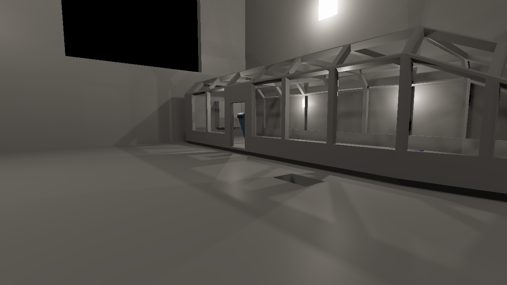
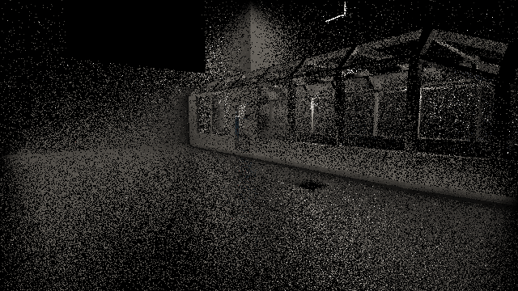
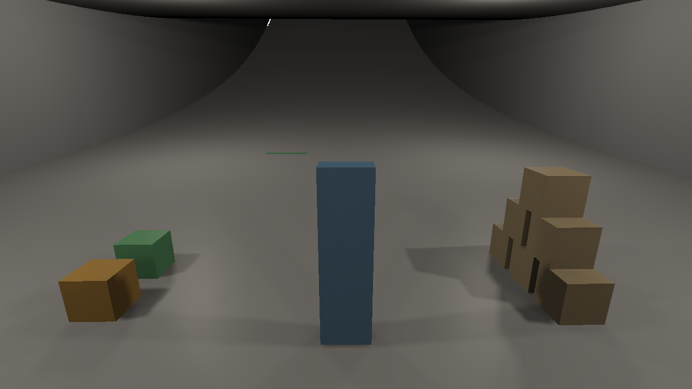
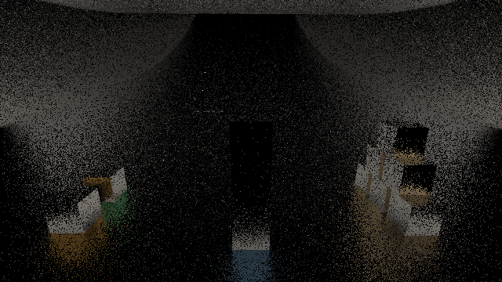

# Spike: the GPU time of the screen trace on the M1 Max (ter-toaw)

The screen trace does not fit the budget. The budget of [temporal-renderer.md](../../plans/temporal-renderer.md), section 11, gives the whole screen tracer 0.8 to 1.7 ms at a render size of 1280 x 720. With own rays for 10 % of the pixels, the trace alone takes about 10.0 ms. With own rays for 25 %, it takes 14.3 to 14.5 ms. That is 5.9 to 8.5 times the high end of the budget, on demo-exit's deck view and on its floor view alike. The orchestrator takes this result to the user before ticket 4 (ter-gayt) starts.

## Result

Each time below is the median over 120 frames of the GPU busy time that a Metal System Trace gives. The trace ran in Release builds, headless, with `--video none`. A row gives the range over its timed runs. The sum is the reflection time plus the diffuse time.

| View | Own rays | Runs | Reflection rays (ms) | Diffuse rays (ms) | Sum (ms) | Times the budget's 1.7 ms |
|---|---|---:|---:|---:|---:|---:|
| Deck | 10 % | 3 | 6.79 to 6.81 | 3.24 | 10.04 to 10.05 | 5.9 |
| Deck | 25 % | 2 | 9.82 | 4.63 to 4.64 | 14.45 to 14.46 | 8.5 |
| Floor | 10 % | 2 | 6.13 to 6.14 | 3.82 | 9.95 to 9.96 | 5.9 |
| Floor | 25 % | 2 | 8.79 to 8.82 | 5.46 to 5.47 | 14.25 to 14.29 | 8.4 |

The runs of one row differ by at most 0.04 ms, which is 0.3 % of the sum. So the result does not depend on the run.

The time follows the number of rays. A reflection ray costs 19 to 23 ns, and a diffuse ray 11 to 12 ns ("The cost of a ray"). The budget's 0.6 to 0.9 million rays get 1.7 ms for the whole tracer. That is about 2 to 3 ns per ray, the plan and the resolve included. A smaller step limit does not close the gap. With 32 steps per reflection ray and 8 per diffuse ray, the deck view still takes 3.20 to 3.36 ms. The diffuse rays then find almost no hit ("The step experiment").

## Method

### What the spike built

The spike adds three passes to today's frame, right after the direct pass. The code is in commit 91a20f20c on the branch `ter-toaw-trace-timing-spike` and is not merged. Commit a53a6e87e on the same branch changes only the run script.

| Pass | What it does |
|---|---|
| trace spike plan | Clears the own-ray list of each kind. Then it runs one invocation per pixel. For each kind that the pixel can start, a `pcg3d` draw lists the pixel for an own ray. The probability is the own-ray share. |
| trace spike reflection | One invocation per 2 x 2 block traces the block's reflection ray. Then an indirect dispatch over the reflection list traces each listed pixel's own reflection ray. |
| trace spike diffuse | The same for the diffuse rays. |

The parts that ticket 4 takes from the branch:

- `screen_trace.glsl` holds `traceScreen`, the ray kinds and the randomness. `traceScreen` calls `traceRay` of `reflection.glsl` unchanged. So it is today's hierarchical trace over today's depth pyramid, with its pixel planes, its continuation rule and its thickness of 1.1 z.
- `trace_spike.glsl` holds the block rays, the own rays, the hit's light, the records and the own-ray list.
- `Spike/TraceSpike.cs` holds the images, the sets and the passes.

The rays follow section 6 of the design:

- A reflection ray starts from a lit pixel whose floored roughness is at most 0.5. Its direction is the view direction reflected about a half vector. The half vector comes from GGX's visible normals by spherical caps (Dupuy and Benyoub 2023), at alpha = r², with r floored at 0.045. Its limit is 256 steps.
- A diffuse ray starts from every lit pixel. Its direction is cosine-weighted around the shading normal. Its limit is 64 steps.
- A ray starts at its pixel's surface point, moved off the geometric surface as today's trace moves it. A direction below the geometric plane traces nothing.
- Each 2 x 2 block traces one ray of each kind. The block's turn picks the first pixel that can start the ray, from the draw index plus a hash of the block.
- Every random number comes from `pcg3d` of three values. They are the packed pixel or block, the frame number as the draw index, and a constant per kind and use.
- A hit reads today's direct image at the hit pixel q, times the edge fade and 1 − q. It also reads q's distance for the hit distance. A miss reads nothing.
- A block ray writes a record of 16 bytes to two images of a quarter of the render size: the hit light and the hit distance as RGBA16F, and the direction's octahedral code, the density and two flags as RGBA16_UINT. An own ray writes its hit light and hit distance to a full-size RGBA16F image.

### Why the compiler keeps the trace

Every ray ends in `imageStore` calls to storage images, and the stored values depend on the trace's outcome. A store to a storage image is a side effect, so neither glslc nor the driver can remove it. Nothing in the frame reads these images. The count mode and the image dump below show that the rays run and hit the scene.

### The ray counts

The count mode (`TERTIUS_TRACE_SPIKE_COUNT=1`) counts the rays and the hits by atomic adds. It ran outside the timed runs, over the first 10 frames of each view's window, because the atomic adds change the timings. Each line gives the mean per drawn frame. The 11 drawn frames include the exposure's metering draw. The count mode writes its counts to the demo's standard output. A second set of count runs at 11:31 wrote them to `captures/toaw/count2-<view>-<share>.txt`, and it gave the same counts as the first set.

| View | Own rays | Reflection rays: blocks + own | Reflection hits | Below the plane | Diffuse rays: blocks + own | Diffuse hits |
|---|---|---:|---:|---:|---:|---:|
| Deck | 10 % | 216,798 + 86,673 | 149,809 | 8,927 | 216,798 + 86,599 | 69,159 |
| Deck | 25 % | 216,798 + 216,831 | 214,115 | 12,763 | 216,798 + 216,487 | 98,789 |
| Floor | 10 % | 230,400 + 92,146 | 178,574 | 10,805 | 230,400 + 92,083 | 103,894 |
| Floor | 25 % | 230,400 + 230,542 | 255,315 | 15,434 | 230,400 + 230,178 | 148,427 |

The deck view has a little sky, so 216,798 of its 230,400 blocks start a ray. The demo's paint has a roughness of 0.38, below the limit of 0.5. So every block that starts a diffuse ray also starts a reflection ray. The plan lists only pixels that can start the ray. So the own rays are 9.4 % and 23.5 % of the deck's 921,600 pixels. On the floor view every pixel is lit, and the own rays are 10.0 % and 25.0 %.

### The images of the hits

`TERTIUS_TRACE_SPIKE_DUMP=<folder>` writes two kinds of PNG files: the last frame's direct image, and the hit light of each kind's block rays. The values are mapped by x / (1 + x) and a gamma of 2.2. The block image has one texel per block, 640 x 360.

| Deck: the direct image | Deck: the reflection rays' hit light |
|---|---|
|  |  |

| Floor: the direct image | Floor: the reflection rays' hit light |
|---|---|
|  |  |

Each block shows the one sample of its ray, so the images are noisy, as one sample per block is before any history. On the deck, the floor reflects the building and the walls. On the floor view, the floor under each box shows the box's color: orange under the orange box, green under the green box, and blue under the blue column. So the rays go where a glossy reflection goes, and the hits read the right pixels.

### The timing

`tools/trace-spike/timed-run.sh` makes one timed run:

1. It takes the GPU lock: it retries `mkdir /tmp/tertius-gpu-measure.lock` every 15 s while the folder exists. It holds the lock to the end of the run. A failed run also releases it at its end.
2. It writes `uptime` as the first line of the run's log.
3. It runs `tools/gpu-trace.sh --no-counters` on 120 frames of `scripts/demo-exit.json` at 1280 x 720, with `--trace-spike <share>`. The deck view starts at frame 399 and the floor view at frame 2552. The script also records the window from the end of "trace spike plan" to the start of "occlusion depth".
4. It writes `uptime` again at the end and releases the lock.

The floor window is the 120-frame window `time-floor` of ticket ter-f3g2, so that its times compare with that ticket's. In `scripts/demo-exit.json`, the floor film of the follow camera starts at frame 2412, the start that metal-trace-spike.md used. The window starts 140 frames into that film, at frame 2552. Its script, `captures/f3g2/scripts/time-floor.json` in the main checkout, runs 2916 ticks for the frames before the floor film, then 140 ticks of the follow camera. Git ignores `captures/`. Every block of the floor view traces a reflection ray, so the floor is glossy at frame 2412 and at frame 2552 alike.

`tools/trace-spike/analyze.py` makes one table row from each run's `passes.json` and log. The trace holds 121 frames per run: the 120 frames and the metering draw.

Each kind's time is the busy time of its pass in the trace (tools/README.md, "GPU trace"). That is the union of the GPU intervals of the pass's encoders. It holds the block dispatch and the indirect dispatch of the own rays. The two passes did not overlap each other or any other pass: each one's time alone equals its busy time. The window from the plan's end to the next pass's start is 0.11 to 0.16 ms longer than the sum of the two medians. So the sum is what the frame pays for the trace.

## The runs

The main runs took place on 2026-11-03 between 10:07 and 10:33 EST, on the Apple M1 Max with 10 cores. The step runs and the counter runs came later, and their sections give their times and loads. The load column gives the load averages of the log's first line. In the main runs, the 1-minute load was 1.66 to 4.27. The logs record the load only at the start and at the end of each run. So they do not show that these loads were the lowest of the day. Each run held the GPU lock.

| Run | Load 1 / 5 / 15 min | Reflection median (p95), ms | Diffuse median (p95), ms | Sum of medians, ms | Window median, ms | Plan median, ms | Frame span median, ms |
|---|---|---:|---:|---:|---:|---:|---:|
| deck-10-r1 | 4.27 / 3.36 / 3.03 | 6.81 (7.00) | 3.24 (3.26) | 10.05 | 10.19 | 0.42 | 18.62 |
| deck-10-r1x | 3.05 / 3.41 / 3.12 | 6.80 (6.98) | 3.24 (3.27) | 10.04 | 10.20 | 0.42 | 18.59 |
| deck-10-r2 | 2.41 / 3.26 / 3.30 | 6.79 (6.92) | 3.24 (3.27) | 10.04 | 10.19 | 0.41 | 18.59 |
| deck-25-r1 | 2.66 / 3.28 / 3.08 | 9.82 (9.95) | 4.63 (4.66) | 14.46 | 14.60 | 0.43 | 22.87 |
| deck-25-r2 | 2.60 / 3.38 / 3.34 | 9.82 (9.98) | 4.64 (4.66) | 14.45 | 14.60 | 0.43 | 23.01 |
| floor-10-r1 | 3.81 / 3.50 / 3.17 | 6.14 (6.73) | 3.82 (3.90) | 9.96 | 10.11 | 0.54 | 18.29 |
| floor-10-r2 | 2.98 / 3.54 / 3.39 | 6.13 (6.39) | 3.82 (3.89) | 9.95 | 10.07 | 0.54 | 18.30 |
| floor-25-r1 | 3.68 / 3.49 / 3.18 | 8.82 (9.10) | 5.47 (5.55) | 14.29 | 14.39 | 0.55 | 22.59 |
| floor-25-r2b | 1.66 / 2.94 / 3.17 | 8.79 (9.19) | 5.46 (5.55) | 14.25 | 14.37 | 0.56 | 22.53 |

Notes on the runs:

- deck-10-r1 was the first run, before the others. deck-10-r1x repeats it as the first run of the interleaved order: deck-10, deck-25, floor-10, floor-25, then the reverse.
- In the first try of floor-25-r2, xctrace hung for 17 minutes after the demo exited, and it held the lock. An interrupt ended it, and the report step then failed. floor-25-r2b repeats that run. The run script now interrupts xctrace 60 s after the demo exits, terminates it 30 s later and kills it 30 s after that. It does so only while the recording runs, so a slow report step after the recording is not cut short. A stub recorder that ignores the interrupt and the termination ended after 126 s, and the lock was released.
- The plan's busy median of 0.41 to 0.56 ms overlaps the direct pass. Its time alone is about 0.11 ms. The plan is a stand-in for the design's ray plan, so its time is not part of the trace's time.
- The frame span holds today's whole frame plus the spike. Today's frame at this size has no reflection rays on the demo's paint, because today's limit is a roughness of 0.37.

## The cost of a ray

Each time is the median of the row's runs. A ray here is a ray that starts, from the count table.

| View | Own rays | Reflection rays | ns per reflection ray | Diffuse rays | ns per diffuse ray |
|---|---|---:|---:|---:|---:|
| Deck | 10 % | 303,471 | 22.4 | 303,397 | 10.7 |
| Deck | 25 % | 433,629 | 22.6 | 433,285 | 10.7 |
| Floor | 10 % | 322,546 | 19.0 | 322,483 | 11.8 |
| Floor | 25 % | 460,942 | 19.1 | 460,578 | 11.9 |

The cost per ray stays the same from 10 % to 25 %. On the deck, the 130,000 more reflection rays of 25 % add 3.03 ms, 23 ns each. So the time has no large fixed part, and it grows with the number of rays. At the budget's counts, the trace needs 0.6 to 0.9 million rays per frame. A whole tracer of 1.7 ms for them leaves about 2 to 3 ns per ray, including the plan and the resolve. That is 4 to 11 times faster than the measured rays.

## The step experiment

The option `--trace-spike-steps R,D` sets the steps of a reflection ray and of a diffuse ray. Each setting got two timed runs in one batch, on the deck view with own rays for 10 %. The first run of each setting went from 32 and 8 up to 512 and 128, and the second run went back down. The batch ran from 10:57 to 11:18, at a 1-minute load of 5.86 to 31.15. A row gives the range over its two runs. The hits come from the count mode.

| Steps: reflection, diffuse | Load 1 min, runs a and b | Reflection median (p95), ms | Diffuse median (p95), ms | Sum, ms | Reflection hits | Diffuse hits |
|---|---|---:|---:|---:|---:|---:|
| 32, 8 | 6.28, 22.20 | 2.56 to 2.71 (3.78 to 3.83) | 0.64 to 0.65 (0.94 to 0.95) | 3.20 to 3.36 | 87,883 | 3,677 |
| 64, 16 | 5.86, 22.45 | 5.09 to 5.14 (6.02 to 7.09) | 1.05 to 1.08 (1.32 to 1.56) | 6.15 to 6.21 | 123,443 | 10,435 |
| 128, 32 | 18.90, 14.40 | 5.90 to 5.95 (7.33 to 7.37) | 1.68 (2.20) | 7.59 to 7.63 | 145,008 | 38,521 |
| 256, 64 (the design's) | 25.48, 20.77 | 6.82 to 6.83 (6.99 to 7.20) | 3.25 (3.28 to 3.32) | 10.07 | 149,809 | 69,159 |
| 512, 128 | 30.37, 31.15 | 7.42 to 7.43 (7.67 to 7.71) | 5.02 to 5.04 (5.07 to 5.08) | 12.46 | 150,097 | 82,997 |

What the table shows:

- No setting fits the budget. The smallest, 32 and 8 steps, takes 3.20 to 3.36 ms, twice the budget's high end, for less than half of the hits.
- The reflection rays find almost all their hits within 256 steps: 512 steps add 288 hits. Yet 512 steps cost 0.60 ms more. So some reflection rays that miss walk through all their steps.
- The diffuse rays need their steps: 8 steps find 5 % of the hits of 64 steps. 128 steps find 20 % more hits than 64, for 1.77 to 1.79 ms more.
- The design's setting gives 10.07 ms here, at a load of 20.77 to 25.48. The main runs gave 10.04 ms at a load of 2.41 to 4.27. So the load of other processes on the CPU did not change the GPU time of the trace.

An earlier set of step runs had one run per setting, from 10:32 to 10:35 at a load of 5.33 to 6.33. It gave other sums at the small settings: 3.53, 5.79 and 8.38 ms for 32, 64 and 128 reflection steps. At 512 steps it gave 12.44 ms, the same as this batch. So a sum of a small setting can differ by up to 0.79 ms between two sessions. The two runs of each setting in this batch differ by at most 0.16 ms. The spike did not find the cause. Every sum of either set exceeds the budget.

## Where the time goes

One more run per view recorded the GPU's counters (`TRACE_SPIKE_COUNTERS=1` in `timed-run.sh`), with own rays for 10 %. The counters are the "Performance Limiters" of the Metal System Trace (tools/README.md, "GPU trace"). A limiter is the share of the time that a unit of the GPU was busy. The counters slow the frame a little, so these runs give the limiters, not the times.

| View | Load 1 min | Pass | Busy median, ms | Top limiter | Second limiter | Read GB/s | Write GB/s |
|---|---|---|---:|---|---|---:|---:|
| Deck | 26.05 | trace spike reflection | 6.83 | ALU 50 % | GPU Last Level Cache 8 % | 5.2 | 0.3 |
| Deck | 26.05 | trace spike diffuse | 3.25 | ALU 61 % | GPU Last Level Cache 15 % | 6.2 | 0.6 |
| Floor | 21.91 | trace spike reflection | 6.28 | ALU 49 % | GPU Last Level Cache 10 % | 6.8 | 0.3 |
| Floor | 21.91 | trace spike diffuse | 3.88 | ALU 59 % | GPU Last Level Cache 18 % | 8.7 | 0.5 |

The trace is not bound by memory bandwidth. Its passes read 5 to 9 GB/s. In the same runs, the occlusion depth pass reads 34 GB/s. So the ten texel reads of the test at level 0 do not set the time by their bandwidth. No unit of the GPU is busy for more than 61 % of the time, and the ALU is the busiest. The counters do not show what the GPU waits for in the rest of the time. Two candidates are the wait for each step's read before the next step, and idle lanes. A SIMD group is the 32 lanes that run one instruction together, and its lanes idle while other lanes still step. The spike did not separate them.

## Comparison with the budget

Section 11 gives the screen trace 0.8 to 1.7 ms. That covers the ray plan, the trace and the resolve. The estimate rested on today's sector pass, 1.60 ms at 1080p, and today's reflection trace, 0.14 ms. In this spike, the trace alone takes 9.95 to 10.05 ms at 10 % own rays and 14.25 to 14.46 ms at 25 %. So the trace alone is 5.9 to 8.5 times the high end of the whole tracer's budget.

The whole tracer costs more than the trace measured here, for these reasons:

- A hit of the design reads about six values: the direct history, the indirect history at the previous place, and the material. The spike reads two.
- A miss of the design reads the environment map. The spike reads nothing.
- The design adds the real ray plan and the resolve. The spike's plan is a cheaper stand-in, and the spike has no resolve.

The trace's passes run alone on the GPU, so the trace adds its whole time to the frame: about 10 ms at 10 % own rays. Section 11's frame estimate of 7.4 to 10.7 ms has no room for it.

## Limits

1. The ray counts come from the first 10 frames of each window, not from the 120 timed frames. The camera moves during the window, so the counts of the later frames differ a little.
2. The plan picks the own rays by a hash, spread over the screen. The design's own rays gather along the edges of surfaces and on new surfaces. Their coherence differs, and the spike did not measure the effect.
3. Each kind runs in its own pass, one after the other. The design's one trace dispatch can run both kinds side by side. Busy time means only that some encoder of the pass runs. It does not mean that the GPU's cores are full. The tail of a divergent dispatch leaves cores idle, and the other kind's rays can fill them. So one combined dispatch can save more than the gap of 0.11 to 0.16 ms between the passes. The spike did not measure how much.
4. The hit reads, the misses, the real plan and the resolve are missing ("Comparison with the budget"). Each one adds time.
5. Hair has no rule of its own here. The design lets a hair pixel's rays pass through its own card. The two views hold no hair.
6. The spike did not record the GPU's clock state. So the report does not show that the GPU ran at its highest clock. The runs of one row agree within 0.3 %, so the clock was the same in each run of a row.
7. The step runs had a higher load, 5.86 to 31.15. Their 95th percentiles spread more than those of the main runs. The small settings gave different sums in an earlier session ("The step experiment").
8. Only the M1 Max was measured. The budget is for this GPU.

## What ticket 4 must change in the spike's code

The review of the spike found four defects in the code that ticket 4 takes. None of them changes the times above.

1. A block ray and its pixel's own ray have the same direction. `traceFrom` draws both from `pcg3d` of the pixel, the draw index and `DirectionDraw[kind]`. So when the block's chosen pixel also gets an own ray of that kind, the second ray costs a full trace and adds no information. The design's rule in section 6, "Randomness", has the same gap. Ticket ter-jz2y holds the two ways out, and ticket 4 waits for it. The spike traces both rays, so its times hold.
2. The own-ray list exists twice. `trace_spike.glsl` copies the list's layout, `OwnRayGroupSize`, `MostOwnRayGroups`, `appendOwnRay` and the stride loop from `reflection_own_rays.glsl`. `TraceSpike.cs` writes the list's clear and the indirect dispatch inline, in place of a call to `OwnRayDispatch`. Ticket 4 moves the list's GLSL into one include, makes `OwnRayDispatch` take the pipeline and the layout, and calls it from the tracer.
3. Three rules exist twice. `tracingPixel` in `screen_trace.glsl` copies the rule that sky and impostors start no ray (`reflection_pixel.glsl`) and the rule of the ray's start (`reflection_ray.glsl`). `traceFrom` copies the rule of the hit point (`reflection_ray.glsl`). `MaxRoughness` is a GLSL constant, but the design makes `ScreenTrace.MaxRoughness` a setting. Ticket 4 makes `screen_trace.glsl` the one owner of these rules, deletes the `reflection_*` copies as section 12 plans, and passes `MaxRoughness` by a push constant.
4. A block ray's density can exceed the half-float range. The density is D(h) / (2 (v.z + sqrt(alpha² + (1 − alpha²) v.z²))), with v.z = n · v. At the roughness floor, the peak of D(h) is 1 / (π alpha²), about 77,600. Below an n · v of about 0.3, the density then exceeds 65,504, the largest half float, and `packHalf2x16` stores a value out of range. Ticket 4 stores the density in a form that fits, for example its log2.

## How to repeat the runs

Build nothing first: `gpu-trace.sh` builds the demo in Release. Run each command in the dev shell from the repository's root, on the branch `ter-toaw-trace-timing-spike`:

```bash
nix develop --command bash tools/trace-spike/timed-run.sh captures/toaw/runs/deck-10-r1 399 0.10
nix develop --command bash tools/trace-spike/timed-run.sh captures/toaw/runs/floor-25-r1 2552 0.25
nix develop --command bash tools/trace-spike/timed-run.sh captures/toaw/runs/deck-10-steps-32-8 399 0.10 --trace-spike-steps 32,8
TRACE_SPIKE_COUNTERS=1 nix develop --command bash tools/trace-spike/timed-run.sh captures/toaw/runs/counters-deck-10 399 0.10
cd captures/toaw/runs && python3 -I ../../../tools/trace-spike/analyze.py deck-10-r1 floor-25-r1
```

For the counts and the images, trim a script of 10 frames, then run the demo with the count mode and the dump:

```bash
nix develop --command python3 -I tools/gpu-trace.py trim scripts/demo-exit.json 399 10 captures/toaw/scripts/deck10.json
TERTIUS_TRACE_SPIKE_COUNT=1 TERTIUS_TRACE_SPIKE_DUMP=captures/toaw/dump-deck nix develop --command bash -c 'src/Tertius.Demo/bin/Release/net11.0/Tertius.Demo --script captures/toaw/scripts/deck10.json --headless --out captures/toaw/count-deck --size 1280x720 --video none --trace-spike 0.1' > captures/toaw/count-deck.txt
```

The raw run folders stay in `captures/toaw/` of the spike's worktree. Git ignores that folder.
