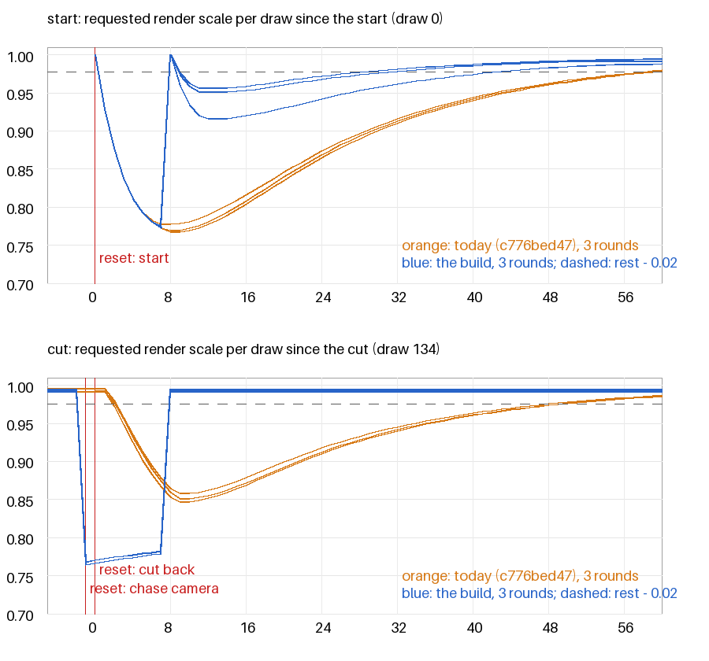

# The announced dip of the render scale (ter-bcwr)

After a reset of the frame history, a start or a camera cut, the ray plan traces an own ray at nearly every pixel for 8
draws. Today the render scale's controller sees these dear draws only as late measurements: the scale falls over about 8
draws and climbs back at a twentieth of the gap per draw, so it stays more than 0.02 under its rest for 45 to 59 draws.
The build gives each draw a cost kind and the controller one cost model and one request per kind, so a cut dips at once
and returns at once.

## Terms

- A draw's **cost kind** (`DrawCost`) is catch-up for the first `FrameHistory.CatchUpDraws` (8) draws after a reset, and
  ordinary after. The frame history derives it from the draw index since the last reset. It is not stored.
- The **request** of a kind is the render scale that a draw of that kind asks for (`RenderScaleController.RequestedScaleFor`).
- The **rest** is the median requested scale of a run's last 40 draws.
- **Back** is the number of draws from the event until the requested scale is within 0.02 of the rest and stays there to
  the end of the 60-draw window. It is 0 when the scale never left.
- A **size change** is a draw whose render size differs from the draw before.
- A draw's **span** is its GPU time in ms, from the time log.

## What the build does

`FrameHistory.CostOf` gives the next draw's kind before its `Begin`, through the same draw-index rule that `Begin` uses.
The renderer asks the controller for the scale of that kind. `Drew` records the kind with the realized scale, so a
measurement that arrives frames late goes to the kind of its own draw. `Measure` fits only that kind's model and moves
only that kind's request. A kind without a fitted model asks for the scale of the kind before it: a catch-up draw for the
ordinary scale, and an ordinary draw for the target's largest. The rates and the band are today's, for both kinds
(ter-5kz6 holds them).

## The card take

Job `cut1` on the RTX 2000 Ada (`tools/card-submit.sh cut1 2cd409b7a 16.6667 3`, $0.0511): 3 rounds of t0-gumm's
`start.json` and `cut.json` for both codes, the order swapped each round, after one discarded warm-up run of each build.
Both trees run their own `probe.patch`. Today adds the acceptance record's `scratch-dynamic-scale-step2.patch` and
t0-gumm's `scratch-first-filmed.patch`, and the build adds `scratch-takes-build.patch`, the same two fitted to its
`BeginDraw`. The target is `FrameTimeTarget(16.67, 0.5, 1)` at 1920 × 1080. `tools/cardsum.py` prints the numbers below.

| Event | Code | Back (3 rounds) | Lowest scale | Size changes: in the 60-draw window / in the run |
|---|---|---|---|---|
| cut | today | 47, 47, 45 | 0.848 to 0.858 | 22 to 25 / 57 to 61 |
| cut | build | 8, 8, 8 | 0.767 to 0.771 | 2 / 23 to 24 |
| start | today | 59, 56, 54 | 0.768 to 0.778 | 30 to 32 / 32 to 34 |
| start | build | 28, 28, 39 | 0.773 to 0.776 | 15 to 21 / 15 to 22 |

The cut meets the acceptance: back within 8 draws, against 12 allowed, and fewer size changes. The span of the dip's
draws 0 to 7 is 15.5 to 16.7 ms, against 19.9 to 27.8 ms today.

The start does not meet it, and the ticket does not ask it to (decision 4 of the note of 2026-11-23): the first reset of
a run has no catch-up model. Draws 0 to 7 follow today's curve down to 0.77, and draw 8 returns to 1.0. The ordinary
model then has no fit, so its first measurement is draw 8 alone, at 20.3 to 23.0 ms. It lowers the ordinary request to
0.92 to 0.96, and the return at a twentieth of the gap takes 28 to 39 draws. That is the start's own dip (t58-np60).

`pics/card-scale.png`: the requested scale per draw, today in orange and the build in blue, 3 rounds each. The red lines
mark the resets. `cut.json` films one frame on the chase camera (draw 133) before the cut back to the person camera
(draw 134). Both camera changes are cuts, so draw 133 is itself a reset, and the build draws it small.

### The cut, draw by draw

From `cut-build-r1` and `cut-today-r1`. The size log records the size that each draw drew: the scratch patch passes
that same size to `Begin`.

| Draw (k from the cut) | Kind in the build | Build: drawn size, span | Today: drawn size, span |
|---|---|---|---|
| 130 to 132 (−4 to −2) | ordinary | 1904×1071, 16.9 to 17.1 ms | 1904×1071, 16.8 to 17.2 ms |
| 133 (−1) | catch-up, index 0: the chase camera's frame, itself a cut | 1472×828, 7.8 ms | 1904×1071, 10.5 ms |
| 134 to 136 (0 to 2) | catch-up, index 0 to 2 | 1472×828, 16.1 to 16.7 ms | 1904×1071 to 1872×1053, 24.7 to 26.2 ms |
| 137 to 141 (3 to 7) | catch-up, index 3 to 7 | 1488×837, 15.8 to 16.1 ms | 1824×1026 to 1680×945, 19.9 to 23.7 ms |
| 142 (8) | ordinary, index 8 | 1904×1071, 18.9 ms | 1648×927, 16.0 ms |
| 143 to 146 (9 to 12) | ordinary | 1904×1071, 17.0 to 17.3 ms | 1648×927, 13.6 to 13.9 ms |

The last catch-up draw (141) draws small, and the first ordinary draw (142) draws at the full size: each request takes
the kind of its own draw. Draw 133 is a cheap exterior view and draws small anyway, because the kind belongs to the draw
and not to the scene.

### Draw 8's cost (t0-xwdz)

Draw 8, the first ordinary draw, costs 1.9 to 3.6 ms more than draw 9 at both events, in both codes. The time log splits
each draw into the work at the render size and the rest. The extra is all at the render size: 15.9 to 16.5 ms per unit
of area, against 19.8 to 20.4 for the catch-up draws and 12.8 to 13.4 for draws 9 on. Today's code shows the same draw 8
with no size change at that draw, so FSR's size change is not the cause.

t0-gumm's own-ray logs of today's cut and start (`/private/tmp/t0-gbgj/gumm-mac/{cut,start}-today/ownrays-none.txt`,
1280 × 720):

| Draw since the reset | Reflection own rays (cut / start) | Diffuse own rays (cut / start) |
|---|---|---|
| 0 to 7 | about 678,000 / 678,000 | about 678,000 / 678,000 |
| 8 | 154,400 / 335,822 | 2,306 / 32,997 |
| 9 | 43,798 / 39,137 | 1,991 / 11,854 |
| 12 | 15,711 / 13,131 | 1,988 / 5,828 |

The diffuse kind ends exactly at draw 8, so the plan's read of the stored length is not one draw late. The history log
of the same cut gives a mean diffuse length of 7.85 after draw 7, with 1.9 % under 8. What remains is reflection own rays
at 23 % (cut) to 50 % (start) of the pixels, decaying over draws 8 to 12. The cause is inferred from the code, not
logged, because no log holds the specular length. The anti-lag of `accumulate_spatial.comp` acts once a history is longer
than the fast cap of 4 and cuts it toward that cap. The reflections' box takes no retained widening, so in draws 5 to 7 a
young, noisy reflection history moves the clamp and is cut back at many pixels. So the length stays 8 by the line
orchestrator's rule, and t0-xwdz holds the tail.

### A reset in a scene of another cost

The catch-up model is fitted in the scene of the last reset. A mirror of the controller's rule in Python, with timings
two draws late, gives the requests of one reset in a scene of another cost (per unit of area, ms):

| Fit, then reset in | Requests of draws 0 to 7 | The controller's cost of those draws, ms (budget 15) |
|---|---|---|
| 20, then 40 | 0.787 0.787 0.787 0.767 0.741 0.715 0.690 0.667 | 27.8 27.8 27.8 26.5 25.0 23.4 22.0 20.8 |
| 40, then 20 | 0.556 0.556 0.556 0.557 0.559 0.563 0.567 0.573 | 9.2 9.2 9.2 9.2 9.3 9.3 9.4 9.6 |

- A dear view after a cheap fit: the dear draws miss the frame time for all 8 draws, though by less than today. The
  ordinary request stays where it was (`ADearCatchUpDrawAfterACheapCatchUpFitDoesNotMoveTheOrdinaryRequest`).
- A cheap view after a dear fit: the catch-up draws stay small without need, as draw 133 does, and climb only at a
  twentieth of the gap.
- The model's weight of 0.2 needs about 10 to 15 measurements to follow a new scene, which is 2 to 3 resets with 6
  measurements each. The cheap case recovers more slowly, because the request rises at a twentieth of the gap.

## The pictures

The Mac replays each code's card log of round 1, draw for draw (`tools/macrun.sh`, VIDEO=1, with the binaries `bt`
and `bb` from t0-gbgj's `build.sh`). Every run's size log equals its replay (0 draws with another scale). The fixed
exposure is 4.08 stops.

| Run | Slowest region settles (draws) | Boil, draws 1 to 59 | Grain, draws 0 to 15 |
|---|---|---|---|
| cut, today | 156 | 0.107 % | 0.91 % |
| cut, build | 137 | 0.095 % | 0.92 % |
| start, today | 156 | 0.107 % | 0.89 % |
| start, build | 151 | 0.100 % | 0.91 % |

The measures are t0-gumm's `events.py`. By them the build's first 20 draws are no worse than today's: the grain is the
same, and the boil and the settle are lower.

- `pics/cut-today-vs-build.mp4` and `pics/start-today-vs-build.mp4`: side by side, today on the left. One draw per video
  frame at 60 frames a second, 1280 × 720 per pane, the render scale and size under each label, the draw counter in the
  corner. H.264, yuv420p, CRF 12. The decode check matches the source within 0.38 %.
- `pics/cut-dip-start-11.png` (draws 132, 134 and 135) and `pics/cut-return-11.png` (draws 140 to 143): the far wall, its
  window and two lamps at 1:1. At the dip's start (0.771), the lamps' edges are a little softer than today's at 0.996.
  At the return, no frame shows a pop or a blur step.
- `pics/cut-edges-x3.png`: the window's edges at 3 ×. In draws 141 and 142, the last small draw and the first full-size
  draw, the build's top edge shows a faint row of dark dots that today's frames do not show. At 1:1 it is near
  invisible, and draw 143 is clean again.
- The region means of `frames.series` rise smoothly through the return: the whole image moves by 0.07 from draw 141 to
  draw 142, and the left wall and the floor keep their slope.

## Tools

- `tools/card.sh`, `tools/card-submit.sh`: the card job.
- `tools/cardsum.py`: the numbers of the card's logs.
- `tools/scalechart.py`: the chart.
- `tools/macrun.sh`: the Mac replays, from t0-gumm's `macrun.sh`.
- `scratch-takes-build.patch`: the takes' scratch patches, fitted to the build. Never commit it to src.

The videos use t0-gumm's `videos.py` and `events.py`, and the sheets use t0-rs55's `sheet11.py`. The logs are in
`/private/tmp/t0-gbgj/cloud-bcwr/cut1` and `/private/tmp/t0-gbgj/bcwr-mac`.
